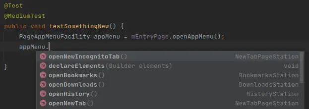

#  Public Transit

Public Transit is a framework for integration tests that models application
states and transitions between them.

[TOC]

## How to Use Public Transit?

* This README: concepts and framework features.
* [Best Practices](best_practices.md): guidance for writing and reviewing tests
  and Transit Layer code.
* [Debugging](debugging.md): `ViewPrinter`, debugging options, and timeouts.

### Write Your First Test {#first-test}

Public Transit tests can be in any instrumentation test target. Targets other
than `chrome/android/javatests` need these deps:

```gn
"//base/test:public_transit_java",
"//chrome/test/android:chrome_java_transit",
```

Add `//content/public/test/android:content_transit_java` when declaring DOM
elements with `WebPageFacility` / `HtmlElement`.

A minimal batched test:

```java
@RunWith(ChromeJUnit4ClassRunner.class)
@Batch(Batch.PER_CLASS)
public class MyFeatureTest {
    @Rule
    public AutoResetCtaTransitTestRule mCtaTestRule =
            ChromeTransitTestRules.autoResetCtaActivityRule();

    @Test
    @LargeTest
    public void testOpenNewTabFromAppMenu() {
        WebPageStation page = mCtaTestRule.startOnBlankPage();
        RegularNewTabPageStation ntp = page.openRegularTabAppMenu().openNewTab();
    }
}
```

Run it with `tools/autotest.py -C out/Debug MyFeatureTest`.

From the starting Station, call transition methods to navigate to the state you
want to test. If a state or affordance isn't modeled yet, add a `Station`,
`Facility` or transition method to the Transit Layer in
`//chrome/test/android/javatests/src/org/chromium/chrome/test/transit/` (see
[Classes and Concepts](#concepts)). [`ViewPrinter`](debugging.md#viewprinter)
helps find the Views to declare.

See some example tests:

* [ExampleAutoResetCtaTest](/chrome/android/javatests/src/org/chromium/chrome/browser/ExampleAutoResetCtaTest.java)
* [ExampleFreshCtaTest](/chrome/android/javatests/src/org/chromium/chrome/browser/ExampleFreshCtaTest.java)
* [ExampleReusedCtaTest](/chrome/android/javatests/src/org/chromium/chrome/browser/ExampleReusedCtaTest.java)

## Why Use Public Transit?

**Scalability**

Public Transit introduces a framework for sharing code between tests, such
that UI affordances are modelled once in the Transit Layer, and then reused
between tests. When app behavior changes, the matching test changes will
often be limited to the Transit Layer (instead of individual tests).
Furthermore, when systemic issues are found, fixes for them can often be
made in the Framework Layer without the need to update individual tests.

**Debuggability**

Chrome's integration test failures have historically been difficult to diagnose,
especially when not reproducible with local debugging. Public Transit's
extensive logging and assertions provide more upfront information about test
failures.

**Consistency**

Integration tests are complex, and often so is the code behind them. Public
Transit's clear distinction between "Transit Layer" and "Test Layer" guides
tests to be written in a consistent way, making them easier to understand.

**Discoverability**

The Transit Layer makes heavy use of concrete types, such that all transitions
between states are discoverable through auto-complete:



## Primary Framework Features

### State Management

* All transitions between states are synchronous operations, which means it is
  impossible to forget to wait on conditions.
* Most conditions are modelled in the Transit Layer, which means it is harder
  for individual tests to miss a condition compared with adhoc tests.

### Logging and Error Messages {#logging}

Public Transit emits detailed logs to Android's Logcat for each transition and
active condition. When transitions fail (due to timeouts), the state of all
conditions are logged. This step-by-step logging helps contextualizing failures
like native crashes and allows comparing failing runs with successful runs.

Example logs (`cr_Transit`) of a successful transition:

```
StationToStationTrip 4 (from [<S3: WebPageStation>, <S3|F1003: ToolbarFacility>] to [<S4: WebPageStation>, <S4|F1004: ToolbarFacility>]): started
StationToStationTrip 4 (from [<S3: WebPageStation>, <S3|F1003: ToolbarFacility>] to [<S4: WebPageStation>, <S4|F1004: ToolbarFacility>]): will run trigger on Instrumentation thread
StationToStationTrip 4 (from [<S3: WebPageStation>, <S3|F1003: ToolbarFacility>] to [<S4: WebPageStation>, <S4|F1004: ToolbarFacility>]): finished running trigger
StationToStationTrip 4 (from [<S3: WebPageStation>, <S3|F1003: ToolbarFacility>] to [<S4: WebPageStation>, <S4|F1004: ToolbarFacility>]): waiting for conditions
StationToStationTrip 4 (from [<S3: WebPageStation>, <S3|F1003: ToolbarFacility>] to [<S4: WebPageStation>, <S4|F1004: ToolbarFacility>]): Conditions fulfilled:
✅ OK ENTER <S4: WebPageStation>:
    [1] [OK  ] Activity exists and is RESUMED: ChromeTabbedActivity in the same task as previous Station {fulfilled after 0~12 ms}
...
    [7] [OK  ] Page URL: a string containing "/chrome/test/data/android/navigate/two.html" {fulfilled after 2908~3073 ms}
           34- 2908ms ( 48x): NO   | Page URL: "http://127.0.0.1:33010/chrome/test/data/android/navigate/one.html"
         3073- 3126ms (  2x): OK   | Page URL: "http://127.0.0.1:33010/chrome/test/data/android/navigate/two.html"
✅ OK ENTER <S4|F1004: ToolbarFacility>:
    [8] [OK  ] View: (view.getId() is <2130773896/org.chromium.chrome.tests:id/tab_switcher_button>) (>= 51% displayed, effectively VISIBLE, enabled) {fulfilled after 0~25 ms}
    [9] [OK  ] View: (view.getId() is <2130773201/org.chromium.chrome.tests:id/menu_button>) (>= 51% displayed, effectively VISIBLE, enabled) {fulfilled after 0~33 ms}
StationToStationTrip 4 (from [<S3: WebPageStation>, <S3|F1003: ToolbarFacility>] to [<S4: WebPageStation>, <S4|F1004: ToolbarFacility>]): finished
```

See [Timeouts and Failure Reports](debugging.md#timeouts) for timeout defaults
and reading `TravelException` condition reports.

### Code Reuse

Public Transit increases code reuse between test classes that go through the
same test setup and user flow by putting common code in the Transit Layer,
including:

* Conditions to ensure certain states are reached
* Transition methods to go to other states
* Espresso `ViewMatchers` for the same UI elements

The transition methods show the "routes" that can be taken to continue from the
current state, increasing discoverability of shared code.

## Additional Framework Features {#features}


### Batching {#batching}

It is recommended to batch Public Transit tests to reduce runtime and save CQ/CI
resources.

#### How to Batch reusing the Activity between tests but resetting tab state (recommended)

This keeps the `ChromeTabbedActivity`, closes all tabs between tests, and
returns to a blank page.

Using `AutoResetCtaTransitTestRule`:

1. Add `@Batch(Batch.PER_CLASS)` to the test class.
2. Use `ChromeTransitTestRules.autoResetCtaActivityRule()` (default; closes all
   tab state) or `ChromeTransitTestRules.fastAutoResetCtaActivityRule()` (keeps
   one tab open — faster, though it retains more tab-level state).
3. Get the first station in each test case from the test rule, e.g.
   `mCtaTestRule.startOnBlankPage()`, `startOnNtp()`, or
   `startOnPage(url, builder)`.

Tests do not need to return to the home station. `AutoResetCtaTransitTestRule`
also finishes leftover non-`ChromeTabbedActivity` activities after each test and
closes extra `ChromeTabbedActivity` windows on the next `startOnBlankPage()`.
Only some reset paths are supported — this is best effort since the reset
transition is not part of a regular user flow.

Example: [ExampleAutoResetCtaTest](/chrome/android/javatests/src/org/chromium/chrome/browser/ExampleAutoResetCtaTest.java)

#### How to Batch restarting the Activity between tests

This restarts the Android Activities while keeping the browser process alive.
Static fields, singletons and globals are not reset unless ResettersForTesting
was used.

1. Add `@Batch(Batch.PER_CLASS)` to the test class.
2. Use the `@Rule` returned by
   `ChromeTransitTestRules.freshChromeTabbedActivityRule()`.
3. Get the first station in each test case from the test rule. e.g.
   `mCtaTestRule.startOnBlankPage()`.

The `BatchedPublicTransitRule` is not necessary. Returning to the home station
is not necessary. However, this does not run as fast as reusing the Activity,
especially in Release.

Example: [ExampleFreshCtaTest](/chrome/android/javatests/src/org/chromium/chrome/browser/ExampleFreshCtaTest.java)

#### How to Batch reusing the Activity between tests staying on the same state

This both keeps the Activity and doesn't reset any app state between tests (apart
from `ResettersForTesting`) - a test is started immediately after the previous
finished.

Using `ReusedCtaTransitTestRule`:

1. Add `@Batch(Batch.PER_CLASS)` to the test class.
2. Use a "Reused" factory method such as
   `ChromeTransitTestRules.blankPageStartReusedActivityRule()`.
3. Get the first station in each test case from the test rule:
   `mCtaTestRule.start()`.

Each test should return to the home station. If a test does not end in the
home station, it will fail (if it already hasn't) with a descriptive message.
The following tests will also fail right at the start.

Example: [ExampleReusedCtaTest](/chrome/android/javatests/src/org/chromium/chrome/browser/ExampleReusedCtaTest.java)

### Standalone View Waits (`ViewFinder`) {#viewfinder}

Outside a `Station` or `Facility`, [`ViewFinder`] runs standalone View checks
through the same `DisplayedCondition` / `NotDisplayedAnymoreCondition`
machinery used by `ViewElement` (defaulting to `RootSpec.focusedRoot()` when no
`Activity` is passed):

* **Polling waits (5000 ms default)**: `waitForView(...)` and
  `waitForNoView(...)`.
* **Immediate zero-timeout checks**: `expectView(...)` and `expectNoView(...)`
  (replaces `Espresso.onView()` without polling).

`waitForView()` and `expectView()` accept varargs `Matcher<View>...` and return
a `ViewPresence` with `.click()` (via `ForgivingClickAction`), `.longPress()`,
`.typeText(...)`, `.performViewAction(...)`, `.check(...)`, and `.getView()`.
See [ViewFinder Best Practices](best_practices.md#viewfinder).

[`ViewFinder`]: https://source.chromium.org/search?q=symbol:org.chromium.base.test.transit.ViewFinder&ss=chromium

### ViewPrinter and Debugging Options {#debugging}

See [ViewPrinter](debugging.md#viewprinter) to print View hierarchies and
[Debugging Options](debugging.md#debugging-options) to slow down or freeze tests
with `PublicTransitConfig`.

## Overview

### Metaphor

The metaphor for the framework is that a Transit Layer provides tests with
routes to navigate the app using shared code, as opposed to each test driving
its private car (writing its own private code) to set up the test.

A Public Transit test moves around the app by going from `Station` to `Station`,
and the stations are connected by routes (transition methods). `Stations` are
marked by `Elements`, which are recognizable features of the destination station
(features such as Android Views), which the test takes as evidence that it has
arrived and is ready to perform any test-specific operation, checking or further
navigation.

At a `Station` there are `Facilities` that can be entered, such as menus,
dialogs, or more abstract substates, such as data loaded from disk. Transition
methods are also used to enter and exit those `Facilities`.

The metaphor is not very accurate in that **`Stations` and `Facilities` instances
are snapshots of the app state** that the test is expected to reach. A user action
that changes a selection in a form, for example, would be modeled not by mutating
the dialog's `Facility`, but creating a second instance of the dialog `Facility`
with a property. `Stations` and `Facilities` are mostly immutable objects.

### Structure and Layers {#layers}

Public Transit is structured as follows:

|Layer|Contents|File names|Location|Width (how many files)
|-|-|-|-|-|
|Test Layer|Instrumentation test classes|`*Test.java`|`//chrome/**/javatests`|wide|
|Transit Layer|Concrete `Stations`, `Facilities`|`*Station.java`, `*Condition.java`, etc.|`//chrome/test/android/javatests`|wide|
|Framework Layer|Public Transit classes|All classes with package `org.chromium.base.test.transit.*`|[`//base/test/.../transit`]|narrow|

[`//base/test/.../transit`]: https://source.chromium.org/chromium/chromium/src/+/main:base/test/android/javatests/src/org/chromium/base/test/transit/

#### Test Layer

The **Test Layer** contains the JUnit test classes with `@Test` methods. It should
be readable at a high level and delegate the logic that can be shared with other
tests to the Transit Layer.

Code in the Test Layer that uses the Transit Layer should contain no explicit
waits; the waits should be modeled as transition methods.

An example of Test Layer code:

```java
@Test
public void testOpenTabSwitcher() {
    WebPageStation page = mCtaTestRule.startOnBlankPage();
    RegularWebPageAppMenuFacility appMenu = page.openRegularTabAppMenu();
    RegularNewTabPageStation ntp = appMenu.openNewTab();
    RegularTabSwitcherStation tabSwitcher = ntp.openRegularTabSwitcher();
}
```

Transition methods, such as `WebPageStation#openRegularTabAppMenu()`, should be
in the Transit Layer for sharing with other tests. A transition that is truly
specific to one test may be written in the Test Layer, but should still use the
transition APIs rather than explicit waits. See
[Best Practices](best_practices.md#layers).

#### Transit Layer

The **Transit Layer** contains the app-specific `Stations`, `Facilities`,
`Transitions` and `Conditions`, as well as entry points. This is the bulk of the
test code.

The Transit Layer is a representation of what the app looks like in terms of
possible states, and how these states can be navigated.

#### Framework Layer

The **Framework Layer** is the Public Transit library code, which is
app-agnostic. It contains the Public Transit concepts of `Station`,
`Transition`, `Condition`, etc. Framework unit tests run on the host via
`base_junit_tests` using [`PublicTransitUnitTestRule`].

[`PublicTransitUnitTestRule`]: https://source.chromium.org/search?q=symbol:org.chromium.base.test.transit.PublicTransitUnitTestRule&ss=chromium


## Classes and Concepts {#concepts}

### Stations {#stations}

A [**`Station`**] represents one of the app's "screens", that is, a full (or
mostly full) window view. Only one `Station` can be active **per window/task**
at a time (`TrafficControl.getActiveStations()` keeps active `Station`s in
window order, keeping the initial window first and appending new windows at the
end).

For each screen in the app, a concrete implementation of `Station` should be
created in the Transit Layer, implementing:

* **constructor** (calling `super(ActivityClass.class)` or `super(null)`) and/or
  **`declareExtraElements()`** declaring the `Views` and other enter/exit
  conditions that define this `Station`.
* **transition methods** to travel to other `Stations` or to enter `Facilities`.
  These methods are synchronous and return a handle to the entered
  `ConditionalState` only after the transition is done and the new
  `ConditionalState` becomes `ACTIVE`.

Built-in `Station` helpers manage the host window:

* `bringWindowToFront()` focuses the station's task window and waits for window
  focus.
* `rotateTo(orientation)` rotates between `Configuration.ORIENTATION_PORTRAIT`
  and `ORIENTATION_LANDSCAPE` and waits for orientation, `DecorView` bounds, and
  layout to settle.
* `finishActivity()` runs `activity.finish()` and completes via
  `reachLastStop()`, exiting the `Station` and waiting for its `Activity` to be
  `DESTROYED`.

Example of a concrete `Station`:

```java
/** The tab switcher screen, with the tab grid and the tab management toolbar. */
public class TabSwitcherStation extends Station<ChromeTabbedActivity> {
    public final ViewElement<View> newTabButtonElement;
    public final ViewElement<View> incognitoToggleTabsElement;

    public TabSwitcherStation() {
        super(ChromeTabbedActivity.class);
        newTabButtonElement = declareView(withId(R.id.new_tab_button));
        incognitoToggleTabsElement = declareView(withId(R.id.incognito_toggle_tabs));
    }

    public RegularNewTabPageStation openNewTabFromButton() {
        return newTabButtonElement
                .clickTo()
                .arriveAt(
                        RegularNewTabPageStation.newBuilder()
                                .initOpeningNewTab()
                                .build());
    }
}
```

[**`Station`**]: https://source.chromium.org/search?q=symbol:org.chromium.base.test.transit.Station&ss=chromium

### Facilities {#facilities}

A [**`Facility`**] represents things like pop-up menus, dialogs or messages that
are scoped to one of the app's "screens".

Multiple `Facilities` may be active at one time inside the host `Station` that
contains them.

As with `Stations`, concrete, app-specific implementations of Facility should be
created in the Transit Layer declaring **Elements** and **transition
methods**.

Useful patterns and specialized bases:

* **Default Facilities**: A `Station` can declare default `Facility` instances
  with `declareDefaultFacility()`. They are entered together with the `Station`
  in every transition to it, so UI that is usually present (e.g. a toolbar) can
  be modelled as a `Facility` and exited on its own when it goes away. Callers
  can also attach extra `Facility` instances to a page transition via
  `BasePageStation.Builder#withFacility(facility)`.
* **`ScrollableFacility`**: Base for scrollable lists, menus, and RecyclerViews
  (`declareContainerView(...)` and `declareItems(ItemsBuilder)`), providing item
  actions like `scrollToAndSelectTo()`.
* **`WebPageFacility`** (`//content/public/test/android:content_transit_java`):
  Base `Facility` for declaring DOM elements inside a loaded web page using CSS
  selectors via `declareHtmlElement(cssSelector)` on any host `Station`
  implementing `WebContentsElementProvider` (e.g. `WebPageStation` and
  `CctPageStation`).

[**`Facility`**]: https://source.chromium.org/search?q=symbol:org.chromium.base.test.transit.Facility&ss=chromium

### State {#states}

A [**`State`**] represents something not tied to a Station, like data written
to disk, or a popup that persists through different `Stations`.

Multiple `States` may be active at one time.

As with `Stations`, concrete, app-specific implementations of State should be
created in the Transit Layer declaring **Elements**. It usually won't have any
transition methods.

[**`State`**]: https://source.chromium.org/search?q=symbol:org.chromium.base.test.transit.State&ss=chromium

### ConditionalStates {#conditional-states}

`Station`, `Facility` and `State` extend [**`ConditionalState`**], which means
they declare enter and exit conditions as `Elements` and have a linear
lifecycle:

* `NEW` -> `TRANSITIONING_TO` -> `ACTIVE` -> `TRANSITIONING_FROM` -> `FINISHED`

`ConditionalState`s form a parent/child hierarchy (for example, a `Facility`'s
parent is its host `Station`). Exiting a parent `ConditionalState` automatically
exits all of its active descendants in the same transition.

Once `FINISHED`, a `ConditionalState` should not be navigated to anymore. If a
test comes back to a previous screen, it should be represented by a new
`Station` instance.

[**`ConditionalState`**]: https://source.chromium.org/search?q=symbol:org.chromium.base.test.transit.ConditionalState&ss=chromium

### Elements {#elements}

`ConditionalState`s declare **`Element`s** in their constructor (or
`declareExtraElements()`) to define shared enter/exit `Condition`s and typed
accessors (`value()` while `ACTIVE`, `getFromPast()` after exit):

* **`ViewElement`** (`declareView(...)`): Matches an Android `View` (supports
  varargs `Matcher<View>...` to avoid `allOf(...)`, plus `descendant()`,
  `ancestor()`, and `matches(matcher)`). By default it is **scoped** (enters via
  `DisplayedCondition`, exits via `NotDisplayedAnymoreCondition`) and checks
  `>= 51%` displayed, effectively `View.VISIBLE`, enabled, and no pending layout
  (`!isLayoutRequested()` on both the matched `View` and its root `DecorView`,
  skipping the child check for `View.GONE`). Searches default to
  `RootSpec.activityOrDialogRoot(...)` (covering focused dialogs automatically);
  restrict via `ViewElement.rootSpecOption(RootSpec.*)` (`activityRoot`,
  `dialogRoot`, `focusedRoot`, `specificRoot`, `anyRoot`).
* **`OptionalViewElement`** (`declareOptionalView(...)`): Lazily checked `View`
  for flag-gated or conditional UI that does not block entering the owner state.
  Verify explicitly with `checkPresent()` / `checkAbsent()` or wait via
  `present()` / `absent()` conditions.
* **`ActivityElement`** (`declareActivity(...)`, automatically created by
  `Station(Class)`): Resolves the host `Activity` and exposes `allowSubclasses()`
  (for `ChromeTabbedActivity2` etc.) and `expectActivityDestroyed()`. Defaults
  to `ActivityElement.NEW_TASK_TIMEOUT_MS` (10000 ms) for new-task launches.
* **`FragmentElement`**: Matches a live AndroidX `Fragment` hosted by an
  `ActivityElement`.
* **`LogicalElement`**: Symmetric boolean enter/exit check built from a lambda
  (e.g. `LogicalElement.uiThreadLogicalElement(...)`).
* **`ElementFactory`** (`declareElementFactory(condition, builder -> ...)`):
  Dynamically declares delayed elements only after a prerequisite `Condition`
  is fulfilled mid-transition (shown with a leading `+[N]` in logs).
* **`HtmlElement`** (`//content/public/test/android:content_transit_java`):
  DOM node matched by CSS selector (`HtmlElementSpec`), declared via
  `WebPageFacility#declareHtmlElement(cssSelector)`.
* **Absence assertions**: `declareNoView(...)` asserts a matching `View` is not
  displayed when entering the state.
* **Custom result elements**: `declareEnterConditionAsElement(conditionWithResult)`
  exposes a `ConditionWithResult<T>`'s produced value as an `Element<T>`.

### Conditions {#conditions}

**`Conditions`** are checks performed to ensure a certain transition is
finished.

Common `Condition` subclasses are provided by the Framework Layer (e.g.
[`DisplayedCondition`], [`CallbackCondition`], and [`PayloadCallbackCondition`]).

A lightweight way to wait for `Conditions` without creating any concrete
`Stations`, `Facilities` or `States` is a transition with `waitFor()`, e.g.
`runTo(trigger).waitFor(condition1, condition2)`.

[`DisplayedCondition`]: https://source.chromium.org/search?q=symbol:org.chromium.base.test.transit.DisplayedCondition&ss=chromium
[`CallbackCondition`]: https://source.chromium.org/search?q=symbol:org.chromium.base.test.transit.CallbackCondition&ss=chromium
[`PayloadCallbackCondition`]: https://source.chromium.org/search?q=symbol:org.chromium.base.test.transit.PayloadCallbackCondition&ss=chromium

#### Custom Conditions

Custom app-specific Conditions should be implemented in the Transit Layer by
extending [`UiThreadCondition`] or [`InstrumentationThreadCondition`]. Simple
checks can be built from lambdas instead of subclassing:

* `UiThreadCondition.from(description, check)` /
  `InstrumentationThreadCondition.from(description, check)`
* [`SimpleConditions`] (`.uiThreadCondition(...)`,
  `.instrumentationThreadCondition(...)`, and `*WithResult(...)` factories that
  can also wire a `Supplier<InputT>` dependency)

[`SimpleConditions`]: https://source.chromium.org/search?q=symbol:org.chromium.base.test.transit.SimpleConditions&ss=chromium

A Condition should implement `checkWithSuppliers()`, which should check the
conditions and return `fulfilled()`, `notFulfilled()` or `awaiting()`. An
optional but encouraged status message can be provided as argument. These
messages are aggregated and printed to logcat with the times they were output in
the transition summary. `whether()` can also be returned as a convenience
method.

Custom Conditions may require a dependency to be checked which might not exist
before the transition's trigger is run. They should take the dependency as a
constructor argument of type `Condition` or `Element` that implements
`Supplier<DependencyT>` and call `dependOnSupplier()`. The dependency should
supply `DependencyT` when fulfilled.

An example of a custom condition:

```java
class PageLoadedCondition extends UiThreadCondition {
    private Supplier<Tab> mTabSupplier;

    PageLoadedCondition(Supplier<Tab> tabCondition) {
        mTabSupplier = dependOnSupplier(tabCondition, "Tab");
    }

    @Override
    public String buildDescription() {
        return "Tab loaded";
    }

    @Override
    public ConditionStatus checkWithSuppliers() {
        Tab tab = mTabSupplier.get();
        WebContents webContents = tab.getWebContents();
        if (webContents == null) {
            return awaiting("Tab has no WebContents yet");
        }

        boolean isLoading = tab.isLoading();
        boolean showLoadingUi = webContents.shouldShowLoadingUI();
        return whether(
                !isLoading && !showLoadingUi,
                "isLoading %b, showLoadingUi %b",
                isLoading,
                showLoadingUi);
    }
}
```

[`UiThreadCondition`]: https://source.chromium.org/search?q=symbol:org.chromium.base.test.transit.UiThreadCondition&ss=chromium
[`InstrumentationThreadCondition`]: https://source.chromium.org/search?q=symbol:org.chromium.base.test.transit.InstrumentationThreadCondition&ss=chromium

### Transitions {#transitions}

From the point of view of the Test Layer, transition methods are blocking. When
a `Station` or `Facility` is returned by one of those methods, it is always
`ACTIVE` and can be immediately acted upon without further waiting.

#### Transition APIs

Transitions are triggered by methods that end in `To()`. Some common ones are
`clickTo()`, `runTo()`, `pressBackTo()`. This doesn't execute the transition,
but creates a `TripBuilder`. When `arriveAt()`, `enterFacility()`,
`replaceFacility()`, `reach()`, `reachLastStop()`, `waitFor()`, `complete()` or
other terminal methods are called on the `TripBuilder`, the transition is
executed.

Transitions between `Stations` are done by calling `arriveAt()`. To exit a
`Station` without entering another (e.g. finishing an `Activity` or closing a
window), call `reachLastStop()` (or `reachLastStopAnd(station)`), which
automatically sets `expectActivityDestroyed()` on the exited `Station`'s
`ActivityElement`.

Transitions into and out of `Facilities` are done by calling `enterFacility()`,
`enterFacilities()`, `exitFacility()`, `exitFacilities()`, or
`replaceFacility()` (with `facility.replacedBy(next)` as the `Outcome`
counterpart). If the app moves to another `Station`, any active `Facilities`
have their exit conditions added to the transition conditions.

Transitions into and out of `States` are done by calling `enterState()` and
`exitState()`.

Conditions not tied to Conditional States can be checked with `waitFor()`.

Multiple expectations can be chained by the methods ending with `And()`, e.g.
`clickTo().waitForAnd(c1, c2).exitFacilityAnd(e).enterFacility(f)`, or packaged
as a reusable [`Outcome`] and joined with `trip.reach(outcome)` /
`outcome.after(trip)` (see [Outcomes](best_practices.md#outcomes)).

Transitions that open a new window or task use `inNewTask()`, e.g.
`clickTo().inNewTask().arriveAt(station)`. Its `ActivityElement` checks
`TrafficControl.getActiveStations()` live on every poll and skips tasks owned by
other active `Station`s. See [New Windows and Tasks](best_practices.md#new-task).

[`Outcome`]: https://source.chromium.org/search?q=symbol:org.chromium.base.test.transit.Outcome&ss=chromium

#### Enter, Exit and Transition Conditions {#transition-conditions}


The Conditions of a transition are the aggregation of:
* The **enter Conditions** of a `ConditionalState` being entered.
* The **exit Conditions** of a `ConditionalState` being exited unless the same
  Element is in a state being entered too.
* Any extra **transition Conditions** added to the `TripBuilder`.
  * Most transitions don't need to add extra special Conditions.


#### Implementation Details


The way a Transition works is:
1. The states being exited go from Phase `ACTIVE` to `TRANSITIONING_FROM` and
   the states being entered go from Phase `NEW` to `TRANSITIONING_TO`.
2. The `Conditions` to complete the Transition are determined by comparing
   `Elements` of states being exited and the ones being entered.
3. A pre-check is run to ensure at least one of the Conditions is not fulfilled.
4. The provided `Trigger` lambda is run.
5. `ConditionWaiter` polls, checking the Conditions each cycle.
6. If ConditionWaiter times out before all Conditions are fulfilled:
    1. The test fails with an exception that contains the Transition, the status
       of all Conditions, and the stack up until the Test Layer.
7. If the Conditions are all fulfilled:
    1. The states being exited go from Phase `TRANSITIONING_FROM` to `FINISHED`
       and the states being entered go from Phase `TRANSITIONING_TO` to
       `ACTIVE`.
    2. A summary of the Condition statuses is printed to logcat.
    3. The entered ConditionalState, now `ACTIVE`, is returned to the transit
       layer and then to the test layer.


### TransitionOptions {#transition-options}

[`TransitionOptions`] let individual Transitions be customized, adjusting
timeouts, adding retries, or disabling the pre-check. They are set through
`TripBuilder` methods such as `withTimeout()`, `withRetry()` and
`withPossiblyAlreadyFulfilled()`. See [Timeouts](debugging.md#timeouts) before
changing a timeout.

[`TransitionOptions`]: https://source.chromium.org/search?q=symbol:org.chromium.base.test.transit.Transition.TransitionOptions&ss=chromium

## General Guidance {#guidance}

### Ownership of the Transit Layer {#ownership}

The Chrome-specific `Stations`, `Facilities`, `States` and `Conditions` that
comprise the Transit Layer should be owned by the same team responsible for the
related production code.

### Hopping Off {#hopping-off}

It is possible to write tests that start as a Public Transit test and use the
Transit layer to navigate to a certain point, then "hop off" framework and
continue navigating the app as a regular instrumentation test.

While it is preferable to model all transitions in the Transit Layer, a test
that uses Public Transit partially also realizes its benefits partially and
there should be no framework impediment to doing so.

Metaphorically, if there is no public transit to an address, you ride it as
close as possible and continue on foot.

### Hopping On {#hopping-on}

The reverse is also possible: a test that is not using Public Transit, or a
legacy test util, can "hop on" without an origin `Station`:

* When the UI is **already** in the target state, call
  `TrafficControl.hopOnAt(activity, station, facilities...)`.
* When running a **trigger action** to reach the target state, call
  `tripBuilder.hopOnTo(activity, station, facilities...)`.

Both abandon any previously active `Station`s first via
`TrafficControl.hopOffPublicTransit()` and match the `Activity` by instance.
This is how shared test utils are converted to Public Transit incrementally. See
[Converting Legacy Test Utils](best_practices.md#hop-on).
