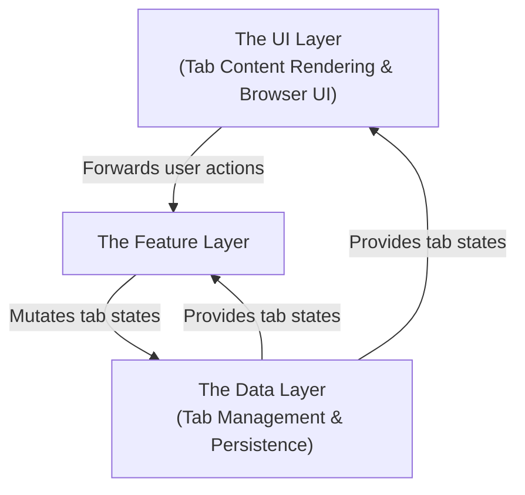
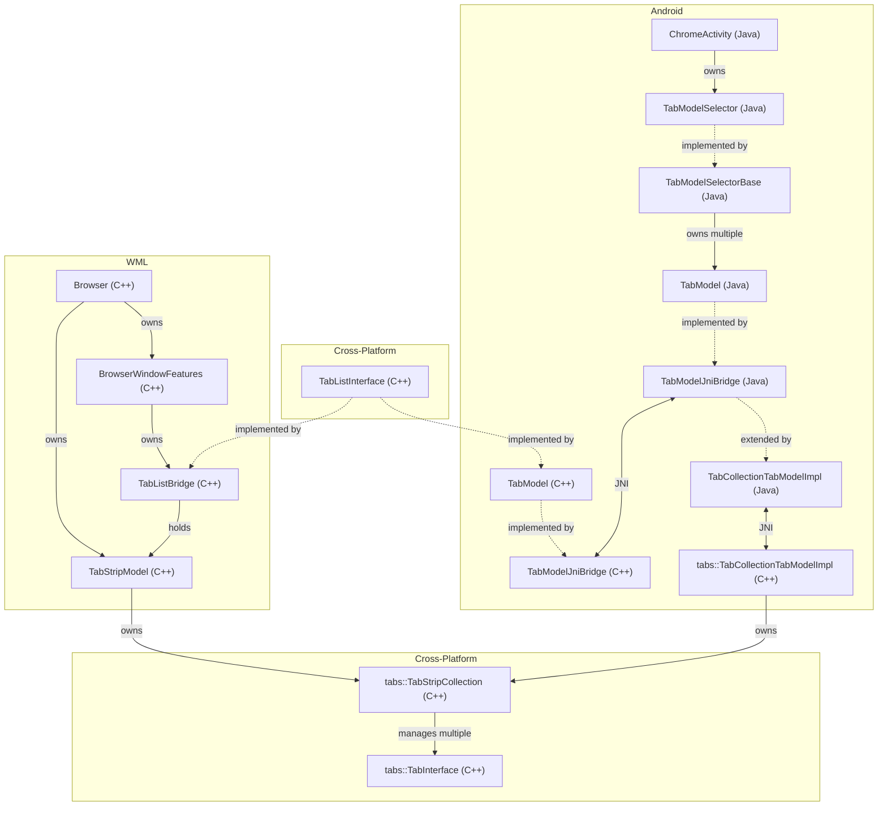
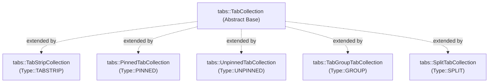
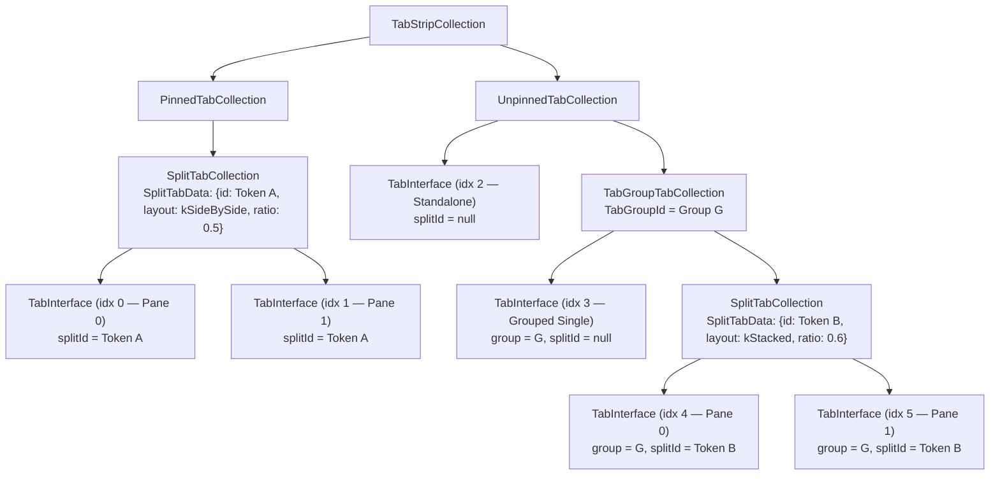
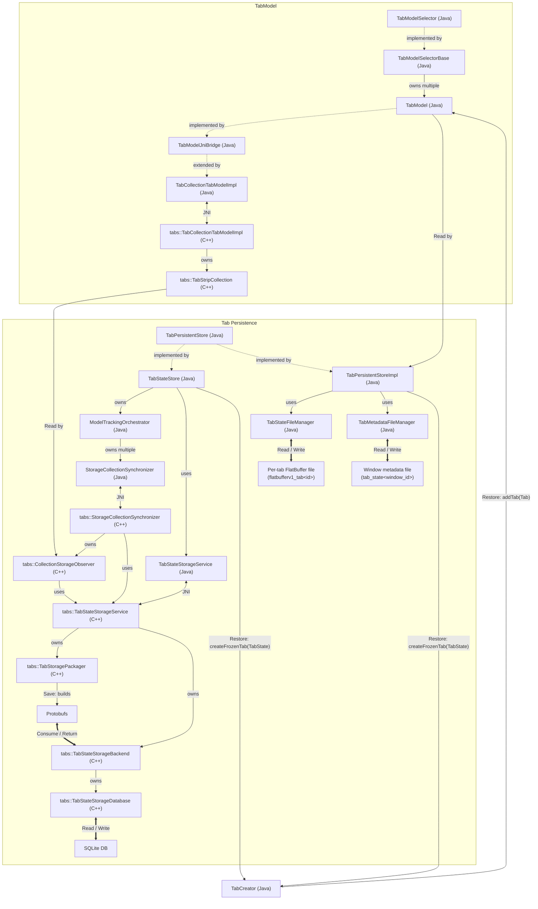
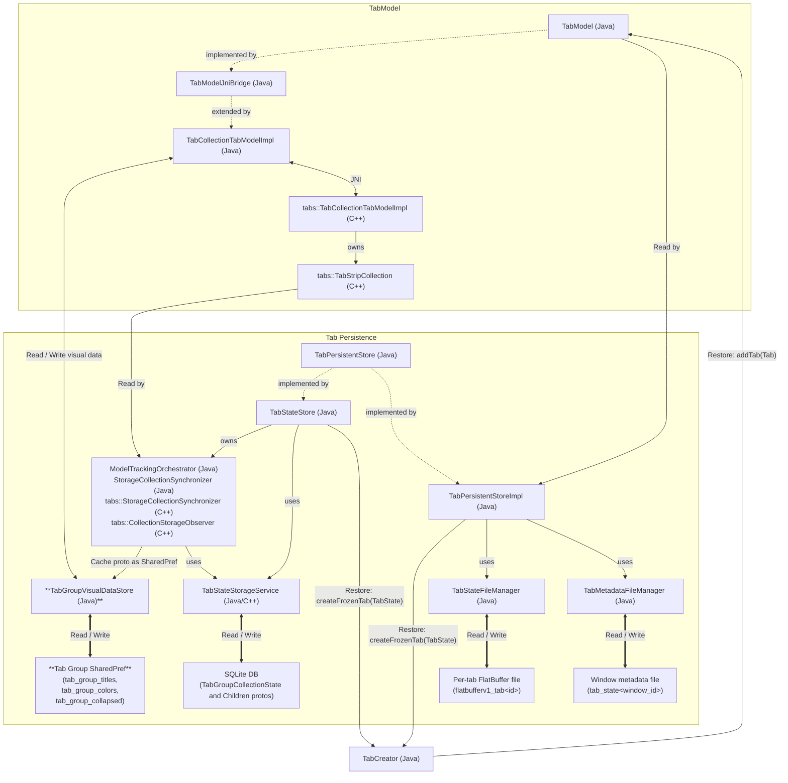
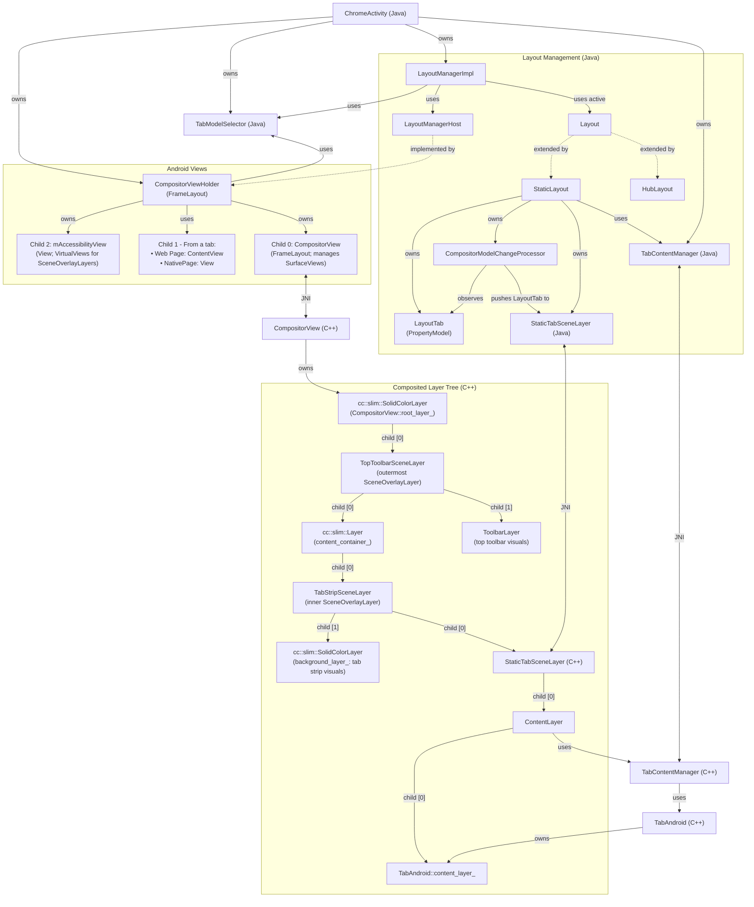
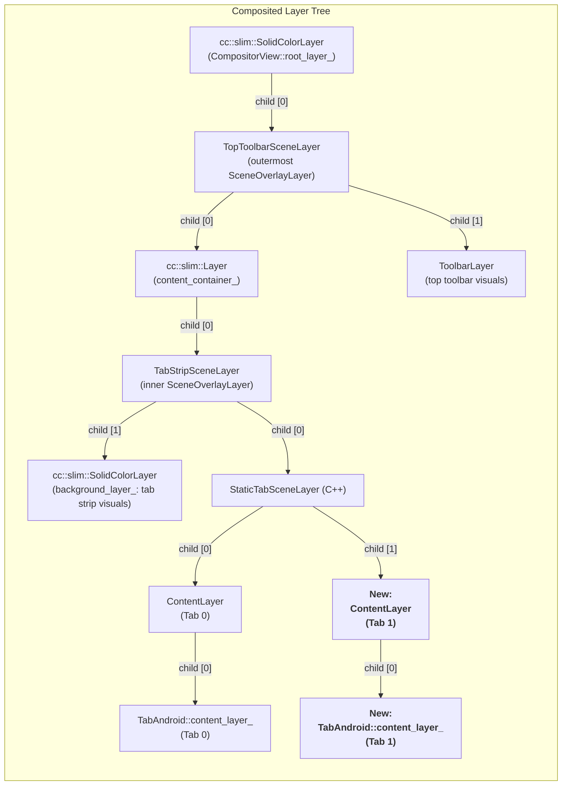
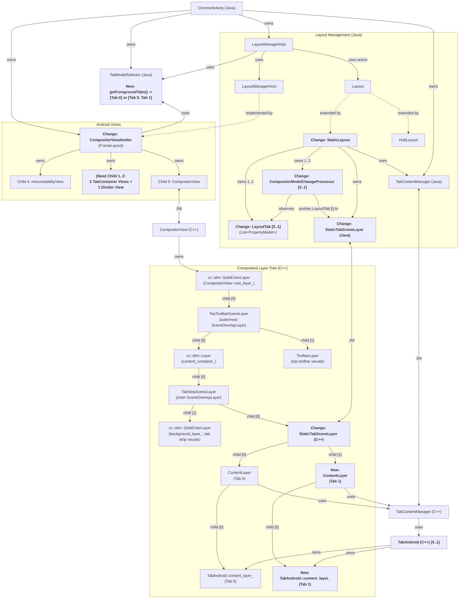

# Android Split View — Engineering Design

## 1. Core proposal

### 1.1. Summary

This document contains the engineering design for **Android Split View**, which achieves parity with [Split View on Windows/Mac/Linux (WML)](https://support.google.com/chrome/answer/16971124) and adapts to different Android form factors.

At a high level, the design is structured into three architectural layers:



*Fig. 1: Architecture Overview (an arrow from `A` to `B` indicates "`A` calls `B`" or "data flows from `A` to `B`").*

* **The UI Layer**:
  * Consists of:
    * tab content rendering, and
    * browser UI (tab strip, toolbar, context menus, etc.).
  * Forwards user actions to the **Feature Layer** and renders states provided by the **Data Layer**.

* **The Feature Layer**:
  * An Android module that centralizes all Split View business logic (such as entry/exit flows, resizing behavior, and responsive layout adaptation), avoiding scattered CUJ logic across the **UI Layer** and the **Data Layer**.
  * Controls (Flag-guards) whether to activate Split View code paths in other layers, avoiding scattered flag checks (`if/else` branching) across those layers.

* **The Data Layer**:
  * Extends the existing tab system to serve as the single source of truth for Split View states and their persistence.
  * Provides APIs for the **UI Layer** and the **Feature Layer**.

Another way to think about the architecture:

* The **UI Layer** and the **Data Layer** are the infrastructure.
* The **Feature Layer** supports CUJs by utilizing the infrastructure.

### 1.2. Context

#### 1.2.1. Background, Goals & Requirements

Please see the PRD: **Android Split View PRD** (internal).

#### 1.2.2. Platforms

- [ ] Windows
- [ ] Mac
- [ ] Linux
- [ ] ChromeOS
- [x] Chrome on Android *— Important: if you are only targeting some form factors (but not all), remember to include the justification below.*
  - [x] Smartphones *— Consider foldables*
  - [x] Tablets
  - [x] Desktop *— (Desktop Android)*
  - [ ] Chrome Custom Tabs — *(CCT)*
  - [ ] Automotive
- [ ] Webview on Android
- [ ] iOS *— Important: if you're only targeting iPhones or iPads (but not both), remember to include the justification below.*
  - [ ] iPhones
  - [ ] iPads
  - [ ] Duo (Foldable iPhones)
- [ ] Fuchsia

**Platform & Form-Factor Justification:**

* **Chrome Custom Tabs (CCT)** is excluded because (1) it's not in scope of the PRD and (2) it is a single-page embedded surface without multi-tab browser UI.
  * However, CCT shares the core **Data Layer** and **UI Layer** infrastructure with the main browser window, so the design can still support Split View in CCT in the future.
* **Automotive** is excluded only because it's not in scope of the PRD; the engineering design can fully support it.

### 1.3. High-Level Design

In this section, we will first examine the two infrastructure layers ([Data Layer](#131-data-layer) and [UI Layer](#132-ui-layer)) and then connect them with [Feature Layer](#133-feature-layer).

Since this is a large project, each subsection won't cover every requirement in details. Instead, we will focus on the core technical direction and leave detailed design to dedicated Google Doc tabs or Jetski implementation plans.

#### 1.3.1. Data Layer

##### 1.3.1.1. Background

###### 1.3.1.1.1. Tab Management Architecture

To support Split View, we should first understand how Chrome on Android manages tabs and how its architecture connects to the cross-platform interfaces/components.



*Fig. 2: Current Android tab management architecture and its shared C++ foundation with WML.*

As illustrated in **Fig. 2**, while Android and WML have platform-specific browser window and tab controllers, both converge on [`TabStripCollection`](https://source.chromium.org/chromium/chromium/src/+/main:components/tabs/public/tab_strip_collection.h;l=32;drc=7db84efdef5d1964c4e59bb26810c40e8b08801a) as the **shared C++ foundation** that organizes tabs ([`TabInterface`](https://source.chromium.org/chromium/chromium/src/+/main:components/tabs/public/tab_interface.h;l=80;drc=12ef0d62a440f10126aa941b12d8733a1227e5aa) instances).

`TabStripCollection` already supports Split View on WML via [`SplitTabCollection`](https://source.chromium.org/chromium/chromium/src/+/main:components/tabs/public/split_tab_collection.h;l=19;drc=5ae8298594a5635150a832aa09184c44fa6c8c3c), so Android can directly build on this shared infrastructure.

###### 1.3.1.1.2. TabCollection Data Structure

Tabs are organized as an n-ary tree of [`TabCollection`](https://source.chromium.org/chromium/chromium/src/+/main:components/tabs/public/tab_collection.h;l=45;drc=6440c9ea954b51b3e1fbd1bdb3c2ea94fd1613a9) nodes. Each node's children are either a `TabInterface` or another `TabCollection`.

* Each node (`TabCollection`) [owns a `TabCollectionStorage`](https://source.chromium.org/chromium/chromium/src/+/main:components/tabs/public/tab_collection.h;l=353;drc=6440c9ea954b51b3e1fbd1bdb3c2ea94fd1613a9) that keeps its children in an ordered sequence.
* There are 5 types of `TabCollection`s in production.
  * `TabStripCollection` (`Type::TABSTRIP`):
    * It’s the root node in the n-ary tree;
    * It only holds one [`PinnedTabCollection`](https://source.chromium.org/chromium/chromium/src/+/main:components/tabs/public/pinned_tab_collection.h;l=12;drc=b2f10ab554e6a5f2fe175d7aa6358fa05c72fd64) and one [`UnpinnedTabCollection`](https://source.chromium.org/chromium/chromium/src/+/main:components/tabs/public/unpinned_tab_collection.h;l=16;drc=9e0f2536a906d8cc497e8b9bc48f5effd5a0398c).
      * There are no `TabInterface` children.
  * `PinnedTabCollection` (`Type::PINNED`)
  * `UnpinnedTabCollection` (`Type::UNPINNED`)
  * [`TabGroupTabCollection`](https://source.chromium.org/chromium/chromium/src/+/main:components/tabs/public/tab_group_tab_collection.h;l=20;drc=6c7213c72cc5e42c881d0ae57127ffe550963893) (`Type::GROUP`)
  * [`SplitTabCollection`](https://source.chromium.org/chromium/chromium/src/+/main:components/tabs/public/split_tab_collection.h;l=19;drc=5ae8298594a5635150a832aa09184c44fa6c8c3c) (`Type::SPLIT`):
    * This [owns Split View data](https://source.chromium.org/chromium/chromium/src/+/main:components/tabs/public/split_tab_collection.h;l=33;drc=5ae8298594a5635150a832aa09184c44fa6c8c3c) (`SplitTabData`).



*Fig. 3: `TabCollection` class hierarchy.*

An example runtime `TabCollection` tree is shown in **Fig. 4**:



*Fig. 4: An example runtime `TabCollection` tree.*

Note that it’s possible to have more than one `SplitTabCollection` in a window. For example, a single window can simultaneously hold 3 `SplitTabCollection`s:

* A `SplitTabCollection` in the `PinnedTabCollection`;
* A `SplitTabCollection` in an unpinned `TabGroupTabCollection`;
* A `SplitTabCollection` in the `UnpinnedTabCollection`.

###### 1.3.1.1.3. Tab Persistence Architecture



*Fig. 5a: Tab persistence architecture (**excluding** tab group data).*



*Fig. 5b: Tab persistence architecture (**focusing** on tab group data).*

Key points from **Fig. 5a** and **Fig. 5b** relevant to Split View:

* **Two tab persistence implementations**
  * Chrome on Android has two implementations of [`TabPersistentStore`](https://source.chromium.org/chromium/chromium/src/+/main:chrome/browser/tabmodel/android/java/src/org/chromium/chrome/browser/tabmodel/TabPersistentStore.java;l=25;drc=080f113e7ee99c2775729f7b8183df8f785264c1):
    * [**`TabStateStore`**](https://source.chromium.org/chromium/chromium/src/+/main:chrome/android/java/src/org/chromium/chrome/browser/app/tabmodel/TabStateStore.java;l=49;drc=933165ced7f60b3c64a13e7dce995f9b0b787436) (SQLite-based, New)**:
      * Observes `TabStripCollection` and persists protos for `TabCollection`s into a SQLite DB.
    * [**`TabPersistentStoreImpl`**](https://source.chromium.org/chromium/chromium/src/+/main:chrome/android/java/src/org/chromium/chrome/browser/tabmodel/TabPersistentStoreImpl.java;l=94;drc=d0f11943401e20a453215475c7bb0fca917983e5) (File-based, Legacy)**:
      * Reads the flat `TabModel` and persists:
        * a per-window metadata file and
        * a per-tab FlatBuffer file.
    * Migration is controlled by the [`TabStorageSqlitePrototype`](https://source.chromium.org/chromium/chromium/src/+/main:chrome/browser/flags/android/java/src/org/chromium/chrome/browser/flags/ChromeFeatureList.java;l=1467;drc=6b0ebff5dfb178647194fac60b4d35a29ad0ecec) feature flag.
* **Storage schemas**
  * **SQLite DB ([`tab_state_storage_database.cc`](https://source.chromium.org/chromium/chromium/src/+/main:chrome/browser/tab/tab_state_storage_database.cc;l=65,74;drc=2ad5464c7a8da3297d74508175b7de62efa2afb0))**:
    * `nodes` table: Stores every node in the `TabStripCollection` tree as a row. Recall that each node is either a `TabCollection` or a `TabInterface`.

| Column | Type | Description |
| ----- | ----- | ----- |
| `id` | `BLOB PRIMARY KEY NOT NULL` | Unique node ID. |
| `window_tag` | `TEXT NOT NULL` | ID for the node's window. |
| `is_off_the_record` | `INTEGER NOT NULL` | Whether the node belongs to an Incognito model. |
| `type` | `INTEGER NOT NULL` | [`TabStorageType`](https://source.chromium.org/chromium/chromium/src/+/main:chrome/browser/tab/tab_storage_type.h;l=13;drc=2ad5464c7a8da3297d74508175b7de62efa2afb0) of the node. This mirrors the node type in the `TabStripCollection` tree. |
| `children` | `BLOB` | A list of child node IDs (see [`children.proto`](https://source.chromium.org/chromium/chromium/src/+/main:chrome/browser/tab/protocol/children.proto;l=13;drc=76d4713b302df3876d0e552207d233e05c1ba915)). |
| `payload` | `BLOB` | Data for the node. See: [tab\_strip\_collection\_state.proto](https://source.chromium.org/chromium/chromium/src/+/main:chrome/browser/tab/protocol/tab_strip_collection_state.proto;l=14;drc=567d9903a00c5adc9a0ea1369635205bf62b23d7) [tab\_group\_collection\_state.proto](https://source.chromium.org/chromium/chromium/src/+/main:chrome/browser/tab/protocol/tab_group_collection_state.proto;l=12;drc=de0b075950eae017cf97a4bc107626e658ba4e80) [split\_collection\_state.proto](https://source.chromium.org/chromium/chromium/src/+/main:chrome/browser/tab/protocol/split_collection_state.proto;l=11;drc=f29737db28bb57cc56562dfbcbd44451e22e7141) [tab\_state.proto](https://source.chromium.org/chromium/chromium/src/+/main:chrome/browser/tab/protocol/tab_state.proto;l=14;drc=dca5670926a7effc81ae1c24798f392ef7c9952b) |

    * `divergent_nodes` table: Tracks divergent child ordering when live `TabStripCollection` mutations occur during an incremental session restore, reconciled on the next load.

| Column | Type |
| ----- | ----- |
| `id` | `BLOB PRIMARY KEY NOT NULL` |
| `window_tag` | `TEXT NOT NULL` |
| `is_off_the_record` | `INTEGER NOT NULL` |
| `children` | `BLOB` |

  * **File-based storage**:
    * **Window metadata file (`tab_state<window_id>`)**

| Field | Type | Description |
| ----- | ----- | ----- |
| `version` | `int` | Metadata file format version. |
| `numTabsTotal` | `int` | Total number of tabs (Incognito + standard). |
| `incognitoCount` | `int` | Number of Incognito tabs. |
| `incognitoActiveIndex` | `int` | Index of the active Incognito tab. |
| `standardActiveIndex` | `int` | Index of the active standard tab. |
| `id` (repeated `numTabsTotal` times) | `int` | Tab ID (Incognito tabs first, followed by standard tabs). |
| `url` (repeated `numTabsTotal` times) | `String` (UTF-8) | Tab URL (paired with each `id`). |

  * **File-based storage (continued)**:
    * **Per-tab FlatBuffer file ([`flatbufferv1_tab<id>`](https://source.chromium.org/chromium/chromium/src/+/main:chrome/browser/tabpersistence/android/java/src/org/chromium/chrome/browser/tabpersistence/flatbuffer/tab_state_v1.fbs;l=18;drc=1c8333e4b093fdbe98fad6374e4f6f900f802315))**: Generally mirrors the [tab\_state.proto](https://source.chromium.org/chromium/chromium/src/+/main:chrome/browser/tab/protocol/tab_state.proto;l=14;drc=dca5670926a7effc81ae1c24798f392ef7c9952b), but there are small differences.
    * **`SharedPreferences` for tab groups:**
      * Note that the per-tab FlatBuffer file only stores [a tab group ID](https://source.chromium.org/chromium/chromium/src/+/main:chrome/browser/tabpersistence/android/java/src/org/chromium/chrome/browser/tabpersistence/flatbuffer/tab_state_v1.fbs;l=47;drc=1c8333e4b093fdbe98fad6374e4f6f900f802315). The rest of tab group data is stored in `SharedPreferences` keyed by that ID.
      * [`TabGroupVisualDataStore`](https://source.chromium.org/chromium/chromium/src/+/main:chrome/browser/tabmodel/android/java/src/org/chromium/chrome/browser/tabmodel/TabGroupVisualDataStore.java;l=32;drc=1c8333e4b093fdbe98fad6374e4f6f900f802315) is the class managing the tab group `SharedPreferences`.
* **Special treatment of tab group data (**Fig. 5b**)**
  * Note that tab group data is stored in conceptually different ways in the two `TabPersistentStore` implementations.
    * `TabStateStore` (**SQLite-based, New**)
      * The `nodes` table contains all types of `TabCollection` tree nodes. A tab group is a row with a specific payload (`tab_group_collection_state.proto`).
      * The tree structure is encoded in each row’s `children` column, which is traversed on load to reconstruct tab order.
    * `TabPersistentStoreImpl` (**File-based, Legacy**)
      * Tab group data is stored separately in dedicated `SharedPreferences`, keyed by tab group IDs.
      * Each per-tab FlatBuffer file has a `tab_group_id` referencing the `SharedPreferences`.
      * To model this using a database:
        * For the tab group `SharedPreferences`:
          * We would have a `tab_groups` table where the primary key is `tab_group_id`.
        * For *all* the per-tab FlatBuffer files:
          * We would have a `tabs` table where each row contains the content of one per-tab file.
          * The columns of the `tabs` table would be the schema of the per-tab file, including `tab_group_id`.
        * The `tabs.tab_group_id` column is a foreign key referencing `tab_groups.tab_group_id`.
  * `TabGroupVisualDataStore` bridges the differences:
    * `TabPersistentStoreImpl` (**File-based, Legacy**)
      * Read path (restore tabs):
        * `TabPersistentStoreImpl` loads the window metadata file and the per-tab FlatBuffer file, then restores tabs via `TabCreator#createFrozenTab()` → `TabModel#addTab()`.
          * Note that each `Tab` will have a tab group ID field loaded from the per-tab file.
        * During `TabModel#addTab()`,
          * If a tab group ID is seen for the first time, we will:
            * load tab group data from `TabGroupVisualDataStore`,
            * create a tab group in the `TabCollection` tree, and
            * add the tab to the new tab group.
          * If a tab group already exists for a tab group ID, we will add the tab to that group.
      * Write path:
        * `TabModel` (`TabCollectionTabModelImpl`) writes new tab group data to `TabGroupVisualDataStore` and updates the `TabCollection` tree.
    * `TabStateStore` (**SQLite-based, New**)
      * Read path (restore tabs):
        * `TabStateStore` loads data from the SQLite DB.
        * `ModelTrackingOrchestrator` caches tab group proto data (in memory) inside `TabGroupVisualDataStore`.
        * When we restore tabs via the same `TabCreator#createFrozenTab()` → `TabModel#addTab()` path, the logic will work as `TabGroupVisualDataStore` will return the cached SQLite data.
        * When tab restoration completes, `TabRestorer` will [clear the in-memory cache](https://source.chromium.org/chromium/chromium/src/+/main:chrome/android/java/src/org/chromium/chrome/browser/app/tabmodel/TabRestorer.java;l=392-394;drc=64db9e2f783006abe190a35244ef95284f5a8553).
      * Write path:
        * `TabModel` (`TabCollectionTabModelImpl`) still writes new tab group data to `TabGroupVisualDataStore` and updates the `TabCollection` tree.
        * **In addition**, the new data will be written to the SQLite DB via `ModelTrackingOrchestrator`.
          * This is done by [registering a `TabGroupObserver`](https://source.chromium.org/chromium/chromium/src/+/main:chrome/android/java/src/org/chromium/chrome/browser/app/tabmodel/ModelTrackingOrchestrator.java;l=542;drc=1c8333e4b093fdbe98fad6374e4f6f900f802315).

###### 1.3.1.1.4. Split View APIs in Cross-Platform Interfaces

Several Split View APIs are already defined in cross-platform tab interfaces:

* **TabListInterface**:
  * `CreateSplit()`
  * `GetSplitTabVisualData()`
  * `ListSplits()`
  * `Unsplit()`
* **TabInterface**:
  * `GetSplit()`
  * `IsSplit()`

These APIs aren't implemented on Android, which we should fix as part of this project to support cross-platform features (like Extensions' `tabs` APIs for Split View).

###### 1.3.1.1.5. Split View APIs on WML

WML's `TabStripModel` and `TabStripModelObserver` expose a richer Split View API surface to support its CUJs, which can be used as a reference for Android. However, these shouldn’t be the *starting point* of the tab API design for Android. We should always start from an Android CUJ and only add what we need (see the [general steps for Android design](#13121-tab-apis) below).

* `TabStripModel`:
  * `AddToNewSplit()`
  * `ContainsSplit()`
  * `DetachSplitTabForInsertion()`
  * `ExecuteAddToNewSplitCommand()`
  * `GetForegroundTabs()`
  * `GetSplitData()`
  * `GetSplitForTab()`
  * `InsertDetachedSplitTabAt()`
  * `IsTabInForeground()`
  * `ListSplits()`
  * `MoveSplitTo()`
  * `RemoveSplit()`
  * `RestoreSplit()`
  * `ReverseTabsInSplit()`
  * `UpdateSplitLayout()`
  * `UpdateSplitRatio()`
  * `UpdateTabInSplit()`

* `TabStripModelObserver`
  * `OnSplitTabChanged()`

##### 1.3.1.2. New Design

###### 1.3.1.2.1. Tab APIs

Since the cross-platform tab management foundation (`TabStripCollection`) already provides the data layer functionalities for Split View, Android needs to:

* (1) Expose data layer functionalities via new APIs in Android's tab system.
  * These APIs will enable **UI Layer** and **Feature Layer** to implement CUJs.
  * For common CUJs between WML and Android, the Android APIs will generally mirror WML APIs.
* (2) Implement existing Split View APIs in cross-platform interfaces (`TabListInterface` and `TabInterface`).
* (3) As part of (1), consider the following on a case-by-case basis:
  * Consolidate APIs into cross-platform interfaces.
    * For example, we can promote `TabStripModel::GetForegroundTabs()` to `TabListInterface`.
    * This will standardize Split View APIs across all platforms and make it easier to support cross-platform features.
  * Reuse existing WML implementation when reasonable.
    * For example, the [`SplitTabChange`](https://source.chromium.org/chromium/chromium/src/+/main:chrome/browser/ui/tabs/tab_strip_model_observer.h;l=342;drc=b5cc7c8ecc923050e6dfcea67853cc2a4f5fe4bf) struct doesn't really need WML-specific code, so it can be shared with Android.
* (4) For Android-specific CUJs, evaluate on a case-by-case basis and create Android-specific APIs when needed.
  * One notable example is “undo tab closure”.

We'll defer detailed tab API design to a dedicated Google Doc tab or Jetski implementation plans. The general steps are as follows:

* (a) Identify the most important CUJ that currently has no tab API support.
* (b) Identify WML and/or cross-platform APIs for that CUJ, or confirm if the CUJ is Android-specific and needs Android-specific APIs.
* (c) Go through Steps (1) ~ (4) above to implement the required APIs for that CUJ.
* (d) Repeat.

However, one key conceptual detail is worth highlighting here:

* With Split View, we can show two tabs, but there is still at most one active/current tab.
* Following WML, we introduce the concept of "foreground tabs":
  * Foreground tabs are all tabs that are visible, but at most one of them is the active/current tab.
* The corresponding APIs will be:
  * `TabModelSelector#getCurrentTab()`
  * `TabModelSelector#getForegroundTabs()`
  * `TabModel#getCurrentTabSupplier()`
  * `TabModel#getForegroundTabsSupplier()`
* The "foreground tabs vs active tab" distinction will keep all features relying on the active tab working, such as Omnibox, back/forward navigation, tab-scoped side panels, etc.
  * If a feature needs to reflect Split View state, it should use "foreground tabs".

The following table summarizes equivalent concepts in cross-platform code, WML, and Android, which can be used as a reference for detailed API design/implementation.

| Cross-Platform | WML | Android |
| ----- | ----- | ----- |
| **Active/Current tab**: The tab that’s active/being acted on. At any moment, there is at most 1 active/current tab. | Same | Same (or at least it should be) |
| **Foreground tab(s)**: All tabs that are visible. With Split View, there can be 1 or 2 foreground tabs. Foreground tabs always include the current/active tab. | Same | Same (or at least it should be) |
| **Selected tab(s)**: Multi-selected tabs. | Same | Same (or at least it should be) |
| `TabListInterface` (C++) | `TabListBridge` (C++)<br>`TabStripModel` (C++) | C++:<br>`TabModel`<br>`TabModelJniBridge`<br>`TabCollectionTabModelImpl`<br><br>Java:<br>`TabModel`<br>`TabModelJniBridge`<br>`TabCollectionTabModelImpl` |
| `TabInterface` CRUD APIs (C++) | `TabModel` (C++) | C++:<br>`TabAndroid`<br><br>Java:<br>`Tab`<br>`TabImpl` |
| `TabInterface` observation APIs (C++):<br>`RegisterDidActivate()` `RegisterDidBecomeVisible()` `RegisterDidInsert()` … | `TabModel` (C++) implements them. | `TabAndroid` (C++) implements the cross-platform observation APIs.<br><br>Additionally, there is a Java `TabObserver`. |
| `TabListInterfaceObserver` (C++) | `TabStripModelObserver` (C++) | C++:<br>`TabModelObserverJniBridge`<br><br>Java:<br>`TabModelObserver` |
| `SplitTabId` (C++) | — | `Token` (Java)<br><br>From Calder Kitagawa: “*We should consider aliasing this so it doesn't get confused with [TabGroupId](https://source.chromium.org/chromium/chromium/src/+/main:chrome/browser/tab/java/src/org/chromium/chrome/browser/tab/TabGroupCollectionData.java;l=43;drc=706f79336961dca0261b13c9d582500207079040).*”<br><br>The Java `Token` is final, so one way is to create a wrapper class as an alias:<br><br>`public final class SplitTabId { public final Token mToken; }`<br><br>`public final class TabGroupId { public final Token mToken; }` |
| `SplitTabLayout` (C++) | — | `@SplitTabLayout` (Java enum generated from C++) |
| `SplitTabVisualData` (C++) | — | `SplitTabVisualData` (new Java class) |

###### 1.3.1.2.2. Tab Persistence

Following [Tab Persistence Architecture](#13113-tab-persistence-architecture), we’ll follow the existing tab group design (**Fig. 5b**) to support the SQLite-based store, the file-based store, and `TabModel`’s existing tab restoration flow. The implementation for Split View consists of 5 parts:

* **Part 1: Update storage schema and direct read/write logic.**
  * **SQLite-based store (`TabStateStore`)**:
    * This is straightforward since the `TabStateStore` system already observes `TabStripCollection`, and most of Split View’s in-memory and persisted data types are already defined. We just need to add what's missing for Split View by following existing logic.
  * **File-based store (`TabPersistentStoreImpl`)**:
    * Update the per-tab FlatBuffer file: append *only* `split_tab_id` to [tab\_state\_v1.fbs](https://source.chromium.org/chromium/chromium/src/+/main:chrome/browser/tabpersistence/android/java/src/org/chromium/chrome/browser/tabpersistence/flatbuffer/tab_state_v1.fbs;l=18;drc=7d60827f34aa685336b4dbf6cbb3a6de1f5a0a61).
      * Because [tab\_state\_v1.fbs](https://source.chromium.org/chromium/chromium/src/+/main:chrome/browser/tabpersistence/android/java/src/org/chromium/chrome/browser/tabpersistence/flatbuffer/tab_state_v1.fbs;l=18;drc=7d60827f34aa685336b4dbf6cbb3a6de1f5a0a61) is a FlatBuffer `table`, appending new fields is backward- and forward-compatible.
  * **`SplitTabVisualDataStore` (New)**
    * Similar to `TabGroupVisualDataStore`, we’ll create `SplitTabVisualDataStore` to manage:
      * New `SharedPreferences` keyed by `split_tab_id`:
        * `split_layout`
        * `split_ratio`
      * An in-memory cache for Split View data in the SQLite DB for the “File-based store -> SQLite-based store” migration.
* **Part 2: Observe Split View state changes.**
  * Recall that in [the SQLite-based store’s write path](#13113-tab-persistence-architecture), a write is triggered by an observer.
  * We’ll need an observer for Split View states, but there is no need for a new `SplitTabObserver` interface since we can just add `OnSplitTabChanged()` to `TabModelObserver`.
    * This mirrors WML’s `TabStripModelObserver#OnSplitTabChanged()` and allows consolidating the API into the cross-platform `TabListInterfaceObserver`.
  * In addition, `TabObserver` also needs to observe Split View states for a particular tab. This way `TabStateAttributes` can mark the tab dirty so its persisted Split View states can be updated (see `TabObserver#onTabGroupIdChanged()`).
* **Part 3 (Optional, pending further investigation): Update C++ `TabStripCollection` to allow adding `SplitTabCollection` before its child tabs.**
  * Recall that [during tab restoration](#13113-tab-persistence-architecture), `TabModel` creates a tab group first, before adding all its child tabs.
  * However, the current [`TabStripCollection::CreateSplit()`](https://source.chromium.org/chromium/chromium/src/+/main:components/tabs/impl/tab_strip_collection.cc;l=423-452;drc=75daec136d6bb527b181ca527087ad234f5acd7a) API requires both tabs to already exist in the parent collection, and WML uses a two-step pattern in [`SessionRestoreImpl`](https://source.chromium.org/chromium/chromium/src/+/main:chrome/browser/sessions/session_restore.cc;l=1125,1143;drc=2ed8a6f108b4664a6b1ef65ea7f58d2377b923a9):
    * It first adds each restored tab individually via `RestoreTab()`, and once both tabs sharing a `split_id` are in `TabStripModel`, it calls `TabStripModel::RestoreSplit()` to group them into a `SplitTabCollection`.
  * Technically we can make this work for Android, but it would be nice to add an overload `CreateSplit(std::unique_ptr<SplitTabCollection>)` *if it makes sense from the cross-platform perspective*.
    * At a high-level, this requires:
      * (1) Detached split staging in `TabStripCollection` (mirroring `TabStripCollection::detached_group_collections_`)
      * (2) Plumbing `split_id` into
        * `TabStripCollection::AddTabRecursive()`
        * `TabStripCollection::MoveTabRecursive()`
        * `TabStripCollection::MoveTabsRecursive()`
* **Part 4: Feature flag rollback support.**
  * In case the Split View feature flag is rolled back, we should remove Split View data from storage.
  * One simple and effective strategy is to check the feature flag in the read path.
    * Read path:
      * Check the feature flag in the deserialization paths for both SQLite DB and the per-tab FlatBuffer. If the feature flag is off:
        * Drop `split_tab_id` from `TabState` and mark that restored tab dirty so its per-tab FlatBuffer file and SQLite DB row will be rewritten without `split_tab_id`.
        * Delete the `split_tab_id` entry from `SplitTabVisualDataStore`'s `SharedPreferences`.
      * This will prevent Split View from being restored.
      * Note that for the SQLite DB, we still have to parse each `kSplit` row's `children` column, otherwise we won’t be able to construct the correctly ordered tab list (see **Fig. 4** and the [SQLite DB schema](#13113-tab-persistence-architecture)). We can skip the `payload` column.
    * Write path:
      * No change is needed here since the in-memory `Tab`s won’t have Split View data after the read path.
      * We can `assert` that the feature flag is enabled whenever Split View data is written.
    * Why this works: we plan to use a Java cached flag since we may need to read its value before the native library is loaded, such as for browser UI entry points. Java cached flags are process-stable, so in the event of a rollback, we’ll always start from the read path, then the write path will remove Split View data.
  * Note that we plan to centralize feature flag checks in the **Feature Layer**, but the checks in rollback support is a reasonable exception.
* **Part 5: Put everything together.**

Notes from Calder Kitagawa that supports the design above:

* *“I would put only `split_tab_id` in the `fbs`.*
  * *“The `split_layout`/`split_ratio` should be like Tab Groups and we put that information in shared prefs keyed by the `split_tab_id`.*
  * *“This avoids duplicate data, extra disk writes, and possible conflicts since **each tab state file is written atomically, but the entire operation is not atomic**.*
  * *“If you shift Tab 1 and Tab 2 in a split, but only one of the files writes then you would end up having to do conflict resolution. Keeping this in a shared pref means there is one source of truth.*
  * *“I'd rather we get onto the new (SQLite) system ASAP, but given we shouldn't block on it existing this is the best middle ground IMO.”*

###### 1.3.1.2.3. Feature Flag Usage

We expect Data Layer changes to be implemented without many `if-else` branches checking the Split View feature flag.

* The new [tab APIs](#13121-tab-apis) should have no callers until the **Feature Layer** starts a CUJ using both the **Data Layer** and the **UI Layer**.
  * We plan to check the feature flag in the **Feature Layer**.
* The new [schema for tab persistence](#13122-tab-persistence) must be backward- and forward-compatible, irrespective of the feature flag's presence.
  * Code reading and writing the new data is similar to the new tab APIs.
  * From Calder Kitagawa:
    * *“You will likely want a way to ‘delete’ the data if the flag is ever rolled back so keep that in mind. Historically this is a separate killswitch guarded ‘cleanup’ method that just clears any data on a rollback. i.e. data is detected in fields and the main feature flag was disabled.”*

Therefore, Data Layer changes can be implemented mostly without an `if-else` flag check.

* For safety, we can `assert` in the new code paths that the feature flag is enabled.
* This prevents zig-zags in the codebase, which makes it harder to understand logic and easier to introduce regressions.

#### 1.3.2. UI Layer

The UI Layer consists of (1) the tab content rendering infrastructure and (2) the browser UI. This section focuses on (1) as building (2) on top of the **Data Layer** and (1) is conceptually straightforward.

##### 1.3.2.1. Background

To support Split View, we should first understand how Chrome on Android renders a single tab in the **browser process**. We won't dive into the **renderer processes** and the **GPU/Viz process** because Split View doesn’t require modifying either, but we'll include relevant information for context.

###### 1.3.2.1.1. Single-Tab Rendering Architecture



*Fig. 6: Single-tab rendering in the browser process.*

In **Fig. 6**, the single-tab rendering architecture works as follows:

* **Browser-process scope**: Everything in **Fig. 6** runs inside the **browser process**.
  * **Renderer processes** and the **GPU/Viz process** are not shown in **Fig. 6**. For context:
    * **Renderer processes** translate HTML/CSS/DOM content into paint commands (while routing media content over dedicated GPU/media streams) so the **GPU/Viz process** populates image buffers in GPU memory.
      * On each update (such as scrolling or animation), **renderer processes** submit a [`CompositorFrame`](https://source.chromium.org/chromium/chromium/src/+/main:components/viz/common/quads/compositor_frame.h;l=31;drc=99c367b908fb27d958d8e961ce3b041bcfd51a5c) telling the **GPU/Viz process** how to arrange those GPU buffers into the tab's surface.
      * In **Fig. 6**, [`CompositorViewHolder`](https://source.chromium.org/chromium/chromium/src/+/main:chrome/android/java/src/org/chromium/chrome/browser/compositor/CompositorViewHolder.java;l=140;drc=b9c415af26bc810dc65d3503705776fa0bae5088)'s `Child 1: ContentView` and `TabAndroid (C++)` communicate with the active tab's renderer process(es) to forward input events, synchronize viewport sizing, drive the soft keyboard and web accessibility, and anchor web popups.
    * **The GPU/Viz process** composites the final frame into an Android hardware buffer ([`AHardwareBuffer`](https://developer.android.com/ndk/reference/group/a-hardware-buffer)) backing the active `SurfaceView` managed by [`CompositorView (Java)`](https://source.chromium.org/chromium/chromium/src/+/main:chrome/android/java/src/org/chromium/chrome/browser/compositor/CompositorView.java;l=69;drc=77b89898595ed2d6ad719ad1708ca7d2008dd28d).
      * [`CompositorView (C++)`](https://source.chromium.org/chromium/chromium/src/+/main:chrome/browser/android/compositor/compositor_view.h;l=40;drc=397f32292d81d9f200ae3af52f64058f839c7948) submits the `Composited Layer Tree` to the **GPU/Viz process**.
      * In that tree, [`TabAndroid::content_layer_`](https://source.chromium.org/chromium/chromium/src/+/main:chrome/browser/android/tab_android.h;l=344;drc=5c8d78f8b6d2d517dc6b036b62fb4e1152f186eb) holds a lightweight [`SurfaceId`](https://source.chromium.org/chromium/chromium/src/+/main:components/viz/common/surfaces/surface_id.h;l=27;drc=0620ec773449a30017546435f0184a17041c6b99) reference telling the **GPU/Viz process** where to embed the tab's live web surface
        * The tab’s live web surface is already held in GPU memory inside the **GPU/Viz process**.
      * [`TabContentManager (C++)`](https://source.chromium.org/chromium/chromium/src/+/main:chrome/browser/android/compositor/tab_content_manager.h;l=36;drc=0620ec773449a30017546435f0184a17041c6b99) requests frame readbacks from the **GPU/Viz process** to cache fallback tab thumbnails.
* **Source of truth for tab data**:
  * `TabModelSelector`/`TabModel` serves as the source of truth for tabs.
* **Layout management**: Controls which visual scene occupies the window. Only one [`Layout`](https://source.chromium.org/chromium/chromium/src/+/main:chrome/android/java/src/org/chromium/chrome/browser/compositor/layouts/Layout.java;l=41;drc=b9e283bb7a6cb46e628acd8ac7d04133698f1148) is active at a time.
  * **What a `Layout` is**:
    * A Chrome `Layout` is **not** an Android `View` layout.
    * Instead, it is a **window-level visual mode**. Examples:
      * [`StaticLayout`](https://source.chromium.org/chromium/chromium/src/+/main:chrome/android/java/src/org/chromium/chrome/browser/compositor/layouts/StaticLayout.java;l=56;drc=7fdfffb4a2b2e15cd0bb9765333baf9103a41f1c) is the browsing-time layout.
      * `HubLayout` is the Grid Tab Switcher UI.
  * **Bidirectional communication with `Android Views`**:
    * This is done via the [`LayoutManagerHost`](https://source.chromium.org/chromium/chromium/src/+/main:chrome/android/java/src/org/chromium/chrome/browser/compositor/layouts/LayoutManagerHost.java;l=23;drc=f1a1c426de4a1ea4c75edad5db794405c081d737) interface, implemented by `CompositorViewHolder`.
    * `Android Views` → `Layout`:
      * When `StaticLayout` is active, `CompositorViewHolder` provides viewport bounds, browser controls, etc..
    * `Layout` → `Android Views`:
      * The `Layout` system tells `CompositorViewHolder` whether to display the active tab's Android `View` (`Child 1`) and requests a new compositor frame whenever the scene changes.
* **Android Views**:
  * `CompositorViewHolder`:
    * A `FrameLayout` that stacks 3 child `View`s from back (`Child 0`) to front (`Child 2`).
    * **Child 0 -** `CompositorView`:
      * A `FrameLayout` that manages `SurfaceView`s for the final composited frames from the **GPU/Viz process**.
    * **Child 1 -** the active tab's Android `View`.
      * **Web page**:
        * A **transparent** [`ContentView`](https://source.chromium.org/chromium/chromium/src/+/main:components/embedder_support/android/java/src/org/chromium/components/embedder_support/view/ContentView.java;l=69;drc=37261406d27b8cfce2d021ebd12c12b414c540ff) to receive input and support Android UI for the underlying `WebContents`.
      * **`NativePage`** (such as Bookmarks, Downloads, etc.):
        * An **opaque** standard Android `View`.
        * When a `NativePage` is visible, `StaticLayout` disables live web surface compositing underneath.
    * **Child 2 - `mAccessibilityView`**:
      * A **transparent** `View` supporting accessibility for composited browser UI (such as the horizontal tab strip).
      * Note that this view does not provide accessibility for `WebContents` or `NativePage`s; `Child 1` handles both directly.
* **Composited Layer Tree**:
  * Each node (`Layer`) represents a group of visual elements.
    * It holds the visual content, such as:
      * a bitmap in `ToolbarLayer`,
      * a solid color, or
      * a `SurfaceId` in `TabAndroid::content_layer_`.
    * It contains instructions for the **GPU/Viz process** on how to place and composite that content, such as:
      * the `x`/`y` position, size, clip/rounded corners, opacity, etc.
  * The tree topology defines:
    * (1) Z-order stacking via depth-first pre-order traversal:
      * From back to front: root → left subtree → right subtree.
    * (2) Hierarchical inheritance of parent transforms, clips, and opacity.
  * Note that the tree topology has no bearing on the `x`/`y` layout. Other than the z-order, siblings indicate they share (inherit) their parent's coordinate space, transforms, clips, opacity, etc.
    * The `x`/`y` layout is specified by each node.
* **The [MVC perspective](https://source.chromium.org/chromium/chromium/src/+/main:docs/ui/android/mvc_overview.md;drc=997bb97bbadd10b86d1643d6dc570384c6579bb4)**:
  * **Model (M)**:
    * [`LayoutTab`](https://source.chromium.org/chromium/chromium/src/+/main:chrome/android/java/src/org/chromium/chrome/browser/compositor/layouts/components/LayoutTab.java;l=22;drc=7e822a7a2778ea4c52724bc8de56868cd938dc0a) holds the rendering state for a tab's compositor layer—its tab ID, position, dimensions, background color, whether to display a live web surface, etc.
  * **View (V)**:
    * `CompositorViewHolder`, its children, and the Composited Layer Tree.
  * **Controller (C)**:
    * `LayoutManagerImpl` and the active `Layout` (such as `StaticLayout`) fill the controller role.

###### 1.3.2.1.2. Single-Tab Spatial (x-y) and Stacking (z-x) Layouts

The two ASCII diagrams below illustrate how **Android Views** and the **Composited Layer Tree** in **Fig. 6** are arranged in `x-y` screen space and `z` stacking order in the single-tab scenario.

* **Fig. 7a (`x-y` layout)** uses conventional screen coordinates.
* **Fig. 7b (`z-x` layout)** shows a vertical cross-section where `z` is the stacking axis (from back to front), and `x` is the horizontal screen axis.

```
  (0, 0)                                                              (W, 0)
    +-------------------------------------------------------------------+----> x
    |  Top Browser Controls Area                                        |
    |  • Composited Layer Tree:                                         |
    |    - TabStripSceneLayer -> child [1]: background_layer_           |
    |    - TopToolbarSceneLayer -> child [1]: ToolbarLayer              |
    |  • Android Views:                                                 |
    |    - Child 2: mAccessibilityView (VirtualViews for SceneOverlays) |
    |  height = topControlsOffset                                       |
    +-------------------------------------------------------------------+ (W, topControlsOffset)
    |                                                                   |
    |  Single Tab Content Area                                          |
    |  Origin: (0, topControlsOffset)                                   |
    |  Size:   W x (H - topControlsOffset - bottomControlsOffset)       |
    |                                                                   |
    |  1) Android Views (in CompositorViewHolder):                      |
    |     • Child 1:                                                    |
    |       - Web Page: transparent ContentView (input, IME, a11y,      |
    |         popups)                                                   |
    |       - NativePage: opaque View                                   |
    |  2) Composited Layer Tree (in Child 0: CompositorView):           |
    |     • StaticTabSceneLayer (C++) -> ContentLayer                   |
    |       -> TabAndroid::content_layer_ (live web SurfaceId or        |
    |          fallback thumbnail)                                      |
    |                                                                   |
    +-------------------------------------------------------------------+ (W, H - bottomControlsOffset)
    |  Bottom Browser Controls (if present)                             |
    +-------------------------------------------------------------------+ (W, H)
    |
    v
    y
```

*Fig. 7a: Single-tab **`x-y`** layout in screen coordinates.*

```
     z (front / top of stack)
     ^
     |  [Android Views inside CompositorViewHolder]
     |  +-------------------------------------------------------------------+
z=10 |  | Child 2: mAccessibilityView                                       |
     |  | (Transparent View; VirtualViews for SceneOverlayLayers)           |
     |  +-------------------------------------------------------------------+
     |  +-------------------------------------------------------------------+
 z=9 |  | Child 1: ContentView (transparent, Web Page)                      |
     |  |       or View (opaque, NativePage)                                |
     |  +-------------------------------------------------------------------+
     | - - - - - - - - - - - - - - - - - - - - - - - - - - - - - - - - - - - - (SurfaceView boundary)
     |  [Child 0: CompositorView — Composited Layer Tree (C++)]
     |  +-------------------------------------------------------------------+
 z=8 |  | ToolbarLayer (child [1] of TopToolbarSceneLayer; toolbar visuals) |
     |  +-------------------------------------------------------------------+
     |  +-------------------------------------------------------------------+
 z=7 |  | background_layer_ (child [1] of TabStripSceneLayer; strip visuals)|
     |  +-------------------------------------------------------------------+
     |  +-------------------------------------------------------------------+
 z=6 |  | TabAndroid::content_layer_ (child [0] of ContentLayer)            |
     |  +-------------------------------------------------------------------+
     |  +-------------------------------------------------------------------+
 z=5 |  | ContentLayer (child [0] of StaticTabSceneLayer (C++); container)  |
     |  +-------------------------------------------------------------------+
     |  +-------------------------------------------------------------------+
 z=4 |  | StaticTabSceneLayer (C++) (child [0] of TabStrip...; container)   |
     |  +-------------------------------------------------------------------+
     |  +-------------------------------------------------------------------+
 z=3 |  | TabStripSceneLayer (child [0] of content_container_; container)   |
     |  +-------------------------------------------------------------------+
     |  +-------------------------------------------------------------------+
 z=2 |  | content_container_ (child [0] of TopToolbarSceneLayer; container) |
     |  +-------------------------------------------------------------------+
     |  +-------------------------------------------------------------------+
 z=1 |  | TopToolbarSceneLayer (child [0] of root_layer_; container)        |
     |  +-------------------------------------------------------------------+
     |  +-------------------------------------------------------------------+
 z=0 |  | CompositorView::root_layer_ (cc::slim::SolidColorLayer)           |
     +--+-------------------------------------------------------------------+----> x
   (0, 0)                                                                 (W, 0)
```

*Fig. 7b: Single-tab **`z-x`** layout showing stacking order from back (`z=0`) to front (`z=10`).*

##### 1.3.2.2. New Design

###### 1.3.2.2.1. Intuition

In **Fig. 6**, a visible tab is represented in two places that occupy the same `(x, y)` screen area:

* **Composited Layer Tree:**
  * [`StaticTabSceneLayer (C++)`](https://source.chromium.org/chromium/chromium/src/+/main:chrome/browser/android/compositor/scene_layer/static_tab_scene_layer.h;l=22;drc=7e822a7a2778ea4c52724bc8de56868cd938dc0a) → [`ContentLayer`](https://source.chromium.org/chromium/chromium/src/+/main:chrome/browser/android/compositor/layer/content_layer.h;l=26;drc=7e822a7a2778ea4c52724bc8de56868cd938dc0a) → `TabAndroid::content_layer_`.
* **Android Views:**
  * `CompositorViewHolder` → `Child 1`

To show two tabs:

* **Composited Layer Tree:**
  * Add another `ContentLayer` under `StaticTabSceneLayer`.
  * Rationale:
    * `ContentLayer` is designed for a single tab, i.e., it's tab-scoped.
    * Everything above `StaticTabSceneLayer` in **Fig. 6** represents window-scoped UI.
    * Therefore, `StaticTabSceneLayer` is the right branching point.
  * Precedent:
    * In [`ToolbarSwipeSceneLayer`](https://source.chromium.org/chromium/chromium/src/+/main:chrome/browser/android/compositor/scene_layer/toolbar_swipe_scene_layer.h;l=20;drc=f59cf8062ba898201c4807c2e25e37c606c76ec6), which replaces `StaticTabSceneLayer` when the user is swiping sideways on the toolbar, there are also [two `ContentLayer` children](https://source.chromium.org/chromium/chromium/src/+/main:chrome/browser/android/compositor/scene_layer/toolbar_swipe_scene_layer.h;l=44-45;drc=f59cf8062ba898201c4807c2e25e37c606c76ec6).
* **Android Views:**
  * Since a tab's Android `View` must occupy the same `(x, y)` screen area as the tab's composited layer, we'll replace `CompositorViewHolder`'s `Child 1` with 3 `View`s:
    * 2 `TabContainer` `View`s (`FrameLayout`s) for the tabs' Android `View`s, and
    * 1 `View` for the divider.
  * Since (1) we need to perfectly align all 3 `View`s with the underlying composited layers by adjusting their layout params, and (2) Split View has side-by-side and top-and-bottom (stacked) modes, there is no need to introduce an extra container to host the 3 `View`s.

Based on the above, we will show (1) the new **Composited Layer Tree** and (2) the **spatial and stacking layouts**.



*Fig. 8: Composited Layer Tree for Split View.*

```
  [A] Side-by-Side Mode
  (0, 0)                                                                    (W, 0)
    +-------------------------------------------------------------------------+----> x
    |  Top Browser Controls Area                                              |
    |  • Composited Layer Tree:                                               |
    |    - TabStripSceneLayer -> child [1]: background_layer_                 |
    |    - TopToolbarSceneLayer -> child [1]: ToolbarLayer                    |
    |  • Android Views:                                                       |
    |    - Child 4: mAccessibilityView (VirtualViews for SceneOverlays)       |
    |  height = topControlsOffset                                             |
    +-------------------------------------------------------------------------+ (W, topControlsOffset)
    |   +------------------------------+---+------------------------------+   |
    |   | Tab 0 Area (Left Pane)       | D | Tab 1 Area (Right Pane)      |   |
    |   | Origin: (x0, y0)             | i | Origin: (x1, y0)             |   |
    |   | Size:   w0 x h0              | v | Size:   w1 x h0              |   |
    |   |                              | i |                              |   |
    |   | 1) Android Views:            | d | 1) Android Views:            |   |
    |   |    • Child 1:                | e |    • Child 2:                |   |
    |   |      TabContainer (Tab 0)    | r |      TabContainer (Tab 1)    |   |
    |   |      -> ContentView or       |   |      -> ContentView or       |   |
    |   |         NativePage View      | V |         NativePage View      |   |
    |   | 2) Composited Layer Tree:    | i | 2) Composited Layer Tree:    |   |
    |   |    • StaticTabSceneLayer     | e |    • StaticTabSceneLayer     |   |
    |   |      -> ContentLayer (Tab 0) | w |      -> ContentLayer (Tab 1) |   |
    |   |      -> TabAndroid::         |   |      -> TabAndroid::         |   |
    |   |         content_layer_       |(3)|         content_layer_       |   |
    |   +------------------------------+---+------------------------------+   |
    +-------------------------------------------------------------------------+ (W, H - bottomControlsOffset)
    |  Bottom Browser Controls (if present)                                   |
    +-------------------------------------------------------------------------+ (W, H)
    |
    v
    y

  [B] Top-and-Bottom (Stacked) Mode
  (0, 0)                                                                    (W, 0)
    +-------------------------------------------------------------------------+----> x
    |  Top Browser Controls Area (height = topControlsOffset)                 |
    +-------------------------------------------------------------------------+ (W, topControlsOffset)
    |   +-----------------------------------------------------------------+   |
    |   | Tab 0 Area (Top Pane): Origin (x0, y0), Size w0 x h0            |   |
    |   | 1) Android Views:         Child 1: TabContainer (Tab 0)         |   |
    |   |                           -> ContentView or NativePage View     |   |
    |   | 2) Composited Layer Tree: StaticTabSceneLayer                   |   |
    |   |                           -> ContentLayer (Tab 0)               |   |
    |   |                           -> TabAndroid::content_layer_         |   |
    |   +-----------------------------------------------------------------+   |
    |   |                      Child 3: Divider View                      |   |
    |   +-----------------------------------------------------------------+   |
    |   | Tab 1 Area (Bottom Pane): Origin (x0, y1), Size w0 x h1         |   |
    |   | 1) Android Views:         Child 2: TabContainer (Tab 1)         |   |
    |   |                           -> ContentView or NativePage View     |   |
    |   | 2) Composited Layer Tree: StaticTabSceneLayer                   |   |
    |   |                           -> ContentLayer (Tab 1)               |   |
    |   |                           -> TabAndroid::content_layer_         |   |
    |   +-----------------------------------------------------------------+   |
    +-------------------------------------------------------------------------+ (W, H - bottomControlsOffset)
    |  Bottom Browser Controls (if present)                                   |
    +-------------------------------------------------------------------------+ (W, H)
    |
    v
    y
```

*Fig. 9a: Split View **`x-y`** spatial layout for Side-by-Side (`[A]`) and Top-and-Bottom / Stacked (`[B]`) modes.*

```
  [A] Side-by-Side Mode (z-x cross-section; Tab 0 at x0..x0+w0, Tab 1 at x1..x1+w1)
  [B] Top-and-Bottom (Stacked) Mode (z-y cross-section; Tab 0 at y0..y0+h0, Tab 1 at y1..y1+h1)

     z (front / top of stack)
     ^
     |  [Android Views inside CompositorViewHolder]
     |  +-------------------------------------------------------------------+
z=14 |  | Child 4: mAccessibilityView                                       |
     |  | (Transparent View; VirtualViews for SceneOverlayLayers)           |
     |  +-------------------------------------------------------------------+
     |                                +-------+
z=13 |                                | Child |
     |                                |   3:  |
     |                                |Divider|
     |                                | View  |
     |                                +-------+
     |                                         +--------------------------+
z=12 |                                         | Child 2:                 |
     |                                         | TabContainer (Tab 1)     |
     |                                         | -> ContentView or        |
     |                                         |    NativePage View       |
     |                                         +--------------------------+
     |    +--------------------------+
z=11 |    | Child 1:                 |
     |    | TabContainer (Tab 0)     |
     |    | -> ContentView or        |
     |    |    NativePage View       |
     |    +--------------------------+
     | - - - - - - - - - - - - - - - - - - - - - - - - - - - - - - - - - - - - - (SurfaceView boundary)
     |  [Child 0: CompositorView — Composited Layer Tree (C++)]
     |  +-------------------------------------------------------------------+
z=10 |  | ToolbarLayer (child [1] of TopToolbarSceneLayer; toolbar visuals) |
     |  +-------------------------------------------------------------------+
     |  +-------------------------------------------------------------------+
 z=9 |  | background_layer_ (child [1] of TabStripSceneLayer; strip visuals)|
     |  +-------------------------------------------------------------------+
     |                                         +--------------------------+
 z=8 |                                         | Tab 1:                   |
     |                                         | TabAndroid::             |
     |                                         |   content_layer_         |
     |                                         | (child [0] of            |
     |                                         |  ContentLayer (Tab 1))   |
     |                                         +--------------------------+
     |                                         +--------------------------+
 z=7 |                                         | ContentLayer (Tab 1)     |
     |                                         | (child [1] of StaticTab  |
     |                                         |  SceneLayer; container)  |
     |                                         +--------------------------+
     |    +--------------------------+
 z=6 |    | Tab 0:                   |
     |    | TabAndroid::             |
     |    |   content_layer_         |
     |    | (child [0] of            |
     |    |  ContentLayer (Tab 0))   |
     |    +--------------------------+
     |    +--------------------------+
 z=5 |    | ContentLayer (Tab 0)     |
     |    | (child [0] of StaticTab  |
     |    |  SceneLayer; container)  |
     |    +--------------------------+
     |  +-------------------------------------------------------------------+
 z=4 |  | StaticTabSceneLayer (C++) (child [0] of TabStrip...; container)   |
     |  +-------------------------------------------------------------------+
     |  +-------------------------------------------------------------------+
 z=3 |  | TabStripSceneLayer (child [0] of content_container_; container)   |
     |  +-------------------------------------------------------------------+
     |  +-------------------------------------------------------------------+
 z=2 |  | content_container_ (child [0] of TopToolbarSceneLayer; container) |
     |  +-------------------------------------------------------------------+
     |  +-------------------------------------------------------------------+
 z=1 |  | TopToolbarSceneLayer (child [0] of root_layer_; container)        |
     |  +-------------------------------------------------------------------+
     |  +-------------------------------------------------------------------+
 z=0 |  | CompositorView::root_layer_ (cc::slim::SolidColorLayer)           |
     +----+--------------------------+---------+--------------------------+----> x (Side-by-Side)
   (0, 0) x0                      x0+w0       x1                       x1+w1
       or y0                      y0+h0       y1                       y1+h1     y (Stacked)
```

*Fig. 9b: Split-View **`z`**-order stacking layout (`z-x` for Side-by-Side, `z-y` for Top-and-Bottom / Stacked) from back (`z=0`) to front (`z=14`).*

###### 1.3.2.2.2. New Architecture

Combining the [intuition](#13221-intuition) and the "[foreground tabs](#13121-tab-apis)" concepts in the **Data Layer**, **Fig. 10** shows the architecture to support both "single tab mode" and Split View:



*Fig. 10: Multi-tab rendering in the browser process (modified components shown in **bold**).*

Changes in **Fig. 10**:

* **Source of truth for tab data**:
  * `TabModelSelector`/`TabModel` continues serving as the source of truth.
  * The new `getForegroundTabs*()` APIs provide the ordered list of visible tabs (1 or 2).
  * The `getCurrentTab*()` APIs remain unchanged. They continue identifying the single active tab.
* **Layout management**:
  * `StaticLayout` manages up to 2 `LayoutTab`s.
    * Each `LayoutTab` specifies its index in Split View (0 or 1).
      * For single-tab mode, the index will always be 0.
      * For a side-by-side Split View:
        * (0, 1) == (Left/Start pane, Right/End pane)
      * For a top-and-bottom Split View:
        * (0, 1) == (Top pane, Bottom pane)
* **Android Views**:
  * `CompositorViewHolder`:
    * **Child 0 -** **`CompositorView`**: Unchanged.
    * **Child {1, 2, 3} -** 2 `TabContainer` `View`s + 1 divider `View`
      * In single-tab mode, only 1 `TabContainer` `View` is shown and the divider `View` is hidden.
    * **Child 4 - `mAccessibilityView`**: Unchanged.
* **Composited Layer Tree:**
  * `StaticTabSceneLayer (C++)` attaches 1 or 2 `ContentLayer` children.
* **The [MVC perspective](https://source.chromium.org/chromium/chromium/src/+/main:docs/ui/android/mvc_overview.md;drc=997bb97bbadd10b86d1643d6dc570384c6579bb4):**
  * **Model (M)**: 1 or 2 `LayoutTab` instances.
  * **View (V)**: `CompositorViewHolder` and **Composited Layer Tree** are updated to render 1 or 2 tabs.
  * **Controller (C)**: `StaticLayout` and other relevant classes are updated to control 1 or 2 tabs.

###### 1.3.2.2.3. Risks & Mitigations

The new architecture unifies single-tab and multi-tab rendering, and opens the opportunity to support more than 2 tab panes in the future. However, the risks are:

* It's a large-scale change that eliminates all single-tab assumptions in the tab rendering stack.
* The change can't be *cleanly* flag-guarded unless we fork core components such as `CompositorViewHolder`, `StaticLayout`, and `StaticTabSceneLayer`.
  * From the perspective of the feature flag's lifecycle, Split View will be a multi-quarter project (from the first usage of the feature flag in code to deleting the flag), so forking components that may need to be updated for other features (especially `CompositorViewHolder`) isn't a good option:
    * It at least doubles the work for other features. In particular, `CompositorViewHolder` is changed often.
    * We need to maintain 2 variants of one of the most critical parts in Chrome on Android for multiple quarters.
  * For `CompositorViewHolder`, generally we'll group all its current single-tab states in a `ForegroundTab` class, then let it manage a `List<ForegroundTab>`.
    * This can be done in an incremental and safe way:
      * Create `ForegroundTab`;
      * Move single-tab states into it, one at a time;
      * Once all single-tab states are in `ForegroundTab`, create `List<ForegroundTab>`;
      * Existing code should only interact with `mForegroundTabs[0]`.

The good news:

* To single-tab rendering, the new architecture is no-op refactoring. Similar to [the **Data Layer** design](#13123-feature-flag-usage), the multi-tab code paths will only be activated by the flag-guarded **Feature Layer**.

Therefore, the **UI Layer** work can be done in two phases:

* **Phase 1:**
  * In-place, no-op refactoring: add required APIs/data structures (such as a list of tabs) in preparation for Split View, while keeping the single-tab rendering logic unchanged.
* **Phase 2:**
  * Build Split View support on top of Phase 1. The new code paths should only be activated by the flag-guarded **Feature Layer.**

###### 1.3.2.2.4. Alternatives Considered

* **Alternative 1: A separate Chrome Layout / SceneLayer for Split View**
  * Create a separate `SplitViewLayout` (and `SplitViewSceneLayer`) to replace `StaticLayout` (and `StaticTabSceneLayer`) when the user enters Split View.
    * This is similar to how `ToolbarSwipeLayout` works.
  * Pros:
    * *Slightly* better flag-guarding for the `Layout` system and Composited Layer Tree.
  * Cons:
    * Android Views (`CompositorViewHolder`) still needs in-place refactoring, so the flag-guarding benefit isn't significant.
    * Switching between `Layout`s and updating Composited Layer Tree may be less smooth than simply requesting re-composition in an existing layer.
    * This essentially forks `StaticLayout`:
      * A separate `Layout` requires a new `LayoutType`. However, Split View is just a new mode of `LayoutType.BROWSING`, so existing features relying on `LayoutType.BROWSING` need to be updated so they at least consider `LayoutType.BROWSING` and `LayoutType.SPLIT_VIEW_BROWSING` the same.
      * The "controller" logic from [the MVC perspective](#13222-new-architecture) will be mostly duplicated: managing `LayoutTab`s, communicating with the Composited Layer Tree, etc.
* **Alternative 2: A `SecondaryTabContainer` `View` for the 2nd tab in Split View**
  * This is similar to how the side panel works on Android:
    * When the user enters Split View, we adjust the position of the 1st tab, then add the `SecondaryTabContainer` for the 2nd tab.
    * The `SecondaryTabContainer` is an Android View that contains either a [`ThinWebView`](https://source.chromium.org/chromium/chromium/src/+/main:components/thin_webview/java/src/org/chromium/components/thinwebview/ThinWebView.java;l=20;drc=62140f67be95876bf7c6a5c17437b39999c883fa) for a web page or the Android View for a `NativePage`.
    * Note that we cannot use the existing `SideUi` framework to build this because Split View can be arranged top-and-bottom.
  * Pros:
    * Significantly fewer changes in the existing single-tab rendering stack.
  * Cons:
    * `ThinWebView` manages its own compositor, which (1) makes rendering two tabs more expensive and (2) causes janky UI (such as when the user switches between "side-by-side" and "top-and-bottom" arrangements or swaps contents between the two panes).
    * `ThinWebView` has no feature parity with `CompositorView` (see “[CompositorView vs. ThinWebView](#appendix-compositorview-vs-thinwebview)” for details).
    * Even with complete feature parity, technical asymmetry will persist.
      * For example, when we implement the "drag a tab into Split View" user journey:
        * If the tab lands in `CompositorView`, we update the `TabModel` and let it drive the UI update.
        * If the tab lands in `ThinWebView`, we update the `TabModel`, extract the tab's `WebContents`, and attach it to the `ThinWebView`.

#### 1.3.3. Feature Layer

While it is possible to implement Split View without the **Feature Layer**, doing so means building CUJs directly into infrastructure components, such as `CompositorViewHolder`, `StripLayoutHelper`, `TabContextMenuCoordinator`, etc. It will scatter Split View CUJs across the codebase, making it difficult to build mental models and flag-guard/maintain/test the feature.

Therefore, we will build the **Feature Layer** as an Android module that orchestrates the **Data Layer** and the **UI Layer**.

Example directory structure:

```

# For illustration purposes only.
#
# We'll defer detailed API design to a dedicated Google Doc tab.
#
# We put Split View under //chrome/browser/ui/android/
# because there is no dedicated folder for Split View
# on WML.

chrome/browser/ui/android/split_view/
├── BUILD.gn
├── java/src/org/chromium/chrome/browser/ui/android/split_view/
│   ├── SplitViewTabContextMenuCoordinator.java
│   ├── SplitViewToolbarCoordinator.java
│   ├── SplitViewWebContentsContextMenuCoordinator.java
│   ├── SplitViewActivityLifecycleObserver.java
│   |
└── internal/
    ├── BUILD.gn
    └── java/src/org/chromium/chrome/browser/ui/android/split_view/
        ├── SplitViewFactory.java
        |
        ├── SplitViewTabContextMenuCoordinatorImpl.java
        ├── SplitViewToolbarCoordinatorImpl.java
        ├── SplitViewWebContentsContextMenuCoordinatorImpl.java
        ├── SplitViewActivityLifecycleObserverImpl.java
        |
        ├── SplitViewController.java
        ├── ChooseATabNativePage.java
        └── *Test.java
```

In the example structure above, the public interfaces are mostly categorized by Split View’s entry points.

* An infrastructure component (tab strip, toolbar, etc.) uses `SplitViewFactory` to build an entry point UI coordinator, such as `SplitViewToolbarCoordinator`.
  * `SplitViewFactory` is flag-guarded: it only returns a concrete object if the Split View’s feature flag is enabled. Otherwise, it returns null.
* The infrastructure component then uses the UI coordinator to build the entry point UI.
* Each entry point UI coordinator's implementation (such as `SplitViewToolbarCoordinatorImpl`) uses internal components (such as `SplitViewController` and `ChooseATabNativePage`) and the **Data Layer** to implement CUJs.

`SplitViewActivityLifecycleObserver` isn’t an entry point, but an observer that `ChromeActivity` should register so that Split View can react to Activity lifecycle events, such as changes in window size or device orientation.

## 2. Considerations

### 2.1. Speed & efficiency

The [proposed architecture for **the UI Layer**](#13222-new-architecture) optimizes speed and efficiency:

* Split View requires rendering two tabs, so there will be more work on the renderer side.
* The proposed architecture composites two tabs with a single compositor, which minimizes the overall work.

[The **Data Layer** changes](#13122-tab-persistence) don’t have significant impact on speed or efficiency:

* We will write an insignificant amount of data to preserve Split View states.
* Restoring Split View states from those data follows the existing procedure that restores tabs, except that when we see two tabs with the same “Split ID”, we update the in-memory `TabStripCollection` tree structure to group those two tabs in a `SplitTabCollection`.

### 2.2. Stability

TODO(crbug.com/584803742): Complete this section.

### 2.3. Simplicity

**Q:** Is the feature as streamlined as possible, and easy to understand for users?

**A:** The feature aims to achieve parity with [Split View on Windows/Mac/Linux (WML)](https://support.google.com/chrome/answer/16971124) and adapts to different Android form factors. Simplicity for users is designed at the PRD/UX level.

### 2.4. Security

TODO(crbug.com/584803742): Complete this section.

### 2.5. Privacy

N/A.

Split View doesn’t cross Profile / Incognito boundaries. The new data persisted for restoring Split View states only describe the UI and don’t include any user data.

### 2.6. Interop and compatibility (Web Platform)

N/A.

### 2.7. Enterprise

N/A.

### 2.8. Testability

TODO(crbug.com/584803742): Complete this section.

## 3. Rollout plan & metrics

### 3.1. Rollout plan

This section summarizes the feature flag strategy discussed in the [Design](#13-high-level-design) section.

To avoid scattered `if-else` flag checks or forking core infrastructure across a multi-quarter project, **the Feature Layer** serves as the primary gatekeeper.

* **The Data Layer**: Implemented mostly without `if-else` flag branching.
  * The new tab APIs remain dormant in production until invoked by the **Feature Layer**.
  * The tab persistence schema is backward- and forward-compatible regardless of the feature flag's state.
  * For safety, new Split View code paths can `assert` that the feature flag is enabled.
* **The UI Layer**:
  * Rather than forking `CompositorViewHolder`, `StaticLayout`, and `StaticTabSceneLayer` behind a flag, implement the UI Layer in two phases:
  * **Phase 1 (In-place, no-op refactoring)**:
    * Generalize single-tab data structures and APIs to multiple (one or two) foreground tabs while keeping single-tab rendering behavior unchanged and continuously tested.
  * **Phase 2 (Multi-tab rendering support)**:
    * Build multi-tab rendering on top of Phase 1.
    * When the feature flag is disabled, there will be at most 1 tab, so multi-tab rendering paths remain dormant until activated by the **Feature Layer**.
* **The Feature Layer**:
  * `SplitViewFactory` centralizes the feature flag check.
    * When the feature flag is disabled, no concrete implementation for any public interface will be returned, so no Split View logic will be enabled in any of the three layers.
    * When the feature flag is enabled, concrete implementations for public interfaces will enable Split View.

One exception is the rollback support in tab persistence. We’ll guard the read path with the feature flag (see [Tab Persistence, Part 4](#13122-tab-persistence) for details).

### 3.2. Metrics

TBD.

## 4. Follow-up Work

* Unify `TabGroupData` across platforms.
  * This is a distant follow-up that isn’t required by Split View.
  * From Calder Kitagawa, regarding reusing `SplitTabVisualData` on Android:
    * *“We didn't do this for [`TabGroupData`](https://source.chromium.org/chromium/chromium/src/+/main:chrome/browser/ui/tabs/tab_group_data.h;l=46;drc=1229fbe2d2bcab9483ae5076c0242f682c88bc0f) to avoid the extra object and redundant updates. However, I'm not sure that was the right choice.*
    * *“If reusing `SplitTabVisualData` is successful on Android I suggest also doing the same for `TabGroupData`, i.e. create a Java equivalent.*
    * *“There is a tradeoff in that having these objects requires extra heap allocation in Java and the objects are harder to work with over JNI boundary, but they have the benefit of consolidating updates.”*

## 5. References

- Desktop Tab Strip: Tab Collections Design Doc (internal)

- Chrome Android Tab Collections (internal)

## Appendix: CompositorView vs. ThinWebView

This section is AI-generated.

[**`CompositorView`**](https://source.chromium.org/chromium/chromium/src/+/main:chrome/android/java/src/org/chromium/chrome/browser/compositor/CompositorView.java;l=;drc=9448f7b07d2d02b96dcb7fe0b8999a0c9e53b6d7) and [`ThinWebView`](https://source.chromium.org/chromium/chromium/src/+/main:components/thin_webview/java/src/org/chromium/components/thinwebview/ThinWebView.java;l=;drc=9448f7b07d2d02b96dcb7fe0b8999a0c9e53b6d7) do not have feature parity.

While both wrap a native `content::Compositor` to render web content onto an Android `Surface`, they are designed for fundamentally different use cases:

- **Chrome's [`CompositorView`](https://source.chromium.org/chromium/chromium/src/+/main:chrome/android/java/src/org/chromium/chrome/browser/compositor/CompositorView.java;l=69-72;drc=9448f7b07d2d02b96dcb7fe0b8999a0c9e53b6d7)** (paired with [`CompositorViewHolder`](https://source.chromium.org/chromium/chromium/src/+/main:chrome/android/java/src/org/chromium/chrome/browser/compositor/CompositorViewHolder.java;l=140-148;drc=9448f7b07d2d02b96dcb7fe0b8999a0c9e53b6d7) and native [`android::CompositorView`](https://source.chromium.org/chromium/chromium/src/+/main:chrome/browser/android/compositor/compositor_view.cc;l=82-101;drc=9448f7b07d2d02b96dcb7fe0b8999a0c9e53b6d7)) is the full-featured browser window compositor capable of compositing complex multi-layer scenes (`SceneLayer` trees, multiple tabs, browser controls, tab strip, animations, and overlays).
- [**`ThinWebView`**](https://source.chromium.org/chromium/chromium/src/+/main:components/thin_webview/internal/java/src/org/chromium/components/thinwebview/internal/ThinWebViewImpl.java;l=48;drc=9448f7b07d2d02b96dcb7fe0b8999a0c9e53b6d7) (which internally wraps a minimalist [`thin_webview::CompositorViewImpl`](https://source.chromium.org/chromium/chromium/src/+/main:components/thin_webview/internal/java/src/org/chromium/components/thinwebview/internal/CompositorViewImpl.java;l=38;drc=9448f7b07d2d02b96dcb7fe0b8999a0c9e53b6d7) and native [`thin_webview::android::CompositorViewImpl`](https://source.chromium.org/chromium/chromium/src/+/main:components/thin_webview/internal/compositor_view_impl.cc;l=58-73;drc=9448f7b07d2d02b96dcb7fe0b8999a0c9e53b6d7)) is a lightweight, single-`WebContents` embedder view meant for auxiliary UI surfaces (Side Panel WebUIs, Bottom Sheet WebUIs, Ephemeral Tab, Lens Overlay, PaymentHandler).

---

### Feature Comparison

| Capability | [`CompositorView`](https://source.chromium.org/chromium/chromium/src/+/main:chrome/android/java/src/org/chromium/chrome/browser/compositor/CompositorView.java;l=;drc=9448f7b07d2d02b96dcb7fe0b8999a0c9e53b6d7) (+ [`CompositorViewHolder`](https://source.chromium.org/chromium/chromium/src/+/main:chrome/android/java/src/org/chromium/chrome/browser/compositor/CompositorViewHolder.java;l=;drc=9448f7b07d2d02b96dcb7fe0b8999a0c9e53b6d7)) | [`ThinWebView`](https://source.chromium.org/chromium/chromium/src/+/main:components/thin_webview/internal/java/src/org/chromium/components/thinwebview/internal/ThinWebViewImpl.java;l=;drc=9448f7b07d2d02b96dcb7fe0b8999a0c9e53b6d7) (+ [`thin_webview::CompositorViewImpl`](https://source.chromium.org/chromium/chromium/src/+/main:components/thin_webview/internal/java/src/org/chromium/components/thinwebview/internal/CompositorViewImpl.java;l=;drc=9448f7b07d2d02b96dcb7fe0b8999a0c9e53b6d7)) |
| ----- | ----- | ----- |
| **Scene Graph & Multi-Layer Composition** | Full [`SceneLayer`](https://source.chromium.org/chromium/chromium/src/+/main:chrome/browser/android/compositor/compositor_view.cc;l=327-373;drc=9448f7b07d2d02b96dcb7fe0b8999a0c9e53b6d7) tree driven by `LayoutManagerImpl`, [`TabContentManager`](https://source.chromium.org/chromium/chromium/src/+/main:chrome/browser/android/compositor/compositor_view.cc;l=58-74;drc=9448f7b07d2d02b96dcb7fe0b8999a0c9e53b6d7) (live layers + static tab thumbnails), and [`ResourceManager`](https://source.chromium.org/chromium/chromium/src/+/main:chrome/browser/android/compositor/compositor_view.cc;l=135-142;drc=9448f7b07d2d02b96dcb7fe0b8999a0c9e53b6d7). Can composite multiple `WebContents` layers, toolbars, tab strips, and scene overlays in one `content::Compositor`. | Single `WebContents` only. [`CompositorViewImpl::SetRootLayer`](https://source.chromium.org/chromium/chromium/src/+/main:components/thin_webview/internal/compositor_view_impl.cc;l=127-135;drc=9448f7b07d2d02b96dcb7fe0b8999a0c9e53b6d7) enforces `DCHECK(children.size() <= 1)` and directly attaches `web_contents_->GetNativeView()->GetLayer()`. No `SceneLayer`, `TabContentManager`, or `ResourceManager`. |
| **`WindowAndroid` & Activity Integration** | Binds directly to the Activity's primary [`ActivityWindowAndroid`](https://source.chromium.org/chromium/chromium/src/+/main:chrome/android/java/src/org/chromium/chrome/browser/compositor/CompositorView.java;l=364-375;drc=9448f7b07d2d02b96dcb7fe0b8999a0c9e53b6d7). All window-scoped state (`UnownedUserData`, insets, keyboard shortcuts, permissions, color providers) works natively. | Because a `WindowAndroid` can only host one `content::Compositor`, [`ThinWebViewHost`](https://source.chromium.org/chromium/chromium/src/+/main:chrome/browser/android/thin_webview/java/src/org/chromium/chrome/browser/thin_webview/ThinWebViewHost.java;l=66-73;drc=9448f7b07d2d02b96dcb7fe0b8999a0c9e53b6d7) and [`ThinWebViewImpl`](https://source.chromium.org/chromium/chromium/src/+/main:components/thin_webview/internal/java/src/org/chromium/components/thinwebview/internal/ThinWebViewImpl.java;l=86-113;drc=9448f7b07d2d02b96dcb7fe0b8999a0c9e53b6d7) must allocate a **separate, orphaned `WindowAndroid`** and reparent the `WebContents`'s `ViewAndroid` into it ([`thin_webview.cc`](https://source.chromium.org/chromium/chromium/src/+/main:components/thin_webview/internal/thin_webview.cc;l=81-84;drc=9448f7b07d2d02b96dcb7fe0b8999a0c9e53b6d7)). |
| **Surface Management & Format Switching** | Uses [`CompositorSurfaceManagerImpl`](https://source.chromium.org/chromium/chromium/src/+/main:chrome/android/java/src/org/chromium/chrome/browser/compositor/CompositorSurfaceManagerImpl.java;l=45;drc=9448f7b07d2d02b96dcb7fe0b8999a0c9e53b6d7) with **dual `SurfaceView`s** (`OPAQUE` and `TRANSLUCENT`) and backbuffer caching (`cacheBackBufferForCurrentSurface`) for glitch-free transitions across video overlays, XR modes, and `SurfaceControl`. | Creates a single static [`SurfaceView`](https://source.chromium.org/chromium/chromium/src/+/main:components/thin_webview/internal/java/src/org/chromium/components/thinwebview/internal/CompositorViewImpl.java;l=119-159;drc=9448f7b07d2d02b96dcb7fe0b8999a0c9e53b6d7) (or [`TextureView`](https://source.chromium.org/chromium/chromium/src/+/main:components/thin_webview/internal/java/src/org/chromium/components/thinwebview/internal/CompositorViewImpl.java;l=161-224;drc=9448f7b07d2d02b96dcb7fe0b8999a0c9e53b6d7) when `supportsOpacity` is true, or [`XrSurfaceEntityView`](https://source.chromium.org/chromium/chromium/src/+/main:components/thin_webview/internal/java/src/org/chromium/components/thinwebview/internal/CompositorViewImpl.java;l=226-265;drc=9448f7b07d2d02b96dcb7fe0b8999a0c9e53b6d7)). No dual-surface transition manager. |
| **Text Selection Magnifier (`SurfaceControl` Fallback)** | Implements [`WindowAndroid.SelectionHandlesObserver`](https://source.chromium.org/chromium/chromium/src/+/main:chrome/android/java/src/org/chromium/chrome/browser/compositor/CompositorView.java;l=294-328;drc=9448f7b07d2d02b96dcb7fe0b8999a0c9e53b6d7) to temporarily switch from `SurfaceControl` to direct `SurfaceView` rendering while selection handles are active so Android's `Magnifier` widget can read buffers. | Not supported; sets `controller.setUseWindowReadbackView(false)` in [`ThinWebViewImpl.attachWebContents`](https://source.chromium.org/chromium/chromium/src/+/main:components/thin_webview/internal/java/src/org/chromium/components/thinwebview/internal/ThinWebViewImpl.java;l=171-172;drc=9448f7b07d2d02b96dcb7fe0b8999a0c9e53b6d7) and does not observe selection handle state. |
| **GPU Crash Recovery & Surface Workarounds** | Observes `BrowserChildProcessKilled` ([`compositor_view.cc`](https://source.chromium.org/chromium/chromium/src/+/main:chrome/browser/android/compositor/compositor_view.cc;l=400-413;drc=9448f7b07d2d02b96dcb7fe0b8999a0c9e53b6d7)) to recreate the surface on GPU process crashes, includes [`ScreenStateReceiverWorkaround`](https://source.chromium.org/chromium/chromium/src/+/main:chrome/android/java/src/org/chromium/chrome/browser/compositor/CompositorView.java;l=135-168;drc=9448f7b07d2d02b96dcb7fe0b8999a0c9e53b6d7), and guards against invalid surface sizes ([`compositor_view.cc`](https://source.chromium.org/chromium/chromium/src/+/main:chrome/browser/android/compositor/compositor_view.cc;l=207-212;drc=9448f7b07d2d02b96dcb7fe0b8999a0c9e53b6d7)). | [`CompositorViewImpl.recreateSurface()`](https://source.chromium.org/chromium/chromium/src/+/main:components/thin_webview/internal/java/src/org/chromium/components/thinwebview/internal/CompositorViewImpl.java;l=276-279;drc=9448f7b07d2d02b96dcb7fe0b8999a0c9e53b6d7) is an empty `TODO` stub; does not observe `BrowserChildProcessObserver` or screen state. |
| **Viz Input Transfer (`InputOnViz`)** | Passes `InputTransferToken` to native [`SurfaceChanged`](https://source.chromium.org/chromium/chromium/src/+/main:chrome/android/java/src/org/chromium/chrome/browser/compositor/CompositorView.java;l=601-679;drc=9448f7b07d2d02b96dcb7fe0b8999a0c9e53b6d7) and registers [`InputTransferHandler`](https://source.chromium.org/chromium/chromium/src/+/main:chrome/android/java/src/org/chromium/chrome/browser/compositor/CompositorView.java;l=666-679;drc=9448f7b07d2d02b96dcb7fe0b8999a0c9e53b6d7) in `SurfaceInputTransferHandlerMap`. | Passes `nullptr` for `browser_input_token` in [`CompositorViewImpl::SurfaceChanged`](https://source.chromium.org/chromium/chromium/src/+/main:components/thin_webview/internal/compositor_view_impl.cc;l=106;drc=9448f7b07d2d02b96dcb7fe0b8999a0c9e53b6d7). No `InputOnViz` support. |
| **Atomic Fluid Resize** | Synchronizes surface shrinks and window resizes on tablets/desktop via `surfaceRedrawNeededAsync`, `setDrawPaused`, `SurfaceControl.Transaction` commit listeners, and `deadline_override` in [`OnPhysicalBackingSizeChanged`](https://source.chromium.org/chromium/chromium/src/+/main:chrome/browser/android/compositor/compositor_view.cc;l=229-244;drc=9448f7b07d2d02b96dcb7fe0b8999a0c9e53b6d7). | No fluid resize synchronization. Live-resizing a `ThinWebView` causes visible guttering/jank, so callers like [`SidePanelContainerCoordinatorImpl`](https://source.chromium.org/chromium/chromium/src/+/main:chrome/browser/ui/side_panel/internal/android/java/src/org/chromium/chrome/browser/ui/side_panel/SidePanelContainerCoordinatorImpl.java;l=730-738;drc=9448f7b07d2d02b96dcb7fe0b8999a0c9e53b6d7) and [`WebViewResizingHelper`](https://source.chromium.org/chromium/chromium/src/+/main:chrome/browser/context_sharing/tab_bottom_sheet/android/java/src/org/chromium/chrome/browser/tab_bottom_sheet/WebViewResizingHelper.java;l=;drc=9448f7b07d2d02b96dcb7fe0b8999a0c9e53b6d7) must pin the view width or use `ignoreSizeChanges = true` during drags. |
| **Browser Controls & Virtual Keyboard (IME)** | Full `BrowserControlsManager` integration (`OnControlsResizeViewChanged`), `VirtualKeyboardMode` (`RESIZES_VISUAL` / `RESIZES_CONTENT` / `OVERLAYS_CONTENT`), [`NotifyVirtualKeyboardOverlayRect`](https://source.chromium.org/chromium/chromium/src/+/main:chrome/browser/android/compositor/compositor_view.cc;l=256-268;drc=9448f7b07d2d02b96dcb7fe0b8999a0c9e53b6d7), and keyboard height retention in [`onMeasure`](https://source.chromium.org/chromium/chromium/src/+/main:chrome/android/java/src/org/chromium/chrome/browser/compositor/CompositorView.java;l=230-284;drc=9448f7b07d2d02b96dcb7fe0b8999a0c9e53b6d7). | Explicitly forces browser controls to `kHidden` on every navigation in [`ThinWebView::PrimaryPageChanged`](https://source.chromium.org/chromium/chromium/src/+/main:components/thin_webview/internal/thin_webview.cc;l=48-55;drc=9448f7b07d2d02b96dcb7fe0b8999a0c9e53b6d7). Lacks virtual keyboard overlay geometry notifications and viewport inset tracking. |
| **Tab Helpers & WebContents Lifecycle** | Operates with full `Tab` lifecycle (`TabImpl` visibility tracking, `TabHelpers::AttachTabHelpers`). | [`ChromeThinWebViewInitializer::AttachTabHelpers`](https://source.chromium.org/chromium/chromium/src/+/main:chrome/browser/android/thin_webview/chrome_thin_webview_initializer.cc;l=34-63;drc=9448f7b07d2d02b96dcb7fe0b8999a0c9e53b6d7) attaches only a minimal subset (Autofill/PasswordManager, SubresourceFilter, `PageSpecificContentSettings`, `PermissionRequestManager`, `ContextMenuHelper`). Marks `WebContents` `VISIBLE` once on attach ([`ThinWebViewImpl.java`](https://source.chromium.org/chromium/chromium/src/+/main:components/thin_webview/internal/java/src/org/chromium/components/thinwebview/internal/ThinWebViewImpl.java;l=188;drc=9448f7b07d2d02b96dcb7fe0b8999a0c9e53b6d7)) and never hides it on Activity stop unless the host manually observes `ActivityStateObserver`. |

---

### Notable Consequences of `ThinWebView`'s Orphaned `WindowAndroid`

Because `ThinWebView` creates an isolated `WindowAndroid` to own its second `content::Compositor` instance, features hosting a `WebContents` in `ThinWebView` (such as [`ThinWebViewHost`](https://source.chromium.org/chromium/chromium/src/+/main:chrome/browser/android/thin_webview/java/src/org/chromium/chrome/browser/thin_webview/ThinWebViewHost.java;l=;drc=9448f7b07d2d02b96dcb7fe0b8999a0c9e53b6d7), [`TabThinWebViewHost`](https://source.chromium.org/chromium/chromium/src/+/main:chrome/browser/android/thin_webview/tab_thin_web_view_host.cc;l=;drc=9448f7b07d2d02b96dcb7fe0b8999a0c9e53b6d7), and [`TabBottomSheetWebUi`](https://source.chromium.org/chromium/chromium/src/+/main:chrome/browser/context_sharing/tab_bottom_sheet/android/java/src/org/chromium/chrome/browser/tab_bottom_sheet/TabBottomSheetWebUi.java;l=;drc=9448f7b07d2d02b96dcb7fe0b8999a0c9e53b6d7)) have to manually patch several gaps:

1. **Keyboard shortcuts (`Ctrl+T`, etc.)**: Swallowed when `ThinWebView` has focus unless the host manually forwards `PreHandleKeyboardEvent`/`HandleKeyboardEvent` to the main tab's delegate ([`tab_thin_web_view_host.cc`](https://source.chromium.org/chromium/chromium/src/+/main:chrome/browser/android/thin_webview/tab_thin_web_view_host.cc;l=114-149;drc=9448f7b07d2d02b96dcb7fe0b8999a0c9e53b6d7)) or attaches `KeyboardShortcutsDelegate` to the orphaned `WindowAndroid` ([`TabBottomSheetWebUi.java`](https://source.chromium.org/chromium/chromium/src/+/main:chrome/browser/context_sharing/tab_bottom_sheet/android/java/src/org/chromium/chrome/browser/tab_bottom_sheet/TabBottomSheetWebUi.java;l=185-194;drc=9448f7b07d2d02b96dcb7fe0b8999a0c9e53b6d7)).
2. **Permissions & `UnownedUserData`**: `webContents.getTopLevelNativeWindow()` returns the orphaned `WindowAndroid` rather than the Activity's `WindowAndroid`, so `AndroidPermissionDelegate` and suppliers like `TabModelSelectorSupplier` must be manually bridged ([`TabBottomSheetWebUi.java`](https://source.chromium.org/chromium/chromium/src/+/main:chrome/browser/context_sharing/tab_bottom_sheet/android/java/src/org/chromium/chrome/browser/tab_bottom_sheet/TabBottomSheetWebUi.java;l=194-217;drc=9448f7b07d2d02b96dcb7fe0b8999a0c9e53b6d7)).
3. **Theming (`prefers-color-scheme`)**: Requires calling `webContents.setTopLevelNativeWindow(hostWindowAndroid)` *before* `mThinWebView.attachWebContents(...)` solely for its side effect of pointing the `WebContents`'s `ColorProviderSource` at the real Activity window before `ThinWebView` reparents the `ViewAndroid` ([`ThinWebViewHost.java`](https://source.chromium.org/chromium/chromium/src/+/main:chrome/browser/android/thin_webview/java/src/org/chromium/chrome/browser/thin_webview/ThinWebViewHost.java;l=140-149;drc=9448f7b07d2d02b96dcb7fe0b8999a0c9e53b6d7)).
