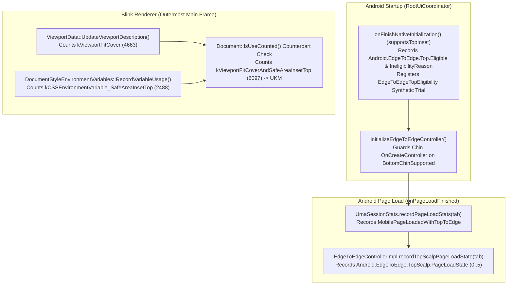

<!--
**Agent Preamble:**
> **CRITICAL:** Before reading this design or writing any code, you MUST read
> the project's AGENTS.md (if it exists).

**Execution Plans:**
*   `plans/2026-11-06-top-e2e-metrics-plan.md`
-->

## 1. Context and Goals

**Problem formulation:** Top Edge-to-Edge in Chrome on Android (`b/498302496`,
`b/505803562`) renders web pages and customized New Tab Pages (NTPs) behind the
OS status bar. However, Chrome lacks the telemetry funnel required by
`b/567231650` and `b/580934118`: startup device eligibility histograms, a
symmetric Finch synthetic trial (`EdgeToEdgeTopEligibility`), page-load Top
Scalp state histograms, a top edge-to-edge page-load user action, and a Blink
`UseCounter` for `viewport-fit=cover` combined with `env(safe-area-inset-top)`.
Additionally, initializing `EdgeToEdgeControllerImpl` on 3-button navigation
phones for Top Edge-to-Edge causes
`RootUiCoordinator.initializeEdgeToEdgeController()` to record
`Eligible2.OnCreateController = false` (`NAVIGATION_MODE`) and register
`EdgeToEdgeChinEligibility:Not Eligible` only in the `EdgeToEdgeTopInset`
Enabled arm.

**Background:** For Bottom Edge-to-Edge (`b/541365521`), Chrome tracks startup
eligibility (`Android.EdgeToEdge.Eligible2*` and `EdgeToEdgeChinEligibility`),
`MobilePageLoadedWithToEdge`, `WebFeature::kViewportFitCover`,
`WebFeature::kCSSEnvironmentVariable_SafeAreaInsetBottom`, and their union
`WebFeature::kViewportFitCoverOrSafeAreaInsetBottom`. Top Edge-to-Edge requires
an analogous funnel tailored to top-inset rules (where 3-button navigation on
phones is eligible) and an intersection `UseCounter` (`AND` condition) to
measure status-bar occlusion risk.

**Goals:**

1. **G1 — Measure Top Safe-Area Adoption
   (`kViewportFitCoverAndSafeAreaInsetTop`, `b/580934118`):** Count outermost
   main-frame documents that use both `viewport-fit=cover` and
   `env(safe-area-inset-top)` in either evaluation order, and emit this feature
   to UKM.
2. **G2 — Measure Startup Top Eligibility and Symmetric Synthetic Trial
   (`b/567231650`):** Record `Android.EdgeToEdge.Top.Eligible` and
   `Android.EdgeToEdge.Top.IneligibilityReason`. Register
   `EdgeToEdgeTopEligibility` symmetrically in
   `RootUiCoordinator.onFinishNativeInitialization()` and prevent 3-button
   navigation top-only startups from skewing bottom-chin `OnCreateController`
   metrics.
3. **G3 — Measure Top Edge-to-Edge Reach (`MobilePageLoadedWithTopToEdge`,
   `b/580934118`):** Record a `not_user_triggered="true"` user action in
   `UmaSessionStats` when a page loads with top edge-to-edge enabled and
   supported for the tab.
4. **G4 — Measure Top Scalp Page-Load States
   (`Android.EdgeToEdge.TopScalp.PageLoadState`, `b/580934118`):** Record an
   enumerated histogram on `TabObserver.onPageLoadFinished` in
   `EdgeToEdgeControllerImpl` covering all six Top Scalp states.

**Non-Goals:**

1. **NG1 — Top Scalp UI or Layout Changes:** This design does not alter
   `EdgeToEdgeTopScalpMediator`, `EdgeToEdgeControllerImpl` inset consumption,
   or Blink `safe-area-inset-top` values.
2. **NG2 — Non-Tabbed Activities:** Custom Tabs
   (`BaseCustomTabRootUiCoordinator`), WebAPKs, and TWAs do not support Top
   Scalp and are excluded from Top Edge-to-Edge eligibility and page-load state
   histograms.

## 2. Proposed Architecture

The telemetry architecture spans one standalone Blink/UKM CL and two stacked
Android CLs:

1. **Renderer Blink `UseCounter` and Browser UKM Allowlist (`Milestone 1`,
   `b/580934118`):**
   [`ViewportData::UpdateViewportDescription`](/third_party/blink/renderer/core/frame/viewport_data.cc)
   and
   [`DocumentStyleEnvironmentVariables::RecordVariableUsage`](/third_party/blink/renderer/core/css/document_style_environment_variables.cc)
   cooperate through the per-document `UseCounterImpl` bitset to record
   `WebFeature::kViewportFitCoverAndSafeAreaInsetTop` (`6097`).
   [`GetAllowedUkmFeatures`](/components/page_load_metrics/browser/observers/use_counter/ukm_features.cc)
   forwards this feature to UKM alongside `WebFeature::kViewportFitCover`.
2. **Android Startup Top Eligibility and Synthetic Trial (`Milestone 2`,
   `b/567231650`):** When `supportsTopInset()` is true in
   [`RootUiCoordinator.onFinishNativeInitialization`](/chrome/android/java/src/org/chromium/chrome/browser/ui/RootUiCoordinator.java),
   Chrome calls `EdgeToEdgeUtils.recordTopEligibilityForEveryStart(mActivity)`
   (evaluating `OS_VERSION`, `FORM_FACTOR`, and `DEVICE_TYPE` without checking
   `sEdgeToEdgeTopInset.isEnabled()`) and registers the
   `EdgeToEdgeTopEligibility` synthetic trial (`Eligible` vs. `Not Eligible`).
   `EdgeToEdgeUtils.isEdgelessTopInsetSupported(activity)` and
   `RootUiCoordinator.onFinishNativeInitialization()` check device/window
   eligibility before calling `isEdgeToEdgeRefactorEnabled()` so ineligible
   tablets and automotive devices do not unnecessarily activate the
   `EdgeToEdgeTopInset` Finch study. In
   `RootUiCoordinator.initializeEdgeToEdgeController()`, Chrome gates
   bottom-chin `recordEligibilityOnCreate` and `EdgeToEdgeChinEligibility` on
   `sEdgeToEdgeMonitorConfigurations` so top-only 3-button navigation startups
   do not pollute bottom-chin metrics.
3. **Android Page-Load Telemetry (`Milestone 3`, `b/580934118`):**
   [`UmaSessionStats.recordPageLoadStats`](/chrome/android/java/src/org/chromium/chrome/browser/metrics/UmaSessionStats.java)
   records `MobilePageLoadedWithTopToEdge` via JNI in
   [`uma_session_stats.cc`](/chrome/browser/android/metrics/uma_session_stats.cc)
   when
   `!tab.isCustomTab() && EdgeToEdgeUtils.isEdgelessTopInsetSupported(activity) && EdgeToEdgeUtils.isTopEdgeToEdgeEnabled() && EdgeToEdgeUtils.tabSupportsTopEdgeToEdge(tab)`
   is true.
   [`EdgeToEdgeControllerImpl`](/chrome/browser/ui/android/edge_to_edge/internal/java/src/org/chromium/chrome/browser/ui/edge_to_edge/EdgeToEdgeControllerImpl.java)
   records `Android.EdgeToEdge.TopScalp.PageLoadState` via
   [`EdgeToEdgeUtils.recordTopScalpPageLoadState`](/chrome/browser/ui/android/edge_to_edge/java/src/org/chromium/chrome/browser/ui/edge_to_edge/EdgeToEdgeUtils.java)
   when `mTabObserver.onPageLoadFinished` runs for the active tab.



### Platforms Affected

- [ ] Windows
- [ ] Mac
- [ ] Linux
- [ ] ChromeOS
- *Android Form Factors:*
  - [x] Android (Smartphones/Tablets — Blink `UseCounter` runs on all platforms,
    while Android startup and page-load telemetry run in `ChromeActivity`)
  - [ ] Chrome Custom Tabs (CCT — excluded from Top Edge-to-Edge eligibility and
    `TopScalp.PageLoadState`)
  - [ ] Android WebView
- [ ] iOS

### Process & Thread Model

1. **Blink Renderer Main Thread:** `ViewportData` and
   `DocumentStyleEnvironmentVariables` run on the renderer main thread and query
   `Document::IsUseCounted` in $O(1)$ bitset lookup time. They add zero new Mojo
   IPCs because `UseCounter` uses existing `PageLoadMetrics` plumbing.
2. **Android Browser UI Thread:** `RootUiCoordinator`, `UmaSessionStats`, and
   `EdgeToEdgeControllerImpl` run on the Android UI thread and perform
   non-blocking in-memory metric recording.

### Data Models & Schemas

1. **`blink::mojom::WebFeature::kViewportFitCoverAndSafeAreaInsetTop`
   (`6097`):** Appended to
   [`web_feature.mojom`](/third_party/blink/public/mojom/use_counter/metrics/web_feature.mojom)
   and mirrored into
   [`tools/metrics/histograms/metadata/blink/enums.xml`](/tools/metrics/histograms/metadata/blink/enums.xml).
2. **Startup Top Eligibility Histograms (`IneligibilityReason`):** Reuses
   `EdgeToEdgeUtils.IneligibilityReason` (`OS_VERSION = 0`, `FORM_FACTOR = 1`,
   `NAVIGATION_MODE = 2`, `DEVICE_TYPE = 3`, where `NAVIGATION_MODE` is never
   emitted for top eligibility because 3-button navigation is supported) for:
   - `Android.EdgeToEdge.Top.Eligible` (`Boolean`)
   - `Android.EdgeToEdge.Top.IneligibilityReason` (`IneligibilityReason`)
3. **`EdgeToEdgeUtils.TopScalpPageLoadState` (`@IntDef` and XML Enum):** Defines
   six mutually exclusive states for
   `Android.EdgeToEdge.TopScalp.PageLoadState`:
   1. `DEFAULT_FIXED_SCALP` (`0`): Standard `viewport-fit=auto` web page or
      default NTP where Top Scalp is visible and fixed (`NEVER_SCROLLABLE`),
      including when `mStatusIndicatorVisible` is true on a non-opted-in page.
   2. `OPTED_IN_SCROLLABLE_SCALP` (`1`): `viewport-fit=cover` web page drawing
      to the top edge with Top Scalp visible and scrollable
      (`DEFAULT_SCROLLABLE`).
   3. `FULL_TOP_EDGE_TO_EDGE_NO_SCALP` (`2`): Native page (such as a customized
      NTP) where `tabShouldDrawFullTopEdgeToEdge()` is true.
   4. `OPTED_IN_SUPPRESSED_BY_STATUS_INDICATOR` (`3`): Opted-in web page or
      customized NTP suppressed from drawing to the top edge because
      `mStatusIndicatorVisible` is true.
   5. `OPTED_IN_SUPPRESSED_BY_UNSUPPORTED_CONFIG` (`4`): Opted-in web page or
      customized NTP suppressed because
      `!EdgeToEdgeUtils.isEdgelessTopInsetSupported(mActivity)` is true (for
      example, on a tablet running `EdgeToEdgeControllerImpl` for the bottom
      chin).
   6. `DISABLED_IN_FULLSCREEN` (`5`): Persistent fullscreen mode is active on
      page load (`mFullscreenManager.getPersistentFullscreenMode()`).

### API Surface & Mojo Interfaces

1. **Mojo Enum Extension:** Adds `kViewportFitCoverAndSafeAreaInsetTop = 6097`
   to `blink::mojom::WebFeature` in
   [`web_feature.mojom`](/third_party/blink/public/mojom/use_counter/metrics/web_feature.mojom).
2. **JNI Boundary:** Adds `void recordPageLoadedWithTopToEdge()` to
   `UmaSessionStats.Natives` and
   `JNI_UmaSessionStats_RecordPageLoadedWithTopToEdge` in
   [`uma_session_stats.cc`](/chrome/browser/android/metrics/uma_session_stats.cc).
3. **EdgeToEdge Public Utility API:** Adds
   `recordTopEligibilityForEveryStart(Activity)`,
   `@IntDef TopScalpPageLoadState`, and
   `recordTopScalpPageLoadState(@TopScalpPageLoadState int state)` in
   [`EdgeToEdgeUtils.java`](/chrome/browser/ui/android/edge_to_edge/java/src/org/chromium/chrome/browser/ui/edge_to_edge/EdgeToEdgeUtils.java).

## 3. Alternatives Considered

1. **Register `EdgeToEdgeTopEligibility` or `.OnCreateController` histograms
   inside `RootUiCoordinator.initializeEdgeToEdgeController()`:** *Rejected.*
   When `sEdgeToEdgeMonitorConfigurations` is enabled,
   `EdgeToEdgeControllerCreator` only invokes `initializeEdgeToEdgeController()`
   on a 3-button navigation phone when `shouldInitializeForTopEdgeToEdge()` is
   true (which checks `isEdgelessTopInsetSupported(activity)`, including
   `sEdgeToEdgeTopInset.isEnabled()`). Unlike Bottom Chin (which needed
   `Eligible2.OnCreateController` because `hasTappableNavigationBar` reads
   asynchronous window insets that are often absent during
   `onFinishNativeInitialization()`), Top Edge-to-Edge eligibility checks only
   static device properties (`!isTablet`, `SDK_INT >= R`, `!isAutomotive`) that
   are 100% known at `onFinishNativeInitialization()`. Recording
   `Top.Eligible.OnCreateController` and
   `Top.IneligibilityReason.OnCreateController` inside
   `initializeEdgeToEdgeController()` would make
   `Top.IneligibilityReason.OnCreateController` unreachable when
   `sEdgeToEdgeMonitorConfigurations` is enabled and skew Control vs. Enabled
   arms. Registering `EdgeToEdgeTopEligibility` and recording
   `Android.EdgeToEdge.Top.Eligible` / `IneligibilityReason` in
   `onFinishNativeInitialization()` without checking
   `sEdgeToEdgeTopInset.isEnabled()` guarantees symmetric enrollment across
   Control and Enabled arms.
2. **Check `seen_variables_` in `StyleEnvironmentVariables` instead of
   `Document::IsUseCounted(WebFeature::kCSSEnvironmentVariable_SafeAreaInsetTop)`:**
   *Rejected.* `StyleEnvironmentVariables::ResolveVariable` inserts into
   `seen_variables_` even when `record_metrics` is `false` inside User-Agent
   (UA) shadow DOM, such as `<video controls>` media controls. Querying
   `Document::IsUseCounted` guarantees that UA shadow DOM styles never trigger
   `kViewportFitCoverAndSafeAreaInsetTop`.
3. **Record `Android.EdgeToEdge.TopScalp.PageLoadState` inside
   `UmaSessionStats.recordPageLoadStats`:** *Rejected.* `UmaSessionStats` lacks
   references to `EdgeToEdgeControllerImpl`, `mStatusIndicatorVisible`, and
   `FullscreenManager`. Recording in
   `EdgeToEdgeControllerImpl.mTabObserver.onPageLoadFinished` reads controller
   state directly without cross-component coupling.
4. **Record `DEFAULT_FIXED_SCALP` on tablets for `viewport-fit=auto` pages:**
   *Rejected.* When `EdgeToEdgeControllerImpl` runs on a tablet for the bottom
   chin, Top Scalp is unsupported. Recording `DEFAULT_FIXED_SCALP` for every
   tablet page load would inflate bucket `0` with ineligible tablet traffic.

## 4. Core Principle Considerations

### Speed & Efficiency

- **Main Thread Impact:** Negligible. Blink performs one bitset check per
  `<meta name="viewport">` update or `env(safe-area-inset-top)` resolution.
  Android records startup eligibility once per activity start and records one
  integer sample plus one user action per page load.
- **Startup & Critical Paths:** Startup eligibility checks only in-memory
  configuration booleans (`SDK_INT`, tablet form factor, automotive) with zero
  IPC or disk I/O.
- **Memory Footprint:** Small (`<= 1 KB`). Adds zero per-tab or per-document
  heap allocations.
- **Binary Size:** Adds one JNI method, three Java helpers, and two small Blink
  branches (`< 2 KB` DEX and native text).
- **Other Resources:** Zero disk I/O and zero new Mojo IPC messages.
- *AI Workloads:* N/A: Standard UMA, UserAction, and UseCounter telemetry.

### Security

- **Threat Model / Rule of Two / Attack Surface:** N/A: Adds no untrusted data
  parsers or new Mojo interfaces. `WebFeature` values validate through the
  existing generated Mojo enum traits.

### Stability & Simplicity

- **Null-Safety Guards:** In
  [`document_style_environment_variables.cc`](/third_party/blink/renderer/core/css/document_style_environment_variables.cc),
  `document_->GetFrame()` can be null in detached documents. The check guards
  `document_->GetFrame() && document_->GetFrame()->IsOutermostMainFrame()`
  before calling `UseCounter::Count`. In `EdgeToEdgeControllerImpl`,
  `recordTopScalpPageLoadState` guards `mFullscreenManager != null`.

## 5. Privacy, Enterprise & A11y

### Privacy

- **UKM Privacy Cap:** Adding `kViewportFitCoverAndSafeAreaInsetTop` to
  [`ukm_features.cc`](/components/page_load_metrics/browser/observers/use_counter/ukm_features.cc)
  complies with the `< 1%` of page loads UKM rule because its superset
  `kViewportFitCover` fires on `~0.09%` of Android page loads.
- **Incognito Mode:** Standard UMA and UKM collection rules apply (UKM does not
  record in Incognito). No traces are written to disk outside standard metrics
  logs.

### Enterprise

- N/A: Adds internal telemetry with no user-facing or enterprise behavior
  changes.

### Accessibility (A11y)

- N/A: Introduces no UI changes.

## 6. Metrics & Rollout Plan

### Success & Regression Metrics

- **New Client Metrics Added by This Design:**
  1. `Blink.UseCounter.Features`: `kViewportFitCoverAndSafeAreaInsetTop`
     (`6097`), also emitted to UKM `Blink.UseCounter`.
  2. `Android.EdgeToEdge.Top.Eligible` (`Boolean`).
  3. `Android.EdgeToEdge.Top.IneligibilityReason` (`IneligibilityReason`).
  4. `EdgeToEdgeTopEligibility` synthetic field trial (`Eligible` vs.
     `Not Eligible`).
  5. `Android.EdgeToEdge.TopScalp.PageLoadState` (`TopScalpPageLoadState`).
  6. `MobilePageLoadedWithTopToEdge` user action (`not_user_triggered="true"`).
- **Server-Side Computed Histograms (`computed_histograms/histograms.xml`):**
  1. `Blink.UseCounter.ViewportFitCover.SafeAreaInsetTopRatio`:
     `100 * "Blink.UseCounter.Features::6097" / "Blink.UseCounter.Features::4663"`.
     Measures the percentage of `viewport-fit=cover` page loads that also use
     `env(safe-area-inset-top)` (with built-in Finch Home p-values and 95% CIs
     across Control and Enabled arms).
  2. `Blink.UseCounter.ViewportFitCover.PageLoadPercentage`:
     `100 * "Blink.UseCounter.Features::4663" / "Blink.UseCounter.Features::0"`.
     Measures the percentage of regular web page visits (`kPageVisits = 0`,
     excluding the New Tab Page and `chrome://` WebUI pages) that use
     `viewport-fit=cover` (with built-in Finch Home p-values and 95% CIs across
     Control and Enabled arms to detect user abandonment of opted-in sites).
  3. `Android.EdgeToEdge.TopScalp.OptedInSuppressionPercentage`:
     `100 * ("Android.EdgeToEdge.TopScalp.PageLoadState::3" + "Android.EdgeToEdge.TopScalp.PageLoadState::4") / ("Android.EdgeToEdge.TopScalp.PageLoadState::1" + "Android.EdgeToEdge.TopScalp.PageLoadState::2" + "Android.EdgeToEdge.TopScalp.PageLoadState::3" + "Android.EdgeToEdge.TopScalp.PageLoadState::4")`.
     Measures the percentage of opted-in foreground page loads suppressed by
     status indicator (`3`) or unsupported window configuration (`4`, when
     `isEdgelessTopInsetSupported` is false on tablets, foldables in tablet
     mode, automotive devices, or `< Android R`) on a clean 0–100% scale
     without `DEFAULT_FIXED_SCALP` (`0`) dominating the denominator.
  4. `Android.EdgeToEdge.TopPageLoadPercentage`:
     `100 * "UserActions.Counts::MobilePageLoadedWithTopToEdge" / "UserActions.Counts::MobilePageLoaded"`.
     Measures headline page-load reach across all tabs for legacy parity with
     Bottom Chin's `MobilePageLoadedWithToEdge` (whereas
     `Android.EdgeToEdge.TopScalp.PageLoadState` is the primary enumerated
     histogram for foreground page-load proportions).

### Rollout, Finch & Launch Evaluation Framework

- `kViewportFitCoverAndSafeAreaInsetTop`, `Android.EdgeToEdge.Top.Eligible`,
  `Android.EdgeToEdge.Top.IneligibilityReason`, and `EdgeToEdgeTopEligibility`
  (a synthetic field trial via `UmaSessionStats.registerSyntheticFieldTrial`
  that tags UMA log uploads with a client-side eligibility cohort label) record
  unconditionally across Control and Enabled arms so Finch experiments have
  symmetric denominators.
- `MobilePageLoadedWithTopToEdge` and
  `Android.EdgeToEdge.TopScalp.PageLoadState` are gated on Top Edge-to-Edge
  feature enablement and device support.
- **Two-Regime Guardrail Dilution Profile**:
  1. **Regime A — Compositor Top Scalp Replacement (`100%` of eligible page
     loads, Zero Dilution)**: When `isTopEdgeToEdgeEnabled()` is true on an
     eligible phone, `shouldConsumeTopInsets()` returns `true` for every page
     (including `Bucket 0: DEFAULT_FIXED_SCALP`), removing root-view
     `topPadding` and activating `EdgeToEdgeTopScalpMediator`
     (`TopControlType.TOP_SCALP`, `ScrollBehavior.NEVER_SCROLLABLE`) in
     `TopControlsStacker`. Because Finch Home (`uma.googleplex.com/p/chrome/finch`)
     compares `Experiment vs. Control` within a single study and cannot
     cross-filter one study by a second synthetic trial, the
     `EdgeToEdgeTopInset.gcl` `Study.Filter` scopes enrollment directly to
     Android R+ phones (`form_factors = [finch.FormFactor.PHONE]`,
     `min_os_version = '11.0.0'`). Since Top Edge-to-Edge supports both gesture
     and 3-button navigation, this `.gcl` filter gives Finch Home's built-in
     Guardrails tab **100% statistical power (zero dilution)** out of the box,
     while `EdgeToEdgeTopEligibility:Eligible` filters **UMA Timeline**
     (`study_group`) and custom SQL queries.
  2. **Regime B — Scrollable Top Scalp & Web Content Under Status Bar (`~0.09%`
     of web page loads + customized NTPs, ~1,000x Dilution in Session UMA)**:
     Only on `Bucket 1: OPTED_IN_SCROLLABLE_SCALP` (`~0.09%` of web loads) does
     `EdgeToEdgeTopScalpMediator` switch to `ScrollBehavior.DEFAULT_SCROLLABLE`
     and push non-zero `env(safe-area-inset-top)` to Blink. Because the UKM web
     dashboard (`go/ukm-dash`) does not split by Finch study arm or join across
     UKM events, evaluate Regime B without 1,000x session dilution by running a
     custom GoogleSQL query (`f1-sql` / Plx) on `processed_chrome_ukm.readable_ukm`
     joining UKM `PageLoad` events (`PageTiming.ForegroundDuration`,
     `InteractiveTiming`, scroll/input metrics) with UKM `Blink.UseCounter`
     restricted to `source_id`s where `kViewportFitCover` (`4663`) or
     `kViewportFitCoverAndSafeAreaInsetTop` (`6097`) is present, and comparing
     Control vs. Enabled directly on opted-in page loads.
- **Operational Nuances Across Metrics**:
  1. **Foreground Active Tab vs. All Tabs**: `UmaSessionStats`
     (`MobilePageLoadedWithTopToEdge`) uses `TabModelSelectorTabObserver`
     (recording for all tabs including background tab loads, matching
     `MobilePageLoaded`, without inspecting `mStatusIndicatorVisible` or
     `FullscreenManager`), whereas `EdgeToEdgeControllerImpl`
     (`Android.EdgeToEdge.TopScalp.PageLoadState`) records only for
     `mCurrentTab` (foreground active tab) with full suppression awareness
     (`Buckets 1 + 2` represent unsuppressed foreground activations).
  2. **Load-Completion Snapshot vs. Document Lifetime**:
     `TabObserver.onPageLoadFinished` is a load-completion snapshot (static
     `<meta name="viewport" content="viewport-fit=cover">` in `<head>` arrives
     prior to `onPageLoadFinished` on the same navigation-associated FIFO Mojo
     pipe, whereas BFCache restores and post-`onload` JS mutations do not
     re-fire `onPageLoadFinished`).

## 7. Testing Plan

1. **Blink Unit Tests (`blink_unittests`):**
   - `HTMLMetaElementTest.ViewportFit_Cover_IsUseCounted` in
     [`html_meta_element_test.cc`](/third_party/blink/renderer/core/html/html_meta_element_test.cc)
     verifies that `viewport-fit=cover` alone does not count
     `kViewportFitCoverAndSafeAreaInsetTop`.
   - `StyleEnvironmentVariablesTest` in
     [`style_environment_variables_test.cc`](/third_party/blink/renderer/core/css/style_environment_variables_test.cc)
     verifies that `env(safe-area-inset-top)` alone does not count the feature,
     and verifies both orderings (`EnvThenMeta` and `MetaThenEnv`).
2. **Android Robolectric JUnit Tests (`chrome_junit_tests`,
   `edge_to_edge/internal:junit`):**
   - `UmaSessionStatsUnitTest` in
     [`UmaSessionStatsUnitTest.java`](/chrome/android/junit/src/org/chromium/chrome/browser/metrics/UmaSessionStatsUnitTest.java)
     verifies `recordPageLoadedWithTopToEdge` invocation (including exclusion on
     tablets and Custom Tabs).
   - `EdgeToEdgeControllerTest` in
     [`EdgeToEdgeControllerTest.java`](/chrome/browser/ui/android/edge_to_edge/internal/junit/src/org/chromium/chrome/browser/ui/edge_to_edge/EdgeToEdgeControllerTest.java)
     verifies `recordTopEligibilityForEveryStart` (phone eligible including
     3-button nav, tablet `FORM_FACTOR`, automotive `DEVICE_TYPE`) and all six
     `TopScalpPageLoadState` buckets.
3. **Android Instrumentation Tests (`chrome_public_test_apk`):**
   - `EdgeToEdgeInstrumentationTest` in
     [`EdgeToEdgeInstrumentationTest.java`](/chrome/android/javatests/src/org/chromium/chrome/browser/app/edge_to_edge/EdgeToEdgeInstrumentationTest.java)
     verifies `Android.EdgeToEdge.Top.Eligible`,
     `Android.EdgeToEdge.TopScalp.PageLoadState`, and
     `MobilePageLoadedWithTopToEdge` under
     `@EnableFeatures(ChromeFeatureList.EDGE_TO_EDGE_TOP_INSET)`.

## 8. Detailed Implementation Breakdown

### 8.1. Milestone 1: Blink Order-Independent Intersection (`b/580934118`)

Both
[`viewport_data.cc`](/third_party/blink/renderer/core/frame/viewport_data.cc)
and
[`document_style_environment_variables.cc`](/third_party/blink/renderer/core/css/document_style_environment_variables.cc)
check `document_->IsUseCounted(...)` for the counterpart feature on the
outermost main frame:

1. In `ViewportData::UpdateViewportDescription()` when `IsOutermostMainFrame()`
   and `current_viewport_fit` is `kCover` or `kCoverForcedByUserAgent`:
   ```cpp
   if (document_->IsUseCounted(
           WebFeature::kCSSEnvironmentVariable_SafeAreaInsetTop)) {
     UseCounter::Count(
         document_, WebFeature::kViewportFitCoverAndSafeAreaInsetTop);
   }
   ```
2. In `DocumentStyleEnvironmentVariables::RecordVariableUsage()` when
   `name == "safe-area-inset-top"`:
   ```cpp
   if (document_->GetFrame() &&
       document_->GetFrame()->IsOutermostMainFrame() &&
       document_->IsUseCounted(WebFeature::kViewportFitCover)) {
     UseCounter::Count(document_,
                       WebFeature::kViewportFitCoverAndSafeAreaInsetTop);
   }
   ```

### 8.2. Milestone 2: Startup Top Eligibility and Synthetic Trial (`b/567231650`)

1. **`EdgeToEdgeUtils` Top Eligibility Helpers:** Add histogram constants
   (`TOP_ELIGIBLE_HISTOGRAM` and `TOP_INELIGIBLE_REASON_HISTOGRAM`) and method
   `recordTopEligibilityForEveryStart(Activity)`:
   - Checks `DeviceFormFactor.isNonMultiDisplayContextOnTablet(activity)` ->
     `IneligibilityReason.FORM_FACTOR`.
   - Checks `Build.VERSION.SDK_INT < VERSION_CODES.R` ->
     `IneligibilityReason.OS_VERSION`.
   - Checks `DeviceInfo.isAutomotive()` -> `IneligibilityReason.DEVICE_TYPE`.
   - Records boolean `TOP_ELIGIBLE_HISTOGRAM` and returns `eligible`. Does
     **not** check `hasTappableNavigationBar` (3-button navigation is eligible)
     or `sEdgeToEdgeTopInset.isEnabled()`.
2. **`RootUiCoordinator` Startup & Controller Creation:**
   - In `onFinishNativeInitialization()` (right after
     `EdgeToEdgeUtils.recordEligibilityForEveryStart(mActivity)`):
     ```java
     if (supportsTopInset()) {
         boolean topEligible = EdgeToEdgeUtils.recordTopEligibilityForEveryStart(mActivity);
         UmaSessionStats.registerSyntheticFieldTrial(
                 "EdgeToEdgeTopEligibility", topEligible ? "Eligible" : "Not Eligible");
     }
     ```
   - In `initializeEdgeToEdgeController()`: Gate bottom-chin
     `recordEligibilityOnCreate(mActivity)` (plus `EdgeToEdgeChinEligibility`)
     on
     `!ChromeFeatureList.sEdgeToEdgeMonitorConfigurations.isEnabled() || EdgeToEdgeUtils.isEdgeToEdgeBottomChinSupportedByDevice(mActivity) || !EdgeToEdgeUtils.isEdgelessTopInsetSupported(mActivity)`
     so top-only 3-button navigation startups do not record bottom-chin
     ineligibility.
   - In `EdgeToEdgeUtils.isEdgelessTopInsetSupported(Activity)` and
     `RootUiCoordinator.onFinishNativeInitialization()`: Check tablet form
     factor, automotive device type, and `NtpCustomizationUtils` eligibility
     before calling `isEdgeToEdgeRefactorEnabled()` so ineligible devices do not
     unnecessarily activate the `EdgeToEdgeTopInset` Finch trial.

### 8.3. Milestone 3: Android Page-Load Telemetry (`b/580934118`)

1. **Gating `MobilePageLoadedWithTopToEdge` on Device Support, Non-CCT, and
   `isTopEdgeToEdgeEnabled()`:** `UmaSessionStats.recordPageLoadStats` checks
   `!tab.isCustomTab() && EdgeToEdgeUtils.isEdgelessTopInsetSupported(activity) && EdgeToEdgeUtils.isTopEdgeToEdgeEnabled() && EdgeToEdgeUtils.tabSupportsTopEdgeToEdge(tab)`.
2. **Shared `isPageOptedIntoTopEdgeToEdge` Helper and Custom Tab Guard:**
   `EdgeToEdgeControllerImpl` extracts
   `isPageOptedIntoTopEdgeToEdge(@Nullable Tab tab)` so
   `shouldDrawTopEdgeToEdge(tab)` and `recordTopScalpPageLoadState(tab)` share
   the exact same opt-in predicate. `recordTopScalpPageLoadState(tab)` returns
   early when `tab.isCustomTab()` is true.

## 9. Future Work & Technical Debt

- **Legacy Bottom Union Cleanup (`crbug.com/1482559`):** Existing TODOs for
  `kViewportFitCoverOrSafeAreaInsetBottom` remain tracked separately.
