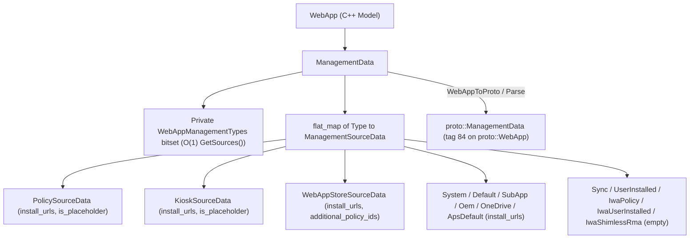

<!--
**Agent Preamble:**
> **CRITICAL:** Before reading this design or writing any code, you MUST read
> the project's AGENTS.md (if it exists).

**Execution Plans:**
*   [2026-11-10-per-source-management-data-plan.md](../plans/2026-11-10-per-source-management-data-plan.md)
-->

# Design: Per-Source Web App Management Data

## 1. Context and Goals

### Problem Formulation

The web app registry currently splits management source state across two
containers in
[/chrome/browser/web_applications/proto/web_app.proto](/chrome/browser/web_applications/proto/web_app.proto)
and
[/chrome/browser/web_applications/web_app.h](/chrome/browser/web_applications/web_app.h).
The `WebApp` class stores active flags in `sources_` alongside a separate
`management_to_external_config_map_` map.

This split creates four concrete defects:

1. **Desynchronized source and configuration state.**
   `WebApp::RemoveInstallUrlForSource()` erases the map entry when
   `install_urls` becomes empty, yet leaves `sources_` unchanged.
   `RemoveInstallSourceJob` manually rebuilds `ExternalConfigMap` even though
   `WebApp::RemoveSource()` already erases the map entry. `ParseWebAppProto()`
   also accepts orphan `management_to_external_config_info` entries for inactive
   sources. It also accepts config entries for `kSync`, `kUserInstalled`, and
   IWA sources that `WebApp` mutators forbid with `CHECK`.
2. **Deserialization crash and silent duplicate overwrites.** In
   [/chrome/browser/web_applications/web_app_database_serialization.cc](/chrome/browser/web_applications/web_app_database_serialization.cc),
   `ProtoToWebAppManagement()` calls `NOTREACHED()` when `management` is unset
   or `WEB_APP_MANAGEMENT_TYPE_UNSPECIFIED`. Repeated
   `ManagementToExternalConfigInfo` entries with the same `management` value
   also overwrite earlier entries silently via `insert_or_assign`.
3. **Over-broad union schema.** Every `ManagementToExternalConfigInfo` message
   exposes `install_urls`, `is_placeholder`, and `additional_policy_ids`. In
   practice, only `kPolicy` and `kKiosk` create placeholder apps.
   `WebAppRegistrar::IsPlaceholderApp` `CHECK`s this rule in
   [/chrome/browser/web_applications/web_app_registrar.cc](/chrome/browser/web_applications/web_app_registrar.cc).
   Only `kWebAppStore` populates `additional_policy_ids` in production inside
   [/chrome/browser/ash/apps/apk_web_app_installer.cc](/chrome/browser/ash/apps/apk_web_app_installer.cc).
   However, `CreateRandomWebApp()` in
   [/chrome/browser/web_applications/test/web_app_test_utils.cc](/chrome/browser/web_applications/test/web_app_test_utils.cc)
   currently generates nonsensical values across eight unrelated sources.
4. **Blocked per-source IWA configuration.** `WebApp` mutators reject IWA
   management types (`kIwaShimlessRma`, `kIwaPolicy`, and `kIwaUserInstalled`).
   Therefore,
   [/chrome/browser/web_applications/isolated_web_apps/update/isolated_web_app_update_manager.cc](/chrome/browser/web_applications/isolated_web_apps/update/isolated_web_app_update_manager.cc)
   cannot store per-source IWA settings next to each source.

### Background

[b/383186222](https://issuetracker.google.com/383186222) proposes replacing
`Sources` and `ManagementToExternalConfigInfo` with per-source messages backed
by `components/proto_extras`
([b/409773874](https://issuetracker.google.com/409773874),
[b/401593568](https://issuetracker.google.com/401593568)). Team design notes
converge on one distinct protobuf message per `WebAppManagement::Type` rather
than one shared union message. That structure keeps schema validation tight. It
also lets future IWA work add update fields to `IwaPolicySourceData` and
`IwaUserInstalledSourceData` cleanly.

IWA `window.open` tab-counter notification state already lives on
`IsolationData` (`opened_tabs_counter_notification_state`). That state remains
on `IsolationData`.

### Goals

- Represent active management sources and per-source configuration inside a
  single `ManagementData` container in C++ and protobuf.
- Give each of the 14 `WebAppManagement::Type` values a distinct protobuf
  message and C++ struct so invalid source-field pairs cannot exist.
- Preserve `O(1)` bitset lookups via `WebApp::GetSources()` while making source
  presence in `ManagementData` the single source of truth.
- Migrate LevelDB records cleanly from database schema version 7 to version 8
  without losing active user or policy data.
- Reject malformed persisted protos gracefully in `ParseWebAppProto()` with UMA
  metrics instead of hitting `NOTREACHED()`.

### Non-Goals

- Moving `WebApp::parent_app_id_` into `SubAppSourceData`, because app identity
  and sub-app validation inspect it at the top level.
- Moving `ClientData::system_web_app_data` into `SystemSourceData` or removing
  `WebAppChromeOsData::oem_installed`
  ([crbug.com/40755721](https://crbug.com/40755721)).
- Adding IWA `update_manifest_url` or `update_channel` fields to
  `IwaPolicySourceData` or `IwaUserInstalledSourceData` in this migration.
- Modifying `sync_pb::WebAppSpecifics` in
  [/components/sync/protocol/web_app_specifics.proto](/components/sync/protocol/web_app_specifics.proto),
  because local management metadata never syncs across devices.

## 2. Proposed Architecture

`WebApp` replaces both `WebAppManagementTypes sources_` and
`ExternalConfigMap management_to_external_config_map_` with one
`ManagementData management_data_` member. We define `ManagementData` in
`chrome/browser/web_applications/model/management_data.h`. In protobuf,
`proto::WebApp` adds `optional ManagementData management_data = 84` from a new
`chrome/browser/web_applications/proto/web_app_management_data.proto` file.

`ManagementData` stores active entries in
`base::flat_map<WebAppManagement::Type, ManagementSourceData>`, where
`ManagementSourceData` is a `std::variant` of 14 distinct typed C++ structs.
`ManagementData` also maintains a private cached
`WebAppManagementTypes active_sources_` bitset. Only `ManagementData` insert and
erase methods update `active_sources_`. Presence of a source key in `entries_`
determines whether that source manages the app and guarantees `active_sources_`
never diverges from config data.



### Field Usage & Caller Resolution

Today, callers access active sources and `ExternalManagementConfig` fields
(`install_urls`, `is_placeholder`, and `additional_policy_ids`) through
homogeneous lookups on `management_to_external_config_map()`. Splitting that
union into 14 distinct types raises a key architectural question for callers
holding a runtime `WebAppManagement::Type`. How do callers read or mutate
per-source fields without repeating 14-way type switches across the codebase?

`ManagementData` resolves this with uniform `WebAppManagement::Type`-keyed
accessors backed by C++20 `std::visit` (`if constexpr` concept checks), plus
`entries()` iteration for cross-source scans:

- **Active source membership (`sources_` / `proto.Sources` vs. map keys):**
  - *Current usage:* Registrar, policy, and UI checks call
    `WebApp::GetSources()` for `O(1)` bitset queries such as `IsSynced()`,
    `IsPolicyInstalledApp()`, and `CanUserUninstallWebApp()`. Meanwhile,
    `WebAppRegistrar::HasExternalAppWithInstallSource()` checks
    `management_to_external_config_map().contains(source)`, and
    `RemoveInstallSourceJob` manually rebuilds the config map after calling
    `RemoveSource()`.
  - *Resolution:* Map presence in `ManagementData::entries_` (and
    `has_<source>()` in protobuf) becomes the single source of truth.
    `ManagementData` caches `active_sources_` so `GetSources()` stays `O(1)`.
    `AddSource(type)` inserts idempotently via `try_emplace`,
    `RemoveSource(type)` erases the bit and struct atomically, and
    `HasExternalAppWithInstallSource()` queries `GetSources().Has(source)`.
- **`install_urls` (retained on the 9 URL-bearing external sources):**
  - *Current usage:* Single-source callers query or mutate URLs for a known
    source in `WebAppRegistrar` (`GetExternallyInstalledApps`,
    `LookUpAppByInstallSourceInstallUrl`), `ExternallyManagedAppManager`,
    `FinalizeInstallOrUpdateJob`, `RemoveInstallUrlJob`, and `RemoveWebAppJob`.
    `RemoveWebAppJob` records uninstalled `kDefault` URLs in
    `UserUninstalledPreinstalledWebAppPrefs` during user uninstalls.
    Cross-source callers scan every source's URLs in
    `WebAppRegistrar::LookUpAppIdByInstallUrl()`, `LooksLikePlaceholder()` in
    [/chrome/browser/web_applications/web_app_helpers.cc](/chrome/browser/web_applications/web_app_helpers.cc),
    and `DedupeInstallUrlsCommand`.
    `WebAppRegistrar::AppsExistWithExternalConfigData()` and
    `UserUninstalledPreinstalledWebAppPrefs::AppIdContainsAllUrls()` have zero
    production callers.
  - *Resolution:* `ManagementData::GetInstallUrls(type)` visits the variant and
    returns a `const base::flat_set<GURL>&`, returning a static empty set for
    inactive or URL-less sources. `HasInstallUrl(url)` handles cross-source URL
    lookups in one call. `AddInstallUrl(type, url)` `CHECK`s URL validity and
    source support, auto-activating `type` when absent.
    `RemoveInstallUrl(type, url)` erases only the URL and keeps source
    membership intact until `RemoveInstallSourceJob` runs. Cross-source loops in
    `DedupeInstallUrlsCommand` and `LooksLikePlaceholder()` visit `entries()`
    with `if constexpr (requires { data.install_urls; })`, and we delete both
    dead helpers.
- **`is_placeholder` (restricted to `PolicySourceData` and `KioskSourceData`):**
  - *Current usage:* Force-installed policy (`kPolicy`) and ChromeOS Kiosk
    (`kKiosk`) installs create placeholder apps when an install URL redirects
    (such as behind a login portal). `WebAppRegistrar::IsPlaceholderApp()` and
    `LookupPlaceholderAppId()` read this flag per source (already `CHECK`ing
    `kPolicy` or `kKiosk`), and `LooksLikePlaceholder()` scans all sources.
    Previously, `FinalizeInstallOrUpdateJob` wrote `is_placeholder` onto every
    external source's map entry.
  - *Resolution:* Now only `PolicySourceData` and `KioskSourceData` store
    `is_placeholder`. `ManagementData::IsPlaceholder(type)` accepts any
    `WebAppManagement::Type`, returning the stored flag for active `kPolicy` or
    `kKiosk` entries and `false` otherwise. `SetIsPlaceholder(type, value)`
    `CHECK`s `kPolicy` or `kKiosk`.
    `FinalizeInstallOrUpdateJob::WriteManagementData()` and
    `WebApp::AddExternalSourceInformation()` `CHECK(!is_placeholder)` for other
    sources and call `SetIsPlaceholder()` only for `kPolicy` or `kKiosk`.
- **`additional_policy_ids` (restricted to `WebAppStoreSourceData`):**
  - *Current usage:* Only `ApkWebAppInstaller` in
    [/chrome/browser/ash/apps/apk_web_app_installer.cc](/chrome/browser/ash/apps/apk_web_app_installer.cc)
    populates `additional_policy_ids` in production, storing ARC Play Store
    package policy IDs on `kWebAppStore` for
    `WebAppPolicyManager::GetPolicyIds()`. Previously,
    `WebAppPolicyManager::GetPolicyIds()` and `DedupeInstallUrlsCommand` looped
    over all map entries to read or copy these IDs.
  - *Resolution:* Now only `WebAppStoreSourceData` stores
    `additional_policy_ids`. `ManagementData::GetAllAdditionalPolicyIds()` reads
    the `kWebAppStore` entry directly (returning `{}` when absent) for
    `WebAppPolicyManager`. `AddAdditionalPolicyId(type, id)` `CHECK`s
    `kWebAppStore` and `!id.empty()`. `WriteManagementData()` `CHECK`s that
    other sources pass no policy IDs, and `DedupeInstallUrlsCommand` copies them
    via `std::get_if<WebAppStoreSourceData>(&source_data)`.
- **Empty-struct sources (`Sync`, `UserInstalled`, `IwaPolicy`,
  `IwaUserInstalled`, `IwaShimlessRma`):**
  - *Current usage & resolution:* Legacy `WebApp` mutators `CHECK`-forbade
    `ExternalConfigMap` entries for these five sources because they use none of
    the three legacy fields. Empty structs let `ManagementData` track every
    source uniformly in `entries_` and `proto::ManagementData`. They also give
    follow-up IWA CLs dedicated structs (`IwaPolicySourceData`,
    `IwaUserInstalledSourceData`) for per-source update settings.

### Platforms Affected

- [x] Windows
- [x] Mac
- [x] Linux
- [x] ChromeOS
- *Android Form Factors:*
  - [ ] Android (Smartphones/Tablets)
  - [ ] Chrome Custom Tabs (CCT)
  - [ ] Android WebView
- [ ] iOS

### Process & Thread Model

- All `ManagementData`, `WebApp`, registrar, and command mutations run
  exclusively in the browser process on the UI thread under
  `WebAppCommandManager` locks.
- This refactor adds zero Mojo IPCs or renderer interactions.
- LevelDB read and write batches continue executing asynchronously on
  `syncer::DataTypeStore`'s existing background sequence.

### Data Models & Schemas

The new `chrome/browser/web_applications/proto/web_app_management_data.proto`
file (`syntax = "proto2"`, `LITE_RUNTIME`, `package web_app.proto`) compiles via
both `proto_library("proto")` and `proto_extras("proto_extras")` in
[/chrome/browser/web_applications/proto/BUILD.gn](/chrome/browser/web_applications/proto/BUILD.gn):

```protobuf
message SystemSourceData {
  repeated string install_urls = 1;
}

message PolicySourceData {
  repeated string install_urls = 1;
  optional bool is_placeholder = 2;
}

message WebAppStoreSourceData {
  repeated string install_urls = 1;
  repeated string additional_policy_ids = 2;
}

message SyncSourceData {}

message DefaultSourceData {
  repeated string install_urls = 1;
}

message SubAppSourceData {
  repeated string install_urls = 1;
}

message KioskSourceData {
  repeated string install_urls = 1;
  optional bool is_placeholder = 2;
}

message OemSourceData {
  repeated string install_urls = 1;
}

message OneDriveIntegrationSourceData {
  repeated string install_urls = 1;
}

message ApsDefaultSourceData {
  repeated string install_urls = 1;
}

message IwaShimlessRmaSourceData {}
message IwaPolicySourceData {}
message IwaUserInstalledSourceData {}
message UserInstalledSourceData {}

// Field numbers mirror deprecated `proto.Sources` (1..15, reserved 8).
message ManagementData {
  optional SystemSourceData system = 1;
  optional PolicySourceData policy = 2;
  optional WebAppStoreSourceData web_app_store = 3;
  optional SyncSourceData sync = 4;
  optional DefaultSourceData default_source = 5;
  optional SubAppSourceData sub_app = 6;
  optional KioskSourceData kiosk = 7;
  reserved 8;
  optional OemSourceData oem = 9;
  optional OneDriveIntegrationSourceData one_drive_integration = 10;
  optional ApsDefaultSourceData aps_default = 11;
  optional IwaShimlessRmaSourceData iwa_shimless_rma = 12;
  optional IwaPolicySourceData iwa_policy = 13;
  optional IwaUserInstalledSourceData iwa_user_installed = 14;
  optional UserInstalledSourceData user_installed = 15;
}
```

Key schema rules:

- Submessage field `5` uses `default_source` instead of `default` to avoid
  collision with the C++ `default` keyword in `protoc` output.
- Field presence (`has_<source>()`) on `proto::ManagementData` encodes source
  membership and eliminates `Sources`.
- [/chrome/browser/web_applications/proto/web_app.proto](/chrome/browser/web_applications/proto/web_app.proto)
  imports `web_app_management_data.proto` and adds
  `optional ManagementData management_data = 84` inside
  `LINT.IfChange(MemberVariables)`. It marks `sources = 7` and
  `management_to_external_config_info = 52` `[deprecated = true]`.

### API Surface & Mojo Interfaces

This change modifies only C++ APIs inside
[/chrome/browser/web_applications/](/chrome/browser/web_applications/) and test
callers such as
[/chrome/browser/ui/views/web_apps/web_app_integration_test_driver.cc](/chrome/browser/ui/views/web_apps/web_app_integration_test_driver.cc).
It introduces zero `.mojom` interface changes.

## 3. Alternatives Considered

### Alternative 1: Single Shared Union `SourceData` Protobuf Message

One option replaces `repeated ManagementToExternalConfigInfo` with a map or
keyed field using one shared message containing `install_urls`,
`is_placeholder`, and `additional_policy_ids`.

- **Trade-offs:** This avoids creating 14 message types, yet still allows
  invalid combinations such as `is_placeholder` on `kSync` or
  `additional_policy_ids` on `kDefault`.
- **Decision:** We reject this option because runtime `CHECK`s cannot prevent
  schema drift as reliably as distinct per-source messages. Separate messages
  also give IWA sources clean extension points.

### Alternative 2: Store `proto::ManagementData` Directly Inside `WebApp`

A second option removes C++ wrapper structs and stores generated
`proto::ManagementData` directly on `WebApp`.

- **Trade-offs:** Storing raw protos holds unvalidated `std::string` URLs
  instead of `GURL` sets and allocates extra heap submessages. It also forces
  repeated `GURL` parsing on synchronous `WebAppRegistrar` lookups. Worse, every
  includer of
  [/chrome/browser/web_applications/web_app.h](/chrome/browser/web_applications/web_app.h)
  would pull heavy protobuf headers.
- **Decision:** We reject this option because existing `model/` types
  (`PendingMigrationInfo`, `AppInstalledBy`) isolate protobuf headers and
  validate `GURL`s on construction. We still generate `proto_extras` `ToValue`
  and `operator==` for `proto::ManagementData` to support database error logging
  (`proto::ToValue(app_proto)`) and proto tests.

### Alternative 3: 14 Inline `std::optional<XxxSourceData>` Members in C++ `ManagementData`

A third option stores 14 separate `std::optional<...>` fields inline on
`ManagementData` instead of
`base::flat_map<WebAppManagement::Type, ManagementSourceData>`.

- **Trade-offs:** Direct struct members avoid map lookups, but add 14 inline
  `std::optional` objects (~500 to 800 bytes) to every `WebApp`. Most installed
  apps only have one or two sources.
- **Decision:** We reject inline optionals and choose
  `base::flat_map<WebAppManagement::Type, ManagementSourceData>` paired with the
  16-bit `active_sources_` cache.

## 4. Core Principle Considerations

### Speed & Efficiency

- **Main Thread Impact:** Minimal. `ManagementData::GetSources()` returns the
  cached `WebAppManagementTypes` bitset by value in `O(1)` time, and
  `base::flat_map` stays tiny (typically 1 or 2 entries).
- **Startup & Critical Paths:** Startup runs a one-time LevelDB batch migration
  from v7 to v8, plus deserialization of `proto::ManagementData`. Steady-state
  execution avoids rebuilding duplicate `ExternalConfigMap` data in
  `RemoveInstallSourceJob`.
- **Memory Footprint:** Small improvement. Removing the 14 separate
  `additional_policy_ids` sets from non-`kWebAppStore` entries reduces per-app
  heap metadata slightly compared to `ExternalManagementConfig`.
- **Binary Size:** Small increase (~10 to 20 KB) from generated protobuf
  reflection-free lite classes and `proto_extras` helpers.
- **Other Resources:** One-time LevelDB rewrite of migrated app records during
  v7-to-v8 upgrade.
- **AI Workloads:** N/A (no machine learning or on-device inference runs here).

### Security

- **Threat Model:** `ManagementData` persists local installation origins and
  enterprise policy identifiers in Chrome's profile LevelDB.
- **Rule of Two:** Local profile storage obeys the browser trust model without
  parsing untrusted network bytes. Even so, `ManagementData::Parse()` strictly
  rejects empty or invalid `install_urls` and empty `additional_policy_ids`
  instead of crashing via `NOTREACHED()`.
- **Attack Surface:** Zero new IPC endpoints or external inputs.

### Stability & Simplicity

- Replaces split-brain bugs between `sources_` and
  `management_to_external_config_map_` with one invariant-enforcing
  `ManagementData` class.
- Eliminates the `NOTREACHED()` crash in `ProtoToWebAppManagement()` on
  corrupted records with unset or unknown `management` enums.
- Retires `features::kWebAppUpgradeToDatabaseVersion6` and removes
  `declined_to_upgrade` from
  [/chrome/browser/web_applications/web_app_database.cc](/chrome/browser/web_applications/web_app_database.cc)
  so `MigrateDatabase()` checks
  `state.metadata.version() != GetCurrentDatabaseVersion()` uniformly.
- Deletes dead `WebAppRegistrar::AppsExistWithExternalConfigData()` and dead
  `UserUninstalledPreinstalledWebAppPrefs::AppIdContainsAllUrls()`.

## 5. Privacy, Enterprise & A11y

### Privacy

N/A: This refactor reorganizes existing local web app installation metadata in
the profile database with no new data collection, identifiers, or Incognito
persistence.

### Enterprise

All existing enterprise behaviors remain intact:

- `WebAppInstallForceList` (`kPolicy`) and ChromeOS Kiosk (`kKiosk`) retain
  `install_urls` and `is_placeholder`.
- `WebAppSettings`, policy pinning, and ARC APK web app `additional_policy_ids`
  (`kWebAppStore`) continue working through
  `WebAppPolicyManager::GetPolicyIds()` without policy schema changes.

### Accessibility (A11y)

N/A: This internal model and storage migration makes zero UI or
accessibility-tree changes.

## 6. Metrics & Rollout Plan

### Success & Regression Metrics

- `WebApp.Database.VersionUpgradedTo`: Emits bucket `8` when profiles upgrade
  from v7 to v8.
- `WebApp.Database.OpenResult`: Monitors `kSuccess`, `kOpenError`, `kReadError`,
  and `kDowngradeDetected` across the v8 rollout.
- `WebAppProto.Parse.Result` (`WebAppProtoParseResult` in
  [/tools/metrics/histograms/metadata/webapps/enums.xml](/tools/metrics/histograms/metadata/webapps/enums.xml)):
  Marks integers `12` (`kObsolete_NoSources`) and `13`
  (`kObsolete_NoSourcesAndNotUninstalling`) obsolete. Appends
  `kNoManagementData = 74`, `kNoSourcesInManagementDataAndNotUninstalling = 75`,
  and `kDeprecatedSourcesOrExternalConfigPresent = 76`. Keeps `enums.xml` synced
  via `LINT.IfChange(ProtoParseResult)`. Existing buckets
  `kInvalidInstallUrl = 43` and `kEmptyPolicyId = 44` remain active.
- `WebApp.Migrations.SourcesAndExternalConfigToManagementData`: Add a
  `Counts1000` histogram (`units="apps"`, `expires_after="2027-11-10"`) in
  [/tools/metrics/histograms/metadata/webapps/histograms.xml](/tools/metrics/histograms/metadata/webapps/histograms.xml)
  owned by `dmurph@chromium.org` and `pwa-team@google.com` to count apps
  upgraded from v7 to v8.

### Rollout & Finch

We do NOT gate the v7-to-v8 migration behind a new Finch flag
(`kWebAppUpgradeToDatabaseVersion8`). This matches earlier `v0` through `v6`
database migrations:

1. **Prerequisite `v6` flag retirement:** `kWebAppUpgradeToDatabaseVersion6` in
   [/chrome/common/chrome_features.h](/chrome/common/chrome_features.h) and
   [/chrome/common/chrome_features.cc](/chrome/common/chrome_features.cc) has
   already enabled v7 by default since January 2026. We retire that flag first
   in a prerequisite CL to make v7 unconditional and remove
   `declined_to_upgrade`, eliminating v6/v8 version skew.
2. **Why Finch cannot reverse a database schema refactor:** Replacing `sources_`
   and `management_to_external_config_map_` with `ManagementData` is a
   compile-time C++ model change. Furthermore,
   `WebAppDatabase::MigrateDatabase()` returns
   `MigrationResult::kDowngradeDetected` whenever
   `state.metadata.version() != GetCurrentDatabaseVersion()`. Turning off a
   database version flag after upgrading triggers
   `RemoveWebAppJob::RemoveForCorruptDatabase()` and wipes user apps, icons, and
   OS integration. Conversely, dual-writing deprecated fields leaves dead bytes
   requiring a future cleanup migration.
3. **Unconditional `v7 -> v8` mechanics:**
   `WebAppDatabase::GetCurrentDatabaseVersion()` returns `8` unconditionally.
   During startup migration, `MigrateSourcesAndExternalConfigToManagementData()`
   converts every record's `sources` and `management_to_external_config_info`
   into `management_data` and clears the deprecated fields. `WebAppToProto()`
   writes only `management_data`. `ParseWebAppProto()` rejects records carrying
   `proto.has_sources()` or non-empty `management_to_external_config_info`
   (`kDeprecatedSourcesOrExternalConfigPresent = 76`) before checking
   `!proto.has_management_data()` (`kNoManagementData = 74`).
4. **Rollout safety:** Safety relies on the prerequisite v6 cleanup, exhaustive
   unit and chained v0-to-v8 tests, and lenient v7-to-v8 migration that logs
   stripped anomalies to `log_`. We then monitor Canary, Dev, Beta, and Stable
   via the metrics above while relying on standard `kDowngradeDetected` recovery
   if a user manually downgrades Chrome.

## 7. Testing Plan

Run all affected C++ tests with `tools/autotest.py -C out/Debug --run-all` after
building `unit_tests` and `browser_tests` via `autoninja`.

- **Unit tests (new and updated):**
  - Create `chrome/browser/web_applications/model/management_data_unittest.cc`
    covering all 14 source types, `GetSources()` parity, `AddInstallUrl`, and
    `RemoveInstallUrl`. Also test `IsPlaceholder`, `additional_policy_ids`
    validation, `AsDebugValue()`, and proto round-trip failure modes.
  - Update
    [/chrome/browser/web_applications/web_app_database_serialization_unittest.cc](/chrome/browser/web_applications/web_app_database_serialization_unittest.cc)
    and
    [/chrome/browser/web_applications/web_app_sync_bridge_unittest.cc](/chrome/browser/web_applications/web_app_sync_bridge_unittest.cc)
    so `CreateWebAppProtoForTesting()` populates `mutable_management_data()`.
    Add serialization tests for v8 `management_data`, zero-source
    `is_uninstalling` apps, and buckets `74`, `75`, and `76`. Migrate
    `ParseWebAppProto_InvalidExternalManagementConfig` to test invalid
    `install_urls` and empty `additional_policy_ids` on `WebAppStoreSourceData`.
  - Update
    [/chrome/browser/web_applications/web_app_database_migration_unittest.cc](/chrome/browser/web_applications/web_app_database_migration_unittest.cc)
    for v7-to-v8 migration across all 14 sources, active-vs-orphan config
    handling, zero-source `is_uninstalling` apps, `log_` diagnostics, and
    idempotency. Verify stripping disallowed `is_placeholder` or
    `additional_policy_ids`, unknown/unset `management` enums without
    `NOTREACHED()`, and `VerifyDatabaseRegistryEqualToRegistrar()`. Keep
    existing `v0`-to-`v6` migration fixtures populating deprecated `sources` via
    a local pre-v8 helper so chained upgrades reach v8, while v8 idempotency
    tests construct `mutable_management_data()`.
  - Update
    [/chrome/browser/web_applications/web_app_unittest.cc](/chrome/browser/web_applications/web_app_unittest.cc),
    [/chrome/test/data/web_apps/empty_web_app.json](/chrome/test/data/web_apps/empty_web_app.json),
    and
    [/chrome/test/data/web_apps/sample_web_app.json](/chrome/test/data/web_apps/sample_web_app.json)
    for the new `"management_data"` debug format. Update
    [/chrome/browser/web_applications/test/web_app_test_utils.cc](/chrome/browser/web_applications/test/web_app_test_utils.cc),
    [/chrome/browser/web_applications/commands/dedupe_install_urls_command_unittest.cc](/chrome/browser/web_applications/commands/dedupe_install_urls_command_unittest.cc),
    and
    [/chrome/browser/web_applications/policy/web_app_policy_manager_unittest.cc](/chrome/browser/web_applications/policy/web_app_policy_manager_unittest.cc).
    In
    [/chrome/browser/web_applications/externally_managed_app_manager_unittest.cc](/chrome/browser/web_applications/externally_managed_app_manager_unittest.cc),
    replace `management_to_external_config_map().empty()` in
    `InstallWebAppAndThenExternalPolicy` with an external-source check rather
    than `entries().empty()` because `kSync` resides in `entries()`. In
    [/chrome/browser/web_applications/jobs/finalize_install_or_update_job_unittest.cc](/chrome/browser/web_applications/jobs/finalize_install_or_update_job_unittest.cc),
    update the `kPolicy` `install_urls` assertion and add new test coverage for
    `WriteManagementData()` `CHECK`s.
- **Browser tests and integration helpers:**
  - Update
    [/chrome/browser/ui/views/web_apps/web_app_integration_test_driver.cc](/chrome/browser/ui/views/web_apps/web_app_integration_test_driver.cc),
    [/chrome/browser/web_applications/policy/web_app_policy_manager_browsertest.cc](/chrome/browser/web_applications/policy/web_app_policy_manager_browsertest.cc),
    and user-app external-source assertions in
    [/chrome/browser/web_applications/externally_managed_app_manager_browsertest.cc](/chrome/browser/web_applications/externally_managed_app_manager_browsertest.cc).
    Delete `VerifyAppIdContainsAllUrls` from
    [/chrome/browser/web_applications/user_uninstalled_preinstalled_web_app_prefs_browsertest.cc](/chrome/browser/web_applications/user_uninstalled_preinstalled_web_app_prefs_browsertest.cc).
  - Verify ChromeOS-only policy, ARC, and SWA callers via UTR or ChromeOS
    trybots.

## 8. Detailed Implementation Breakdown

### Proto Schema & Build Rules

Create `chrome/browser/web_applications/proto/web_app_management_data.proto` and
register it in `proto_library("proto")` and `proto_extras("proto_extras")`
inside
[/chrome/browser/web_applications/proto/BUILD.gn](/chrome/browser/web_applications/proto/BUILD.gn).
Add
`import "chrome/browser/web_applications/proto/web_app_management_data.proto"`
inside
[/chrome/browser/web_applications/proto/web_app.proto](/chrome/browser/web_applications/proto/web_app.proto).
Update `LINT.IfChange(MemberVariables)` in `web_app.proto` to add
`optional ManagementData management_data = 84` and mark `sources = 7` and
`management_to_external_config_info = 52` `[deprecated = true]`.

### C++ `ManagementData` Model

Add `chrome/browser/web_applications/model/management_data.h` and
`management_data.cc` in
[/chrome/browser/web_applications/BUILD.gn](/chrome/browser/web_applications/BUILD.gn).
Forward-declare `proto::ManagementData` in the header to avoid exposing protobuf
headers:

```cpp
namespace web_app {

struct SystemSourceData {
  base::flat_set<GURL> install_urls;
  bool operator==(const SystemSourceData&) const = default;
};
struct PolicySourceData {
  base::flat_set<GURL> install_urls;
  bool is_placeholder = false;
  bool operator==(const PolicySourceData&) const = default;
};
struct WebAppStoreSourceData {
  base::flat_set<GURL> install_urls;
  base::flat_set<std::string> additional_policy_ids;
  bool operator==(const WebAppStoreSourceData&) const = default;
};
struct SyncSourceData {
  bool operator==(const SyncSourceData&) const = default;
};
struct DefaultSourceData {
  base::flat_set<GURL> install_urls;
  bool operator==(const DefaultSourceData&) const = default;
};
struct SubAppSourceData {
  base::flat_set<GURL> install_urls;
  bool operator==(const SubAppSourceData&) const = default;
};
struct KioskSourceData {
  base::flat_set<GURL> install_urls;
  bool is_placeholder = false;
  bool operator==(const KioskSourceData&) const = default;
};
struct OemSourceData {
  base::flat_set<GURL> install_urls;
  bool operator==(const OemSourceData&) const = default;
};
struct OneDriveIntegrationSourceData {
  base::flat_set<GURL> install_urls;
  bool operator==(const OneDriveIntegrationSourceData&) const = default;
};
struct ApsDefaultSourceData {
  base::flat_set<GURL> install_urls;
  bool operator==(const ApsDefaultSourceData&) const = default;
};
struct IwaShimlessRmaSourceData {
  bool operator==(const IwaShimlessRmaSourceData&) const = default;
};
struct IwaPolicySourceData {
  bool operator==(const IwaPolicySourceData&) const = default;
};
struct IwaUserInstalledSourceData {
  bool operator==(const IwaUserInstalledSourceData&) const = default;
};
struct UserInstalledSourceData {
  bool operator==(const UserInstalledSourceData&) const = default;
};

using ManagementSourceData = std::variant<
    SystemSourceData, PolicySourceData, WebAppStoreSourceData, SyncSourceData,
    DefaultSourceData, SubAppSourceData, KioskSourceData, OemSourceData,
    OneDriveIntegrationSourceData, ApsDefaultSourceData,
    IwaShimlessRmaSourceData, IwaPolicySourceData,
    IwaUserInstalledSourceData, UserInstalledSourceData>;

class ManagementData {
 public:
  enum class ParseError {
    kInvalidInstallUrl,
    kEmptyPolicyId,
  };

  ManagementData();
  ~ManagementData();
  ManagementData(const ManagementData&);
  ManagementData(ManagementData&&);
  ManagementData& operator=(const ManagementData&);
  ManagementData& operator=(ManagementData&&);
  friend bool operator==(const ManagementData&,
                         const ManagementData&) = default;

  // Key/source membership queries:
  bool HasSource(WebAppManagement::Type type) const;
  bool HasAnySources() const;
  WebAppManagementTypes GetSources() const { return active_sources_; }
  const base::flat_map<WebAppManagement::Type, ManagementSourceData>& entries()
      const {
    return entries_;
  }

  // Idempotent insertion via try_emplace (preserves existing per-source fields):
  void AddSource(WebAppManagement::Type type);
  void RemoveSource(WebAppManagement::Type type);

  // Per-source typed and helper accessors:
  bool IsPlaceholder(WebAppManagement::Type type) const;
  void SetIsPlaceholder(WebAppManagement::Type type, bool is_placeholder);
  const base::flat_set<GURL>& GetInstallUrls(WebAppManagement::Type type) const;
  bool HasInstallUrl(const GURL& install_url) const;
  void AddInstallUrl(WebAppManagement::Type type, GURL install_url);
  bool RemoveInstallUrl(WebAppManagement::Type type, const GURL& install_url);
  void AddAdditionalPolicyId(WebAppManagement::Type type, std::string policy_id);
  base::flat_set<std::string> GetAllAdditionalPolicyIds() const;

  static base::expected<ManagementData, ParseError> Parse(
      const proto::ManagementData& proto);
  proto::ManagementData ToProto() const;
  base::DictValue AsDebugValue() const;

 private:
  base::flat_map<WebAppManagement::Type, ManagementSourceData> entries_;
  WebAppManagementTypes active_sources_;
};

std::ostream& operator<<(std::ostream& out, const ManagementData& data);

}  // namespace web_app
```

Key `ManagementData` semantics and invariants:

- **Variant invariant:** `entries_` maps each key `WebAppManagement::Type`
  strictly to its matching `ManagementSourceData` variant alternative.
  Constructors and mutators maintain `active_sources_` as the exact bitmask of
  keys in `entries_`.
- **`SetIsPlaceholder()` & `IsPlaceholder()`:** `SetIsPlaceholder()` `CHECK`s
  `type` is `kPolicy` or `kKiosk` and auto-creates the entry via `try_emplace`
  if missing. `IsPlaceholder()` returns `false` when `type` is absent or
  supports no placeholder flag.
- **`GetInstallUrls()`, `HasInstallUrl()`, & `RemoveInstallUrl()`:**
  `GetInstallUrls()` returns a static `base::NoDestructor<base::flat_set<GURL>>`
  empty set both when `type` is absent and on empty-struct sources (`kSync`,
  `kUserInstalled`, IWA types). `HasInstallUrl()` visits `entries_` via
  `absl::Overload` so lookups skip inactive sources.
  `RemoveInstallUrl(type, url)` returns `false` when `type` is absent or maps to
  an empty-struct source.
- **`AddInstallUrl()` & `AddAdditionalPolicyId()`:** Both methods auto-create
  missing entries for `type`. `AddInstallUrl()` `CHECK`s
  `install_url.is_valid()` and that `type` supports `install_urls`.
  `AddAdditionalPolicyId()` `CHECK`s `kWebAppStore` and `!policy_id.empty()`.
- **`ToProto()` empty-submessage presence:** `ToProto()` unconditionally calls
  `proto.mutable_<source>()` for every active entry in `entries_`, including
  empty structs like `UserInstalledSourceData` or `SyncSourceData`. This
  preserves field presence for `RandomWebApps` byte-exact proto round-trip
  tests.
- **`AsDebugValue()` JSON schema:** `ManagementData::AsDebugValue()` returns a
  `base::DictValue` keyed by `base::ToString(type)`. Empty sources (`Sync`,
  `UserInstalled`, IWA types) serialize as `{}`. URL-only sources serialize as
  `{"install_urls": [...]}`. `Policy` and `Kiosk` serialize as
  `{"install_urls": [...], "is_placeholder": bool}`. `WebAppStore` serializes as
  `{"additional_policy_ids": [...], "install_urls": [...]}`.

### `WebApp`, Serialization, & Caller Updates

- **`WebApp` model
  ([/chrome/browser/web_applications/web_app.h](/chrome/browser/web_applications/web_app.h)
  &
  [/chrome/browser/web_applications/web_app.cc](/chrome/browser/web_applications/web_app.cc)):**
  Replace `sources_` and `management_to_external_config_map_` (plus
  `ExternalManagementConfig`, `ExternalConfigMap`, and `operator<<` for configs)
  with `ManagementData management_data_`. Expose
  `const ManagementData& management_data() const` and
  `SetManagementData(ManagementData)`, replacing
  `SetWebAppManagementExternalConfigMap()`. Replace the old config mutators with
  `SetIsPlaceholder()`, `AddInstallUrl()`, `RemoveInstallUrl()`,
  `AddAdditionalPolicyId()`, and `AddExternalSourceInformation()`, plus
  `AddSource()`, `RemoveSource()`, `GetSources()`, `HasAnySources()`, and
  `IsSynced()`. `AddExternalSourceInformation()` calls `AddInstallUrl()`, calls
  `SetIsPlaceholder()` for `kPolicy` or `kKiosk`, and enforces
  `CHECK(!is_placeholder)` otherwise. Retain
  `CHECK_NE(proto::SUGGESTED_FROM_MIGRATION, install_state_)` in
  `WebApp::AddSource()` for `kSync` before calling
  `management_data_.AddSource()`. Update `operator==`,
  `GetHighestPrioritySource()`, and debug `"management_data"` output, and remove
  stale `web_app.h` comments about `sources_` count or skipping
  `is_uninstalling_` persistence.
- **Database serialization
  ([/chrome/browser/web_applications/web_app_database_serialization.h](/chrome/browser/web_applications/web_app_database_serialization.h)
  &
  [/chrome/browser/web_applications/web_app_database_serialization.cc](/chrome/browser/web_applications/web_app_database_serialization.cc)):**
  `ParseWebAppProto()` rejects `proto.has_sources()` or non-empty
  `management_to_external_config_info`
  (`kDeprecatedSourcesOrExternalConfigPresent = 76`) before requiring
  `proto.has_management_data()` (`kNoManagementData = 74`). It maps
  `ManagementData::ParseError` to `kInvalidInstallUrl = 43` and
  `kEmptyPolicyId = 44`. Delete `WebAppManagementToProto()`, and move
  `ProtoToWebAppManagement()` to an anonymous helper in
  [/chrome/browser/web_applications/web_app_database.cc](/chrome/browser/web_applications/web_app_database.cc)
  for v7-to-v8 migration only. That helper returns
  `std::optional<WebAppManagement::Type>` using a `default` arm that returns
  `std::nullopt` (zero `NOTREACHED()`).
- **Registrar & callers:** Update `IsPlaceholderApp`, `LookupPlaceholderAppId`,
  `GetExternallyInstalledApps`, `LookUpAppIdByInstallUrl`, and
  `LookUpAppByInstallSourceInstallUrl` in
  [/chrome/browser/web_applications/web_app_registrar.cc](/chrome/browser/web_applications/web_app_registrar.cc)
  to query `management_data()` (`entries()`, `GetInstallUrls()`,
  `IsPlaceholder()`, `HasInstallUrl()`). Delete dead
  `AppsExistWithExternalConfigData()` from
  [/chrome/browser/web_applications/web_app_registrar.h](/chrome/browser/web_applications/web_app_registrar.h)
  and `web_app_registrar.cc`. Update
  [/chrome/browser/web_applications/jobs/finalize_install_or_update_job.cc](/chrome/browser/web_applications/jobs/finalize_install_or_update_job.cc),
  [/chrome/browser/web_applications/commands/dedupe_install_urls_command.cc](/chrome/browser/web_applications/commands/dedupe_install_urls_command.cc),
  [/chrome/browser/web_applications/externally_managed_app_manager.cc](/chrome/browser/web_applications/externally_managed_app_manager.cc),
  [/chrome/browser/web_applications/jobs/uninstall/remove_install_url_job.cc](/chrome/browser/web_applications/jobs/uninstall/remove_install_url_job.cc),
  [/chrome/browser/web_applications/jobs/uninstall/remove_web_app_job.cc](/chrome/browser/web_applications/jobs/uninstall/remove_web_app_job.cc),
  [/chrome/browser/web_applications/policy/web_app_policy_manager.cc](/chrome/browser/web_applications/policy/web_app_policy_manager.cc),
  and
  [/chrome/browser/web_applications/web_app_helpers.cc](/chrome/browser/web_applications/web_app_helpers.cc)
  to use `ManagementData` accessors and `absl::Overload` visitors. Inside its
  `webapps::IsUserUninstall()` guard, `RemoveWebAppJob` calls
  `UserUninstalledPreinstalledWebAppPrefs::Add(app_id_, app->management_data().GetInstallUrls(WebAppManagement::kDefault))`
  whenever `app->IsPreinstalledApp()` is true. This preserves
  `CHECK(app->CanUserUninstallWebApp())` and pref writes for empty
  `install_urls` while omitting the map lookup. Delete dead
  `AppIdContainsAllUrls()` from
  [/chrome/browser/web_applications/user_uninstalled_preinstalled_web_app_prefs.h](/chrome/browser/web_applications/user_uninstalled_preinstalled_web_app_prefs.h)
  and
  [/chrome/browser/web_applications/user_uninstalled_preinstalled_web_app_prefs.cc](/chrome/browser/web_applications/user_uninstalled_preinstalled_web_app_prefs.cc).
- **Spatial maps & docs:** Update
  [/chrome/browser/web_applications/model/README.md](/chrome/browser/web_applications/model/README.md)
  to document `ManagementData` and the `Parse()`/`ToProto()` domain-model
  pattern, and link it from
  [/chrome/browser/web_applications/AGENTS.md](/chrome/browser/web_applications/AGENTS.md)
  under Canonical Docs. Run `harness-updater` checks to verify link freshness.

### Non-Obvious Implementation Details & Gotchas

1. **Zero-source two-phase pending-uninstall apps
   (`is_uninstalling() == true`):** `WebAppSyncBridge` in
   [/chrome/browser/web_applications/web_app_sync_bridge.cc](/chrome/browser/web_applications/web_app_sync_bridge.cc)
   persists zero-source apps with `is_uninstalling() == true` so startup
   finishes uninstalling them. Three places must handle zero active sources
   explicitly. First, `MigrateSourcesAndExternalConfigToManagementData()` calls
   `app_proto.mutable_management_data()` whenever `app_proto.has_sources()`,
   even when all 14 boolean flags are `false`. Second, `WebAppToProto()` keeps
   `CHECK(web_app.HasAnySources() || web_app.is_uninstalling())` and
   unconditionally sets
   `*local_data->mutable_management_data() = web_app.management_data().ToProto()`
   so `has_management_data()` stays `true`. Third, `ManagementData::Parse()`
   accepts an empty `proto::ManagementData` while `ParseWebAppProto()` enforces
   `!management_data->HasAnySources() && !proto.is_uninstalling()`
   (`kNoSourcesInManagementDataAndNotUninstalling = 75`).
2. **`AddSource()` idempotency & mutator activation:**
   `FinalizeInstallOrUpdateJob` calls `AddSource()` before writing config
   fields, while `ExternallyManagedAppManager` delegates installs via
   `FinalizeInstallOrUpdateJob` and calls `AddInstallUrl()` on existing apps.
   `ManagementData::AddSource(type)` uses `try_emplace` so calling it on an
   active source preserves existing `install_urls`, `is_placeholder`, and
   `additional_policy_ids`. Conversely, `AddInstallUrl()`, `SetIsPlaceholder()`,
   and `AddAdditionalPolicyId()` intentionally activate `type` in `GetSources()`
   when auto-creating missing entries, including via `test::AddInstallUrlData()`
   and `test::AddInstallUrlAndPlaceholderData()`.
3. **`RemoveInstallUrl()` keeps source membership:** Legacy
   `WebApp::RemoveInstallUrlForSource()` erased the `ExternalConfigMap` key when
   `install_urls` reached zero, diverging from `sources_`.
   `ManagementData::RemoveInstallUrl()` erases only the URL and leaves the
   source entry intact. `RemoveInstallUrlJob` already delegates
   `is_only_install_url` removal to `RemoveInstallSourceJob`, which calls
   `RemoveSource()`.
4. **`RemoveInstallSourceJob` cleanup:** Delete the manual `modified_config_map`
   loop in
   [/chrome/browser/web_applications/jobs/uninstall/remove_install_source_job.cc](/chrome/browser/web_applications/jobs/uninstall/remove_install_source_job.cc).
   Calling `app->RemoveSource(source)` updates both source membership and
   per-source data atomically.
5. **`DedupeInstallUrlsCommand` and `FinalizeInstallOrUpdateJob` guards:** In
   `DedupeInstallUrlsCommand`, visit `entries()` with `absl::Overload` and copy
   `additional_policy_ids` ONLY for `WebAppStoreSourceData` (`kWebAppStore`). In
   `FinalizeInstallOrUpdateJob::WriteManagementData()` (renamed from
   `WriteExternalConfigMapInfo()`), call
   `SetIsPlaceholder(source, is_placeholder)` only for `kPolicy` or `kKiosk`
   (`CHECK(!is_placeholder)` otherwise), and call `AddAdditionalPolicyId()` only
   for `kWebAppStore` (`CHECK(additional_policy_ids.empty())` otherwise).
6. **`WebAppRegistrar::HasExternalAppWithInstallSource()` and
   `test::CreateRandomWebApp()`:** `HasExternalAppWithInstallSource()` queries
   `web_app->GetSources().Has(source)` to match prior `ExternalConfigMap`
   presence on `kSystem`. Update `CreateRandomWebApp()` in
   [/chrome/browser/web_applications/test/web_app_test_utils.cc](/chrome/browser/web_applications/test/web_app_test_utils.cc)
   so random apps emit `is_placeholder` only on `kPolicy` and `kKiosk`, emit
   `additional_policy_ids` only on `kWebAppStore`, and omit `install_urls` on
   empty sources.
7. **v7-to-v8 database migration rules in `WebAppDatabase`:**
   - *Idempotency:* Skip records untouched when `!app_proto.has_sources()` and
     `app_proto.management_to_external_config_info_size() == 0`. If
     `app_proto.has_management_data()` already exists alongside deprecated
     fields, keep `management_data`, clear deprecated fields, log to `log_`, and
     mark the app changed. If `!app_proto.has_sources()` and
     `app_proto.management_to_external_config_info_size() > 0`, clear those
     orphaned entries and log to `log_` without creating `management_data`.
   - *Active sources:* Migrate only sources that are `true` in
     `proto.sources()`, calling `mutable_management_data()` even when all flags
     are `false`. Drop orphan entries (`false` flag), disallowed types (`kSync`,
     `kUserInstalled`, IWA), and unset or unknown `management` enums without
     crashing.
   - *Sanitization and diagnostics:* Use last-entry-wins for repeated
     `management` values to match `insert_or_assign`. Strip disallowed
     `is_placeholder` and `additional_policy_ids`, plus invalid `install_urls`
     and empty `additional_policy_ids`, rather than dropping installed apps.
     Append a structured entry to `WebAppDatabase::log_` for every dropped,
     overwritten, or stripped item.

## 9. Future Work & Technical Debt

- **Retired technical debt:** Retires
  `features::kWebAppUpgradeToDatabaseVersion6`, split `sources_` and
  `ExternalConfigMap` state, the `NOTREACHED()` parse crash,
  `RemoveInstallSourceJob`'s redundant map rebuild, dead
  `WebAppRegistrar::AppsExistWithExternalConfigData()`, and dead
  `UserUninstalledPreinstalledWebAppPrefs::AppIdContainsAllUrls()`.
- **Schema debt retained intentionally:** Keep `[deprecated = true]` fields
  `sources = 7` and `management_to_external_config_info = 52` in
  `web_app.proto`. Also keep `Sources`, `WebAppManagementType`, and
  `ManagementToExternalConfigInfo` temporarily, and replace them with `reserved`
  after we retire v0-to-v8 migration.
- **Deferred work enabled by this design:** Future work can add
  `update_manifest_url` and `update_channel` fields to `IwaPolicySourceData` and
  `IwaUserInstalledSourceData` for per-source IWA updates. Follow-up cleanups
  can also evaluate `oem_installed`
  ([crbug.com/40755721](https://crbug.com/40755721)) and
  `AndroidSmsAppSetupControllerImpl`
  ([crbug.com/40832630](https://crbug.com/40832630)).
