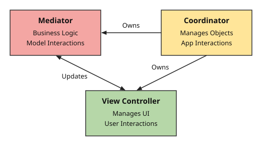
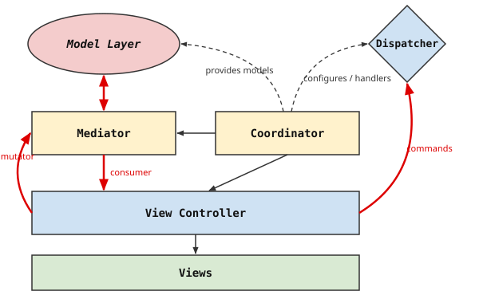

# Chrome on iOS Architecture

> **Core Principle:** To remain maintainable, Chrome on iOS must remain
> understandable. For this, we use the foundational principles of
> **encapsulation**, **decoupling**, and **abstraction** to define consistent,
> repeatable **design patterns** that make the application as a whole easy to
> change, fix, test, and understand.

[TOC]

______________________________________________________________________

## About These Documents

The documents in this directory describe the **design intent** of the Chrome on
iOS architecture, not the current state of the code base. Much existing code
predates the current guidance or deviates from it, so existing code shouldn't be
used as an example of a pattern just because it exists. New code should follow
the patterns described here.

None of the guidance is arbitrary: every pattern and guideline in these
documents follows from the larger patterns outlined in this overview. Where
there are specific, known use cases that conflict with a general pattern or
guideline, those cases are documented as being explicit acceptable uses. A
concrete example is that in general coordinators should not have delegates, but
there are [specific cases](coordinators.md#coordinator-delegates) where
delegation is appropriate.

In general the guidance in these documents is fairly prescriptive. The intent is
that for a given feature, there is one clear, obvious way to implement it.
Consistency, especially in a large codebase with many contributors, is critical
for long-term code health.

Given that, however, it is critical to note that this architecture is presented
as a set of design patterns, and not as a framework of implemented classes.
Patterns give us more adaptability in the face of changing features and
technologies. Instead of trying to construct a framework that solves every
problem, architectural patterns give us general tactics for solving different
classes of problems.

This document outlines the architecture as a whole, and explains *why* these
design patterns are used. The more detailed pattern-specific documents explain
*what* the individual patterns are and *how* to apply them:

- [Coordinators](coordinators.md): Encapsulating UI features and managing their
  lifecycles.
- [Mediators](mediators.md): Connecting the model layer to the UI.
- [UI Commands and Disintermediated Dispatch](commands.md): Requesting UI
  changes across features.

______________________________________________________________________

## A Pattern Language

The idea of design patterns is usually traced to Christopher Alexander et al.'s
*A Pattern Language: Towns, Buildings, Construction*, which describes the design
of physical spaces as a *pattern language*: interconnected patterns, each
motivated by larger patterns and in turn motivating smaller ones. The
architecture of Chrome on iOS is described the same way: its patterns run from
the needs of the people who build it ([human patterns](#human-patterns)),
through the basic principles of software design
([patterns of principle](#patterns-of-principle)), to the structure of our
application ([patterns of structure](#patterns-of-structure)), which the pattern
documents describe in detail.

______________________________________________________________________

## Human Patterns

To serve the needs of its users and of the business, Chrome on iOS needs to be
maintainable: it must be possible to continue developing it indefinitely far
into the future. It's difficult to maintain software that isn't understood, so
it's critical to preserve **intellectual control** of the code base as much as
possible: to understand the code well enough to reason about what it does, and
about what a change to it will do. (The term goes back at least to Harlan
Mills's work on structured programming at IBM.) As Robert Nystrom writes in
[*Game Programming Patterns*](https://gameprogrammingpatterns.com/architecture-performance-and-games.html):

> Good design means that when I make a change, it's as if the entire program was
> crafted in anticipation of it.

Where intellectual control can't be maintained, the code should at least be
under **statistical control**: confidence, established by tests, that it behaves
as intended, which requires **testable code**. Patterns help only if the people
applying them understand them, so each pattern should be named, documented
together with its motivation, and applied consistently. Documentation and
consistent application of patterns is also critical for generative coding
agents, who must be able to extrapolate from the code base and apply patterns
correctly. Because coding agents are non-deterministic, we can think of this as
**stochastical control**: increasing the odds that generated code is also
correct code. Finally, every part of the code base needs **owners** who
understand it and are responsible for maintaining it, which requires clear
boundaries between parts of the code, such as features with directories of their
own.

______________________________________________________________________

## Patterns of Principle

### Problem Decomposition

A large application can be understood only in parts. Problem decomposition
divides it into components small enough to understand individually, by
establishing boundaries of responsibility and defining what those boundaries
mean. The fundamental mechanisms for doing so are encapsulation, decoupling, and
abstraction, and most of the patterns in these documents apply some or all of
them:

- **Encapsulation:** Everything you need to know about an entity is in one
  place. Its state, its logic, and the details of how it works are gathered
  behind a single boundary, rather than spread among its clients.
- **Decoupling:** You don't need to understand other entities. Code depends on
  as few other entities as possible, and never on their concrete classes, their
  internals, or their position in a hierarchy.
- **Abstraction:** Understanding an interface is sufficient. Objects describe
  what they need from their collaborators as protocols—a consumer, a mutator, a
  command handler—rather than depending on how those collaborators work.

### Layers

Layers divide code into areas of responsibility, with rules about which layers
can depend on which: higher layers may use the APIs of lower layers, but not
vice versa. Code in a lower layer can therefore be understood and tested without
any knowledge of the layers above it, and code in a higher layer needs to
understand only the interfaces of the lower layers it uses.

### Scopes

A second division of responsibility, orthogonal to layers, is by scope. Most
objects are scoped to the application, a profile, a scene (a window), a browser
(a set of tabs in a window, such as its regular or incognito tabs), or a tab.
For example, each browser has one `WebStateList`, and most coordinators are
browser-scoped (see [Coordinator Scope](coordinators.md#coordinator-scope)).

### Naming Convention

Consistent names make each object's role recognizable at a glance. Suffixes such
as `Coordinator`, `Mediator`, `ViewController`, `Consumer`, `Mutator`, and
`Commands` each identify a role in a pattern. Drawing every name from a
deliberately constrained vocabulary also pushes designs toward the identified
patterns: naming an object requires deciding which role it plays.

### Dependency Injection

Each object receives exactly the dependencies it uses from the object that
creates it, rather than finding them for itself, so its interface fully
describes what it depends on. Injected dependencies are also an object's test
seams, which provide the testability that [statistical control](#human-patterns)
requires: if testing an object seems to require a test-only interface, or
constructing the object differently than production code does, the test design
is wrong.

Dependency injection is a key example of how this architecture prefers patterns
over frameworks. There are many dependency injection *frameworks* available,
with a plethora of features. In some contexts these frameworks are valuable, and
their benefits offset their costs in terms of reducing intellectual control. For
Chrome on iOS, no such framework is used, but the general pattern of injecting
specific dependencies into code modules is used extensively.

### Line in the Sand

**Backbone containers** are objects from which arbitrary dependencies can be
retrieved. An object that holds one can depend on anything, so its interface no
longer describes what it depends on. A line in the sand confines backbone
containers to a clearly defined part of the object hierarchy: objects above the
line may hold them, and use them to find the dependencies of the objects they
create, while objects below the line receive only the specific dependencies they
use. Because objects below the line can't reach anything they aren't given,
they're independent of the structure of the application around them, and can be
understood, reused, and tested in isolation. In Chrome on iOS, coordinators are
the last objects above the line (see
[The "Line in the Sand" for Dependencies](mediators.md#the-line-in-the-sand-for-dependencies)).

______________________________________________________________________

## Patterns of Structure

UIKit is designed around view controllers as the basic building blocks of an
application, and view controllers tend to accrete responsibilities far beyond
their intended role. On top of the Controller role of classic
Model-View-Controller (handling user input, and updating the model and the UI in
response to each other), they take on View responsibilities (view setup, layout,
and updates) and Model responsibilities (manipulating data and services
directly), and become coupled to the lifecycles, presentation, and dependencies
of the view controllers they present. The result is monolithic view controllers
that can't be understood, changed, or tested apart from their surroundings.

The patterns of structure divide these responsibilities instead. Within each
feature, a **coordinator** encapsulates the feature, a **mediator** implements
its business logic over **deep models**, and an **isolated view controller**
manages its views. Features are connected to each other by **UI commands**.

### Deep Model

Each model gathers as much of its domain—state, persistence, operations, and
change notification—as possible behind a simple interface, rather than acting as
a passive data structure whose logic is spread among its clients. (Compare the
"deep modules" of John Ousterhout's *A Philosophy of Software Design*.) Keyed
services, the `WebStateList`, browser agents, and tab helpers are all deep
models.

Model objects that many features interact with, such as the `WebStateList`,
would accumulate too much responsibility if those features were built into them.
Instead, features extend the model at the appropriate scope, as keyed services,
agents, or tab helpers. A feature's non-UI logic belongs in such a model
extension, not in its mediator (see
[Mediators Accessing Other Services and Commands](mediators.md#mediators-accessing-other-services-and-commands)).

### Isolated View Controller

View controllers manage views, layout, and user interaction, with no knowledge
of the model layer, coordinators, concrete mediator classes, or other features.
They render state pushed to them over consumer protocols, and report user
actions through mutator and command protocols, so they can be understood and
tested on their own. One way to think of the [Coordinator](#coordinator) and
[Mediator](#mediator) patterns is as the surrounding architecture needed to
isolate view controllers while keeping to all of the other principles.

### Coordinator

UIKit's view controller hierarchy often diverges from the logical structure of
the UI, and view controllers that present other view controllers become coupled
to their children. [Coordinators](coordinators.md) give the UI an explicit
structure instead: features contain or present sub-features, so coordinators
form a hierarchy (see
[The Coordinator Hierarchy](coordinators.md#the-coordinator-hierarchy)). Each
level of the hierarchy can be understood on its own: a parent coordinator needs
to understand its children's interfaces, but not their contents, nor their
children.

- **Encapsulation:** A coordinator creates, owns, and connects its feature's
  view controllers, mediators, and child coordinators, and keeps them private.
  Each parent coordinator owns its children's lifecycles.
- **Decoupling:** A coordinator connects its feature's objects through
  protocols, injects only the narrow dependencies each one needs, and never
  communicates directly with its sibling coordinators.
- **Abstraction:** Every coordinator exposes the same minimal lifecycle
  (`-start` and `-stop`). Whether its UI is contained, pushed, or presented
  modally is a hidden implementation detail.

*Motivated by [Encapsulation](#problem-decomposition),
[Abstraction](#problem-decomposition),
[Dependency Injection](#dependency-injection),
[Line in the Sand](#line-in-the-sand), and
[Isolated View Controller](#isolated-view-controller).*

*Motivates [Mediator](#mediator), [UI Command](#ui-command), and idioms such as
view controller containment and transition handlers.*

### Mutation-Observation Cycle

The model is the single source of truth. User intent flows from the UI to the
model as a mutation, and the UI changes only when the resulting model change is
observed and pushed back to it, never in anticipation of one. Because data flows
in one direction, the UI can't drift out of sync with the model (see
[The Mutation-Observation Cycle](mediators.md#the-mutation-observation-cycle)).

### Mediator

Business logic—translating model state into UI state, and user intent into model
changes—would otherwise end up in view controllers (coupling the UI to the
model) or in coordinators (turning them into catch-all controllers).
[Mediators](mediators.md) give business logic a home of its own in the
coordinator layer, between the model and UI layers:

- **Encapsulation:** Each mediator owns the business logic for a single
  model-to-UI relationship.
- **Decoupling:** Model objects never cross into the UI layer, and a mediator
  never receives a backbone container; it's given only the model objects it
  uses.
- **Abstraction:** A mediator pushes state to an abstract **consumer** and
  receives user intent through an abstract **mutator**; neither the mediator nor
  the view controller knows the other's class.

*Motivated by [Layers](#layers), [Decoupling](#problem-decomposition),
[Deep Model](#deep-model),
[Isolated View Controller](#isolated-view-controller),
[Coordinator](#coordinator), and
[Mutation-Observation Cycle](#mutation-observation-cycle).*

*Motivates [State-Independent Consumer](#state-independent-consumer).*

### State-Independent Consumer

Each update a mediator pushes to its consumer is self-contained, carrying
complete current values rather than changes and identifying items by stable
identifiers, so its effect can be understood from the update alone, without
knowing the consumer's prior state (see
[State Independence](mediators.md#state-independence)).

### UI Command

Features frequently need to request UI outside of their own feature—such as
presenting Settings—without presenting it themselves, knowing what handles the
request, or relaying it through intermediaries. UIKit's responder chain
decouples senders from receivers, but it can only route along the view
controller hierarchy, and any object along the way can intercept a message.
[UI commands](commands.md) address both problems: a central dispatcher,
`CommandDispatcher`, routes each command directly to a single handler configured
at runtime (*disintermediated dispatch*), so a command has the same effect
wherever it's sent from within the same `Browser` (see
[The Command Dispatcher](commands.md#the-command-dispatcher)). UI commands are
strictly for UI changes; changes to model state go through the model layer.

- **Encapsulation:** Commands form the public API of the UI layer; how a command
  is satisfied is private to its handler.
- **Decoupling:** Callers depend only on a command protocol (`id<FooCommands>`).
  Only coordinators hold the `CommandDispatcher` itself; objects below the
  [line in the sand](#line-in-the-sand) receive handlers for exactly the
  protocols they use. Features never communicate directly with their siblings,
  and parents don't relay messages between children.
- **Abstraction:** A caller needs to understand only a command's protocol, not
  the path the command takes or what handles it.

*Motivated by [Decoupling](#problem-decomposition),
[Abstraction](#problem-decomposition),
[Isolated View Controller](#isolated-view-controller), and
[Coordinator](#coordinator).*

______________________________________________________________________

## Feature Architecture at a Glance

This section summarizes how the objects in a feature are owned and how they
communicate, for reference while reading the pattern documents.

Solid black arrows indicate creation and ownership, dashed arrows indicate
dependencies provided without ownership, and heavy red arrows indicate
interactions across abstract protocols.

### Object Ownership

- Each window (**scene**) has a hierarchy of coordinators, in which each parent
  creates, starts, stops, and owns its children.
- A coordinator creates and owns its feature's view controllers, mediators, and
  helper objects. A view controller creates and owns its views.
- Model objects are owned within the model layer and tied to their scope: keyed
  services to a profile, the `WebStateList` and browser agents to a `Browser`,
  and tab helpers to a `WebState`. A coordinator passes model objects to its
  mediators, but doesn't own them.

### Communication

Each path between objects carries one narrowly defined type of communication.
For example, any object can send a UI command, but a command only requests a
high-level UI change: it never changes model state, and never returns a value.

| From                        | To                  | Communicates                                                   | Through                                          | See                                                                                                |
| --------------------------- | ------------------- | -------------------------------------------------------------- | ------------------------------------------------ | -------------------------------------------------------------------------------------------------- |
| Mediator                    | View controller     | UI state, translated from model state                          | Consumer protocol                                | [Consumer Protocols](mediators.md#consumer-protocols)                                              |
| View controller             | Mediator            | User actions that depend on the model                          | Mutator protocol                                 | [Model Updates Through the Mediator](mediators.md#model-updates-through-the-mediator)              |
| View controller             | Mediator            | Queries for decisions needed only at interaction time          | Consumer data source                             | [Interaction-Time Queries](mediators.md#interaction-time-queries)                                  |
| Model                       | Mediator            | Notifications of model changes                                 | Model observer interfaces, via observer bridges  | [Observing Model Objects](mediators.md#observing-model-objects)                                    |
| Mediator                    | Model               | Queries and mutations of model state                           | Direct calls on injected model objects           | [Mediators](mediators.md)                                                                          |
| Any object                  | Another feature     | Requests for high-level UI changes                             | UI command handler backed by `CommandDispatcher` | [UI Commands](commands.md)                                                                         |
| View controller or mediator | Its own coordinator | Requests for UI changes within the feature                     | Local command protocol                           | [Local Commands](coordinators.md#local-commands)                                                   |
| Child coordinator           | Parent coordinator  | Requests for its own teardown (or, in specific cases, results) | UI command (or, in specific cases, a delegate)   | [Coordinator Delegates](coordinators.md#coordinator-delegates)                                     |
| Feature                     | Sibling feature     | Requests for UI changes, or changes to shared data             | Never directly: UI commands, or the model layer  | [Sibling and Cross-Feature Communication](coordinators.md#sibling-and-cross-feature-communication) |

Once a coordinator has connected its feature's objects, it doesn't call methods
on its view controller or mediator to enact business logic or UI updates. Its
remaining work is mostly presenting and dismissing UI, and tearing the feature
down.
