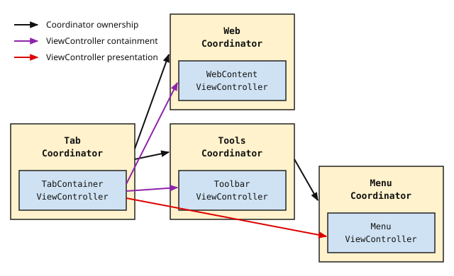

# Coordinators

> **Core Principle:** To **decompose** the user interface into **encapsulated**
> components, a **hierarchy** of coordinators is used. Coordinators provide an
> **abstraction layer** over individual pieces of UI, and define one of the
> fundamental **layers** of Chrome on iOS.

______________________________________________________________________

## Motivating Ideas

UIKit view controllers tend to accrete responsibilities far beyond their
intended role; Chrome on iOS divides those responsibilities among isolated view
controllers, [mediators](mediators.md), and coordinators (see
[Patterns of Structure](README.md#patterns-of-structure)). Coordinators
encapsulate entire UI features: they assemble and own the feature's objects,
inject their dependencies, and manage interactions with the rest of the
application.

The user interface of Chrome on iOS is decomposed into discrete, focused, and
autonomous **features**—such as the omnibox, the toolbar, the overflow menu, or
the tab grid. Features compose hierarchically: a browser tab conceptually
contains toolbars and web content, and a toolbar contains the omnibox. The
Coordinator pattern mirrors this logical composition by providing a structured
mechanism for **encapsulation**, **hierarchy**, and **composition** without
preempting or re-implementing built-in `UIViewController` mechanisms such as
presentation and containment.

Finally, the Coordinator pattern is an architectural **pattern**, not a
heavyweight framework. It relies on a minimal base class and consistent
conventions rather than complex superclass machinery.

______________________________________________________________________

## Architectural Overview

Each UI feature is managed by a **coordinator**, which internally manages
dependencies and object connections for the feature and externally acts as the
feature's minimal public API.

At a high level, a coordinator forms a partnership with its **mediator** and
**view controller**, dividing the roles that traditional UIKit architectures
place entirely inside a view controller:


While the mediator and view controller perform the ongoing work of the feature,
the coordinator sets up the connections between them and manages their
relationship with the rest of the application.

### Features vs. View Controllers

Coordinators manage UI features, but a UI feature is not necessarily isomorphic
to a single `UIViewController`:

- A complex feature may involve multiple view controllers managed or coordinated
  together.
- Conversely, not every presented `UIViewController` constitutes a separate UI
  feature requiring its own coordinator.

### Coordinator Scope

Almost all coordinators are **browser-scoped**: each is tied to a specific
`Browser` instance (such as a window's regular or incognito browser) and manages
UI for that browser.

Coordinators are never instantiated per tab; per-tab model state is managed in
the model layer (e.g., by tab helpers). Some long-lived coordinators present
content that updates whenever the active tab changes, by observing the browser's
`WebStateList`. Others are short-lived and present UI for a single tab that is
dismissed on tab change or navigation—but they are still given a `Browser`, and
access the rest of the app through it.

### Presentation and Containment Mechanics

Coordinators are responsible for configuring how their view controllers are
presented or contained—such as modal presentation styles, navigation stacks, or
custom **transition handlers**—without directly implementing view hierarchy
manipulations or animation logic themselves.

### Directory Structure and Dependencies

To enforce layering boundaries in the source tree, feature code is organized
into three subdirectories under `//ios/chrome/browser/<feature_name>/`:

- `model/`: Model-layer classes (such as keyed services, tab helpers, and
  browser agents).
- `coordinator/`: Coordinator-layer classes, including both **coordinators** and
  **[mediators](mediators.md)**.
- `ui/`: UI-layer classes, including views and view controllers.

Because the `ui/` directory must not depend on `coordinator/` or `model/`, any
protocol or data class definitions shared between `coordinator/` and `ui/`—such
as
[consumer, consumer data source, and mutator protocols, composite item classes](mediators.md#directory-structure-and-dependencies),
and [local command protocols](#local-commands)—must be declared in headers
located in `ui/`. Both the view controller (in `ui/`) and the coordinator or
mediator (in `coordinator/`) import these headers from `ui/`.

______________________________________________________________________

## Creating and Implementing a Coordinator

### Subclassing `ChromeCoordinator`

Each feature's coordinator is an Objective-C class that subclasses
[`ChromeCoordinator`][chromecoordinator]. `ChromeCoordinator` provides a minimal
common interface:

- The designated initializer `-initWithBaseViewController:browser:`.
- Read-only, unowned access to `baseViewController` (`weak`) and `browser`, plus
  convenience getters derived from `browser`: `profile`
  (`self.browser->GetProfile()`), `sceneState`
  (`self.browser->GetSceneState()`), and `-isOffTheRecord`
  (`self.profile->IsOffTheRecord()`).
- The `-start` and `-stop` template methods for subclasses to override (their
  base implementations are no-ops).

Whenever possible, coordinator subclasses should not expand their public API
beyond initialization, `-start`, and `-stop`. The standard initializer's two
parameters provide the foundational context every browser-scoped coordinator
requires:

1. **`baseViewController` (`UIViewController*`)**: Held weakly by the
   coordinator; defines the UI context in which the feature's view controller
   will be presented or contained.
2. **`browser` (`Browser*`)**: An unowned pointer to the backbone container
   providing access to the `ProfileIOS`, `WebStateList`, browser agents, and
   `CommandDispatcher`. Because coordinators are owned by the hierarchy and
   stopped before their `Browser` is destroyed, the `Browser` is guaranteed to
   outlive its coordinators.

A subclass may define a custom designated initializer when it needs
invocation-specific configuration that cannot be obtained from `Browser` (such
as an entry point or the item to act on), or when it pushes onto an existing
navigation stack via `-initWithBaseNavigationController:browser:` (see
[Modal Presentation and Navigation Stacks](#modal-presentation-and-navigation-stacks)).
Initializers must not take model-layer services that the coordinator can obtain
from `self.browser` or `self.profile`.

When a coordinator's view controller is contained as a child view controller
inside a parent view hierarchy rather than presented modally, the coordinator
may also expose a read-only **`viewController`** property (see
[View Controller Containment](#view-controller-containment)).

All other references to internal objects (such as the mediator or a presented
view controller), along with any protocol conformances (such as command,
delegate, or presentation controller protocols), belong in the `.mm` file rather
than the public `.h` header.

### Objects Created and Connected by a Coordinator

A coordinator typically creates, owns, and connects the following objects:

- **View Controller**: Manages the feature's views and user interactions.
- **[Mediator](mediators.md)**: Connects model-layer services and observables to
  the view controller.
- **Child Coordinators**: Encapsulate sub-features contained within or presented
  by this feature.
- **Helper Objects**: Transition handlers or other coordinator-layer helpers.

Child objects created by a coordinator must not depend directly on each other's
concrete classes. Instead, their interactions are defined through Objective-C
protocols, and the coordinator wires them together during `-start`:


In the diagram above:

- **Solid black arrows** indicate **creation and ownership**. The coordinator
  creates and owns the mediator and view controller; the view controller creates
  and owns its views.
- **Dashed black arrows** indicate **dependency provision without ownership**.
  The coordinator extracts model objects from `Browser` or `ProfileIOS` and
  passes them to the mediator, and obtains command handlers from the
  `CommandDispatcher` to pass to the view controller or mediator.
- **Heavy red arrows** indicate **interactions across abstract protocol
  interfaces**:
  - The mediator observes and mutates the **Model Layer**.
  - The mediator pushes UI updates to the view controller through a
    **[consumer](mediators.md#consumer-protocols)** protocol
    (`id<FooConsumer>`).
  - The view controller requests model updates from the mediator through a
    **[mutator](mediators.md#model-updates-through-the-mediator)** protocol
    (`id<FooMutator>`).
  - The view controller (or mediator) triggers application-level or
    cross-feature UI changes by calling a
    **[command handler](commands.md#type-safety-and-command-handlers)**
    (`id<FooCommands>`) backed by the `CommandDispatcher` (or a
    **[local command](#local-commands)** handler for feature-internal UI
    actions).

Notice that once its child objects are initialized and connected, **the
coordinator does not call methods on the view controller or mediator** to enact
business logic or UI updates. Its remaining work is mostly presenting and
dismissing UI, and
[disconnecting the mediator](mediators.md#teardown-and-disconnect) during
teardown (see [Between Start and Stop](#between-start-and-stop)).

______________________________________________________________________

## Coordinator Lifecycle

### Parent Ownership of Lifecycle

**Coordinators do not own their own lifecycles.** A coordinator's parent is
responsible for creating it, owning it, starting it, stopping it, and destroying
it:

1. Prior to calling `-start`, the parent initializes the child coordinator with
   its `baseViewController` and `Browser` (and sets any required configuration
   properties). Initialization must only store parameters; creating objects,
   registering command handlers, and connecting dependencies all belong in
   `-start`.
2. Calling `-start` activates the coordinator's feature in the UI.
3. Calling `-stop` deactivates the coordinator's feature and tears down its
   resources.
4. Immediately after `-stop` returns, the parent clears its reference to the
   child coordinator so it can be deallocated.

Because a coordinator is started once and destroyed after `-stop`, **a
coordinator must never call `-start` or `-stop` on itself**, and `-start` and
`-stop` must not be called repeatedly on the same instance. Calling
`[self stop]` leaves the parent holding a strong reference to a stopped
coordinator instance; instead, every `-start` call on a child coordinator must
be matched by a `-stop` call from the parent, followed by clearing the parent's
reference.

A coordinator's lifetime from `-start` to `-stop` should correspond to the
active lifetime of its feature in the UI. A parent must not start a child
coordinator up front to sit dormant without UI while waiting for a command or
event to present its view controller later; instead, the parent handles the
command that triggers the feature and creates and starts the child coordinator
only when its UI is needed.

### Standard Start and Stop Flow

Even when a feature has a control (such as a "Done" or "Cancel" button) whose
sole purpose is to close the feature, the child coordinator does not stop
itself. Instead, the parent coordinator registers as the handler for the command
that shows and hides the child feature, and the child's view controller invokes
the hide command via a command handler:

```objectivec
// parent_coordinator.mm
@interface ParentCoordinator () <ChildCommands>
@end

@implementation ParentCoordinator {
  ChildCoordinator* _childCoordinator;
}

- (void)start {
  ...
  [self.browser->GetCommandDispatcher()
      startDispatchingToTarget:self
                   forProtocol:@protocol(ChildCommands)];
  ...
}

- (void)stop {
  [_childCoordinator stop];
  _childCoordinator = nil;
  [self.browser->GetCommandDispatcher() stopDispatchingToTarget:self];
  ...
}

#pragma mark - ChildCommands

- (void)showChildFeature {
  _childCoordinator = [[ChildCoordinator alloc]
      initWithBaseViewController:_viewController
                         browser:self.browser];
  [_childCoordinator start];
}

- (void)hideChildFeature {
  [_childCoordinator stop];
  _childCoordinator = nil;
}

@end
```

Inside the child coordinator, `-start` wires up the mediator, view controller,
and command handler, and `-stop` performs deterministic cleanup:

```objectivec
// child_coordinator.mm
@implementation ChildCoordinator {
  ChildViewController* _viewController;
  ChildMediator* _mediator;
}

- (void)start {
  _viewController = [[ChildViewController alloc] init];
  _viewController.childHandler = HandlerForProtocol(
      self.browser->GetCommandDispatcher(), ChildCommands);

  ProfileIOS* profile = self.browser->GetProfile();
  _mediator = [[ChildMediator alloc]
      initWithPrefService:profile->GetPrefs()
             webStateList:self.browser->GetWebStateList()];

  _mediator.consumer = _viewController;
  _viewController.mutator = _mediator;

  [self.baseViewController presentViewController:_viewController
                                        animated:YES
                                      completion:nil];
}

- (void)stop {
  [_mediator disconnect];
  _mediator = nil;

  [_viewController.presentingViewController
      dismissViewControllerAnimated:YES
                         completion:nil];
  _viewController = nil;
}

@end
```

And the child view controller triggers dismissal directly through its command
handler:

```objectivec
// child_view_controller.h
@interface ChildViewController : UIViewController
@property(nonatomic, weak) id<ChildCommands> childHandler;
@property(nonatomic, weak) id<ChildMutator> mutator;
@end

// child_view_controller.mm
@implementation ChildViewController

- (void)viewDidLoad {
  [super viewDidLoad];
  ...
  __weak __typeof(self) weakSelf = self;
  UIAction* doneAction = [UIAction actionWithHandler:^(UIAction* action) {
    [weakSelf.childHandler hideChildFeature];
  }];
  [_doneButton addAction:doneAction
        forControlEvents:UIControlEventTouchUpInside];
}

@end
```

### Between Start and Stop

Once started, a feature mostly runs itself: the view controller and mediator
communicate through consumer and mutator protocols, and reach the rest of the
app through commands. Between `-start` and `-stop`, a coordinator acts only to
coordinate:

- **Presentation**: Presenting, dismissing, and transitioning between the view
  controllers it owns, starting and stopping child coordinators, and temporarily
  disabling its UI while a child feature is shown.
- **Dependency management**: Updating its mediator when a dependency it supplied
  changes.
- **Child results**: Passing data returned by a child coordinator, system
  picker, or UIKit dismissal callback to its mediator.

Most other needs that arise while a feature is running are met without the
coordinator:

- **Responding to user actions**: The view controller calls its mutator (the
  mediator) to change model state, and a command handler to trigger UI
  transitions.
- **Updating displayed content**: The mediator observes the model and updates
  its consumer.
- **Handling feature-internal commands**: The mediator or view controller that
  implements a command is registered directly as its target (see
  [Registering Command Targets](#registering-command-targets)).
- **Requests from outside the feature**: Other features dispatch commands, or
  change model state that the feature's mediator observes, rather than calling
  methods on its coordinator.
- **Presenting UI that depends on model data**: The mediator, which has the
  data, invokes a command with that data as arguments.

### Deterministic Teardown in `-stop`

In Objective-C and UIKit, object deallocation timing is non-deterministic—UIKit
animations, presentation controllers, or autorelease pools may retain views and
view controllers well after a feature is dismissed. Therefore, **classes must
never rely on `-dealloc` to perform cleanup required for correctness** (such as
unregistering C++ observers or stopping command dispatch).

Every coordinator's `-stop` implementation must deterministically tear down the
feature:

1. **Stop child coordinators**: Call `-stop` on any active child coordinators
   and set their instance variables to `nil`.
2. **Stop command dispatching**: Unregister any command targets registered by
   the coordinator on the `CommandDispatcher` (via `-stopDispatchingToTarget:`).
3. **[Disconnect mediators](mediators.md#teardown-and-disconnect)**: Call
   `-disconnect` on any mediators owned by the coordinator so they immediately
   end observation of C++ model objects (`WebStateList`, keyed services,
   `PrefService`), then set their instance variables to `nil`.
4. **Dismiss or remove the view controller**: Dismiss or detach the managed view
   controller and set its instance variable to `nil`.

### Handling UIKit-Driven Dismissals

Users can often dismiss a presented or pushed view controller through built-in
UIKit interactions—such as swiping down a modal sheet or tapping the Back button
in a navigation bar—without triggering an explicit close control owned by the
feature. Even when UIKit removes the view controller from the screen, the parent
coordinator still owns the child coordinator's lifecycle:

1. **Detect the UIKit dismissal**: Configure the appropriate UIKit delegate
   (such as `UIAdaptivePresentationControllerDelegate` for modal sheets or
   `UINavigationControllerDelegate` for navigation stacks) to detect when the
   user finishes dismissing or popping the view controller.
2. **Request teardown from the parent**: Never call `[self stop]` in response to
   a UIKit dismissal. Instead, route the teardown request to the parent
   coordinator just like an explicit close button—by invoking the feature's hide
   command via a command handler (or calling a coordinator delegate method for
   parent-agnostic coordinators) so the parent stops and releases the child
   coordinator.
3. **Safely handle already-dismissed view controllers in `-stop`**: Because
   `-stop` runs both when dismissing the feature programmatically and after
   UIKit has already removed the view controller, view controller dismissal in
   `-stop` must be a safe no-op if the view controller is no longer presented.
   (This is why the `ChildCoordinator` example above messages
   `_viewController.presentingViewController` rather than
   `self.baseViewController`: if UIKit has already dismissed `_viewController`,
   `presentingViewController` is `nil` and the call safely does nothing.)

### Coordinator Delegates

A child coordinator requests its own teardown by invoking a command handled by
its parent (see [Standard Start and Stop Flow](#standard-start-and-stop-flow)).
A coordinator-specific **delegate protocol** (`ChildCoordinatorDelegate`) is
appropriate only in the following cases:

1. **Parent-agnostic coordinators**: A *parent-agnostic* coordinator is one that
   can be started by several different parent coordinators across the app (such
   as a sign-in or authentication prompt). Because its parent isn't fixed,
   dispatching a global command would not target the specific parent instance
   that started it. Instead, the child coordinator can define a delegate
   protocol that its parent implements to request teardown. If the decision to
   end the flow is made by the child's mediator (for example, because sign-in
   became disabled while the flow was showing), the mediator invokes a
   [local command](#local-commands) implemented by the child coordinator, which
   in turn notifies its delegate. The delegate protocol belongs to the
   coordinator; the mediator never defines or calls one.
2. **Returning data to the parent**: When a child coordinator needs to pass data
   back to its parent coordinator, a delegate method can be used. This data
   could be a user selection or the outcome of an interactive flow.
3. **Synchronizing with asynchronous dismissal**: When stopping a coordinator
   triggers an animated dismissal, the UI remains visible briefly after `-stop`
   returns. Usually the parent does not need to care about animation timing. If
   the parent *must* wait for the dismissal animation to complete before taking
   an action, the child coordinator can notify its delegate upon completion:

```objectivec
@protocol ChildCoordinatorDelegate <NSObject>
- (void)childCoordinatorDidStop:(ChildCoordinator*)coordinator;
@end
```

Outside of these cases, don't add a delegate protocol just to request teardown;
it duplicates the command mechanism and couples the child to its parent. If a
teardown delegate seems necessary because the child's owner is a view
controller, scene agent, or other non-coordinator object, the ownership is
wrong: the child should be owned by a coordinator. Similarly, an internal step
of a larger feature often doesn't need its own coordinator at all (see
[Features vs. View Controllers](#features-vs-view-controllers)); the feature's
coordinator can manage it directly with its view controllers.

A coordinator delegate protocol should follow standard Objective-C delegation
conventions, including passing the delegating coordinator as the first argument.
It should be limited to the uses above; don't use it to open other features (use
a dispatched command), to query the parent, or to adjust the parent's UI or
layout. For messaging from a feature's own view controllers or mediators to its
coordinator, a delegate is not appropriate; instead, a different type of
protocol—a
[local command protocol](commands.md#shared-vs-local-command-protocols)—should
be used (see [Local Commands](#local-commands)).

Adding `-startWithCompletion:` or `-stopWithCompletion:` methods to a
coordinator is generally **discouraged**:

- Whether a child coordinator animates its presentation or dismissal is an
  internal implementation detail that shouldn't leak into its public lifecycle
  API.
- Passing a completion block makes the child responsible for executing arbitrary
  parent code.
- Completion blocks tighten coupling between parent and child coordinators.

Completion blocks on `-stop` should only be used when a parent coordinator must
sequence a specific one-off continuation after teardown and doing so via a
delegate callback would require maintaining awkward state machines in the
parent.

______________________________________________________________________

## The Coordinator Hierarchy

Each window (**scene**) in the application has an independent coordinator
hierarchy forming an explicit ownership tree: a parent coordinator creates and
owns child coordinators, which in turn create and own their own children. Each
scene contains multiple browsers, and most coordinators are browser-scoped; thus
for each browser there is an independent hierarchy of coordinators. Above the
root of these browser-scoped coordinator hierarchies are a small number of
coordinators that aren't browser-scoped (such as the scene's root coordinator,
or coordinators whose UI spans multiple browsers). These can be implemented as
subclasses of [`RootCoordinator`][rootcoordinator], which conforms to the same
informal `-start` and `-stop` protocol as
[`ChromeCoordinator`][chromecoordinator] without requiring a single `Browser`
dependency.

This hierarchy serves two primary architectural purposes:

1. **Encapsulating complexity**: Decomposing the application into a tree of
   self-contained features limits what each coordinator is responsible for and
   normalizes inter-feature interactions. Individual features can be modified,
   refactored, or replaced without affecting surrounding features.
2. **Abstracting UIKit view controller relationships**: UIKit has two distinct
   mechanisms for composing view controllers:

- **Containment**: A parent view controller can contain any number of child view
  controllers.
- **Presentation**: A view controller can present at most one view controller
  modally (and if a contained child presents a view controller, UIKit routes the
  presentation through the container ancestor).

Because of UIKit's rules, the view controller hierarchy often diverges from the
logical feature hierarchy. The coordinator hierarchy preserves the logical
structure of the UI while hiding UIKit containment and presentation mechanics as
implementation details:



In this example (greatly simplified from Chrome's actual structure):

- Logically, a tab contains web content and a toolbar, and the toolbar can
  display a tools menu. The **coordinator hierarchy** (black arrows) directly
  reflects this logical composition: `TabCoordinator` owns `WebCoordinator` and
  `ToolsCoordinator`, and `ToolsCoordinator` owns `MenuCoordinator`.
- At the UIKit level, `TabContainerViewController` contains
  `WebContentViewController` and `ToolbarViewController` (purple arrows), and
  presents `MenuViewController` (red arrow).
- Because `MenuCoordinator` is initialized with `TabContainerViewController` as
  its `baseViewController`, the fact that `MenuViewController` is presented by
  `TabContainerViewController` rather than `ToolbarViewController` is hidden
  from the rest of the application. If the menu presentation is later changed
  from modal presentation to custom view controller containment, the coordinator
  hierarchy and `MenuViewController` remain unchanged.

### Modal Presentation and Navigation Stacks

Coordinators use standard UIKit presentation and navigation controllers to
display presented features:

- **Modal presentation**: When presenting a feature modally on
  `self.baseViewController`, the coordinator configures the presented view
  controller's presentation style, presentation controller, and transition
  behavior before presenting it. Keeping presentation configuration in the
  coordinator leaves the view controller agnostic of how it is displayed.
- **Navigation stacks**: A modal flow that pushes a sequence of screens is
  managed by a coordinator that creates a `UINavigationController` and presents
  it on `self.baseViewController`:
  - If each screen is an independent feature, the flow coordinator starts a
    child coordinator for each one, passing it the navigation controller. Each
    screen coordinator pushes its view controller in `-start` and pops it in
    `-stop`, so the flow coordinator can present screens in any order and
    screens can be reused across flows. User-driven Back navigation is detected
    by the navigation controller's delegate to trigger child teardown, as
    described in
    [Handling UIKit-Driven Dismissals](#handling-uikit-driven-dismissals).
  - If the screens are steps of a single feature (such as a list and its detail
    view), one coordinator can manage the stack and its view controllers
    directly (see
    [Features vs. View Controllers](#features-vs-view-controllers)).

### View Controller Containment

When a child coordinator's view controller is **contained** inside a parent view
hierarchy rather than presented modally (such as a toolbar, location bar, or tab
strip), the child coordinator must not reach directly into
`self.baseViewController.view` to insert subviews or activate layout
constraints. Instead, the parent container view controller owns the layout slot
where the child view belongs:

1. **Child coordinator exposes its view controller**: The child coordinator
   declares a read-only `viewController` property. In `-start`, it creates and
   wires its `viewController` and `mediator` without inserting the view into a
   parent view hierarchy.
2. **Parent coordinator passes the child view controller to the container**:
   After starting the child coordinator, the parent coordinator assigns
   `childCoordinator.viewController` to a semantic slot property on its own
   container view controller.
3. **Container view controller performs UIKit containment**: The container view
   controller's setter performs standard `UIViewController` containment
   (`-addChildViewController:`, subview insertion, constraint activation, and
   `-didMoveToParentViewController:`) and removes the previous child view
   controller when replaced or cleared.

```objectivec
// parent_coordinator.mm
- (void)start {
  _viewController = [[ParentContainerViewController alloc] init];
  _childCoordinator = [[ChildCoordinator alloc]
      initWithBaseViewController:_viewController
                         browser:self.browser];
  [_childCoordinator start];
  _viewController.childContentViewController =
      _childCoordinator.viewController;
}
```

______________________________________________________________________

## Coordinators and Commands

Coordinators configure command routing through their `Browser`'s
`CommandDispatcher`, and provide type-safe command handlers to their child
objects (see [UI Commands and Disintermediated Dispatch](commands.md)).

### Registering Command Targets

- When a command's implementation consists of starting or stopping a child
  coordinator (or coordinating high-level UI transitions), the **coordinator
  registers itself** as the dispatch target on
  `self.browser->GetCommandDispatcher()`.
- When a command triggers a feature-internal UI update that is handled directly
  by a mediator or helper object owned by the coordinator, the **coordinator can
  register that child object directly** as the dispatch target rather than
  registering itself and forwarding the method call.
- A parent coordinator must **never** register a child coordinator on the
  `CommandDispatcher`; each coordinator is responsible for registering and
  unregistering its own command targets during `-start` and `-stop`.
- Because command targets are invoked exclusively through the
  `CommandDispatcher` (never called directly on a concrete coordinator
  reference), coordinators and other target classes should declare conformance
  to command protocols in their private `.mm` class extensions rather than in
  their public `.h` headers.

### Providing Command Handlers

Objects that invoke commands (such as view controllers and mediators) must never
be given the raw `CommandDispatcher` or `Browser`. Instead, the coordinator
obtains type-safe command handlers from `self.browser->GetCommandDispatcher()`
and injects them into its child objects. See
[Type Safety and Command Handlers](commands.md#type-safety-and-command-handlers)
and [Naming Command Handlers](commands.md#naming-command-handlers) for details
on how handlers are created, injected, and named.

### Local Commands

For messaging from a feature's view controllers or mediators to its own
coordinator, a delegate is not appropriate; instead, define a **local command
protocol** in the feature's `ui/` directory and assign the coordinator directly
as the handler (without registering on `CommandDispatcher`). Command passing
*between* coordinators must always use `CommandDispatcher`. See
[Shared vs. Local Command Protocols](commands.md#shared-vs-local-command-protocols)
for the rules governing local command protocols.

### Sibling and Cross-Feature Communication

Child coordinators (and their mediators and view controllers) must **never**
communicate directly with sibling coordinators, nor should a parent coordinator
act as a relay to forward state or events between its children.

Instead, all cross-feature UI interactions must be routed through **commands**
via the `CommandDispatcher` (and shared data changes must flow through the model
layer). Routing cross-feature interactions through the dispatcher decouples
features from their position in the coordinator hierarchy, making it trivial to
move or restructure features later.

______________________________________________________________________

## Core Guidelines and Boundaries

- **Keep coordinators focused on coordination.** Do not allow coordinators to
  become catch-all controllers:
  - Push business logic and model observation/mutation into
    **[mediators](mediators.md)**.
  - Push layout, view hierarchy setup, and user interaction handling into **view
    controllers and views**.
  - Push domain state and persistence into **model-layer services, browser
    agents, and tab helpers**.
- **Coordinators are a strict boundary
  ("[line in the sand](README.md#line-in-the-sand)") for backbone containers.**
  - Backbone container objects—`Browser`, `ProfileIOS`, `CommandDispatcher`,
    `SceneState`, `ProfileState`, `AppState`, and `ApplicationContext`—must
    **not** be passed into mediators, view controllers, or views.
  - Coordinators extract the specific dependencies required by their child
    objects (such as a `PrefService*`, `WebStateList*`, specific keyed services,
    browser agents, or command handlers via `HandlerForProtocol()`) and pass
    only those narrow dependencies into initializers or properties.
  - Do not pass command handlers into a coordinator that already has access to a
    `Browser`; the coordinator should obtain handlers from its own `Browser`'s
    `CommandDispatcher`.
- **Coordinators must not interact with model objects directly.**
  - Normally, a coordinator should only touch model services, browser agents,
    `PrefService`, or `WebStateList` in order to pass pointers to them into a
    mediator's initializer.
  - For a simple feature that does not otherwise need a mediator, reading a
    small amount of static data in `-start` to configure the view controller is
    acceptable. As soon as that data stops being static—requiring observation,
    updates, or mutation—it must move to a mediator.
  - Coordinators must never observe model objects or execute business logic in
    response to model changes. If a coordinator needs to react to model state,
    move that responsibility into a mediator (or browser agent/tab helper) that
    dispatches a UI command when a coordinator-level change is needed.
  - A class that has no view controller of its own and exists only to observe
    tabs or model state and dispatch commands is a **browser agent** or **tab
    helper**, not a coordinator.
- **Do not use the coordinator as a generic delegate for its mediator or view
  controller.**
  - A **mediator** should
    [almost never delegate to its coordinator](mediators.md#mediators-accessing-other-services-and-commands).
    To update the UI, the mediator calls its `consumer` (the view controller).
    To trigger another UI feature or high-level UI transition, the mediator
    calls a command handler.
  - A **view controller** should not use a generic delegate to talk to its
    coordinator. Generic view controller delegates
    (`-viewControllerDidTapEdit:`) report raw UI events or ask the delegate to
    make decisions, pulling UI logic and state management into the coordinator.
    Instead, to mutate model state, the view controller calls its `mutator` (the
    mediator); to trigger UI transitions or dismiss the feature, it calls a
    command handler (dispatched via `CommandDispatcher` or a
    [local command protocol](#local-commands)).
  - Avoid protocols that only exist for one object to forward a call to another
    object. Connect the caller directly to the handler or target protocol
    instead.
- **Create coordinators for logical features, not individual
  `UIViewController`s.** Not every presented view controller constitutes a
  separate feature requiring its own coordinator. For example, consider the
  common case of displaying an alert—depending on the context, it may or may not
  be appropriate to use a dedicated coordinator:
  - When an alert or confirmation dialog is triggered by a feature whose view
    controller is already on screen (for example, when the tab grid asks the
    user to confirm closing all tabs), the alert has minimal state and functions
    as a control belonging to that feature's view. The feature's view controller
    should instantiate and present the alert directly rather than signaling to
    its coordinator to create and start a child coordinator to handle the alert.
    Like any other control in the UI layer, the alert routes user choices
    through the view controller's mutator or command handler.
  - By contrast, when an alert *is* the entire UI for a separate feature with no
    other view controller of its own (such as an enterprise policy prompt), or
    when the alert is part of a multi-step service workflow (such as checking
    for unsynced data before confirming sign-out), that feature's coordinator
    legitimately owns and presents the alert.

______________________________________________________________________

## Pattern Context

Coordinators in Chrome on iOS draw inspiration from Soroush Khanlou's 2015
Coordinator pattern and Martin Fowler's Application Controller pattern, as well
as the **Facade** pattern (*Design Patterns*) and the **Controller** role in
**Model-View-Controller** (*Pattern-Oriented Software Architecture*).

While a classic Facade unifies access to a complex subsystem, a Coordinator also
strictly **limits** the interface of a UI feature to a minimal, uniform
lifecycle (`-initWithBaseViewController:browser:`, `-start`, `-stop`), hiding
all internal view controllers, mediators, and presentation mechanics behind that
boundary.

______________________________________________________________________

## Glossary

- **Backbone Containers**: High-level container objects (`Browser`,
  `ProfileIOS`, `CommandDispatcher`, `SceneState`, `ProfileState`, `AppState`,
  `ApplicationContext`) from which model services and dispatchers are retrieved.
  They are used by coordinators to extract dependencies and must not be passed
  on to mediators or view controllers.
- **Base View Controller**: A `UIViewController` passed to a coordinator that
  defines the UI context in which the coordinator's feature operates (for
  example, the view controller on top of which the feature is presented, or
  inside of which it is contained).
- **Child Coordinators**: Coordinators created, owned, started, and stopped by a
  parent coordinator. Child coordinators have no direct reference to their
  parent (unless communicating through a narrow delegate protocol, for example
  in a parent-agnostic coordinator).
- **Coordinator**: An object (almost always a subclass of
  [`ChromeCoordinator`][chromecoordinator]) that encapsulates a UI feature,
  provides a minimal lifecycle API (`-start` and `-stop`), and creates,
  connects, and owns the view controllers, mediators, and helpers required for
  that feature.
- **Coordinator Hierarchy**: The tree of coordinators for a given scene,
  branching through the child coordinators owned by each active coordinator.
- **Feature**: A distinct, cohesive part of the user interface with a
  well-defined role. A feature may contain or present sub-features, and may
  comprise one or more view controllers.
- **Root Coordinator**: A coordinator base class
  ([`RootCoordinator`][rootcoordinator]) that conforms to the same informal
  `-start` and `-stop` lifecycle protocol as
  [`ChromeCoordinator`][chromecoordinator] without requiring a single `Browser`
  dependency, used for coordinators near the root of a scene that aren't
  browser-scoped.

______________________________________________________________________

## Connecting Patterns

See [Coordinator](README.md#coordinator) in the architecture overview for how
coordinators relate to the other patterns.

*Motivated by [Encapsulation](README.md#problem-decomposition),
[Abstraction](README.md#problem-decomposition),
[Dependency Injection](README.md#dependency-injection),
[Line in the Sand](README.md#line-in-the-sand), and
[Isolated View Controller](README.md#isolated-view-controller).*

*Motivates [Mediator](mediators.md), [UI Command](commands.md), and idioms such
as [view controller containment](#view-controller-containment) and
[transition handlers](#presentation-and-containment-mechanics).*

[chromecoordinator]: /ios/chrome/browser/shared/coordinator/chrome_coordinator/chrome_coordinator.h
[rootcoordinator]: /ios/chrome/browser/shared/coordinator/root_coordinator/root_coordinator.h
