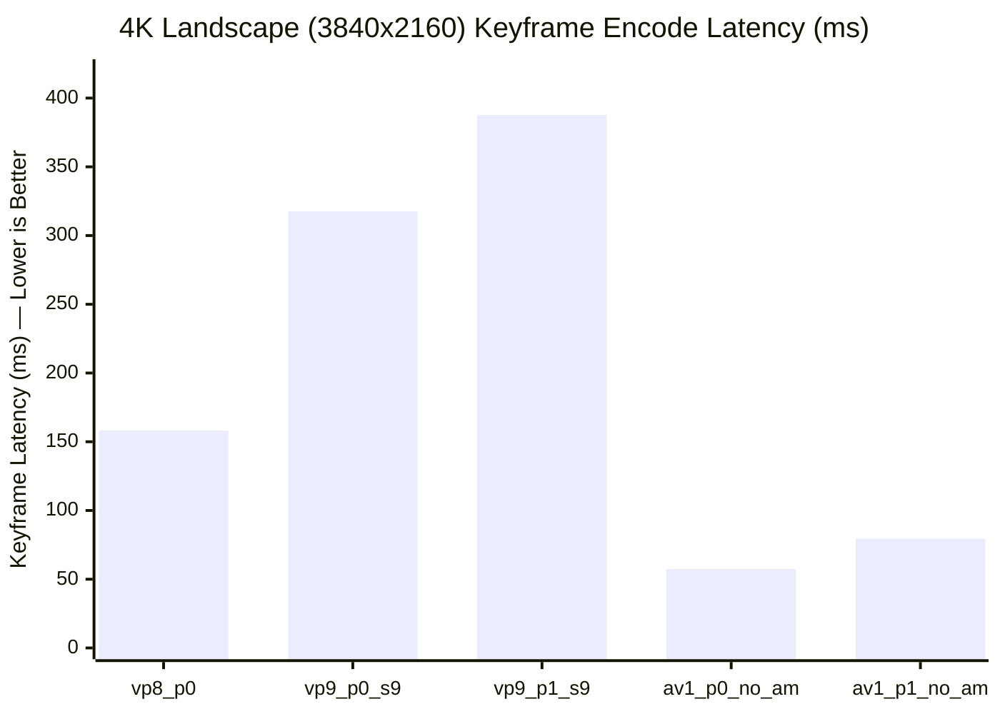

# Chrome Remote Desktop Video Encoder Baseline Benchmark Report (Example)

> [!NOTE]
> This file is a reference example of the Markdown analysis report generated by
> the `webrtc-video-encoder-benchmark` skill. Absolute encode latencies and
> throughput numbers depend on the host CPU microarchitecture, core count, and
> clock frequency of the machine where `webrtc_video_encoder_benchmark` is
> executed.

- **CRD Host Build Version**: `159.0.8130.0` (`origin/main` @ `64d594d95cbbd`, includes encoder & benchmark infrastructure through [`encoder_bitrate_filter.cc`](//remoting/codec/encoder_bitrate_filter.cc))
- **Benchmark Binary**: [`webrtc_video_encoder_benchmark`](//remoting/codec/webrtc_video_encoder_benchmark.cc) (Release static build, `is_debug=false`, `dcheck_always_on=false`)
- **Host Environment**: Linux x86_64 Workstation (`Intel(R) Xeon(R) CPU @ 2.60GHz`, Family 6, Model 106, 24C/48T)
- **Workload Matrix**: 8 synthetic scenarios $\times$ 6 resolutions (landscape & portrait) $\times$ 7 encoder configurations = **336 benchmark runs** (100 frames per run at 30.0 FPS = **33,600 encoded frames**)
- **Configuration**: [`baseline_benchmark_config.json`](./baseline_benchmark_config.json)

---

## 1. Executive Summary & Key Findings

> [!IMPORTANT]
> **AV1 (`av1_p0_s11` and `av1_p1_s11`) is the only codec family that meets the 30 FPS (`33.33 ms`) delta frame encode budget across all 48 scenario $\times$ resolution combinations**, including 4K Portrait (`2160x3840`) full-screen motion and stress workloads where VP9 and VP8 drop below 30 FPS.

### Headline Takeaways

1. **30 FPS (`33.33 ms`) Real-Time Frame Budget Compliance**:
   - **1080p (`1920x1080`, `1080x1920`) & 1440p (`2560x1440`, `1440x2560`)**: All 7 encoders comfortably meet the `33.33 ms` delta mean and P90 budget across all 8 scenarios. Even in `chaos_stress`, 1080p delta mean is `11.0–26.3 ms` and 1440p delta mean is `12.1–22.8 ms`.
   - **4K Landscape (`3840x2160`)**: All 7 encoders stay under the `33.33 ms` delta mean budget across all 8 scenarios. In the heaviest 4K landscape scenarios (`low_motion` at 93.2% updated area and `chaos_stress`), `av1_p0_s11_no_am` averages **`22.73 ms` / `21.47 ms`** (`42.9–46.0 FPS`), `vp9_p0_s9` averages **`19.06 ms` / `17.92 ms`** (`44.7–48.0 FPS`), `av1_p1_s11_no_am` averages **`26.80 ms` / `25.96 ms`** (`36.2–37.7 FPS`), and `vp9_p1_s9` averages **`24.70 ms` / `25.01 ms`** (`35.1–34.9 FPS`).
   - **4K Portrait (`2160x3840`) Bottleneck for VP9 & VP8**:
     - **`av1_p0_s11` and `av1_p1_s11` pass every 4K portrait scenario** (`<= 29.58 ms` delta mean, even at 95% updated area in `low_motion`).
     - **`vp9_p1_s9` (I444) exceeds the `33.33 ms` delta budget in 4 of 8 scenarios at `2160x3840`**: `busy_developer` (`37.67 ms`, `24.5 FPS`), `low_motion` (`47.46 ms`, `19.7 FPS`), `high_motion` (`36.92 ms`, `24.9 FPS`), and `chaos_stress` (`38.38 ms`, `23.9 FPS`).
     - **`vp9_p0_s9` (I420) and `vp8_p0` also fail the 30 FPS budget at `2160x3840` in `low_motion`**: `vp9_p0_s9` = `36.32 ms` (`25.5 FPS`), `vp8_p0` = `38.00 ms` (`25.2 FPS`).

2. **Portrait vs. Landscape Asymmetry (VP9 Multi-Threading Limitation vs. AV1 Row-MT)**:
   - Rotating any resolution from landscape to portrait (`1920x1080 -> 1080x1920`, `2560x1440 -> 1440x2560`, `3840x2160 -> 2160x3840`) causes **VP9 delta encode latency to degrade by `+35%` to `+95%`**, whereas **AV1 delta encode latency is orientation-invariant (within $\pm 5–10\%$)**.
   - **Code Root Cause**: In [`webrtc_video_encoder_vpx.cc`](//remoting/codec/webrtc_video_encoder_vpx.cc), thread count and `VP9E_SET_TILE_COLUMNS` are derived from frame **width** without enabling `VP9E_SET_ROW_MT = 1`. In portrait orientation, narrow width limits tile columns and starves worker threads. By contrast, [`webrtc_video_encoder_av1.cc`](//remoting/codec/webrtc_video_encoder_av1.cc) enables `AV1E_SET_ROW_MT = 1` along with both `AV1E_SET_TILE_COLUMNS` and `AV1E_SET_TILE_ROWS`, parallelizing cleanly across superblock rows regardless of display orientation.

3. **4K Keyframe Encode Stalls (VP9 `300–407 ms` vs. AV1 `44–110 ms`)**:
   - At 4K (`3840x2160` & `2160x3840`), **VP9 keyframe encoding takes `293–407 ms`** (stalling the encoder for 9–12 frame intervals at 30 FPS), and **VP8 takes `148–213 ms`**.
   - **AV1 encodes 4K keyframes in `44–89 ms` (Profile 0) and `58–110 ms` (Profile 1)** — **`4x to 6x` faster than VP9** while producing **2x to 3.5x smaller keyframe payloads**.

4. **Screen-Content Compression Efficiency & Rate Control**:
   - **AV1 dominates text/UI scrolling (`scroll_vertical`, `scroll_horizontal`, `desktop_clock`, `moving_window`)**: At 4K `scroll_horizontal`, `av1_p0_s11_no_am` encodes delta frames in **`9.82 ms` at `631 kbps` (`QP 15.8`)**, whereas `vp9_p0_s9` takes **`10.33 ms` at `5,039 kbps` (`QP 16.9`)** — AV1 is both faster and uses **`8x` less bandwidth**.
   - **VP8 (`vp8_p0`) severe bitrate overshoot & QP saturation**: Even with quantizer pinned at `max QP = 50.00` on every delta frame, `vp8_p0` overshoots target bitrates by **`1.5x to 2.6x`** in motion and scrolling workloads (e.g., `13,632 kbps` vs `5,184 kbps` target in `1080x1920` `low_motion`; `34,899 kbps` vs `20,736 kbps` target in `2160x3840` `low_motion`).

5. **AV1 Active Map (`no_am` vs. `am`) Evaluation**:
   - Across all 48 configurations, enabling `AV1E_SET_ACTIVE_MAP` (`av1_p0_s11_am` / `av1_p1_s11_am`) yields **no meaningful speedup over `no_am` (typically within $\pm 3\%$)**, and in static/small-damage workloads (`desktop_clock`) `no_am` is **10–20% faster** (`164.6 FPS` vs `142.8 FPS` at 4K P0) and uses **20–45% less bitrate** (`217.6 kbps` vs `405.4 kbps` at 4K P1). `libaom` speed 11 with `AV1E_SET_TUNE_CONTENT = AOM_CONTENT_SCREEN` already performs fast internal superblock skip detection without external active map overhead.

---

## 2. Benchmark Configuration & Methodology

### Encoder Configurations Tested

| Encoder ID | Codec | Profile / Pixel Format | Speed (`cpu-used`) | Active Map | Configured QP Range |
| :--- | :--- | :--- | :---: | :---: | :---: |
| `vp8_p0` | VP8 (`libvpx`) | Profile 0 (`I420` 4:2:0) | `16` (`-16` real-time) | Enabled | `10 – 50` |
| `vp9_p0_s9` | VP9 (`libvpx`) | Profile 0 (`I420` 4:2:0) | `9` | Enabled | `10 – 50` |
| `vp9_p1_s9` | VP9 (`libvpx`) | Profile 1 (`I444` 4:4:4) | `9` | Enabled | `10 – 50` |
| `av1_p0_s11_no_am` | AV1 (`libaom`) | Profile 0 (`I420` 4:2:0) | `11` | Disabled | `10 – 50` |
| `av1_p0_s11_am` | AV1 (`libaom`) | Profile 0 (`I420` 4:2:0) | `11` | Enabled | `10 – 50` |
| `av1_p1_s11_no_am` | AV1 (`libaom`) | Profile 1 (`I444` 4:4:4) | `11` | Disabled | `10 – 50` |
| `av1_p1_s11_am` | AV1 (`libaom`) | Profile 1 (`I444` 4:4:4) | `11` | Enabled | `10 – 50` |

### Target Bitrates by Resolution
Target bitrates are determined by [`EncoderBitrateFilter`](//remoting/codec/encoder_bitrate_filter.cc) (`2.5 kbps` per megapixel-frame at 30 FPS = `2.5 * width * height / 1000` kbps):

| ResolutionClass | Landscape | Portrait | Megapixels | Target Bitrate (`kbps`) |
| :--- | :---: | :---: | :---: | :---: |
| **1080p (FHD)** | `1920x1080` | `1080x1920` | `2.07 MP` | `5,184 kbps` |
| **1440p (QHD)** | `2560x1440` | `1440x2560` | `3.69 MP` | `9,216 kbps` |
| **4K (UHD)** | `3840x2160` | `2160x3840` | `8.29 MP` | `20,736 kbps` |

### Synthetic Scenarios (`100 frames` @ `30.0 FPS` = `3.33s` per run)

| Scenario | HTML Source | Description | Avg Updated Area (`1080p` -> `1440p` -> `4K`) |
| :--- | :--- | :--- | :--- |
| `desktop_clock` | [`desktop_clock.html`](//remoting/test/frame_generator/scenarios/desktop_clock.html) | Static desktop with 1 Hz digital clock update in corner | `1.00%` across all resolutions |
| `scroll_vertical` | [`scroll_vertical.html`](//remoting/test/frame_generator/scenarios/scroll_vertical.html) | Smooth vertical scrolling of dense text/code document | `26–36%` -> `22–31%` -> `17–24%` |
| `scroll_horizontal` | [`scroll_horizontal.html`](//remoting/test/frame_generator/scenarios/scroll_horizontal.html) | Smooth horizontal panning of wide spreadsheet/UI | `14–24%` -> `11–18%` -> `7–13%` |
| `moving_window` | [`moving_window.html`](//remoting/test/frame_generator/scenarios/moving_window.html) | Dragging an overlapping window in a circle across desktop | `13–14%` -> `8.5%` -> `4.3%` |
| `busy_developer` | [`busy_developer.html`](//remoting/test/frame_generator/scenarios/busy_developer.html) | Multi-pane IDE typing, terminal scrolling, and status updates | `57–74%` -> `43–64%` -> `27–44%` |
| `low_motion` | [`low_motion.html`](//remoting/test/frame_generator/scenarios/low_motion.html) | Smooth full-screen text UI vertical scroll (`50 px/s`) | `96–100%` -> `95–99%` -> `93–95%` |
| `high_motion` | [`high_motion.html`](//remoting/test/frame_generator/scenarios/high_motion.html) | Fast-moving bouncing geometric regions across screen | `58–61%` -> `42–44%` -> `26–27%` |
| `chaos_stress` | [`chaos_stress.html`](//remoting/test/frame_generator/scenarios/chaos_stress.html) | High-entropy rotating & translating shapes stress test | `65–66%` -> `45–46%` -> `24–25%` |

---

## 3. Cross-Scenario Architectural Comparisons

### 3.1 Portrait vs. Landscape Asymmetry (`3840x2160` vs. `2160x3840`)

```mermaid
xychart-beta
    title "4K Delta Encode Mean Latency: Landscape (3840x2160) vs Portrait (2160x3840) in chaos_stress"
    x-axis ["vp8_p0", "vp9_p0_s9", "vp9_p1_s9", "av1_p0_no_am", "av1_p0_am", "av1_p1_no_am", "av1_p1_am"]
    y-axis "Delta Mean Latency (ms) — Lower is Better (Budget: 33.3ms)" 0 --> 45
    bar [25.07, 17.92, 25.01, 21.47, 22.06, 25.96, 26.04]
    bar [27.73, 28.72, 38.38, 21.28, 20.97, 25.17, 25.64]
```

| Scenario (`3840x2160` -> `2160x3840`) | `vp8_p0` | `vp9_p0_s9` | `vp9_p1_s9` | `av1_p0_s11_no_am` | `av1_p1_s11_no_am` |
| :--- | :---: | :---: | :---: | :---: | :---: |
| **`scroll_vertical`** | `17.10 -> 29.56 ms` (**+73%**) | `11.85 -> 22.00 ms` (**+86%**) | `16.77 -> 28.58 ms` (**+70%**) | `10.13 -> 11.25 ms` (**+11%**) | `14.46 -> 14.63 ms` (**+1%**) |
| **`busy_developer`** | `17.15 -> 24.21 ms` (**+41%**) | `16.19 -> 26.34 ms` (**+63%**) | `22.90 -> 37.67 ms` (**+65%**) | `15.78 -> 16.18 ms` (**+3%**) | `20.38 -> 21.56 ms` (**+6%**) |
| **`low_motion`** | `30.51 -> 38.00 ms` (**+25%**) | `19.06 -> 36.32 ms` (**+91%**) | `24.70 -> 47.46 ms` (**+92%**) | `22.73 -> 23.26 ms` (**+2%**) | `26.80 -> 29.37 ms` (**+10%**) |
| **`high_motion`** | `18.28 -> 31.18 ms` (**+71%**) | `16.08 -> 28.02 ms` (**+74%**) | `22.14 -> 36.92 ms` (**+67%**) | `16.32 -> 16.06 ms` (**-2%**) | `22.74 -> 22.36 ms` (**-2%**) |
| **`chaos_stress`** | `25.07 -> 27.73 ms` (**+11%**) | `17.92 -> 28.72 ms` (**+60%**) | `25.01 -> 38.38 ms` (**+53%**) | `21.47 -> 21.28 ms` (**-1%**) | `25.96 -> 25.17 ms` (**-3%**) |

> [!TIP]
> **Optimization Opportunity for `WebrtcVideoEncoderVpx`**: Enabling `VP9E_SET_ROW_MT = 1` and sizing thread allocation by total pixels (or `max(width, height)`) rather than `width` alone in [`webrtc_video_encoder_vpx.cc`](//remoting/codec/webrtc_video_encoder_vpx.cc) should eliminate most of the portrait penalty in VP9.

---

### 3.2 Keyframe Encode Latency (`3840x2160` & `2160x3840`)

| Resolution | Scenario | `vp8_p0` Key (ms / KiB) | `vp9_p0_s9` Key (ms / KiB) | `vp9_p1_s9` Key (ms / KiB) | `av1_p0_s11_no_am` Key (ms / KiB) | `av1_p1_s11_no_am` Key (ms / KiB) |
| :--- | :--- | :---: | :---: | :---: | :---: | :---: |
| `3840x2160` | `desktop_clock` | `147.56 ms` / `28.5 KiB` | `307.72 ms` / `26.8 KiB` | `355.79 ms` / `28.2 KiB` | **`45.76 ms` / `8.5 KiB`** | **`58.16 ms` / `9.0 KiB`** |
| `3840x2160` | `scroll_vertical` | `152.20 ms` / `198.1 KiB` | `326.12 ms` / `241.0 KiB` | `396.20 ms` / `327.0 KiB` | **`60.17 ms` / `99.1 KiB`** | **`88.77 ms` / `146.5 KiB`** |
| `3840x2160` | `busy_developer` | `158.16 ms` / `281.1 KiB` | `317.60 ms` / `346.0 KiB` | `387.72 ms` / `463.2 KiB` | **`57.38 ms` / `137.0 KiB`** | **`79.59 ms` / `204.1 KiB`** |
| `3840x2160` | `low_motion` | `177.21 ms` / `504.4 KiB` | `349.14 ms` / `714.6 KiB` | `406.99 ms` / `723.1 KiB` | **`81.95 ms` / `275.5 KiB`** | **`109.73 ms` / `280.1 KiB`** |
| `2160x3840` | `busy_developer` | `198.79 ms` / `416.6 KiB` | `306.63 ms` / `541.3 KiB` | `344.60 ms` / `660.3 KiB` | **`62.80 ms` / `210.0 KiB`** | **`73.68 ms` / `277.0 KiB`** |
| `2160x3840` | `low_motion` | `212.85 ms` / `883.0 KiB` | `321.31 ms` / `1251.2 KiB` | `374.71 ms` / `1258.2 KiB` | **`86.98 ms` / `490.4 KiB`** | **`101.72 ms` / `494.2 KiB`** |

---

## 4. Complete Results by Scenario (All 336 Runs)

In all tables below:
- **All / Delta / Key Latency**: Reported in milliseconds (`ms`).
- **Enc FPS**: Pure encoder throughput (`1000 / All Mean ms`).
- **Bitrate**: Achieved stream bitrate (`kbps`) over the 100-frame sequence vs. target bitrate.
- **Delta QP**: Average / Max quantizer (`0–63` mapped to WebRTC `0–50` scale) across the 99 delta frames.
- Bold rows/cells highlight the fastest encoder or any configuration exceeding the **`33.33 ms` (30 FPS)** delta mean budget.

---

### 4.1 Scenario 1: `desktop_clock` (1.00% Updated Area)

#### Landscape (`1920x1080`, `2560x1440`, `3840x2160`)

| Resolution (Target) | Encoder | Delta Mean (ms) | Delta P50 (ms) | Delta P90 (ms) | Delta P99 (ms) | Key Max (ms) | All Mean (ms) | Enc FPS | Bitrate (kbps) | Delta QP (Avg / Max) |
| :--- | :--- | :---: | :---: | :---: | :---: | :---: | :---: | :---: | :---: | :---: |
| **`1920x1080`** (`5184 kbps`) | `vp8_p0` | 3.15 | 3.11 | 3.35 | 4.27 | 38.45 | 3.50 | 285.5 | 173.1 | 13.54 / 50 |
| | `vp9_p0_s9` | 2.65 | 2.45 | 3.30 | 5.37 | 69.42 | 3.31 | 301.8 | 107.0 | 14.72 / 50 |
| | `vp9_p1_s9` | 3.90 | 3.68 | 4.41 | 7.78 | 79.61 | 4.66 | 214.6 | 137.0 | 14.72 / 50 |
| | **`av1_p0_s11_no_am`** | **2.61** | **2.21** | **3.35** | **5.22** | **24.66** | **2.83** | **353.1** | **66.3** | 16.46 / 38 |
| | `av1_p0_s11_am` | 2.75 | 2.56 | 2.99 | 5.09 | 24.07 | 2.96 | 337.6 | 78.7 | 16.46 / 38 |
| | `av1_p1_s11_no_am` | 3.92 | 3.41 | 5.08 | 8.16 | 34.40 | 4.23 | 236.6 | 99.4 | 17.69 / 38 |
| | `av1_p1_s11_am` | 4.73 | 4.54 | 5.27 | 7.76 | 30.21 | 4.98 | 200.7 | 122.2 | 17.78 / 38 |
| **`2560x1440`** (`9216 kbps`) | `vp8_p0` | 4.03 | 3.94 | 4.36 | 5.97 | 53.82 | 4.53 | 220.8 | 268.4 | 13.58 / 50 |
| | `vp9_p0_s9` | 2.84 | 2.52 | 3.80 | 5.84 | 103.96 | 3.85 | 259.7 | 141.3 | 14.83 / 50 |
| | `vp9_p1_s9` | 4.43 | 4.03 | 5.53 | 8.34 | 114.42 | 5.53 | 180.9 | 183.3 | 14.83 / 50 |
| | **`av1_p0_s11_no_am`** | **2.53** | **2.24** | **2.95** | **5.45** | **28.79** | **2.79** | **358.1** | **85.3** | 16.32 / 38 |
| | `av1_p0_s11_am` | 2.88 | 2.63 | 3.23 | 5.50 | 28.85 | 3.14 | 318.1 | 104.9 | 16.32 / 38 |
| | `av1_p1_s11_no_am` | 4.49 | 3.77 | 6.07 | 9.57 | 35.24 | 4.80 | 208.3 | 132.1 | 16.23 / 38 |
| | `av1_p1_s11_am` | 5.04 | 4.79 | 5.59 | 8.67 | 35.82 | 5.34 | 187.1 | 192.5 | 16.25 / 38 |
| **`3840x2160`** (`20736 kbps`) | `vp8_p0` | 8.63 | 8.54 | 9.15 | 12.73 | 147.56 | 10.02 | 99.8 | 541.6 | 13.64 / 50 |
| | `vp9_p0_s9` | 6.12 | 5.58 | 7.57 | 13.19 | 307.72 | 9.13 | 109.5 | 176.8 | 14.83 / 50 |
| | `vp9_p1_s9` | 9.52 | 8.27 | 12.06 | 25.02 | 355.79 | 12.98 | 77.0 | 236.4 | 14.83 / 50 |
| | **`av1_p0_s11_no_am`** | **5.67** | **5.04** | **6.18** | **12.63** | **45.76** | **6.07** | **164.6** | **140.2** | 15.91 / 38 |
| | `av1_p0_s11_am` | 6.62 | 5.83 | 7.25 | 14.60 | 45.37 | 7.00 | 142.8 | 175.1 | 15.91 / 38 |
| | `av1_p1_s11_no_am` | 9.38 | 8.06 | 11.13 | 22.00 | 58.16 | 9.86 | 101.4 | 217.6 | 15.65 / 38 |
| | `av1_p1_s11_am` | 10.55 | 9.25 | 12.96 | 21.97 | 59.38 | 11.03 | 90.6 | 405.4 | 15.67 / 38 |

#### Portrait (`1080x1920`, `1440x2560`, `2160x3840`)

| Resolution (Target) | Encoder | Delta Mean (ms) | Delta P50 (ms) | Delta P90 (ms) | Delta P99 (ms) | Key Max (ms) | All Mean (ms) | Enc FPS | Bitrate (kbps) | Delta QP (Avg / Max) |
| :--- | :--- | :---: | :---: | :---: | :---: | :---: | :---: | :---: | :---: | :---: |
| **`1080x1920`** (`5184 kbps`) | `vp8_p0` | 2.30 | 2.24 | 2.41 | 3.65 | 33.79 | 2.62 | 381.8 | 173.6 | 13.54 / 50 |
| | `vp9_p0_s9` | 2.02 | 1.87 | 2.36 | 4.11 | 59.96 | 2.60 | 384.8 | 111.9 | 14.72 / 50 |
| | `vp9_p1_s9` | 4.26 | 3.96 | 5.12 | 7.50 | 75.22 | 4.97 | 201.1 | 143.8 | 14.72 / 50 |
| | **`av1_p0_s11_no_am`** | **1.79** | **1.68** | **2.16** | **4.10** | **23.46** | **2.01** | **497.4** | **65.4** | 16.70 / 38 |
| | `av1_p0_s11_am` | 2.27 | 2.13 | 2.45 | 4.24 | 22.91 | 2.48 | 403.5 | 80.0 | 16.70 / 38 |
| | `av1_p1_s11_no_am` | 3.23 | 2.74 | 4.45 | 6.90 | 29.35 | 3.49 | 286.7 | 99.8 | 17.37 / 38 |
| | `av1_p1_s11_am` | 4.07 | 3.89 | 4.37 | 6.67 | 29.34 | 4.33 | 231.2 | 122.1 | 17.38 / 38 |
| **`1440x2560`** (`9216 kbps`) | `vp8_p0` | 4.23 | 4.12 | 4.42 | 6.67 | 56.05 | 4.75 | 210.7 | 268.7 | 13.58 / 50 |
| | `vp9_p0_s9` | 4.20 | 3.77 | 5.87 | 7.64 | 95.86 | 5.12 | 195.4 | 132.5 | 14.83 / 50 |
| | `vp9_p1_s9` | 6.30 | 5.32 | 9.15 | 11.55 | 115.33 | 7.39 | 135.3 | 173.3 | 14.83 / 50 |
| | **`av1_p0_s11_no_am`** | **2.55** | **2.38** | **3.14** | **5.04** | **27.95** | **2.81** | **356.5** | **83.7** | 16.44 / 38 |
| | `av1_p0_s11_am` | 3.08 | 2.97 | 3.55 | 5.47 | 29.04 | 3.34 | 299.3 | 100.4 | 16.44 / 38 |
| | `av1_p1_s11_no_am` | 4.54 | 4.02 | 6.05 | 8.60 | 37.26 | 4.87 | 205.4 | 131.5 | 16.56 / 38 |
| | `av1_p1_s11_am` | 5.50 | 5.18 | 6.36 | 8.83 | 35.36 | 5.79 | 172.6 | 187.0 | 16.59 / 38 |
| **`2160x3840`** (`20736 kbps`) | `vp8_p0` | 10.51 | 10.28 | 11.17 | 17.25 | 173.83 | 12.14 | 82.4 | 539.1 | 13.64 / 50 |
| | `vp9_p0_s9` | 8.41 | 7.23 | 11.70 | 16.70 | 305.68 | 11.39 | 87.8 | 179.2 | 14.83 / 50 |
| | `vp9_p1_s9` | 13.59 | 12.43 | 17.61 | 31.40 | 387.75 | 17.33 | 57.7 | 239.7 | 14.83 / 50 |
| | **`av1_p0_s11_no_am`** | **5.98** | **5.05** | **7.56** | **12.82** | **55.14** | **6.47** | **154.5** | **150.6** | 16.30 / 38 |
| | `av1_p0_s11_am` | 6.58 | 6.11 | 7.30 | 13.15 | 54.64 | 7.06 | 141.6 | 184.0 | 16.30 / 38 |
| | `av1_p1_s11_no_am` | 9.99 | 9.02 | 10.67 | 21.12 | 82.30 | 10.71 | 93.4 | 264.8 | 16.47 / 38 |
| | `av1_p1_s11_am` | 10.84 | 9.81 | 11.92 | 21.82 | 78.44 | 11.51 | 86.9 | 474.3 | 16.49 / 38 |

---

### 4.2 Scenario 2: `scroll_vertical` (17.5% – 35.9% Updated Area)

#### Landscape (`1920x1080`, `2560x1440`, `3840x2160`)

| Resolution (Area / Target) | Encoder | Delta Mean (ms) | Delta P50 (ms) | Delta P90 (ms) | Delta P99 (ms) | Key Max (ms) | All Mean (ms) | Enc FPS | Bitrate (kbps) | Delta QP (Avg / Max) |
| :--- | :--- | :---: | :---: | :---: | :---: | :---: | :---: | :---: | :---: | :---: |
| **`1920x1080`** (`25.98%` / `5184 kbps`) | `vp8_p0` | 6.11 | 6.13 | 6.88 | 8.31 | 35.62 | 6.40 | 156.2 | 3317.3 | 47.90 / 50 |
| | `vp9_p0_s9` | 5.14 | 4.98 | 6.11 | 6.81 | 65.55 | 5.74 | 174.1 | 908.6 | 14.97 / 50 |
| | `vp9_p1_s9` | 6.84 | 6.61 | 8.06 | 9.57 | 70.79 | 7.48 | 133.7 | 851.6 | 14.96 / 50 |
| | **`av1_p0_s11_no_am`** | **4.30** | **3.96** | **5.82** | **7.19** | **28.53** | **4.55** | **219.9** | **407.4** | 17.01 / 40 |
| | `av1_p0_s11_am` | 4.40 | 4.02 | 6.02 | 7.43 | 29.50 | 4.65 | 215.2 | 416.2 | 17.03 / 40 |
| | `av1_p1_s11_no_am` | 5.29 | 4.88 | 6.97 | 8.41 | 32.98 | 5.57 | 179.6 | 379.6 | 16.58 / 40 |
| | `av1_p1_s11_am` | 5.21 | 4.99 | 7.01 | 7.87 | 33.55 | 5.50 | 181.9 | 381.9 | 16.58 / 40 |
| **`2560x1440`** (`22.48%` / `9216 kbps`) | `vp8_p0` | 10.54 | 10.90 | 11.85 | 12.13 | 58.65 | 11.02 | 90.8 | 5606.5 | 44.52 / 50 |
| | `vp9_p0_s9` | 5.85 | 5.71 | 6.55 | 8.31 | 98.65 | 6.78 | 147.5 | 1875.6 | 14.83 / 50 |
| | `vp9_p1_s9` | 8.71 | 8.55 | 9.70 | 12.31 | 115.13 | 9.77 | 102.3 | 1836.2 | 14.83 / 50 |
| | **`av1_p0_s11_no_am`** | **4.73** | **4.55** | **5.52** | **8.20** | **34.47** | **5.03** | **198.9** | **541.6** | 16.13 / 40 |
| | `av1_p0_s11_am` | 5.07 | 4.95 | 6.55 | 8.65 | 34.44 | 5.36 | 186.4 | 546.9 | 16.13 / 40 |
| | `av1_p1_s11_no_am` | 6.67 | 6.28 | 7.92 | 11.32 | 41.60 | 7.02 | 142.4 | 555.2 | 17.15 / 40 |
| | `av1_p1_s11_am` | 6.10 | 5.87 | 7.34 | 11.42 | 41.04 | 6.45 | 155.0 | 542.4 | 17.26 / 40 |
| **`3840x2160`** (`17.49%` / `20736 kbps`) | `vp8_p0` | 17.10 | 17.68 | 19.10 | 19.69 | 152.20 | 18.45 | 54.2 | 12694.8 | 47.40 / 50 |
| | `vp9_p0_s9` | 11.85 | 11.42 | 12.78 | 18.39 | 326.12 | 14.99 | 66.7 | 3587.4 | 15.13 / 50 |
| | `vp9_p1_s9` | 16.77 | 15.83 | 19.64 | 31.59 | 396.20 | 20.57 | 48.6 | 3543.7 | 15.13 / 50 |
| | **`av1_p0_s11_no_am`** | **10.13** | **9.69** | **12.00** | **15.61** | **60.17** | **10.63** | **94.1** | **1089.5** | 16.90 / 40 |
| | `av1_p0_s11_am` | 10.21 | 9.83 | 11.63 | 16.45 | 59.19 | 10.70 | 93.5 | 1101.7 | 16.88 / 40 |
| | `av1_p1_s11_no_am` | 14.46 | 13.51 | 16.72 | 25.70 | 88.77 | 15.20 | 65.8 | 1028.1 | 16.54 / 40 |
| | `av1_p1_s11_am` | 13.53 | 12.98 | 14.91 | 24.69 | 85.32 | 14.25 | 70.2 | 1023.1 | 16.54 / 40 |

#### Portrait (`1080x1920`, `1440x2560`, `2160x3840`)

| Resolution (Area / Target) | Encoder | Delta Mean (ms) | Delta P50 (ms) | Delta P90 (ms) | Delta P99 (ms) | Key Max (ms) | All Mean (ms) | Enc FPS | Bitrate (kbps) | Delta QP (Avg / Max) |
| :--- | :--- | :---: | :---: | :---: | :---: | :---: | :---: | :---: | :---: | :---: |
| **`1080x1920`** (`35.87%` / `5184 kbps`) | `vp8_p0` | 7.65 | 8.45 | 9.11 | 12.73 | 40.44 | 7.97 | 125.4 | 3350.2 | 46.59 / 50 |
| | `vp9_p0_s9` | 9.91 | 9.86 | 11.46 | 11.92 | 67.26 | 10.48 | 95.4 | 1732.3 | 15.32 / 50 |
| | `vp9_p1_s9` | 13.26 | 12.93 | 14.99 | 16.47 | 80.14 | 13.93 | 71.8 | 1554.1 | 15.89 / 50 |
| | **`av1_p0_s11_no_am`** | **4.33** | **4.13** | **5.55** | **6.31** | **38.85** | **4.68** | **213.8** | **434.5** | 15.11 / 38 |
| | `av1_p0_s11_am` | 4.52 | 4.36 | 5.48 | 6.70 | 40.25 | 4.88 | 205.1 | 450.3 | 15.11 / 38 |
| | `av1_p1_s11_no_am` | 5.54 | 5.27 | 7.25 | 8.11 | 45.04 | 5.93 | 168.5 | 416.6 | 16.72 / 38 |
| | `av1_p1_s11_am` | 5.60 | 5.21 | 7.24 | 8.06 | 43.39 | 5.98 | 167.4 | 429.2 | 16.70 / 38 |
| **`1440x2560`** (`30.56%` / `9216 kbps`) | `vp8_p0` | 10.92 | 11.13 | 11.74 | 12.22 | 63.63 | 11.45 | 87.4 | 5624.2 | 45.49 / 50 |
| | `vp9_p0_s9` | 10.46 | 10.38 | 11.21 | 13.49 | 102.09 | 11.38 | 87.9 | 2484.8 | 14.90 / 50 |
| | `vp9_p1_s9` | 14.01 | 14.01 | 14.80 | 16.60 | 108.77 | 14.96 | 66.8 | 2255.8 | 14.90 / 50 |
| | `av1_p0_s11_no_am` | 5.28 | 5.06 | 5.88 | 8.14 | 40.27 | 5.63 | 177.7 | 655.4 | 15.65 / 40 |
| | **`av1_p0_s11_am`** | **5.19** | **4.99** | **5.79** | **7.34** | **40.35** | **5.55** | **180.3** | **661.8** | 15.65 / 40 |
| | `av1_p1_s11_no_am` | 6.81 | 6.61 | 7.08 | 10.13 | 47.94 | 7.22 | 138.5 | 614.7 | 15.55 / 40 |
| | `av1_p1_s11_am` | 7.06 | 6.50 | 7.92 | 10.89 | 51.37 | 7.51 | 133.2 | 619.0 | 15.55 / 40 |
| **`2160x3840`** (`24.21%` / `20736 kbps`) | `vp8_p0` | 29.56 | 31.41 | 32.47 | 34.44 | 190.97 | 31.18 | 32.1 | 12189.0 | 41.96 / 50 |
| | `vp9_p0_s9` | 22.00 | 21.63 | 24.57 | 27.51 | 303.99 | 24.82 | 40.3 | 4442.7 | 15.20 / 50 |
| | `vp9_p1_s9` | 28.58 | 26.54 | 33.03 | 45.85 | 370.96 | 32.00 | 31.3 | 4276.0 | 15.20 / 50 |
| | `av1_p0_s11_no_am` | 11.25 | 10.91 | 11.95 | 16.84 | 57.93 | 11.72 | 85.3 | 1352.1 | 16.08 / 40 |
| | **`av1_p0_s11_am`** | **11.17** | **10.94** | **11.71** | **18.14** | **62.41** | **11.69** | **85.6** | **1351.1** | 16.08 / 40 |
| | `av1_p1_s11_no_am` | 14.63 | 13.76 | 15.00 | 26.15 | 87.93 | 15.36 | 65.1 | 1297.4 | 15.92 / 40 |
| | `av1_p1_s11_am` | 14.36 | 13.58 | 14.70 | 25.99 | 89.21 | 15.10 | 66.2 | 1322.3 | 15.92 / 40 |

---

### 4.3 Scenario 3: `scroll_horizontal` (7.4% – 23.8% Updated Area)

#### Landscape (`1920x1080`, `2560x1440`, `3840x2160`)

| Resolution (Area / Target) | Encoder | Delta Mean (ms) | Delta P50 (ms) | Delta P90 (ms) | Delta P99 (ms) | Key Max (ms) | All Mean (ms) | Enc FPS | Bitrate (kbps) | Delta QP (Avg / Max) |
| :--- | :--- | :---: | :---: | :---: | :---: | :---: | :---: | :---: | :---: | :---: |
| **`1920x1080`** (`23.83%` / `5184 kbps`) | `vp8_p0` | 7.19 | 7.21 | 8.01 | 8.82 | 36.58 | 7.48 | 133.7 | **8787.0** | 50.00 / 50 |
| | `vp9_p0_s9` | 4.66 | 4.39 | 5.65 | 6.68 | 63.62 | 5.25 | 190.5 | 1171.3 | 15.11 / 50 |
| | `vp9_p1_s9` | 6.45 | 6.21 | 7.47 | 9.04 | 72.58 | 7.11 | 140.6 | 1369.9 | 15.16 / 50 |
| | **`av1_p0_s11_no_am`** | **3.92** | **3.81** | **4.49** | **6.01** | **35.60** | **4.24** | **235.8** | **422.4** | 15.87 / 38 |
| | `av1_p0_s11_am` | 4.15 | 4.10 | 4.90 | 5.86 | 35.53 | 4.46 | 224.0 | 431.6 | 15.87 / 38 |
| | `av1_p1_s11_no_am` | 5.35 | 5.01 | 6.60 | 7.44 | 40.10 | 5.70 | 175.5 | 434.4 | 15.61 / 38 |
| | `av1_p1_s11_am` | 5.73 | 5.69 | 6.75 | 7.60 | 40.70 | 6.08 | 164.6 | 444.1 | 15.61 / 38 |
| **`2560x1440`** (`18.21%` / `9216 kbps`) | `vp8_p0` | 10.61 | 10.68 | 11.65 | 12.77 | 58.89 | 11.09 | 90.1 | **12073.8** | 50.00 / 50 |
| | `vp9_p0_s9` | 6.11 | 6.03 | 6.68 | 9.03 | 101.48 | 7.06 | 141.6 | 5041.8 | 31.06 / 50 |
| | `vp9_p1_s9` | 9.02 | 8.93 | 9.43 | 13.54 | 112.37 | 10.05 | 99.5 | 5324.8 | 35.69 / 50 |
| | **`av1_p0_s11_no_am`** | **5.15** | **5.00** | **5.81** | **7.17** | **36.28** | **5.46** | **183.1** | **526.2** | 15.57 / 38 |
| | `av1_p0_s11_am` | 5.21 | 5.07 | 5.65 | 7.24 | 36.45 | 5.52 | 181.0 | 526.8 | 15.59 / 38 |
| | `av1_p1_s11_no_am` | 6.82 | 6.60 | 7.83 | 10.28 | 43.90 | 7.19 | 139.2 | 544.1 | 15.56 / 38 |
| | `av1_p1_s11_am` | 6.84 | 6.65 | 7.76 | 10.22 | 43.31 | 7.20 | 138.9 | 547.8 | 15.56 / 38 |
| **`3840x2160`** (`12.51%` / `20736 kbps`) | `vp8_p0` | 16.18 | 16.05 | 16.67 | 19.59 | 156.88 | 17.58 | 56.9 | 19459.8 | 50.00 / 50 |
| | `vp9_p0_s9` | 10.33 | 9.44 | 12.66 | 17.28 | 330.22 | 13.53 | 73.9 | 5039.0 | 16.85 / 50 |
| | `vp9_p1_s9` | 14.82 | 13.96 | 17.07 | 30.42 | 387.05 | 18.55 | 53.9 | 6633.1 | 16.74 / 50 |
| | `av1_p0_s11_no_am` | 9.82 | 9.40 | 10.80 | 15.16 | 68.74 | 10.41 | 96.1 | 631.0 | 15.78 / 38 |
| | **`av1_p0_s11_am`** | **9.04** | **8.32** | **10.60** | **15.87** | **69.13** | **9.64** | **103.7** | **626.6** | 15.78 / 38 |
| | `av1_p1_s11_no_am` | 13.10 | 12.20 | 13.34 | 24.79 | 96.21 | 13.93 | 71.8 | 633.3 | 17.33 / 40 |
| | `av1_p1_s11_am` | 13.09 | 12.62 | 14.52 | 24.81 | 97.09 | 13.93 | 71.8 | 634.4 | 17.38 / 40 |

#### Portrait (`1080x1920`, `1440x2560`, `2160x3840`)

| Resolution (Area / Target) | Encoder | Delta Mean (ms) | Delta P50 (ms) | Delta P90 (ms) | Delta P99 (ms) | Key Max (ms) | All Mean (ms) | Enc FPS | Bitrate (kbps) | Delta QP (Avg / Max) |
| :--- | :--- | :---: | :---: | :---: | :---: | :---: | :---: | :---: | :---: | :---: |
| **`1080x1920`** (`13.57%` / `5184 kbps`) | `vp8_p0` | 5.18 | 5.14 | 5.76 | 6.75 | 34.13 | 5.47 | 183.0 | 4934.2 | 50.00 / 50 |
| | `vp9_p0_s9` | 5.49 | 5.66 | 6.28 | 9.09 | 59.04 | 6.03 | 165.9 | 2178.3 | 24.21 / 50 |
| | `vp9_p1_s9` | 7.32 | 7.47 | 8.35 | 10.56 | 72.01 | 7.97 | 125.5 | 2043.6 | 23.91 / 50 |
| | **`av1_p0_s11_no_am`** | **3.24** | **3.13** | **3.63** | **5.23** | **26.70** | **3.47** | **288.0** | **285.0** | 15.58 / 38 |
| | `av1_p0_s11_am` | 3.49 | 3.34 | 4.41 | 5.68 | 27.44 | 3.72 | 268.5 | 290.2 | 15.58 / 38 |
| | `av1_p1_s11_no_am` | 4.28 | 4.04 | 4.64 | 7.22 | 33.07 | 4.57 | 218.9 | 300.7 | 15.20 / 38 |
| | `av1_p1_s11_am` | 4.30 | 4.07 | 4.77 | 6.97 | 32.59 | 4.58 | 218.4 | 305.3 | 15.20 / 38 |
| **`1440x2560`** (`10.60%` / `9216 kbps`) | `vp8_p0` | 8.04 | 7.78 | 9.06 | 10.86 | 55.79 | 8.51 | 117.4 | 6755.8 | 50.00 / 50 |
| | `vp9_p0_s9` | 6.12 | 5.80 | 7.16 | 9.72 | 93.83 | 7.00 | 142.8 | 2963.2 | 17.27 / 50 |
| | `vp9_p1_s9` | 9.73 | 9.76 | 10.77 | 13.98 | 105.95 | 10.69 | 93.6 | 2970.3 | 17.54 / 50 |
| | **`av1_p0_s11_no_am`** | **4.30** | **4.15** | **4.59** | **6.73** | **37.40** | **4.63** | **216.1** | **378.0** | 15.56 / 38 |
| | `av1_p0_s11_am` | 4.46 | 4.24 | 4.99 | 7.00 | 36.27 | 4.77 | 209.4 | 372.8 | 15.56 / 38 |
| | `av1_p1_s11_no_am` | 5.71 | 5.46 | 6.00 | 9.78 | 41.77 | 6.07 | 164.7 | 382.7 | 15.39 / 38 |
| | `av1_p1_s11_am` | 5.89 | 5.50 | 6.50 | 10.64 | 42.05 | 6.25 | 160.0 | 380.6 | 15.39 / 38 |
| **`2160x3840`** (`7.44%` / `20736 kbps`) | `vp8_p0` | 19.14 | 20.17 | 21.30 | 23.75 | 170.31 | 20.65 | 48.4 | 12205.4 | 46.73 / 50 |
| | `vp9_p0_s9` | 13.48 | 13.26 | 16.40 | 20.89 | 299.20 | 16.34 | 61.2 | 4278.8 | 15.23 / 50 |
| | `vp9_p1_s9` | 18.21 | 16.48 | 23.12 | 36.28 | 374.34 | 21.77 | 45.9 | 4322.3 | 15.23 / 50 |
| | `av1_p0_s11_no_am` | 8.22 | 7.80 | 8.55 | 14.80 | 53.63 | 8.67 | 115.3 | 373.4 | 15.13 / 38 |
| | **`av1_p0_s11_am`** | **7.88** | **7.14** | **8.79** | **15.71** | **54.13** | **8.34** | **119.9** | **370.5** | 15.13 / 38 |
| | `av1_p1_s11_no_am` | 11.95 | 11.16 | 11.98 | 22.95 | 80.28 | 12.64 | 79.1 | 369.4 | 15.29 / 38 |
| | `av1_p1_s11_am` | 10.95 | 9.97 | 11.63 | 23.15 | 79.22 | 11.63 | 86.0 | 369.6 | 15.29 / 38 |

---

### 4.4 Scenario 4: `moving_window` (4.3% – 14.3% Updated Area)

#### Landscape (`1920x1080`, `2560x1440`, `3840x2160`)

| Resolution (Area / Target) | Encoder | Delta Mean (ms) | Delta P50 (ms) | Delta P90 (ms) | Delta P99 (ms) | Key Max (ms) | All Mean (ms) | Enc FPS | Bitrate (kbps) | Delta QP (Avg / Max) |
| :--- | :--- | :---: | :---: | :---: | :---: | :---: | :---: | :---: | :---: | :---: |
| **`1920x1080`** (`14.34%` / `5184 kbps`) | `vp8_p0` | 4.33 | 4.29 | 5.05 | 5.65 | 32.16 | 4.61 | 216.9 | 2839.9 | 16.48 / 50 |
| | **`vp9_p0_s9`** | **3.98** | **3.99** | **4.47** | **5.13** | 59.37 | **4.53** | **220.8** | 2249.9 | 15.36 / 50 |
| | `vp9_p1_s9` | 5.44 | 5.42 | 5.90 | 7.59 | 73.63 | 6.12 | 163.4 | 2251.0 | 15.76 / 50 |
| | `av1_p0_s11_no_am` | 5.71 | 5.69 | 6.77 | 8.19 | 25.23 | 5.91 | 169.3 | 1802.6 | 15.67 / 40 |
| | `av1_p0_s11_am` | 5.56 | 5.65 | 6.53 | 6.98 | **24.77** | 5.75 | 173.9 | 1804.7 | 15.67 / 40 |
| | `av1_p1_s11_no_am` | 6.28 | 6.16 | 7.36 | 8.63 | 30.14 | 6.52 | 153.4 | 1785.0 | 16.26 / 40 |
| | `av1_p1_s11_am` | 6.04 | 5.95 | 6.91 | 9.05 | 29.61 | 6.28 | 159.3 | 1801.4 | 16.26 / 40 |
| **`2560x1440`** (`8.51%` / `9216 kbps`) | `vp8_p0` | 5.85 | 5.71 | 6.54 | 7.93 | 52.88 | 6.32 | 158.2 | 3069.9 | 14.62 / 50 |
| | **`vp9_p0_s9`** | **4.59** | **4.46** | **4.97** | **7.74** | 98.04 | 5.52 | 181.1 | 2428.1 | 14.96 / 50 |
| | `vp9_p1_s9` | 6.72 | 6.41 | 7.65 | 10.57 | 112.18 | 7.78 | 128.6 | 2429.4 | 14.96 / 50 |
| | `av1_p0_s11_no_am` | 5.18 | 5.13 | 5.73 | 7.78 | **28.94** | **5.41** | **184.7** | 1822.9 | 15.52 / 40 |
| | `av1_p0_s11_am` | 5.22 | 5.14 | 5.74 | 8.76 | 30.18 | 5.47 | 182.7 | 1822.6 | 15.52 / 40 |
| | `av1_p1_s11_no_am` | 7.08 | 6.84 | 8.11 | 10.52 | 35.70 | 7.36 | 135.8 | 1836.8 | 15.55 / 40 |
| | `av1_p1_s11_am` | 6.56 | 6.30 | 7.17 | 10.73 | 35.78 | 6.85 | 146.0 | 1843.0 | 15.55 / 40 |
| **`3840x2160`** (`4.34%` / `20736 kbps`) | `vp8_p0` | 10.03 | 9.51 | 11.32 | 15.38 | 147.52 | 11.40 | 87.7 | 3650.8 | 14.11 / 50 |
| | **`vp9_p0_s9`** | **8.19** | **7.26** | 10.37 | 16.45 | 317.03 | 11.28 | 88.7 | 2301.2 | 14.96 / 50 |
| | `vp9_p1_s9` | 11.67 | 10.30 | 13.98 | 30.40 | 396.28 | 15.51 | 64.5 | 2281.0 | 14.96 / 50 |
| | `av1_p0_s11_no_am` | 9.25 | 8.91 | 10.27 | 15.76 | **46.89** | 9.63 | 103.9 | 1835.6 | 15.64 / 40 |
| | `av1_p0_s11_am` | 8.92 | 8.34 | 10.28 | 16.41 | 47.93 | **9.31** | **107.4** | **1827.4** | 15.64 / 40 |
| | `av1_p1_s11_no_am` | 12.50 | 11.82 | 12.64 | 24.75 | 71.88 | 13.10 | 76.4 | 1842.4 | 15.64 / 40 |
| | `av1_p1_s11_am` | 11.86 | 10.95 | 12.72 | 24.85 | 60.59 | 12.34 | 81.0 | 1843.3 | 15.64 / 40 |

#### Portrait (`1080x1920`, `1440x2560`, `2160x3840`)

| Resolution (Area / Target) | Encoder | Delta Mean (ms) | Delta P50 (ms) | Delta P90 (ms) | Delta P99 (ms) | Key Max (ms) | All Mean (ms) | Enc FPS | Bitrate (kbps) | Delta QP (Avg / Max) |
| :--- | :--- | :---: | :---: | :---: | :---: | :---: | :---: | :---: | :---: | :---: |
| **`1080x1920`** (`13.19%` / `5184 kbps`) | **`vp8_p0`** | **4.06** | **3.99** | **4.48** | **5.58** | 33.87 | **4.36** | **229.3** | 2812.2 | 16.45 / 50 |
| | `vp9_p0_s9` | 4.96 | 4.59 | 6.22 | 7.64 | 57.68 | 5.49 | 182.3 | 2275.3 | 15.23 / 50 |
| | `vp9_p1_s9` | 6.15 | 6.00 | 6.71 | 8.67 | 67.90 | 6.77 | 147.7 | 2328.3 | 15.23 / 50 |
| | `av1_p0_s11_no_am` | 4.50 | 4.51 | 5.02 | 6.45 | 23.47 | 4.69 | 213.0 | **1814.2** | 15.54 / 40 |
| | `av1_p0_s11_am` | 4.83 | 4.78 | 5.77 | 6.76 | **22.52** | 5.01 | 199.7 | 1819.6 | 15.54 / 40 |
| | `av1_p1_s11_no_am` | 5.98 | 5.83 | 6.97 | 8.69 | 27.41 | 6.19 | 161.4 | 1820.2 | 15.54 / 40 |
| | `av1_p1_s11_am` | 5.67 | 5.57 | 6.32 | 8.53 | 27.95 | 5.90 | 169.6 | 1824.0 | 15.54 / 40 |
| **`1440x2560`** (`8.51%` / `9216 kbps`) | `vp8_p0` | 6.04 | 5.98 | 6.46 | 8.55 | 52.10 | 6.50 | 153.7 | 3073.8 | 14.66 / 50 |
| | **`vp9_p0_s9`** | **5.57** | **5.31** | **6.46** | 8.75 | 92.15 | 6.43 | 155.5 | 2454.2 | 14.90 / 50 |
| | `vp9_p1_s9` | 8.25 | 7.59 | 10.27 | 12.77 | 104.39 | 9.21 | 108.6 | 2432.2 | 15.18 / 50 |
| | `av1_p0_s11_no_am` | 5.75 | 5.68 | 6.56 | 8.41 | **30.61** | 6.00 | 166.7 | 1812.4 | 15.60 / 40 |
| | `av1_p0_s11_am` | 5.61 | 5.61 | 6.46 | **8.22** | 30.64 | **5.86** | **170.7** | **1811.3** | 15.60 / 40 |
| | `av1_p1_s11_no_am` | 7.13 | 6.97 | 8.07 | 11.29 | 36.23 | 7.42 | 134.8 | 1829.4 | 15.59 / 40 |
| | `av1_p1_s11_am` | 7.12 | 6.90 | 8.59 | 11.40 | 37.91 | 7.43 | 134.6 | 1828.9 | 15.59 / 40 |
| **`2160x3840`** (`4.34%` / `20736 kbps`) | `vp8_p0` | 14.75 | 15.44 | 16.76 | 20.07 | 165.83 | 16.26 | 61.5 | 3363.3 | 14.11 / 50 |
| | `vp9_p0_s9` | 10.82 | 9.65 | 14.03 | 19.60 | 297.22 | 13.68 | 73.1 | 2357.9 | 15.05 / 50 |
| | `vp9_p1_s9` | 15.84 | 13.75 | 20.60 | 35.31 | 365.26 | 19.33 | 51.7 | 2375.1 | 15.05 / 50 |
| | `av1_p0_s11_no_am` | 8.80 | 8.33 | 9.54 | **14.96** | **44.30** | 9.15 | 109.3 | **1836.0** | 15.45 / 40 |
| | **`av1_p0_s11_am`** | **8.57** | **8.07** | **9.60** | 15.49 | 46.32 | **8.95** | **111.7** | 1837.2 | 15.45 / 40 |
| | `av1_p1_s11_no_am` | 12.21 | 11.38 | 12.60 | 23.22 | 68.70 | 12.78 | 78.3 | 1856.6 | 15.36 / 40 |
| | `av1_p1_s11_am` | 11.76 | 10.72 | 12.65 | 24.71 | 66.87 | 12.31 | 81.2 | 1860.1 | 15.36 / 40 |

---

### 4.5 Scenario 5: `busy_developer` (27.4% – 74.1% Updated Area)

#### Landscape (`1920x1080`, `2560x1440`, `3840x2160`)

| Resolution (Area / Target) | Encoder | Delta Mean (ms) | Delta P50 (ms) | Delta P90 (ms) | Delta P99 (ms) | Key Max (ms) | All Mean (ms) | Enc FPS | Bitrate (kbps) | Delta QP (Avg / Max) |
| :--- | :--- | :---: | :---: | :---: | :---: | :---: | :---: | :---: | :---: | :---: |
| **`1920x1080`** (`56.87%` / `5184 kbps`) | **`vp8_p0`** | **7.42** | **7.28** | 8.57 | **9.44** | 43.92 | **7.79** | **128.4** | 5115.9 | 50.00 / 50 |
| | `vp9_p0_s9` | 7.54 | 7.42 | **8.28** | 9.47 | 69.41 | 8.16 | 122.5 | 3642.9 | 41.26 / 50 |
| | `vp9_p1_s9` | 9.49 | 9.51 | 10.64 | 12.14 | 82.57 | 10.22 | 97.8 | 3870.9 | 45.85 / 50 |
| | `av1_p0_s11_no_am` | 10.65 | 10.73 | 11.53 | 12.45 | **34.82** | 10.89 | 91.8 | 4410.9 | 39.38 / 43 |
| | `av1_p0_s11_am` | 10.69 | 10.61 | 11.68 | 12.96 | 37.89 | 10.96 | 91.2 | 4423.5 | 39.31 / 43 |
| | `av1_p1_s11_no_am` | 11.53 | 11.48 | 13.38 | 14.30 | 42.87 | 11.85 | 84.4 | 4495.2 | 41.41 / 44 |
| | `av1_p1_s11_am` | 11.63 | 11.55 | 12.99 | 14.04 | 44.51 | 11.96 | 83.6 | 4464.4 | 41.40 / 44 |
| **`2560x1440`** (`42.56%` / `9216 kbps`) | `vp8_p0` | 11.16 | 11.33 | 12.33 | 12.89 | 66.53 | 11.72 | 85.4 | 6867.4 | 49.80 / 50 |
| | **`vp9_p0_s9`** | **9.44** | **9.47** | **10.30** | **12.05** | 108.79 | **10.43** | **95.9** | 6103.7 | 36.27 / 50 |
| | `vp9_p1_s9` | 12.83 | 12.92 | 13.89 | 15.71 | 130.31 | 14.01 | 71.4 | 6333.8 | 40.71 / 50 |
| | `av1_p0_s11_no_am` | 10.29 | 10.36 | 11.73 | 12.50 | **38.06** | 10.57 | 94.6 | 7760.3 | 35.55 / 40 |
| | `av1_p0_s11_am` | 11.05 | 11.20 | 12.38 | 13.41 | 38.68 | 11.32 | 88.3 | 7757.1 | 35.44 / 40 |
| | `av1_p1_s11_no_am` | 13.20 | 13.17 | 14.84 | 15.52 | 45.84 | 13.52 | 74.0 | 7791.1 | 37.60 / 40 |
| | `av1_p1_s11_am` | 13.71 | 13.85 | 15.53 | 16.19 | 45.19 | 14.02 | 71.3 | 7791.7 | 37.58 / 40 |
| **`3840x2160`** (`27.40%` / `20736 kbps`) | `vp8_p0` | 17.15 | 16.71 | 20.30 | 21.02 | 158.16 | 18.56 | 53.9 | 12321.0 | 47.00 / 50 |
| | `vp9_p0_s9` | 16.19 | 16.13 | 18.31 | 21.09 | 317.60 | 19.20 | 52.1 | 12033.6 | 22.71 / 50 |
| | `vp9_p1_s9` | 22.90 | 22.63 | 24.90 | 34.17 | 387.72 | 26.55 | 37.7 | 12707.4 | 29.28 / 50 |
| | **`av1_p0_s11_no_am`** | **15.78** | **15.40** | **17.37** | **20.77** | 57.38 | **16.19** | **61.8** | 16943.3 | 31.52 / 40 |
| | `av1_p0_s11_am` | 16.16 | 15.88 | 18.54 | 20.91 | **53.65** | 16.54 | 60.5 | 16956.4 | 31.56 / 40 |
| | `av1_p1_s11_no_am` | 20.38 | 19.83 | 22.37 | 29.14 | 79.59 | 20.97 | 47.7 | 17124.6 | 32.75 / 40 |
| | `av1_p1_s11_am` | 20.62 | 20.16 | 22.25 | 29.49 | 78.62 | 21.20 | 47.2 | 17040.5 | 32.83 / 40 |

#### Portrait (`1080x1920`, `1440x2560`, `2160x3840`)

| Resolution (Area / Target) | Encoder | Delta Mean (ms) | Delta P50 (ms) | Delta P90 (ms) | Delta P99 (ms) | Key Max (ms) | All Mean (ms) | Enc FPS | Bitrate (kbps) | Delta QP (Avg / Max) |
| :--- | :--- | :---: | :---: | :---: | :---: | :---: | :---: | :---: | :---: | :---: |
| **`1080x1920`** (`74.08%` / `5184 kbps`) | **`vp8_p0`** | **8.05** | **8.05** | **8.86** | **9.32** | 48.95 | **8.46** | **118.2** | 5184.0 | 50.00 / 50 |
| | `vp9_p0_s9` | 14.37 | 14.63 | 16.27 | 17.23 | 76.97 | 15.00 | 66.7 | 3827.3 | 42.81 / 50 |
| | `vp9_p1_s9` | 15.89 | 15.52 | 18.69 | 20.08 | 96.91 | 16.70 | 59.9 | 4048.0 | 47.27 / 50 |
| | `av1_p0_s11_no_am` | 9.93 | 9.88 | 10.70 | 12.73 | **37.68** | 10.21 | 97.9 | 4479.2 | 41.05 / 46 |
| | `av1_p0_s11_am` | 10.01 | 9.95 | 10.81 | 13.00 | 37.83 | 10.28 | 97.2 | 4478.8 | 41.10 / 46 |
| | `av1_p1_s11_no_am` | 12.16 | 11.88 | 13.62 | 16.75 | 45.18 | 12.49 | 80.1 | 4519.0 | 42.95 / 46 |
| | `av1_p1_s11_am` | 12.15 | 12.01 | 13.32 | 16.07 | 46.16 | 12.49 | 80.1 | 4517.0 | 43.00 / 46 |
| **`1440x2560`** (`63.53%` / `9216 kbps`) | `vp8_p0` | 13.74 | 13.51 | 16.22 | 17.37 | 76.20 | 14.37 | 69.6 | 7137.9 | 50.00 / 50 |
| | `vp9_p0_s9` | 15.56 | 15.86 | 17.93 | 20.84 | 106.18 | 16.47 | 60.7 | 6191.8 | 37.02 / 50 |
| | `vp9_p1_s9` | 19.47 | 19.47 | 21.59 | 23.59 | 128.04 | 20.55 | 48.7 | 6437.8 | 41.04 / 50 |
| | **`av1_p0_s11_no_am`** | **10.46** | **10.56** | **11.76** | 13.11 | **40.35** | **10.76** | **93.0** | 7786.1 | 38.78 / 42 |
| | `av1_p0_s11_am` | 10.58 | 10.57 | 11.85 | **13.09** | 40.73 | 10.88 | 91.9 | 7764.7 | 38.84 / 42 |
| | `av1_p1_s11_no_am` | 14.15 | 13.88 | 16.46 | 18.39 | 51.36 | 14.52 | 68.9 | 7772.6 | 40.20 / 43 |
| | `av1_p1_s11_am` | 14.21 | 14.19 | 16.20 | 17.87 | 53.23 | 14.60 | 68.5 | 7827.1 | 40.10 / 43 |
| **`2160x3840`** (`43.70%` / `20736 kbps`) | `vp8_p0` | 24.21 | 24.51 | 26.14 | 27.51 | 198.79 | 25.96 | 38.5 | 12489.1 | 47.92 / 50 |
| | `vp9_p0_s9` | 26.34 | 26.28 | 27.72 | 31.44 | 306.63 | 29.14 | 34.3 | 12903.0 | 25.71 / 50 |
| | `vp9_p1_s9` | **37.67** ⚠️ | 37.50 | **41.13** | 47.08 | 344.60 | 40.74 | **24.5** | 13144.6 | 31.76 / 50 |
| | **`av1_p0_s11_no_am`** | **16.18** | **15.93** | **17.62** | **20.95** | 62.80 | **16.65** | **60.1** | 17226.1 | 35.39 / 40 |
| | `av1_p0_s11_am` | 17.11 | 16.91 | 18.95 | 23.07 | **59.14** | 17.53 | 57.0 | 17253.4 | 35.38 / 40 |
| | `av1_p1_s11_no_am` | 21.56 | 20.71 | 23.11 | 33.33 | 73.68 | 22.08 | 45.3 | 17182.6 | 36.29 / 40 |
| | `av1_p1_s11_am` | 21.96 | 21.20 | 23.52 | 34.77 | 80.57 | 22.55 | 44.4 | 17204.3 | 36.31 / 40 |

---

### 4.6 Scenario 6: `low_motion` (93.2% – 99.8% Updated Area)

> [!WARNING]
> In `low_motion` at `2160x3840` (95.03% updated area), **`vp8_p0` (`38.00 ms`), `vp9_p0_s9` (`36.32 ms`), and `vp9_p1_s9` (`47.46 ms`) all exceed the `33.33 ms` (30 FPS) delta frame budget**, whereas **`av1_p0_s11` (`23.26 ms`) and `av1_p1_s11` (`29.37 ms`) maintain >30 FPS**. Additionally, `vp8_p0` overshoots target bitrates by **1.5x to 2.6x** across all 6 resolutions.

#### Landscape (`1920x1080`, `2560x1440`, `3840x2160`)

| Resolution (Area / Target) | Encoder | Delta Mean (ms) | Delta P50 (ms) | Delta P90 (ms) | Delta P99 (ms) | Key Max (ms) | All Mean (ms) | Enc FPS | Bitrate (kbps) | Delta QP (Avg / Max) |
| :--- | :--- | :---: | :---: | :---: | :---: | :---: | :---: | :---: | :---: | :---: |
| **`1920x1080`** (`96.34%` / `5184 kbps`) | `vp8_p0` | 9.64 | 9.75 | 10.52 | 11.18 | 48.56 | 10.03 | 99.7 | **10694.6** | 50.00 / 50 |
| | **`vp9_p0_s9`** | **7.92** | **7.46** | **9.35** | **10.92** | 74.85 | **8.59** | **116.4** | 3733.1 | 39.94 / 50 |
| | `vp9_p1_s9` | 11.27 | 10.77 | 13.16 | 13.84 | 86.03 | 12.02 | 83.2 | 3739.4 | 40.07 / 50 |
| | `av1_p0_s11_no_am` | 11.36 | 10.59 | 15.10 | 18.29 | **62.66** | 11.87 | 84.2 | 4337.1 | 24.97 / 38 |
| | `av1_p0_s11_am` | 11.17 | 10.36 | 16.24 | 18.73 | 63.32 | 11.69 | 85.5 | 4444.1 | 29.80 / 38 |
| | `av1_p1_s11_no_am` | 13.33 | 12.52 | 17.76 | 22.52 | 67.34 | 13.87 | 72.1 | 4364.2 | 24.82 / 38 |
| | `av1_p1_s11_am` | 11.73 | 10.82 | 17.14 | 22.65 | 67.83 | 12.29 | 81.3 | 4437.6 | 29.67 / 39 |
| **`2560x1440`** (`94.98%` / `9216 kbps`) | `vp8_p0` | 18.21 | 18.43 | 19.48 | 20.31 | 77.66 | 18.80 | 53.2 | **13265.3** | 50.00 / 50 |
| | **`vp9_p0_s9`** | **9.60** | **9.07** | **11.42** | **11.96** | 114.13 | **10.65** | **93.9** | 6185.0 | 39.08 / 50 |
| | `vp9_p1_s9` | 13.72 | 12.99 | 16.10 | 18.04 | 125.88 | 14.84 | 67.4 | 6181.8 | 39.20 / 50 |
| | `av1_p0_s11_no_am` | 12.94 | 12.45 | 15.80 | 18.16 | **57.23** | 13.39 | 74.7 | 7953.7 | 28.43 / 38 |
| | `av1_p0_s11_am` | 13.92 | 13.21 | 16.07 | 19.40 | 59.71 | 14.38 | 69.6 | 7953.7 | 28.43 / 38 |
| | `av1_p1_s11_no_am` | 16.08 | 15.73 | 20.09 | 23.45 | 65.84 | 16.58 | 60.3 | 7941.6 | 28.78 / 38 |
| | `av1_p1_s11_am` | 15.73 | 14.87 | 18.81 | 22.43 | 64.73 | 16.22 | 61.7 | 7941.6 | 28.78 / 38 |
| **`3840x2160`** (`93.19%` / `20736 kbps`) | `vp8_p0` | 30.51 | 31.36 | **34.93** | 36.07 | 177.21 | 31.98 | 31.3 | **31431.5** | 50.00 / 50 |
| | **`vp9_p0_s9`** | **19.06** | **18.24** | **22.98** | **24.92** | 349.14 | **22.36** | **44.7** | 13354.1 | 37.18 / 50 |
| | `vp9_p1_s9` | 24.70 | 23.00 | 29.50 | 35.42 | 406.99 | 28.52 | 35.1 | 13282.9 | 37.23 / 50 |
| | `av1_p0_s11_no_am` | 22.73 | 21.83 | 28.30 | 31.19 | 81.95 | 23.32 | 42.9 | 17494.8 | 27.30 / 38 |
| | `av1_p0_s11_am` | 22.10 | 21.56 | 26.55 | 31.11 | **80.24** | 22.68 | 44.1 | 17494.8 | 27.30 / 38 |
| | `av1_p1_s11_no_am` | 26.80 | 25.60 | 30.28 | 40.52 | 109.73 | 27.63 | 36.2 | 17673.0 | 26.66 / 38 |
| | `av1_p1_s11_am` | 27.97 | 26.61 | 32.55 | 40.22 | 104.80 | 28.74 | 34.8 | 17673.0 | 26.66 / 38 |

#### Portrait (`1080x1920`, `1440x2560`, `2160x3840`)

| Resolution (Area / Target) | Encoder | Delta Mean (ms) | Delta P50 (ms) | Delta P90 (ms) | Delta P99 (ms) | Key Max (ms) | All Mean (ms) | Enc FPS | Bitrate (kbps) | Delta QP (Avg / Max) |
| :--- | :--- | :---: | :---: | :---: | :---: | :---: | :---: | :---: | :---: | :---: |
| **`1080x1920`** (`99.83%` / `5184 kbps`) | **`vp8_p0`** | **10.82** | **10.99** | **11.98** | **14.07** | **58.88** | **11.30** | **88.5** | **13631.8** | 50.00 / 50 |
| | `vp9_p0_s9` | 14.44 | 14.29 | 16.70 | 18.43 | 90.60 | 15.20 | 65.8 | 4175.4 | 40.69 / 50 |
| | `vp9_p1_s9` | 18.50 | 19.12 | 20.49 | 21.74 | 102.48 | 19.34 | 51.7 | 4196.9 | 40.85 / 50 |
| | `av1_p0_s11_no_am` | 15.75 | 14.79 | 18.81 | 20.03 | 78.19 | 16.38 | 61.1 | 4527.1 | 33.32 / 39 |
| | `av1_p0_s11_am` | 16.33 | 15.29 | 19.21 | 24.38 | 79.08 | 16.96 | 59.0 | 4527.1 | 33.32 / 39 |
| | `av1_p1_s11_no_am` | 16.84 | 15.82 | 20.06 | 24.10 | 87.58 | 17.54 | 57.0 | 4521.8 | 33.33 / 40 |
| | `av1_p1_s11_am` | 17.63 | 17.35 | 22.03 | 25.06 | 83.14 | 18.29 | 54.7 | 4521.8 | 33.33 / 40 |
| **`1440x2560`** (`98.91%` / `9216 kbps`) | `vp8_p0` | 18.02 | 18.25 | 20.09 | 21.01 | 95.19 | 18.79 | 53.2 | **21782.0** | 50.00 / 50 |
| | **`vp9_p0_s9`** | **15.57** | 15.74 | **17.19** | **18.15** | 118.53 | **16.60** | **60.3** | 6860.9 | 40.84 / 50 |
| | `vp9_p1_s9` | 21.09 | 21.33 | 23.15 | 25.85 | 132.88 | 22.20 | 45.0 | 6877.5 | 40.77 / 50 |
| | `av1_p0_s11_no_am` | 16.35 | **15.42** | 19.45 | 21.04 | 75.21 | 16.94 | 59.0 | 7812.2 | 32.59 / 40 |
| | `av1_p0_s11_am` | 16.55 | 15.57 | 19.24 | 20.98 | **74.54** | 17.13 | 58.4 | 7812.2 | 32.59 / 40 |
| | `av1_p1_s11_no_am` | 18.12 | 17.36 | 20.94 | 24.14 | 82.54 | 18.76 | 53.3 | 7756.5 | 32.51 / 39 |
| | `av1_p1_s11_am` | 18.39 | 17.46 | 21.13 | 23.84 | 81.14 | 19.02 | 52.6 | 7756.5 | 32.51 / 39 |
| **`2160x3840`** (`95.03%` / `20736 kbps`) | `vp8_p0` | **38.00** ⚠️ | 37.78 | **45.20** | 48.33 | 212.85 | 39.75 | **25.2** | **34898.8** | 50.00 / 50 |
| | `vp9_p0_s9` | **36.32** ⚠️ | 34.93 | **43.85** | 49.32 | 321.31 | 39.17 | **25.5** | 13637.6 | 39.66 / 50 |
| | `vp9_p1_s9` | **47.46** ⚠️ | 45.34 | **55.80** | 61.29 | 374.71 | 50.73 | **19.7** | 13611.4 | 39.79 / 50 |
| | **`av1_p0_s11_no_am`** | **23.26** | **22.34** | **26.69** | **30.00** | **86.98** | **23.89** | **41.9** | 17492.7 | 28.19 / 38 |
| | `av1_p0_s11_am` | 23.51 | 22.23 | 27.48 | 33.59 | 88.62 | 24.16 | 41.4 | 17493.1 | 28.19 / 38 |
| | `av1_p1_s11_no_am` | 29.37 | 27.89 | 36.03 | 44.29 | 101.72 | 30.09 | 33.2 | 17681.5 | 29.86 / 38 |
| | `av1_p1_s11_am` | 29.58 | 27.84 | 34.86 | 41.80 | 103.05 | 30.32 | 33.0 | 17629.6 | 29.52 / 38 |

---

### 4.7 Scenario 7: `high_motion` (25.6% – 60.8% Updated Area)

#### Landscape (`1920x1080`, `2560x1440`, `3840x2160`)

| Resolution (Area / Target) | Encoder | Delta Mean (ms) | Delta P50 (ms) | Delta P90 (ms) | Delta P99 (ms) | Key Max (ms) | All Mean (ms) | Enc FPS | Bitrate (kbps) | Delta QP (Avg / Max) |
| :--- | :--- | :---: | :---: | :---: | :---: | :---: | :---: | :---: | :---: | :---: |
| **`1920x1080`** (`58.48%` / `5184 kbps`) | **`vp8_p0`** | **8.17** | **8.06** | **8.45** | **9.62** | 32.25 | **8.41** | **118.9** | 5098.1 | 50.00 / 50 |
| | `vp9_p0_s9` | 9.64 | 9.55 | 10.41 | 12.12 | 62.02 | 10.16 | 98.4 | 3392.6 | 40.93 / 50 |
| | `vp9_p1_s9` | 13.59 | 13.16 | 16.55 | 17.75 | 73.25 | 14.19 | 70.5 | 3450.6 | 45.57 / 50 |
| | `av1_p0_s11_no_am` | 14.86 | 14.84 | 15.93 | 17.74 | 27.02 | 14.98 | 66.8 | 4352.4 | 30.44 / 40 |
| | `av1_p0_s11_am` | 13.74 | 13.81 | 15.29 | 15.82 | **25.82** | 13.86 | 72.1 | 4362.8 | 30.33 / 40 |
| | `av1_p1_s11_no_am` | 16.72 | 16.58 | 18.38 | 22.38 | 32.06 | 16.87 | 59.3 | 4338.3 | 34.71 / 44 |
| | `av1_p1_s11_am` | 17.54 | 17.62 | 19.09 | 20.75 | 34.37 | 17.71 | 56.5 | 4338.4 | 34.77 / 44 |
| **`2560x1440`** (`42.11%` / `9216 kbps`) | `vp8_p0` | 13.37 | 13.29 | 13.98 | 14.94 | 52.26 | 13.76 | 72.7 | 7023.3 | 50.00 / 50 |
| | **`vp9_p0_s9`** | **10.10** | **9.94** | **10.80** | **12.31** | 104.05 | **11.04** | **90.6** | 5711.9 | 37.75 / 50 |
| | `vp9_p1_s9` | 13.38 | 13.23 | 13.94 | 16.13 | 113.53 | 14.38 | 69.6 | 5768.9 | 42.38 / 50 |
| | `av1_p0_s11_no_am` | 12.89 | 12.84 | 14.02 | 14.80 | 31.25 | 13.07 | 76.5 | 7607.6 | 21.14 / 40 |
| | `av1_p0_s11_am` | 12.95 | 12.92 | 13.92 | 15.10 | **29.50** | 13.12 | 76.2 | 7605.6 | 21.24 / 40 |
| | `av1_p1_s11_no_am` | 15.88 | 15.73 | 17.04 | 18.46 | 36.06 | 16.09 | 62.2 | 7507.2 | 27.21 / 40 |
| | `av1_p1_s11_am` | 16.49 | 16.39 | 18.13 | 19.29 | 38.17 | 16.71 | 59.9 | 7530.2 | 27.20 / 40 |
| **`3840x2160`** (`25.58%` / `20736 kbps`) | `vp8_p0` | 18.28 | 18.31 | 19.43 | 22.57 | 148.76 | 19.59 | 51.1 | 11940.4 | 42.76 / 50 |
| | **`vp9_p0_s9`** | **16.08** | **15.72** | **17.13** | 23.21 | 331.90 | 19.24 | 52.0 | 12265.2 | 27.22 / 50 |
| | `vp9_p1_s9` | 22.14 | 21.58 | 23.24 | 34.98 | 387.99 | 25.79 | 38.8 | 12307.5 | 34.54 / 50 |
| | `av1_p0_s11_no_am` | 16.32 | 15.96 | 17.78 | 23.06 | **56.53** | **16.72** | **59.8** | 11175.7 | 14.97 / 40 |
| | `av1_p0_s11_am` | 17.23 | 16.64 | 20.65 | **22.61** | 58.83 | 17.65 | 56.7 | 11114.2 | 14.97 / 40 |
| | `av1_p1_s11_no_am` | 22.74 | 21.87 | 25.83 | 31.08 | 84.42 | 23.36 | 42.8 | 15004.9 | 15.08 / 40 |
| | `av1_p1_s11_am` | 21.86 | 20.91 | 25.52 | 33.40 | 84.44 | 22.48 | 44.5 | 15156.4 | 15.08 / 40 |

#### Portrait (`1080x1920`, `1440x2560`, `2160x3840`)

| Resolution (Area / Target) | Encoder | Delta Mean (ms) | Delta P50 (ms) | Delta P90 (ms) | Delta P99 (ms) | Key Max (ms) | All Mean (ms) | Enc FPS | Bitrate (kbps) | Delta QP (Avg / Max) |
| :--- | :--- | :---: | :---: | :---: | :---: | :---: | :---: | :---: | :---: | :---: |
| **`1080x1920`** (`60.75%` / `5184 kbps`) | **`vp8_p0`** | **8.48** | **8.39** | **8.85** | **11.02** | 32.24 | **8.72** | **114.7** | 5001.1 | 50.00 / 50 |
| | `vp9_p0_s9` | 15.92 | 15.95 | 16.68 | 17.44 | 61.12 | 16.37 | 61.1 | 3375.2 | 43.29 / 50 |
| | `vp9_p1_s9` | 20.19 | 20.14 | 20.96 | 22.68 | 74.32 | 20.73 | 48.2 | 3453.0 | 48.63 / 50 |
| | `av1_p0_s11_no_am` | 15.68 | 15.84 | 16.74 | 17.86 | **24.39** | 15.76 | 63.4 | 4393.1 | 30.92 / 40 |
| | `av1_p0_s11_am` | 15.01 | 14.94 | 16.97 | 18.33 | 24.47 | 15.11 | 66.2 | 4438.5 | 30.40 / 40 |
| | `av1_p1_s11_no_am` | 17.95 | 17.98 | 19.43 | 22.74 | 30.39 | 18.07 | 55.3 | 4412.3 | 34.81 / 40 |
| | `av1_p1_s11_am` | 17.63 | 17.58 | 18.82 | 21.27 | 31.48 | 17.77 | 56.3 | 4419.8 | 34.81 / 40 |
| **`1440x2560`** (`44.42%` / `9216 kbps`) | `vp8_p0` | 12.97 | 12.95 | **13.39** | **14.40** | 52.63 | 13.37 | 74.8 | 6794.5 | 50.00 / 50 |
| | `vp9_p0_s9` | 16.84 | 16.83 | 17.74 | 18.62 | 96.68 | 17.64 | 56.7 | 5693.2 | 38.83 / 50 |
| | `vp9_p1_s9` | 21.39 | 21.20 | 22.67 | 25.12 | 110.78 | 22.29 | 44.9 | 5736.3 | 44.10 / 50 |
| | **`av1_p0_s11_no_am`** | **12.73** | **12.57** | 14.19 | 15.08 | 30.11 | **12.90** | **77.5** | 7646.7 | 21.15 / 40 |
| | `av1_p0_s11_am` | 14.26 | 14.31 | 15.39 | 16.42 | **30.05** | 14.42 | 69.4 | 7616.1 | 21.27 / 40 |
| | `av1_p1_s11_no_am` | 16.29 | 16.15 | 17.36 | 19.71 | 39.38 | 16.52 | 60.5 | 7605.1 | 27.45 / 40 |
| | `av1_p1_s11_am` | 16.62 | 16.50 | 17.78 | 19.87 | 36.98 | 16.82 | 59.5 | 7620.7 | 27.40 / 40 |
| **`2160x3840`** (`27.03%` / `20736 kbps`) | `vp8_p0` | 31.18 | 31.75 | 33.33 | 33.89 | 173.81 | 32.60 | 30.7 | 11902.0 | 41.10 / 50 |
| | `vp9_p0_s9` | 28.02 | 28.36 | 30.04 | 30.95 | 299.64 | 30.74 | 32.5 | 12260.5 | 27.13 / 50 |
| | `vp9_p1_s9` | **36.92** ⚠️ | 36.15 | **39.47** | 47.59 | 369.50 | 40.24 | **24.9** | 12359.2 | 34.67 / 50 |
| | **`av1_p0_s11_no_am`** | **16.06** | **15.56** | **18.75** | **22.81** | **50.67** | **16.41** | **60.9** | 11364.9 | 14.97 / 40 |
| | `av1_p0_s11_am` | 18.36 | 17.89 | 20.26 | 25.85 | 54.81 | 18.72 | 53.4 | 11411.8 | 14.97 / 40 |
| | `av1_p1_s11_no_am` | 22.36 | 21.00 | 27.98 | 33.20 | 77.11 | 22.91 | 43.7 | 15740.9 | 14.97 / 40 |
| | `av1_p1_s11_am` | 23.96 | 22.70 | 28.49 | 33.07 | 74.93 | 24.47 | 40.9 | 15807.0 | 14.97 / 40 |

---

### 4.8 Scenario 8: `chaos_stress` (24.4% – 65.6% Updated Area)

#### Landscape (`1920x1080`, `2560x1440`, `3840x2160`)

| Resolution (Area / Target) | Encoder | Delta Mean (ms) | Delta P50 (ms) | Delta P90 (ms) | Delta P99 (ms) | Key Max (ms) | All Mean (ms) | Enc FPS | Bitrate (kbps) | Delta QP (Avg / Max) |
| :--- | :--- | :---: | :---: | :---: | :---: | :---: | :---: | :---: | :---: | :---: |
| **`1920x1080`** (`65.57%` / `5184 kbps`) | **`vp8_p0`** | **12.43** | **12.67** | **13.05** | **14.51** | 37.12 | **12.68** | **78.9** | **10297.1** | 50.00 / 50 |
| | `vp9_p0_s9` | 12.87 | 12.72 | 13.75 | 15.17 | 63.58 | 13.37 | 74.8 | 4532.4 | 50.00 / 50 |
| | `vp9_p1_s9` | 15.75 | 15.32 | 17.85 | 19.30 | 77.06 | 16.36 | 61.1 | 5402.8 | 50.00 / 50 |
| | `av1_p0_s11_no_am` | 22.69 | 22.40 | 24.24 | 27.60 | **31.81** | 22.78 | 43.9 | 6293.1 | 49.58 / 50 |
| | `av1_p0_s11_am` | 22.56 | 22.44 | 23.68 | 25.61 | 32.90 | 22.66 | 44.1 | 6294.6 | 49.58 / 50 |
| | `av1_p1_s11_no_am` | 24.64 | 24.33 | 26.20 | 28.83 | 38.57 | 24.78 | 40.4 | 6883.4 | 49.64 / 50 |
| | `av1_p1_s11_am` | 24.88 | 24.75 | 26.66 | 30.54 | 39.14 | 25.02 | 40.0 | 6880.1 | 49.64 / 50 |
| **`2560x1440`** (`46.33%` / `9216 kbps`) | `vp8_p0` | 16.22 | 16.12 | 16.86 | 18.30 | 57.23 | 16.63 | 60.1 | **11495.8** | 50.00 / 50 |
| | **`vp9_p0_s9`** | **12.09** | **11.94** | **12.51** | **15.12** | 103.26 | **13.00** | **76.9** | 5720.8 | 47.81 / 50 |
| | `vp9_p1_s9` | 16.51 | 16.36 | 17.25 | 19.65 | 115.85 | 17.51 | 57.1 | 5898.4 | 49.41 / 50 |
| | `av1_p0_s11_no_am` | 17.15 | 16.97 | 18.15 | 21.19 | 34.01 | 17.32 | 57.8 | 7585.3 | 46.98 / 50 |
| | `av1_p0_s11_am` | 17.26 | 17.11 | 18.64 | 20.95 | **33.56** | 17.43 | 57.4 | 7588.9 | 46.98 / 50 |
| | `av1_p1_s11_no_am` | 20.22 | 20.05 | 21.55 | 24.46 | 42.03 | 20.44 | 48.9 | 7731.4 | 48.68 / 50 |
| | `av1_p1_s11_am` | 20.71 | 20.35 | 23.25 | 25.24 | 41.76 | 20.92 | 47.8 | 7726.7 | 48.66 / 50 |
| **`3840x2160`** (`24.80%` / `20736 kbps`) | `vp8_p0` | 25.07 | 26.69 | 27.52 | 28.25 | 150.16 | 26.32 | 38.0 | 15155.3 | 50.00 / 50 |
| | **`vp9_p0_s9`** | **17.92** | **18.22** | **19.63** | **22.57** | 309.47 | **20.84** | **48.0** | 12322.4 | 33.82 / 50 |
| | `vp9_p1_s9` | 25.01 | 24.43 | 27.64 | 38.76 | 389.85 | 28.66 | 34.9 | 12421.3 | 36.74 / 50 |
| | `av1_p0_s11_no_am` | 21.47 | 20.53 | 26.11 | 28.51 | **48.91** | 21.74 | 46.0 | 16728.8 | 24.95 / 40 |
| | `av1_p0_s11_am` | 22.06 | 21.59 | 26.31 | 28.46 | 51.57 | 22.35 | 44.7 | 16741.4 | 24.90 / 40 |
| | `av1_p1_s11_no_am` | 25.96 | 25.20 | 29.21 | 35.02 | 79.90 | 26.50 | 37.7 | 16484.6 | 31.05 / 40 |
| | `av1_p1_s11_am` | 26.04 | 25.15 | 27.47 | 36.62 | 64.22 | 26.42 | 37.9 | 16484.5 | 31.05 / 40 |

#### Portrait (`1080x1920`, `1440x2560`, `2160x3840`)

| Resolution (Area / Target) | Encoder | Delta Mean (ms) | Delta P50 (ms) | Delta P90 (ms) | Delta P99 (ms) | Key Max (ms) | All Mean (ms) | Enc FPS | Bitrate (kbps) | Delta QP (Avg / Max) |
| :--- | :--- | :---: | :---: | :---: | :---: | :---: | :---: | :---: | :---: | :---: |
| **`1080x1920`** (`64.98%` / `5184 kbps`) | **`vp8_p0`** | **11.03** | **10.96** | **11.60** | **12.84** | 37.82 | **11.30** | **88.5** | **10224.2** | 50.00 / 50 |
| | `vp9_p0_s9` | 21.81 | 21.13 | 23.35 | 33.11 | 70.34 | 22.30 | 44.9 | 4526.8 | 50.00 / 50 |
| | `vp9_p1_s9` | 26.32 | 26.28 | 27.24 | 29.75 | 79.57 | 26.85 | 37.2 | 5404.7 | 50.00 / 50 |
| | `av1_p0_s11_no_am` | 20.52 | 20.33 | 21.59 | 23.46 | 36.40 | 20.68 | 48.4 | 6263.2 | 49.64 / 50 |
| | `av1_p0_s11_am` | 20.62 | 20.43 | 21.92 | 23.61 | **33.04** | 20.74 | 48.2 | 6285.3 | 49.64 / 50 |
| | `av1_p1_s11_no_am` | 24.66 | 24.49 | 26.45 | 27.79 | 38.38 | 24.79 | 40.3 | 6873.0 | 49.64 / 50 |
| | `av1_p1_s11_am` | 25.42 | 25.18 | 26.78 | 28.11 | 40.19 | 25.57 | 39.1 | 6850.1 | 49.64 / 50 |
| **`1440x2560`** (`45.27%` / `9216 kbps`) | **`vp8_p0`** | **15.90** | **15.89** | **16.46** | **17.63** | 58.45 | **16.33** | **61.2** | **11314.3** | 50.00 / 50 |
| | `vp9_p0_s9` | 17.36 | 17.05 | 18.36 | 21.63 | 96.94 | 18.16 | 55.1 | 5732.9 | 47.55 / 50 |
| | `vp9_p1_s9` | 22.76 | 22.41 | 23.53 | 28.17 | 111.04 | 23.64 | 42.3 | 5898.1 | 49.51 / 50 |
| | `av1_p0_s11_no_am` | 17.18 | 16.84 | 19.21 | 20.39 | **34.37** | 17.35 | 57.6 | 7628.9 | 46.39 / 50 |
| | `av1_p0_s11_am` | 18.61 | 18.28 | 20.12 | 22.41 | 45.83 | 18.89 | 53.0 | 7627.9 | 46.40 / 50 |
| | `av1_p1_s11_no_am` | 20.38 | 20.11 | 21.72 | 24.15 | 42.77 | 20.60 | 48.5 | 7715.0 | 48.59 / 50 |
| | `av1_p1_s11_am` | 20.11 | 19.72 | 21.36 | 26.23 | 41.94 | 20.33 | 49.2 | 7721.9 | 48.60 / 50 |
| **`2160x3840`** (`24.35%` / `20736 kbps`) | `vp8_p0` | 27.73 | 27.91 | 29.56 | 30.35 | 173.42 | 29.19 | 34.3 | 12951.9 | 49.96 / 50 |
| | `vp9_p0_s9` | 28.72 | 28.42 | 29.46 | 32.81 | 293.18 | 31.36 | 31.9 | 12302.2 | 33.88 / 50 |
| | `vp9_p1_s9` | **38.38** ⚠️ | 37.65 | **40.12** | 51.04 | 377.04 | 41.76 | **23.9** | 12415.6 | 36.80 / 50 |
| | `av1_p0_s11_no_am` | 21.28 | 20.53 | 23.16 | 27.92 | 58.82 | 21.65 | 46.2 | 16709.1 | 24.95 / 40 |
| | **`av1_p0_s11_am`** | **20.97** | **20.39** | **22.63** | **26.45** | **55.84** | **21.32** | **46.9** | 16711.4 | 24.98 / 40 |
| | `av1_p1_s11_no_am` | 25.17 | 24.13 | 27.67 | 36.64 | 81.20 | 25.73 | 38.9 | 16479.8 | 31.10 / 40 |
| | `av1_p1_s11_am` | 25.64 | 25.01 | 27.00 | 35.36 | 78.35 | 26.17 | 38.2 | 16474.3 | 31.12 / 40 |

---

## 5. Actionable Recommendations for Next Steps

1. **Default / Preferred Codec Selection**:
   - **AV1 Speed 11 (`av1_p0_s11` for I420, `av1_p1_s11` for I444)** provides the most predictable real-time performance across all resolutions and orientations, avoids 300–400 ms 4K keyframe stalls, and reduces scrolling bandwidth by `3x–8x`.
2. **Disable or Remove AV1 External Active Map (`AV1E_SET_ACTIVE_MAP`)**:
   - `av1_p0_s11_no_am` and `av1_p1_s11_no_am` match or beat `am` in encode speed while avoiding active-map-induced bitrate inflation on low-damage frames (`desktop_clock`) and removing per-frame active-map buffer allocation/copying overhead in [`webrtc_video_encoder_av1.cc`](//remoting/codec/webrtc_video_encoder_av1.cc).
3. **Fix VP9 Portrait Multi-Threading (`WebrtcVideoEncoderVpx`)**:
   - Investigate enabling `VP9E_SET_ROW_MT = 1` and basing thread count on total pixel area (or `std::max(width, height)`) in [`webrtc_video_encoder_vpx.cc`](//remoting/codec/webrtc_video_encoder_vpx.cc) so portrait monitors (`1080x1920`, `1440x2560`, `2160x3840`) do not suffer a `+40%` to `+95%` encode latency penalty.
