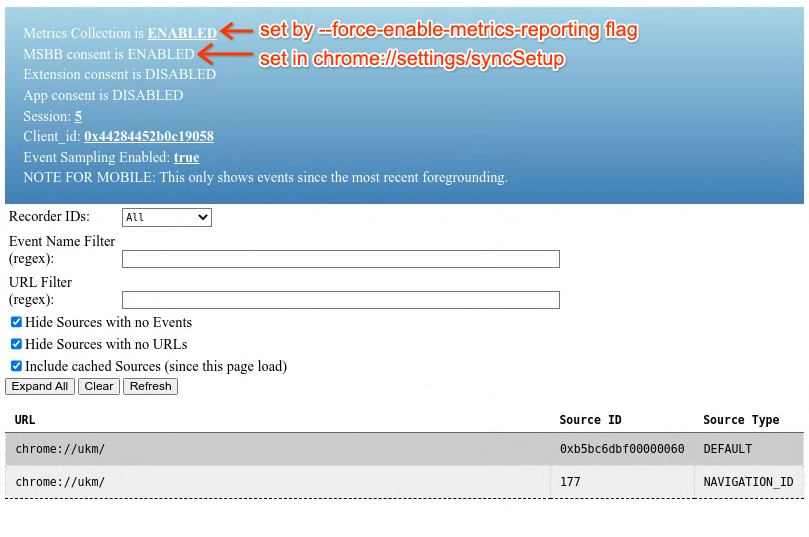
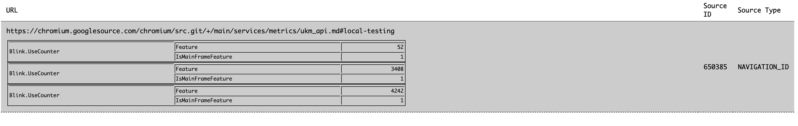

# URL-Keyed Metrics API

This document describes how to write client code to collect UKM data. Before
you add new metrics, you should file a proposal (see Google-internal
[go/ukm](http://go/ukm) for details; external contributors can ask a Googler
reviewer to help sponsor the UKM privacy review).

Last proofread and updated on 2026/11/19.

[TOC]

## Define Your Metrics in ukm.xml

Any events and metrics you collect need to be defined in
[/tools/metrics/ukm/ukm.xml](/tools/metrics/ukm/ukm.xml).

Before uploading changes to `ukm.xml`, run
[/tools/metrics/ukm/pretty_print.py](/tools/metrics/ukm/pretty_print.py) (which
alphabetizes events and metrics and removes `<obsolete>` nodes) and
[/tools/metrics/ukm/validate_format.py](/tools/metrics/ukm/validate_format.py)
to verify formatting and schema rules. Changes to `ukm.xml` require approval
from [/tools/metrics/ukm/PRIVACY_OWNERS](/tools/metrics/ukm/PRIVACY_OWNERS);
include a link to the approved UKM privacy review in your CL description.

### Required Details

*   Event `owner`: the `@chromium.org` or `@google.com` email address of someone
    who can answer questions about how the event is recorded, what it means, and
    how it should be used. List at least two owners, a primary individual owner
    plus a secondary individual and/or team mailing list, so the event is not
    orphaned if someone changes teams.
*   Valid event and metric `name`s:
    *   Event names must match `^[A-Za-z][A-Za-z0-9.]*$` (no underscores) and
        must be case-insensitively unique across `ukm.xml`.
    *   Metric names must match `^[A-Za-z][A-Za-z0-9_.]*$`, cannot be `Event` or
        `Metadata` (case-insensitive), and if reused across multiple events must
        use the exact same casing.
*   A `summary` of the event about which you are recording details, including a
    description of when the event will be recorded.
*   For each metric in the event: a `summary` of the data and what it means.
*   The `enum` type if the metric is enumerated or boolean, which ensures that
    every value is accounted independently with no attempt to "bucket" the
    results (for boolean metrics, use `enum="Boolean"` or a more descriptive
    `Boolean*` enum). Enum definitions are shared with UMA histograms and live
    in
    [/tools/metrics/histograms/enums.xml](/tools/metrics/histograms/enums.xml)
    or domain-specific
    `//tools/metrics/histograms/metadata/<domain>/enums.xml` files.
*   If the metric is numeric, then its unit should be described in the
    `summary`. For example, "seconds", "ms", "KiB". For metrics that denote time
    durations, the metric name should have a unit suffix, e.g.
    "FirstRequestConnectDelayMs" instead of "FirstRequestConnectDelay". If a
    bucketing scheme is used, you should explain that too so that it's clear to
    people reading query results. Precise measurements of user actions timing,
    e.g. in milliseconds, require bucketing to be applied, for instance using
    [GetExponentialBucketMinForFineUserTiming](/services/metrics/public/cpp/metrics_utils.h).
*   If an event conceptually happens once per source, it can be marked
    `singular="true"` so that the server-side generated protobuf defines the
    field as singular (`optional`) instead of `repeated`. Note that
    `singular="true"` only affects server-side log representation: multiple
    client emissions for the same `SourceId` have distinct metric fields merged
    into one event server-side, while duplicate emissions of the *same* metric
    overwrite each other in unspecified order across reports. If you want the
    client itself to buffer updates and record only the latest values once on
    destruction (browser process only), use `ukm::SingularUkmEntry` (see
    [Singular UKM Events](#singular-ukm-events)).

### Example

```xml
<event name="Goat.Teleported">
  <owner>teleporter@chromium.org</owner>
  <owner>teleporter-team@google.com</owner>
  <summary>
    Recorded when a page teleports a goat.
  </summary>
  <metric name="DurationSeconds">
    <summary>
      How long it took to teleport in seconds.
    </summary>
  </metric>
  <metric name="GoatType" enum="GoatType">
    <summary>
      The type of goat that was teleported.
    </summary>
  </metric>
  <metric name="TeleportSucceeded" enum="Boolean">
    <summary>
      Whether the goat teleportation succeeded.
    </summary>
  </metric>
</event>
```

### Controlling the Aggregation of Metrics

Aggregation of metrics is an optional setting for making them available in the
[History](http://go/aggregated-ukm#history-table) table and consequently
viewable on the [UKM dashboard](http://go/ukm-dash) (both Google-internal).

To have a metric aggregated, `<history>`, `<aggregation>` and `<statistics>`
tags need to be added along with the type of statistic to be generated in the
event definition
[/tools/metrics/ukm/ukm.xml](/tools/metrics/ukm/ukm.xml)
file in the Chromium codebase.

Adding the `<aggregation>` tag does not change how the events and metrics are
stored unaggregated in reports and logs.

However, it increases the workload for UKM data processing pipelines. The
computation can be especially costly for frequently emitted events. Therefore,
please only add aggregations when necessary, and remove the `<aggregation>`
block once active monitoring on the UKM dashboard or `UkmHistory` table is no
longer needed. This tag can be added to an existing metric later or removed any
time.

```xml
<event name="Goat.Teleported">
  <metric name="DurationSeconds">
    ...
    <aggregation>
      <history>
        <index fields="profile.country"/>
        <statistics>
          <quantiles type="std-percentiles"/>
        </statistics>
      </history>
    </aggregation>
    ...
  </metric>
</event>
```

Supported statistic types are:

*   `<quantiles type="std-percentiles"/>`: Calculates the "standard percentiles"
    for the values which are 1, 5, 10, 25, 50, 75, 90, 95, and 99 percentiles.
*   `<enumeration/>`: Calculates the proportions of all values individually. The
    proportions indicate the relative frequency of each bucket and are
    calculated independently for each metric over each aggregation. (Details
    below.)

There can also be one or more `index` tags which define additional aggregation
keys. Each `index` tag specifies a comma-separated list of fields that
duplicates all 5 combinations in the
[standard set](http://go/aggregated-ukm#history-table) (Google-internal) with those extra fields
included (note that in `UkmHistory`'s `keys_list` column, all key names are
sorted alphabetically rather than appended at the end, e.g.
`profile.channel,profile.country,profile.platform`). These additional keys are
optional when querying, but within a single `index` tag they are always grouped
together. In other words, `fields="profile.country,profile.form_factor"`
produces all the standard aggregations plus each standard aggregation with
*both* `country` *and* `form_factor`, **not** with only one of them. If
individual and combined versions are desired, use multiple `index` tags.

Commonly used additional `profile.*` index fields are:

*   `profile.country`
*   `profile.form_factor`
*   `profile.system_ram`
*   `profile.is_dominant_version`
*   `profile.is_latest_version`

### Enumeration Proportions

Proportions are calculated against the number of "page loads" (meaning per
"source" which is usually but not always the same as a browser page load) that
emitted one or more values for the enumeration. The proportions will sum to 1.0
for an enumeration that emits only one result per page-load if it emits anything
at all. An enumeration emitted more than once per source will result in
proportions that total greater than 1.0 but are still relative to the total
number of loads. If an individual value is emitted more than once per source,
that value's proportion will be greater than 1.0.

For example, `Security.SiteEngagement` emits one value (either 4 or 2) per source:

*   Source ID: 1, URL: https://www.google.com/, enum value: 4
*   Source ID: 2, URL: https://www.facebook.com/, enum value: 2
*   Source ID: 3, URL: https://www.wikipedia.com/, enum value: 4
*   Source ID: 4, URL: https://www.google.com/, enum value: 4

A proportion calculated over all sources would sum to 1.0:

*   2 (0.25)
*   4 (0.75)

In contrast, `VirtualKeyboard.Open:TextInputType` emits multiple values per
source, and can emit the same value multiple times per source. The sum of the
proportions for `VirtualKeyboard.Open:TextInputType` will be greater than 1.0,
and some proportions will be greater than 1.0. In the following example,
`TextInputType` is emitted multiple times per source, and `TextInputType=4` is
emitted more than once per source:

*   Source ID: 1, URL:https://www.google.com/, enum values: [1, 2, 4, 6]
*   Source ID: 2, URL:https://www.facebook.com/, enum values: [2, 4, 5, 4]
*   Source ID: 3, URL:https://www.wikipedia.com/, enum values: [1, 2, 4]

A proportion calculated over all sources would be:

*   1 (0.6667 = 2/3)
*   2 (1.0000 = 3/3)
*   3 (absent)
*   4 (1.3333 = 4/3)
*   5 (0.3333 = 1/3)
*   6 (0.3333 = 1/3)

The denominator for each is 3 because there were 3 sources reporting the metric.
The numerator for each enum value is the count of how many times the value was
emitted.

### Obsolete Events
If any events or metrics become obsolete or deprecated, simply delete their
definitions from
[/tools/metrics/ukm/ukm.xml](/tools/metrics/ukm/ukm.xml).
Emissions of deleted events or metrics from old Chromium clients will be
discarded by the server.

Do not reuse a name from a deleted event or a name of a deleted metric within
the same event. In case of doubt, you can check whether a name was previously
used and later deleted via `git log -S <Name> -p -- tools/metrics/ukm/ukm.xml`
(or in this Google-internal
[snapshot history](https://source.corp.google.com/search?q=f:ukm.xml&sq=package:piper%20file:%2F%2Fdepot%2Fgoogle3%20-file:google3%2Fexperimental)).

## Client API

### Get UkmRecorder Instance

In order to record UKM events, your code needs a `UkmRecorder` object, defined
by [/services/metrics/public/cpp/ukm_recorder.h](/services/metrics/public/cpp/ukm_recorder.h).

There are three main ways of getting a UkmRecorder instance.

1) Use `ukm::UkmRecorder::Get()`. This currently only works from the Browser process.

2) Within blink/renderer, use one of the following methods:

* `blink::Document::UkmRecorder()`
* `blink::ExecutionContext::UkmRecorder()`
* `blink::ResourceFetcher::UkmRecorder()`

3) If you do not have access to any of the methods in 2), establish a remote
connection to a `UkmRecorderFactory` and use `MojoUkmRecorder::Create()` to get
a `UkmRecorder`.

```cpp
mojo::Remote<ukm::mojom::UkmRecorderFactory> factory;

// This step depends on how the Metrics service is embedded in the application.
BindUkmRecorderFactorySomewhere(factory.BindNewPipeAndPassReceiver());

std::unique_ptr<ukm::MojoUkmRecorder> ukm_recorder =
    ukm::MojoUkmRecorder::Create(*factory);
ukm::builders::MyEvent(source_id)
    .SetMyMetric(metric_value)
    .Record(ukm_recorder.get());
```
Depending on which directory you are getting the UkmRecorder from, you need the
correct interface binder to replace the `BindUkmRecorderFactorySomewhere()` part
above. Some options are:

* blink/renderer: `Platform::Current()->GetBrowserInterfaceBroker()->GetInterface(factory.BindNewPipeAndPassReceiver())`
* content/renderer: `content::RenderThread::Get()->BindHostReceiver(factory.BindNewPipeAndPassReceiver())`

Note: Establishing a new remote connection each time (i.e. per frame, etc.) has
overhead, so try to avoid opening a new one each time.


### Get a ukm::SourceId

UKM identifies navigations by their source ID and you'll need to associate an ID with your event in order to tie it to a main frame URL. Preferably, get an existing ID for the navigation from another object.

Prefer using `ukm::SourceId` if only the underlying int64 value is required to identify a source and is used in Mojo interface, and no type conversion needs to be performed. If additional source type information is needed, `ukm::SourceIdObj` can be used.

The main methods for getting an existing `ukm::SourceId` are:

*   **Browser process (`content/`)**:
    ```cpp
    // From a committed RenderFrameHost:
    ukm::SourceId source_id = render_frame_host->GetPageUkmSourceId();

    // From an in-flight or committing NavigationHandle:
    ukm::SourceId source_id = navigation_handle->GetNextPageUkmSourceId();
    ```
    Prefer `navigation_handle->GetNextPageUkmSourceId()` over manually calling
    `ukm::ConvertToSourceId(navigation_handle->GetNavigationId(), ukm::SourceIdType::NAVIGATION_ID)`,
    as `GetNextPageUkmSourceId()` handles subframe, same-document, and
    back-forward cache navigations. Note that for prerender activations it
    returns a different ID than the eventual `GetPageUkmSourceId()`; see
    [/content/browser/preloading/prerender/README.md](/content/browser/preloading/prerender/README.md#ukm-source-ids).
*   **Blink / renderer process**:
    ```cpp
    ukm::SourceId source_id = document->UkmSourceID();
    // Or from an ExecutionContext:
    ukm::SourceId source_id = execution_context->UkmSourceID();
    ```
*   **iOS (`web::WebState`)** (from
    [/components/ukm/ios/ukm_url_recorder.h](/components/ukm/ios/ukm_url_recorder.h)):
    ```cpp
    ukm::SourceId source_id = ukm::GetSourceIdForWebStateDocument(web_state);
    ```
*   **Events not tied to a URL** (e.g. session- or report-level metrics):
    ```cpp
    ukm::SourceId source_id = ukm::NoURLSourceId();
    ```

Some events occur in the background where an active navigation or frame does not
exist. In that case, you can use `ukm::UkmBackgroundRecorderService` to check
whether the event can be recorded. This uses the History Service to determine
whether the event's origin is still present in the user profile.

```cpp
// Add the service as a dependency in your service's constructor.
DependsOn(ukm::UkmBackgroundRecorderFactory::GetInstance());

// Get an instance of the UKM service using a Profile.
auto* ukm_background_service = ukm::UkmBackgroundRecorderFactory::GetForProfile(profile);

// Check if recording a background event for |origin| is allowed.
ukm_background_service->GetBackgroundSourceIdIfAllowed(origin, base::BindOnce(&DidGetBackgroundSourceId));

// A callback will run with an optional source ID.
void DidGetBackgroundSourceId(std::optional<ukm::SourceId> source_id) {
  if (!source_id) return;  // Can't record as it wasn't found in the history.

  // Use the newly generated source ID.
  ukm::builders::MyEvent(*source_id)
      .SetMyMetric(metric_value)
      .Record(ukm_recorder.get());
}
```

For approved non-navigation URL sources (such as extensions, notifications,
redirects, payment apps, or Federated Credential Management), `ukm::UkmRecorder`
provides dedicated `SourceIdType`s and `base::PassKey`-guarded static helpers
(e.g. `GetSourceIdForRedirectUrl()`, `GetSourceIdForExtensionUrl()`,
`GetSourceIdForNotificationEvent()` in
[/services/metrics/public/cpp/ukm_recorder.h](/services/metrics/public/cpp/ukm_recorder.h))
instead of adding `friend` classes that call `UpdateSourceURL()` directly on
`DEFAULT`-typed source IDs. New uses of custom URL-backed source IDs must be
approved by the UKM owners and go through UKM privacy review.

### Create Events

Helper objects for recording your event are generated from the descriptions in ukm.xml. You can use them like so:

```cpp
#include "services/metrics/public/cpp/ukm_builders.h"

void OnGoatTeleported() {
  ...
  ukm::builders::Goat_Teleported(source_id)
      .SetDurationSeconds(duration.InSeconds())
      .SetGoatType(goat_type)
      .Record(ukm_recorder);
}

// You can also use the UKM builder as an interim data structure.
void OnKangarooJumped() {
  ukm::builders::Kangaroo_Jumped builder(source_id);
  builder.SetJumpHeight(3)
      .SetJumpLength(4);

  // Some other calculations...
  builder.SetJumpLength(5);
  // Records only one `Kangaroo.Jumped` event with metric JumpLength = 5.
  builder.Record(ukm_recorder);
}
```

Periods (`.`) in XML event or metric names are replaced with underscores (`_`)
in both the generated C++ builder class name (e.g.
`ukm::builders::Goat_Teleported`) and metric setter/constant names (e.g.
`SetSubPart_MetricName()`, `kSubPart_MetricNameName`).

To avoid having a UKM report become unbounded in size, an upper limit is placed on the number of events recorded for each event type. Events that are recorded too frequently may be subject to downsampling on the Stable and Beta channels (see Google-internal [go/ukm-downsampling](http://go/ukm-downsampling)). As a rule of thumb, it is recommended that most events be recorded at most once per 100 page loads on average to limit data volume. In addition, if an event type is observed to be spammy, is heavily downsampled, or accounts for more than 10% of all recorded UKM events combined on any platform, you will be asked to reduce the event emission frequency.

For data quality purposes, if you have the option to record an event from either the browser process or a renderer process, prefer the former. Because renderer processes are not trusted, events recorded in them are more complex to attribute to the corresponding browser-side navigations. Prior to Chrome version 149.0.7812.0, this was done using the `DocumentCreated` event. Starting from Chrome version 149.0.7812.0, sources representing blink Documents directly contain their parent navigation URLs in the `resolved_urls` field (and the `DocumentCreated` event is no longer sent to server or recorded in UKM logs). This allows direct, simplified attribution without the limitations and query performance overhead of the legacy `DocumentCreated` join method (see Google-internal [go/ukm-readable-guide](http://go/ukm-readable-guide#processing-events-attached-to-blink-document-sources)).

### Recording from Java (Android)

In Android browser-process Java code, use `org.chromium.components.ukm.UkmRecorder`
([/components/ukm/android/java/src/org/chromium/components/ukm/UkmRecorder.java](/components/ukm/android/java/src/org/chromium/components/ukm/UkmRecorder.java))
with a non-null, non-destroyed `WebContents` on the UI thread:

```java
import org.chromium.components.ukm.UkmRecorder;

new UkmRecorder(webContents, "Goat.Teleported")
    .addMetric("DurationSeconds", durationSeconds)
    .addBooleanMetric("TeleportSucceeded")
    .record();
```

`addBooleanMetric(name)` records a boolean metric with an implied value of `1`
(`true`).

### Singular UKM Events

Unlike `singular="true"` in `ukm.xml` (which only controls server-side protobuf
cardinality), `ukm::SingularUkmEntry` provides a client-side type-safe API for
updating metric fields of an event over time so that only the latest entry is
recorded once when `entry` is destroyed. The `SingularUkmEntry` and its
`EntryBuilder`s must be used and destroyed on the same sequence where it was
created. Currently, only recording from the browser process is supported.

Example:

```cpp
#include "components/ukm/singular_ukm_entry.h"
#include "services/metrics/public/cpp/ukm_builders.h"

// Create the SingularUkmEntry for an event.
std::unique_ptr<ukm::SingularUkmEntry<ukm::builders::MyEvent>> entry =
    ukm::SingularUkmEntry<ukm::builders::MyEvent>::Create(source_id);

{
  // Create a builder for the entry to set the metrics.
  ukm::SingularUkmEntry<ukm::builders::MyEvent>::EntryBuilder builder =
      entry->Builder();
  builder->SetMyMetric(metric_value);
  // When `builder` goes out of scope, the constructed entry will be saved with the SingularUkmEntry.
}

{
  ukm::SingularUkmEntry<ukm::builders::MyEvent>::EntryBuilder builder =
      entry->Builder();
  builder->SetMyMetric(metric_value2);
}
```

The arrow operator (`->`) on a builder is used to set the desired metrics of an event. Once the `builder` is destroyed the newly constructed event is saved as the latest event. The last event, with metric `metric_value2`, is recorded by the UkmRecorder when `entry` is destroyed.

Additional documentation can be found in
[/components/ukm/singular_ukm_entry.h](/components/ukm/singular_ukm_entry.h).

## Local Testing

Build Chromium and run it with flags `--force-enable-metrics-reporting --metrics-upload-interval=N`. The first flag overrides metrics collection to be ON. The second flag means that locally collected metrics will be populated in a UKM report and uploaded every `N` seconds; you may want some small `N` if you are interested in seeing this behavior. Serialized UKM logs can be viewed on `chrome://metrics-internals`. Passing `--export-ukm-logs-to-file=/tmp/ukm.json` makes that page show all logs closed since browser startup and exports them as JSON on browser shutdown.

Then in the browser, go to `chrome://settings/syncSetup` and toggle "Make searches and browsing better" to be ON. If you're unable to do this, you can pass the command line flag `--force-msbb-setting-on-for-ukm` instead. Make sure **no Incognito windows are open**, as any open Incognito window pauses UKM recording across all browser windows.

You should now be seeing "Metrics Collection is ENABLED. MSBB consent is ENABLED" at the top of the `chrome://ukm` debugging page:



If you want to test Extension- or App-related UKMs, toggle the corresponding sync consent in `chrome://settings/syncSetup/advanced`.

Trigger your event locally, refresh `chrome://ukm`, then double-check that your events are recorded correctly.

### Enable Console Debugging Messages

If you're encountering issues concerning UKM user consent, recording events, or uploading UKM reports, you can enable console debugging logs by passing the command line flag `--vmodule=*ukm*=n` (which covers both `components/ukm/` and dropped-entry logging in `services/metrics/`). Because UKM uses `DVLOG` rather than `VLOG`, your local build must have `DCHECK`s enabled (`is_debug = true` or `dcheck_always_on = true` in `args.gn`). Here `n` is the logging level between 1 and 3:

1. Infrequent actions such as changes to user consent, or actions that typically occur once per reporting cycle, e.g. serialization of locally recorded event data into one report and uploading the report to the UKM server.
2. Frequent and recurrent actions within each reporting period, such as an event being recorded, or a new browser navigation has occurred.
3. Very frequent and possibly spammy actions or checks, such as events being dropped due to disabled recording.

Setting a level `n` enables logging messages at all levels <= `n`.

In case of doubt, or if you need a starting point to debug why `chrome://ukm` isn't showing any data in a local build (with `DCHECK`s enabled), you can start with:
```bash
./out/Default/chrome --force-enable-metrics-reporting --metrics-upload-interval=300 --vmodule=*ukm*=3
```

### When are Use Counter UKM events recorded?

Use counter UKM events are appended to chrome://ukm at a different time than UMA events are appended to
chrome://histograms. Use counter UKM events are appended to chrome://ukm when the document is destroyed. This means
that UKM events are recorded when the tab is closed or the page leaves the BF Cache.


In the above screenshot, the value in the right column is the web feature id.

## Unit Testing

For code that records via `ukm::UkmRecorder::Get()` in the browser process,
instantiate a `ukm::TestAutoSetUkmRecorder` (from
[/components/ukm/test_ukm_recorder.h](/components/ukm/test_ukm_recorder.h)),
which automatically registers itself as the global `UkmRecorder` for its
lifetime. If your code instead accepts an explicit `ukm::UkmRecorder*`, you can
pass a `ukm::TestUkmRecorder` directly. Use the generated `kEntryName` and
`k<Metric>Name` constants from `ukm_builders.h` to verify recorded entries:

```cpp
#include "components/ukm/test_ukm_recorder.h"
#include "services/metrics/public/cpp/ukm_builders.h"

ukm::TestAutoSetUkmRecorder test_ukm_recorder;

// Trigger the code under test...
TeleportGoat();

auto entries = test_ukm_recorder.GetEntriesByName(
    ukm::builders::Goat_Teleported::kEntryName);
ASSERT_EQ(entries.size(), 1u);
test_ukm_recorder.ExpectEntrySourceHasUrl(entries[0],
                                          GURL("https://example.com/"));
test_ukm_recorder.ExpectEntryMetric(
    entries[0], ukm::builders::Goat_Teleported::kDurationSecondsName, 5);
```

## Adding UKMs in Every Report

Certain information may be useful to be included on every uploaded UKM report. This may be applicable if your information is always "available" in some sense, as opposed to triggered/computed at a particular instance, which is the default. In this case, the best way to proceed is to set up a [MetricsProvider](/components/metrics/metrics_provider.h). The new Provider should implement the `ProvideCurrentSessionUKMData()` method and record the UKM event using `ukm::NoURLSourceId()` and `ukm::UkmRecorder::Get()`; it will be recorded once per UKM report immediately before the report is serialized for upload:

```cpp
void MyMetricsProvider::ProvideCurrentSessionUKMData() {
  ukm::builders::MySessionEvent(ukm::NoURLSourceId())
      .SetMyMetric(ComputeCurrentValue())
      .Record(ukm::UkmRecorder::Get());
}
```

## Recording Information about Subframes URLs via Categorization

The UKM infrastructure primarily supports recording metrics tied with navigation URLs as that is the basis of the consent model. As there is desire for information related to URLs loaded within a page itself (i.e. subframe URLs), here we describe an approach for how to record this via categorization.

We are able to emit information related to subframe URLs within a UKM event as long as we don't capture the exact URL, but instead emit some categorical label, such as 'ad', or 'uses WebFramework1'. It may be possible for specific sites to be added as a category but this requires privacy review. In general, we prefer to avoid being specific about a site and suggest more general categorization instead.

The full metrics will not be keyed off the subframe URL. Rather, the subframe URL data will be tied with the main frame URL, and it will be emitted as a custom metric. It is possible to emit these events multiple times if there are several subframe URLs with the properties we want to observe on the same page.

### Example

```xml
<event name="WebFrameworkPerformance">
  <owner>owner@chromium.org</owner>
  <summary>
    Recorded when a page uses one of the known web frameworks. This records various performance measurements.
  </summary>
  <metric name="WebFramework" enum="WebFrameworkName">
    <summary>
      Web Framework used.
    </summary>
  </metric>
  <metric name="FrameworkLoadInMs">
    <summary>
      Time to load the framework in milliseconds.
    </summary>
  </metric>
</event>
```

And in `enums.xml` (either `//tools/metrics/histograms/enums.xml` or a
domain-specific `//tools/metrics/histograms/metadata/<domain>/enums.xml`):

```xml
<enum name="WebFrameworkName">
  <int value="0" label="Unknown"/>
  <int value="1" label="WebFramework1"/>
  <int value="2" label="WebFramework2"/>
  ...
</enum>
```

In this example, if a known framework was loaded with a time of 150ms, we could record the framework name and the load time, tied together with the main frame URL. Note that there will need to be custom logic to map the provider to the enum. It's possible this logic may be reusable across UKM clients, please verify if some similar recording is being done elsewhere.
