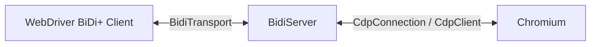

# Embedding BiDi Mapper

BiDi Mapper
([`src/bidiMapper`](https://source.chromium.org/chromium/chromium/src/+/main:third_party/chromium-bidi/src/bidiMapper))
is a JavaScript/TypeScript layer that translates between
[WebDriver BiDi](https://w3c.github.io/webdriver-bidi/) (plus **BiDi+**) and the
Chrome DevTools Protocol (CDP).

This guide covers embedding `BidiMapper.BidiServer` directly inside a
JavaScript/TypeScript host (for example, Node.js) over an existing CDP
connection. This is how **Puppeteer** embeds Mapper (see Puppeteer's
[`BidiOverCdp.ts`](https://github.com/puppeteer/puppeteer/blob/main/packages/puppeteer-core/src/bidi/BidiOverCdp.ts))
and how other JS-based automation tools such as **Playwright** or custom CDP
clients can embed it.

To embed Mapper, supply two transports: a **WebDriver BiDi+ transport**
(`BidiTransport`) for WebDriver BiDi+ commands, responses, and events, and a
**browser-level CDP connection/client** (`CdpConnection` / `CdpClient`) so
Mapper can manage targets and protocol sessions.



## Package & Entry Point

The compiled Mapper package is published on npm as
[`chromium-bidi`](https://www.npmjs.com/package/chromium-bidi) (with
`devtools-protocol` as a peer dependency).

The package entry point
([`src/index.ts`](https://source.chromium.org/chromium/chromium/src/+/main:third_party/chromium-bidi/src/index.ts))
exports:

```ts
import {BidiMapper, Protocol} from 'chromium-bidi';
```

[`BidiMapper`](https://source.chromium.org/chromium/chromium/src/+/main:third_party/chromium-bidi/src/bidiMapper/BidiMapper.ts)
exports:

- [`BidiServer`](https://source.chromium.org/chromium/chromium/src/+/main:third_party/chromium-bidi/src/bidiMapper/BidiServer.ts)
  — main server class (`BidiServer.createAndStart(...)`)
- [`MapperOptions`](https://source.chromium.org/chromium/chromium/src/+/main:third_party/chromium-bidi/src/bidiMapper/MapperOptions.ts)
  — capability/option interface
- [`EventEmitter`](https://source.chromium.org/chromium/chromium/src/+/main:third_party/chromium-bidi/src/utils/EventEmitter.ts)
  — `mitt`-based event emitter to subclass for `CdpClient` (required in
  TypeScript due to its private fields)
- [`OutgoingMessage`](https://source.chromium.org/chromium/chromium/src/+/main:third_party/chromium-bidi/src/bidiMapper/OutgoingMessage.ts)
- TypeScript types:
  [`BidiTransport`](https://source.chromium.org/chromium/chromium/src/+/main:third_party/chromium-bidi/src/bidiMapper/BidiTransport.ts),
  [`CdpConnection`](https://source.chromium.org/chromium/chromium/src/+/main:third_party/chromium-bidi/src/cdp/CdpConnection.ts),
  [`CdpClient`](https://source.chromium.org/chromium/chromium/src/+/main:third_party/chromium-bidi/src/cdp/CdpClient.ts),
  [`BidiCommandParameterParser`](https://source.chromium.org/chromium/chromium/src/+/main:third_party/chromium-bidi/src/bidiMapper/BidiParser.ts),
  [`AclConfig`](https://source.chromium.org/chromium/chromium/src/+/main:third_party/chromium-bidi/src/bidiMapper/modules/session/AclManager.ts),
  [`AclHandler`](https://source.chromium.org/chromium/chromium/src/+/main:third_party/chromium-bidi/src/bidiMapper/modules/session/AclManager.ts),
  [`OnAclChangedListener`](https://source.chromium.org/chromium/chromium/src/+/main:third_party/chromium-bidi/src/bidiMapper/modules/session/AclManager.ts),
  [`UpdateAclHandler`](https://source.chromium.org/chromium/chromium/src/+/main:third_party/chromium-bidi/src/bidiMapper/modules/session/AclManager.ts)

## Starting `BidiServer`

Call `BidiMapper.BidiServer.createAndStart(...)`:

```ts
const bidiServer = await BidiMapper.BidiServer.createAndStart(
  bidiTransport, // BidiTransport
  cdpConnection, // CdpConnection
  browserCdpClient, // CdpClient (browser-level)
  '', // selfTargetId (empty string when running outside the browser)
  parser, // optional BidiCommandParameterParser (defaults to BidiNoOpParser)
  logger, // optional LoggerFn
  restrictedMode, // optional boolean (default: false)
  aclHandler, // optional AclHandler
);
```

## 1. Providing `BidiTransport`

Mapper sends and receives **parsed WebDriver BiDi+ message objects** (not raw
JSON strings) through
[`BidiTransport`](https://source.chromium.org/chromium/chromium/src/+/main:third_party/chromium-bidi/src/bidiMapper/BidiTransport.ts):

```ts
export interface BidiTransport {
  setOnMessage: (
    handler: (message: ChromiumBidi.Command) => Promise<void> | void,
  ) => void;
  sendMessage: (message: ChromiumBidi.Message) => Promise<void> | void;
  close(): void;
}
```

- **`setOnMessage(handler)`**: `BidiServer` registers its incoming command
  handler here. Call `handler(command)` whenever a WebDriver BiDi+ command
  arrives from your client.
  - If your client sends raw JSON text (for example over a WebSocket), parse and
    validate the top-level JSON envelope (`id`, `method`, `params`, optional
    `goog:channel`) before calling `handler`, and return an `invalid argument`
    error response if parsing fails (see
    [`WindowBidiTransport`](https://source.chromium.org/chromium/chromium/src/+/main:third_party/chromium-bidi/src/bidiTab/Transport.ts)
    for a reference implementation).
- **`sendMessage(message)`**: `BidiServer` calls this sequentially for command
  responses, errors, and subscribed events.
  - **Async dispatch recommendation**: When bridging in-process to a client
    transport (as in Puppeteer's `BidiOverCdp.ts`), schedule delivery to the
    client in a macrotask (e.g., `setImmediate` with a `setTimeout(..., 0)`
    fallback) so microtasks from one WebDriver BiDi+ message drain before the
    next message runs, matching WebSocket/pipe transport semantics. Guard
    delivery against post-`close()` callbacks so queued messages are dropped
    once the transport closes.
- **`close()`**: Called when `bidiServer.close()` runs.

## 2. Providing `CdpConnection` and `CdpClient`

Mapper talks to Chromium through two interfaces defined in
[`CdpConnection`](https://source.chromium.org/chromium/chromium/src/+/main:third_party/chromium-bidi/src/cdp/CdpConnection.ts)
and
[`CdpClient`](https://source.chromium.org/chromium/chromium/src/+/main:third_party/chromium-bidi/src/cdp/CdpClient.ts):

```ts
export interface CdpConnection {
  getCdpClient(sessionId: Protocol.Target.SessionID): CdpClient;
}

export interface CdpClient extends EventEmitter<CdpEvents> {
  sessionId: Protocol.Target.SessionID | undefined;
  isCloseError(error: unknown): boolean;
  sendCommand<CdpMethod extends keyof ProtocolMapping.Commands>(
    method: CdpMethod,
    params?: ProtocolMapping.Commands[CdpMethod]['paramsType'][0],
  ): Promise<ProtocolMapping.Commands[CdpMethod]['returnType']>;
}
```

Your adapter must satisfy these requirements:

- **Browser-level root client (`browserCdpClient`)**:
  - Pass a **browser-level** `CdpClient`—either wrapping the root browser
    WebSocket/pipe connection (`sessionId` is `undefined`, as in Puppeteer's
    `BidiOverCdp.ts`) or wrapping a dedicated browser target session created via
    `Target.attachToBrowserTarget` (where `sessionId` is that browser session's
    ID). Mapper identifies the browser client by object identity, not by
    `sessionId`. Do **not** pass a page-level `CdpClient`.
  - During `createAndStart` and `session.new`, Mapper invokes browser-level CDP
    commands including `Target.getBrowserContexts`, `Target.getTargets`,
    `Browser.getVersion`, `Browser.setDownloadBehavior`,
    `Security.setIgnoreCertificateErrors`, `Target.setDiscoverTargets`, and
    `Target.setAutoAttach`.
- **Flattened CDP sessions & attach/detach lifecycle**:
  - During `session.new`, Mapper calls `Target.setAutoAttach` with
    `flatten: true`, `waitForDebuggerOnStart: true`, and a filter excluding
    `page` and `other` at the browser level so it attaches to `tab` targets
    first (preserving prerendering unless `'goog:prerenderingDisabled': true` is
    passed in `session.new` capabilities).
  - **Attach ordering**: When `Target.attachedToTarget` arrives, register the
    child session in your `CdpConnection` **before** emitting
    `Target.attachedToTarget` on the parent `CdpClient`. Mapper calls
    `cdpConnection.getCdpClient(params.sessionId)` synchronously inside its
    `Target.attachedToTarget` handler.
  - **Detach cleanup**: Mapper registers `.on(...)` listeners on every attached
    target `CdpClient` and relies on the embedder's `CdpConnection` to clean up
    detached sessions. When `Target.detachedFromTarget` arrives, deliver the
    event to the parent `CdpClient`, then remove the detached child session (and
    its descendants, if any) from your session map, call `removeAllListeners()`
    on it, and reject its pending commands with a close error. Throw on unknown
    `sessionId` in `getCdpClient(sessionId)` rather than creating a stub client.
- **Event forwarding**:
  - Each `CdpClient` must extend `BidiMapper.EventEmitter<CdpEvents>` (which
    uses `mitt` and supports wildcard `'*'` listeners; `CdpEvents` is not
    re-exported from `BidiMapper`, so map it from `devtools-protocol` as shown
    in the example below).
  - Route each incoming CDP event to the `CdpClient` registered for the event's
    `sessionId` (matching `browserCdpClient` for
    `browserCdpClient.sessionId`—whether `undefined` on the main connection or a
    browser session ID—and attached target sessions otherwise). Ignore events
    for unknown or already-detached sessions rather than calling a throwing
    `getCdpClient(sessionId)`. Mapper relies on `'*'` listeners for
    `goog:cdp.<Event>` forwarding as well as typed event listeners.
- **CDP error format & `isCloseError`**:
  - **Preserve raw CDP protocol errors**: Mapper classifies several CDP errors
    by their exact numeric JSON-RPC `code` and unprefixed `message` (for
    example, `-32000` / `'No node with given id found'`,
    `'No resource with given identifier found'`,
    `'Could not find object with given id'`, and `-32001` /
    `'Session with given id not found.'`). Reject `sendCommand` with objects
    preserving raw `{code, message}` properties (matching Puppeteer's
    `rawErrors: true` in
    [`BrowserConnector.ts`](https://github.com/puppeteer/puppeteer/blob/main/packages/puppeteer-core/src/bidi/BrowserConnector.ts))
    rather than rewriting or prefixing error messages.
  - **Close-error detection (`isCloseError`)**: Return `true` when an error from
    `sendCommand` was caused by the target or session closing (for example,
    `TargetCloseError` in Puppeteer). Mapper uses this to map closed-target race
    conditions to `no such frame` (or suppress expected target teardown errors)
    instead of surfacing `unknown error`.

## 3. `selfTargetId`, `parser`, `logger`, and Restricted Mode

- **`selfTargetId`**: Pass `''` (empty string) when Mapper runs outside the
  browser (e.g., in Node.js). `selfTargetId` is only used when Mapper runs
  inside a browser target so `CdpTargetManager` skips attaching to itself.
- **`parser`**: Optional
  [`BidiCommandParameterParser`](https://source.chromium.org/chromium/chromium/src/+/main:third_party/chromium-bidi/src/bidiMapper/BidiParser.ts).
  - If omitted (`undefined`, as in Puppeteer), `CommandProcessor` uses
    [`BidiNoOpParser`](https://source.chromium.org/chromium/chromium/src/+/main:third_party/chromium-bidi/src/bidiMapper/BidiNoOpParser.ts),
    which skips runtime Zod schema validation on command `params` (appropriate
    when your library constructs commands itself or wants minimal overhead).
  - If you expose Mapper to untrusted/external WebDriver BiDi+ JSON clients,
    pass a validating parser implementing `BidiCommandParameterParser`—for
    reference, see
    [`BidiParser`](https://source.chromium.org/chromium/chromium/src/+/main:third_party/chromium-bidi/src/bidiTab/BidiParser.ts)
    (present in the npm package at the internal unexported subpath
    `chromium-bidi/out/Default/gen/src/bidiTab/BidiParser.js`).
- **`logger`**: Optional
  [`LoggerFn`](https://source.chromium.org/chromium/chromium/src/+/main:third_party/chromium-bidi/src/utils/log.ts)
  (`(type: LogPrefix) => ((...messages: unknown[]) => void) | undefined`).
  `type` is a `LogPrefix`—either a `LogType` value (`bidi`, `cdp`, `debug`,
  `debug:error`, `debug:info`, `debug:warn`) or a `${LogType}:${string}`
  sub-prefix such as `debug:queue` or `debug:browsingContext` (for example,
  Puppeteer forwards ``(prefix: string) => logger(`bidi:${prefix}`)``).
- **`restrictedMode` & `aclHandler`**: Optional parameters for restricted
  sessions (`"goog:sessionType": "restricted"`), implementing the
  [WICG/agentic-webdriver-bidi](https://github.com/WICG/agentic-webdriver-bidi)
  proposal. See the Capability `goog:sessionType`, Command
  `goog:session.setAcl`, and Event `goog:session.changed` sections in
  [README.md](../README.md).

## 4. Session & Lifecycle Responsibilities

- **Session initialization**: Before `session.new` succeeds, `CommandProcessor`
  only accepts `session.new` and `session.status`; all other commands fail with
  `invalid session id`.
- **Embedder-owned session metadata & teardown**:
  - [`SessionProcessor`](https://source.chromium.org/chromium/chromium/src/+/main:third_party/chromium-bidi/src/bidiMapper/modules/session/SessionProcessor.ts)
    returns `sessionId: 'unknown'` and `capabilities.webSocketUrl: ''` for
    `session.new`, and `{ready: false, message: 'already connected'}` for
    `session.status`.
    [`CommandProcessor`](https://source.chromium.org/chromium/chromium/src/+/main:third_party/chromium-bidi/src/bidiMapper/CommandProcessor.ts)
    rejects `session.end` with `unsupported operation`.
  - If your embedder exposes a WebDriver BiDi+ HTTP/WebSocket endpoint or
    manages multiple sessions, the embedder is responsible for
    assigning/rewriting `sessionId`, answering `session.status`, and handling
    `session.end` by closing `BidiServer`.
- **Shutdown**: `BidiServer.close()` closes `BidiTransport` and emits `'close'`,
  but does **not** remove CDP listeners or close your CDP adapters. Call
  `bidiServer.close()` when the WebDriver BiDi+ or CDP connection closes, and
  subscribe to `bidiServer.once('close', ...)` to clean up your CDP session
  adapters and listeners. If the CDP connection closes while `createAndStart`
  is still pending, make sure you also close the `BidiServer` once it resolves
  (see Puppeteer's
  [`connectBidiOverCdp`](https://github.com/puppeteer/puppeteer/blob/main/packages/puppeteer-core/src/bidi/BidiOverCdp.ts)).

## Minimal TypeScript Example

```ts
import {BidiMapper, type Protocol} from 'chromium-bidi';
import type {ProtocolMapping} from 'devtools-protocol/types/protocol-mapping.js';

type CdpEvents = {
  [K in keyof ProtocolMapping.Events]: ProtocolMapping.Events[K][0];
};

// 1. Provide an adapter implementing `BidiMapper.CdpClient` (extending
// `BidiMapper.EventEmitter`) over your real CDP browser/session client (see
// Puppeteer's `BidiOverCdp.ts` for a complete implementation).
declare class MyCdpClient
  extends BidiMapper.EventEmitter<CdpEvents>
  implements BidiMapper.CdpClient
{
  sessionId: string | undefined;
  sendCommand: BidiMapper.CdpClient['sendCommand'];
  isCloseError(error: unknown): boolean;
}

// 2. Provide an adapter implementing `BidiMapper.CdpConnection` over your real
// CDP connection, managing session lookup and attach/detach lifecycle.
declare class MyCdpConnection implements BidiMapper.CdpConnection {
  readonly browserClient: MyCdpClient;
  getCdpClient(sessionId: string): MyCdpClient;
  close(): void;
}

// 3. Provide an adapter implementing `BidiMapper.BidiTransport` to bridge
// WebDriver BiDi+ commands and responses/events with your client.
declare class MyBidiTransport implements BidiMapper.BidiTransport {
  setOnMessage(
    handler: (message: Protocol.ChromiumBidi.Command) => Promise<void> | void,
  ): void;
  sendMessage(message: Protocol.ChromiumBidi.Message): void;
  dispatchFromClient(command: Protocol.ChromiumBidi.Command): void;
  close(): void;
}

// 4. Start `BidiServer` and create a WebDriver BiDi+ session.
declare const cdpConnection: MyCdpConnection;
declare const bidiTransport: MyBidiTransport;

const bidiServer = await BidiMapper.BidiServer.createAndStart(
  bidiTransport, // BidiTransport for WebDriver BiDi+ commands, responses, and events
  cdpConnection, // CdpConnection resolving per-session CdpClients
  cdpConnection.browserClient, // browser-level CdpClient
  '', // selfTargetId (empty string when running outside the browser)
  undefined, // optional BidiCommandParameterParser (defaults to BidiNoOpParser)
  undefined, // optional LoggerFn for debug/protocol logs
  false, // optional restrictedMode (require restricted sessions when true)
  undefined, // optional AclHandler for restricted sessions
);
bidiServer.once('close', () => {
  cdpConnection.close();
});

// Send `session.new` before any other WebDriver BiDi+ commands (except
// `session.status`).
bidiTransport.dispatchFromClient({
  id: 1,
  method: 'session.new',
  params: {capabilities: {}},
});
```
