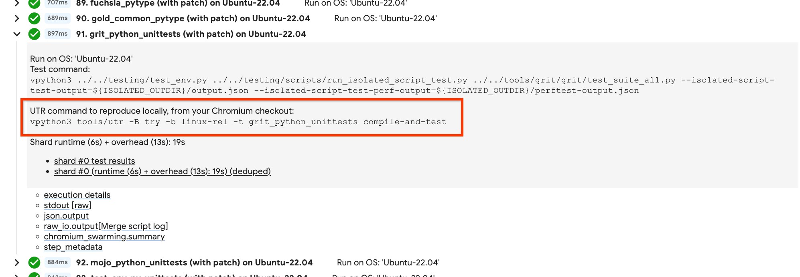
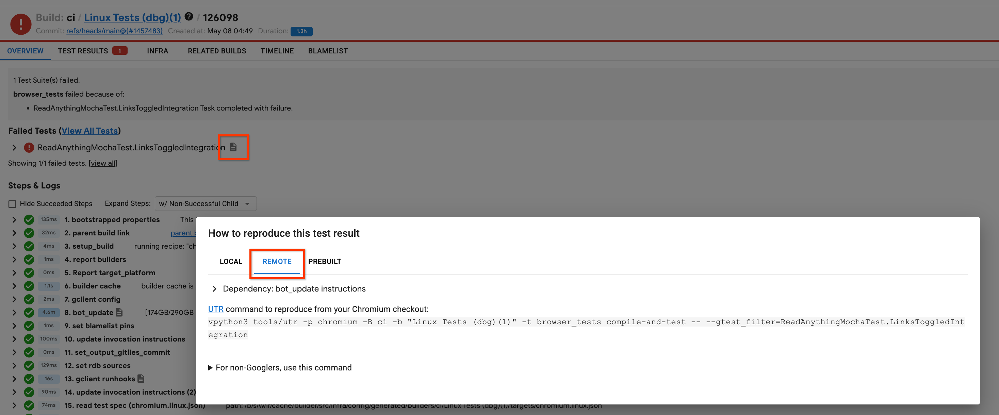
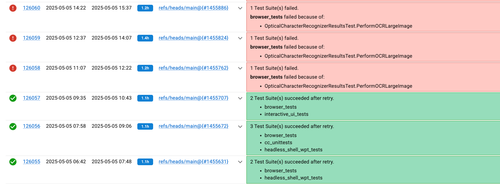
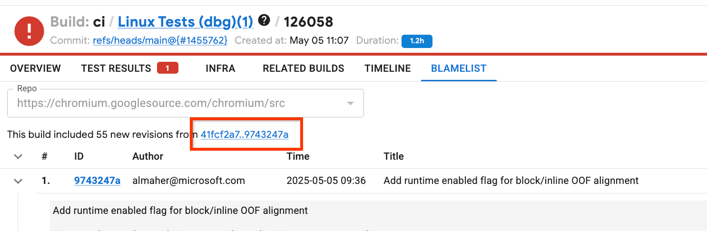
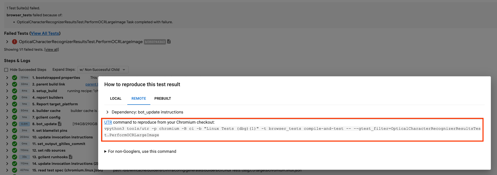
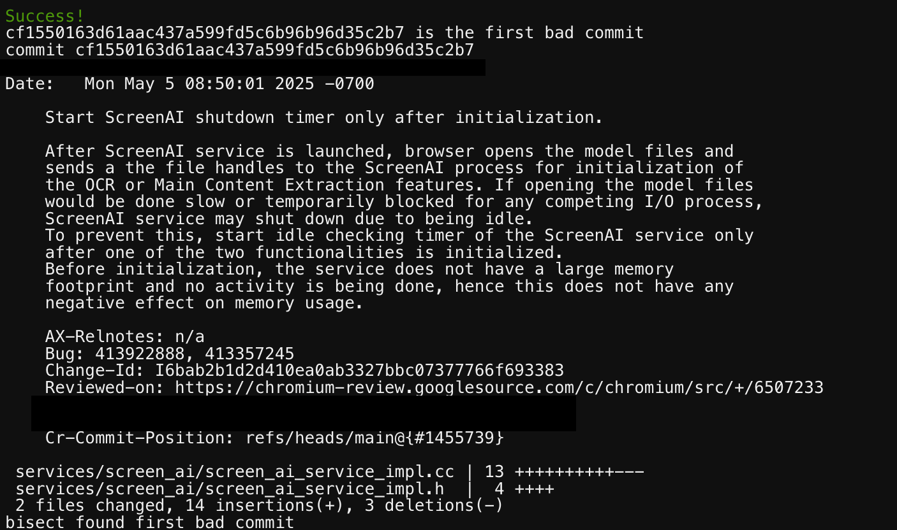

# UTR - The Universal Test Runner

UTR is a tool that can locally compile and/or run tests the same way it's done
on the bots. At its heart, it wraps the same codebase used by the bots to drive
their builds, while bypassing parts that don't make sense for developer's
machines. This abstracts away pesky details that are hard to remember or
discover on bots like:

- GN args that may or may not prevent local reproduction
- Full command line args for a test invocation
- Precise OS version to target for remote tests

With this tool, all such details will automatically use what the given builder
uses. It also bypasses Gerrit entirely, avoiding the need to upload patchsets
& wait for CQ build triggers. Everything is driven locally on your workstation,
allowing for quick edit->debug cycles.

See the [Google-only design doc](https://goto.google.com/chrome-utr-dd) for
further context. Note: most tests on Chrome bots run remotely on Swarming. In
the context of a UTR invocation, these tests will still run remotely on
Swarming. They'll just be _triggered_ and subsequently _collected_
via the UTR on your workstation. For the purposes of reproduction, this makes
no practical difference other than it removes the need to have that specific
test platform present locally to repro (e.g. Windows laptop with specific GPU
model).

## Command-line Usage

The UTR only operates within the context of a builder (via the `-B` and `-b`
command line args). So if you're investigating a failure encountered on a
builder, you can re-use the UTR command printed alongside the failure.
This will re-compile & re-launch the test locally:



You can also find the corresponding UTR invocation in the "reproduction
instructions" for a test by clicking the 📄 symbol next to its result at the
top of the build page:



You can also click on the same 📄 symbol next to a test suite's step further
down the build page to see the UTR invocation that will run the entire suite.

Alternatively, if you don't have a specific builder name already at hand, you
can choose a relevant builder on the
[Chromium build console](https://build.chromium.org/) that runs the test suite
you're interested in. Some basic CQ try builders you can use are listed below:

- **Linux:**
  [linux-rel](https://ci.chromium.org/ui/p/chromium/builders/try/linux-rel),
  runs basic functional test suites on Linux x64 VMs. Use `-B try -b linux-rel`
  on the UTR cmd line.
- **Windows:**
  [win-rel](https://ci.chromium.org/ui/p/chromium/builders/try/win-rel), runs
  basic functional test suites on Windows x64 VMs. Use `-B try -b win-rel` on
  the UTR cmd line.
- **Mac:**
  [mac-rel](https://ci.chromium.org/ui/p/chromium/builders/try/mac-rel), runs
  basic functional test suites on macOS arm64 VMs. Use `-B try -b mac-rel` on
  the UTR cmd line.
- **iOS:**
  [ios-simulator](https://ci.chromium.org/ui/p/chromium/builders/try/ios-simulator),
  runs basic functional test suites on iOS arm64 simulators hosted on Mac VMs.
  Use `-B try -b ios-simulator` on the UTR cmd line.
- **Android (x64 emulator):**
  [android-x64-rel](https://ci.chromium.org/ui/p/chromium/builders/try/android-x64-rel),
  runs basic functional test suites on Android x64 AVD emulators on GCE
  (preferred over `android-arm64-rel` for general Android testing due to broad
  suite coverage). Use `-B try -b android-x64-rel` on the UTR cmd line (or
  [android-desktop-x64-rel](https://ci.chromium.org/ui/p/chromium/builders/try/android-desktop-x64-rel)
  with `-B try -b android-desktop-x64-rel` for Android Desktop).
- **Android (arm64 device):**
  [android-arm64-rel](https://ci.chromium.org/ui/p/chromium/builders/try/android-arm64-rel),
  runs hardware-dependent test suites (such as GPU tests) on physical Android
  arm64 devices (limited device capacity and a smaller subset of test suites
  than x64 emulators). Use `-B try -b android-arm64-rel` on the UTR cmd line.
- **ChromeOS (linux-chromeos):**
  [linux-chromeos-rel](https://ci.chromium.org/ui/p/chromium/builders/try/linux-chromeos-rel),
  runs basic functional test suites in CrOS-flavored builds of Chromium running
  on Linux. (See
  [here](https://chromium.googlesource.com/chromium/src/+/main/docs/chromeos_build_instructions.md#Chromium-OS-on-Linux-linux_chromeos)
  for more info on this config.) Use `-B try -b linux-chromeos-rel` on the UTR
  cmd line.
- **ChromeOS (VM):**
  [chromeos-amd64-generic-rel](https://ci.chromium.org/ui/p/chromium/builders/try/chromeos-amd64-generic-rel),
  runs basic functional test suites on CrOS VMs running on Intel. Use `-B try -b
  chromeos-amd64-generic-rel` on the UTR cmd line.

*** note
Note the following:
- The names of the above builders may change over time and the links may
  eventually break. Navigate [the build console](https://build.chromium.org/)
  to find the current list of running builders.
- Not all cross-compilations are supported. The UTR will flag a warning in such
  cases (eg compiling a Mac test from a Linux machine). Your mileage may vary
  when running the UTR from a platform that differs from the one used on the
  builder:
  - **Linux hosts** can build Linux and ChromeOS natively, and cross-compile
    Android and [Windows](../../docs/win_cross.md). Cross-compiling
    [Mac](../../docs/apple_platform_linkers.md) is partially supported (works
    for most standard test targets, but fails when `enable_dsyms = true` such as
    `is_asan = true` or `is_official_build = true` due to missing Linux
    `dsymutil`, or when targets invoke macOS-only Xcode asset tools); iOS is not
    supported on Linux.
  - **Mac hosts** can build Mac and iOS simulator targets, and cross-compile
    [Windows](../../docs/win_cross.md).
  - **Windows hosts** can only build Windows targets.
  - When cross-compiling to a different OS or CPU architecture, ensure your
    `.gclient` includes the target platform in `target_os` (e.g., `"android"`,
    `"win"`, `"mac"`, `"ios"`, `"chromeos"`) and/or `target_cpu` (e.g.,
    `"arm64"`, `"x64"`, `"arm"`, `"x86"`, etc.) and run `gclient sync`.
***

### Actions and Common Flags

Run `vpython3 tools/utr/run.py -h` (or `vpython3 tools/utr/run.py compile -h`
for compile-specific flags) to see all options:

- **Actions:** `compile` (compiles targets; omit `-t` to compile `all`), `test`
  (runs already-compiled tests on Swarming), or `compile-and-test`. For `test`
  and `compile-and-test`, the UTR waits for all Swarming shards to finish and
  prints the final results URL before exiting.
- `-B <bucket>` / `-b <builder>` / `-t <test_suite>`: Target bucket (`try` or
  `ci`), builder name, and test suite (pass `-t` multiple times for multiple
  suites).
- `-n <N>`: Runs the build/test invocation `N` times without cleaning the build
  dir and exits on the first failure (useful for reproducing flakes across
  separate runs, unlike `--gtest_repeat=N` which repeats inside a single task).
- `--build-dir <dir>` (`-o <dir>`): Custom output directory (defaults to
  `out/UTR<builder_name>`).
- `--keep-gn-args` / `--overwrite-gn-args`, `--skip-config-validation`,
  `--force` (`-f`): Pre-answers config-mismatch prompts (e.g. when local
  `args.gn` differs or when cross-compiling in non-interactive environments).
- `--no-rbe`, `--no-coverage-instrumentation`, `--use-autoninja`: Compile flags
  that must be placed **after** the `compile` or `compile-and-test` action.
- `--`: Passes all remaining arguments directly to the test invocation (e.g.
  `-- --gtest_filter=TestClass.TestCase`).

### Command-line Examples

Below are some example invocations of the UTR:

Compiling all targets of builder "Win10 Tests x64 (dbg)":

```
vpython3 run.py -B ci -b 'Win10 Tests x64 (dbg)' compile
```

Compiling and running the "url_unittests" suite on "linux-chromeos-dbg":

```
vpython3 run.py -B ci -b linux-chromeos-dbg -t url_unittests compile-and-test
```

Compiling and running the "webgl_conformance_validating_tests" suite on the
"android-arm64-rel" CQ bot:

```
vpython3 run.py -B try -b android-arm64-rel -t webgl_conformance_validating_tests test
```

Compiling and running the "blink_web_tests" suite on the "Linux Tests" bot in a
custom build dir:

```
vpython3 run.py -B ci -b 'Linux Tests' -t blink_web_tests --build-dir out/my-custom-out-dir compile-and-test
```

Just running the "browser_tests" suite on the "mac-rel" CQ bot, assuming you've
already compiled it:

```
vpython3 run.py -B try -b mac-rel -t browser_tests test
```

Just running the "interactive_ui_tests" suite on the "linux-chromeos-rel" CQ bot
with additional test cmd-line flags:

```
vpython3 run.py -B try -b linux-chromeos-rel -t interactive_ui_tests test -- --gtest_filter=TestClass.TestCase --gtest_repeat=100
```

## Custom builder configs

For the specified builder, the UTR will reuse its precise configs. This includes
things like GN args, test targets, and test dimensions. These configs are
encoded as starlark in the checkout, and are read at UTR invocation-time.
Consequently, you can make local modifications to these configs and they will be
reflected in any subsequent UTR invocation for that builder.

Example: at time of writing, the
[Linux Tests](https://ci.chromium.org/ui/p/chromium/builders/ci/Linux%20Tests)
builder runs tests on Ubuntu-22.04 (jammy). To test out running its tests on
Ubuntu-24.04 (noble), you would find its builder config in the
[infra starlark dir](https://source.chromium.org/chromium/chromium/src/+/main:infra/config/subprojects/)
in the repo. It should look something like:

```
ci.thin_tester(
    name = "Linux Tests",
    triggered_by = ["ci/Linux Builder"],
    ...
)
```

Find the line that controls the dimensions its tests target:

```
    ...
    targets = targets.bundle(
        ...
        mixins = [
            "isolate_profile_data",
            "linux-jammy",
        ],
    ...
```

And change the Jammy mixin to Noble:

```
    ...
    targets = targets.bundle(
        ...
        mixins = [
            "isolate_profile_data",
            "linux-noble",
        ],
    ...
```

Then regen the infra configs, and re-run the UTR. Within the UTR invocation,
it should now run base_unittests on Ubuntu-24.04 rather than Ubuntu-22.04:

```sh
$ ./infra/config/main.star
$ vpython3 run.py -B ci -b 'Linux Tests' -t base_unittests compile-and-test
```

See [here](../../infra/config/targets/README.md) for more info about how a
builder's tests are configured in starlark.

## Tips/tricks

### Git bisect

*** note
Note for Cog users:

If you are using a Cog workspace (eg. you are using CiderG), `git-bisect`
won't work. Instead you can use the `cog_bisect.py` script, which attempts to
mimic the behavior of `git-bisect`. See go/ciderg-chrome-bisecting.
***

If you're investigating a regression on a builder that's consistently failing,
it may help to use the UTR to bisect down to the revision that introduced the
regression. For example,
`OpticalCharacterRecognizerResultsTest.PerformOCRLargeImage` in browser_tests
started consistently failing on this builder:



**1.** To bisect it, first open the build of the first red build, navigate to the
blamelist tab, and copy the revision range:



**2.** Then enter those revisions into this git command. (Note: need to swap the
revs on the git command so that the known-bad rev comes first followed by the
known-good rev.)
```
git bisect start 9743247a 41fcf2a7
```

**3.** Then copy the UTR reproduction command for the failing test:



**4.** And paste that into the following git command to initiate the bisect:

```
git bisect run bash -c 'gclient sync && vpython3 tools/utr -p chromium -B ci -b "Linux Tests (dbg)(1)" -t browser_tests compile-and-test -- --gtest_filter=OpticalCharacterRecognizerResultsTest.PerformOCRLargeImage'
```

**5.** Given the size of the revision range, it may take some time to fully
bisect. But when it's finished, it should hopefully report the revision that
introduced the regression:



**6.** Don't forget to `git bisect reset` when finished bisecting.

## Troubleshooting

- **Authentication errors:** If binary downloads or Swarming/ResultDB calls
  stall or fail with `luci-auth` errors, authenticate with:

  ```sh
  luci-auth login -scopes https://www.googleapis.com/auth/userinfo.email
  ```

- **Missing CAS inputs on RBE workers (e.g. in Cog workspaces):** If remote
  compilation fails because RBE workers cannot find local virtual files (such as
  `build/util/LASTCHANGE.dummy`), pass `--no-rbe` **after** the `compile` or
  `compile-and-test` action to compile locally:

  ```sh
  vpython3 tools/utr/run.py -B try -b linux-rel -t base_unittests compile-and-test --no-rbe
  ```

## Questions/feedback

If you have any usage questions or suggestions for feedback, feel free to file
a general [Trooper bug](https://g.co/bugatrooper), or ask in the #ops channel in
the Chromium Slack.
