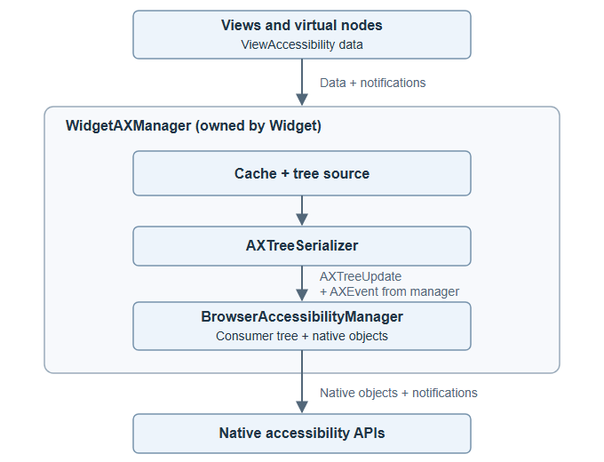
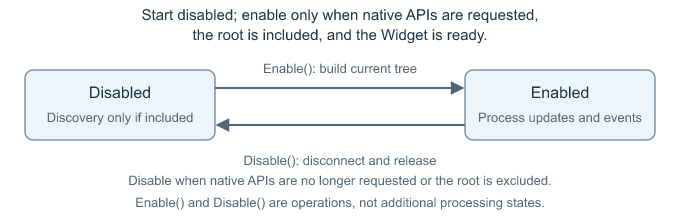

# Expose Views as an AXTree of AXNodes

[Tracking bug](https://issues.chromium.org/issues/40672441)

ViewsAX moves Views-based UI onto the AXTree-based accessibility implementation
used for web content. It replaces the per-View native delegate path with one
serialized tree per Widget.

ViewsAX must preserve the native accessibility behavior of the existing
per-View implementation. Enabling the feature must not change native parentage,
roles or role descriptions, values or their types, attribute writability,
actions, text ranges, focus, or notifications. Internal tree structure may
differ only without changing that exposed behavior. Intentional behavior
changes must also be made in the existing implementation so the feature toggle
does not introduce them.

Platform and feature policy for this path is defined by
[`ViewAccessibility::IsViewsAccessibilityTreeEnabled()`][viewsax-policy].
This path is separate from the Aura-based [ViewsAXManager](views_ax_manager.h).
Enabling and disabling below refer to native accessibility processing while
the per-Widget path is selected.

## Data flow and ownership

Without ViewsAX, a View's
[ViewAXPlatformNodeDelegate](../view_ax_platform_node_delegate.h) owns its
`AXPlatformNode` and answers native accessibility queries from the View
hierarchy.

With ViewsAX, [ViewAccessibility](../view_accessibility.h) supplies data for
Views and virtual nodes, but no longer serves as a native object's delegate.
[WidgetAXManager](widget_ax_manager.h) serializes that data into `AXTreeUpdate`s
and sends updates and events to `BrowserAccessibilityManager`. That manager
maintains an `AXTree` of `AXNode`s and the corresponding native accessibility
objects. Tree traversal and event generation use the shared implementation
rather than Views-specific delegate logic.

Serialization copies each node's ID and accessibility properties, such as role,
name, and state, into `AXNodeData`. The serializer adds the in-tree child node
IDs and puts these records into an `AXTreeUpdate`, which represents an atomic
change to one tree. The first full-tree serialization starts at the root. Later
updates include changed nodes and any structural changes needed to keep the
tree consistent.

A [Widget](../../widget/widget.h) owns its `WidgetAXManager`. The manager owns
the [cache](widget_view_ax_cache.h),
[tree source](view_accessibility_ax_tree_source.h), serializer, and
`BrowserAccessibilityManager`. The cache references existing `ViewAccessibility`
objects; it does not own them.

`WidgetAXManager` batches most changes on a task posted to the current thread's
task runner and delivers updates and events directly to
`BrowserAccessibilityManager` in-process. Native node data and child order
reflect the last delivered update, so the manager must serialize affected
parent and child data for structural changes.

Native accessibility actions travel in the reverse direction.
`BrowserAccessibilityManager` passes `AXActionData` to `WidgetAXManager`. The
tree source resolves the target node ID and calls `HandleAccessibleAction()` on
the corresponding View or virtual node.

## Content inclusion and tree roots

[AXEventGenerator](../../../accessibility/ax_event_generator.cc) requires an
unignored root. Views' ignored-node and leaf behavior is preserved below it.

**Discovery** is how an assistive technology client finds a Widget's native
accessibility entry point through the platform accessibility API. A top-level
Widget can expose a root-only tree for discovery before full-tree processing
is enabled, without exposing its descendants.

An excluded Widget, such as a tab hover card, remains disabled, exposes no
ViewsAX native object, and has no parent-tree connection, including during
discovery. Excluding the root disables processing and tears down its tree.
Including the root re-evaluates the current mode and readiness; if eligible,
the manager rebuilds from current `ViewAccessibility` data. The operating
system may still provide its own fallback object.

## Enablement and disablement

Full-tree processing has two states. Enabling requires process-wide
`AXMode::kNativeAPIs`, an included root, and a ready Widget:

| State | Meaning |
|---|---|
| Disabled | No updates or focus observation; discovery only if included. |
| Enabled | Serialize changes, observe focus, and maintain native objects. |

The manager starts disabled. Once the RootView and native Widget are ready,
it checks the current mode and root inclusion. Readiness and inclusion are
conditions for enabling, not additional processing states.

`Enable()` builds from current `ViewAccessibility` data, starts observing focus,
attempts the initial serialization, and notifies observers. Re-enabling uses
the same path; changes received while disabled are not replayed.

`Disable()` stops updates and focus observation, cancels pending tree work, and
disconnects trees. [Lifecycle observers](widget_ax_manager_observer.h), such as
WebView, must clear their native accessible references before the old native
tree is destroyed. Included top-level Widgets retain a root-only tree for native
discovery. Web content uses a similar [consumer teardown][frame-host] and
[serialization reset][renderer].

`Enable()` and `Disable()` run synchronously and may invoke callbacks before
returning. Enabling during disablement, disabling during enablement, and
rehosting during enablement are prohibited by the
[lifecycle contract](widget_ax_manager.h). Processing is enabled for initial
delivery, but explicit-host publication waits until that delivery attempt
returns. Mode changes must wait until the current mode notification returns;
the manager does not queue them.

## Tree connections

Each Widget's `WidgetAXManager` creates an `AXTreeID` using
[`AXTreeID::CreateNewAXTreeID()`](../../../accessibility/ax_tree_id.h). The ID
is a globally unique, unguessable token for the tree, not a node ID or pointer.
[`AXTreeManager::FromID()`](../../../accessibility/ax_tree_manager.cc) looks up
the manager in a process-wide registry. If the tree is not registered, it returns
null. Otherwise, the manager provides access to the tree.

A host uses a child-tree ID to identify the child tree, and the child records its
parent tree ID. While enabled, a child manager selects at most one logical host:
a valid explicit View, or an ignored synthetic node under the native parent's
RootView when the child is visible and the parent manager and RootView are
available. An explicit host can be in a different Widget from the native parent
and replaces the synthetic host; unhosting can restore it. Trees update
independently, so host switches are not atomic across serialized trees.

If a host has a child-tree ID, its local View and virtual children are hidden
from accessibility. This does not change the View hierarchy. The host has no
children within its own accessibility tree. If the child manager is registered
and has a root, cross-tree traversal uses that root as the host's only child.
Unignored traversal skips an ignored host. Clearing the ID allows the local
children to be exposed again, subject to the usual visibility and leaf rules.

Focus uses the same child-tree and active-descendant resolution as web content.
Unlike legacy per-View native queries, ViewsAX serializes the focused node in
each tree; when focus is in a child tree, its parent names the hosting node.

Removing a host View disconnects the tree immediately, even if `GetWidget()`
still returns the old Widget during removal. Neither endpoint keeps the other
alive.

When a submenu closes while its hosting menu item remains attached,
`ScheduleUnhostAXTree()` instead keeps the connection until pending updates and
events can flush. The closing update must reach `BrowserAccessibilityManager`
before disconnection prevents native notifications.

## Teardown and callbacks

[WebView](../../controls/webview/webview.cc) clears its native accessible parent
before the Widget's native nodes are destroyed and restores it after enablement.
Pending updates from an old tree must not run on its replacement; a delayed
unhost must not disconnect a newer host.

Supported calls during enablement and teardown are documented in
[`WidgetAXManager`](widget_ax_manager.h). Hosting callbacks must not destroy
the manager, Widget, or notifying host View. Native accessibility actions can
close UI, so native calls still need lifetime checks.

## Related documentation

*   [Accessibility overview][accessibility-overview]
*   [Content Accessibility Support][content-accessibility]
*   [Views menus](../../controls/menu/README.md)

[accessibility-overview]: ../../../../docs/accessibility/overview.md
[content-accessibility]: ../../../../content/browser/accessibility/README.md
[frame-host]: ../../../../content/browser/renderer_host/render_frame_host_impl.cc
[renderer]: ../../../../content/renderer/accessibility/render_accessibility_impl.cc
[viewsax-policy]: ../view_accessibility.h
